# Manual de desarrollo V01 de nopCommerce

> **Versión del documento:** V01
> **Versión de referencia de nopCommerce:** 4.90.8 (.NET 9)
> **Fuente de verdad de las referencias:** `Fuentes_nopCommerce.md`
> **Última revisión:** 19 de octubre de 2026

## Índice general {#indice}

- [Parte I — Conceptos esenciales (recordatorio)](#parte-i)
  - [Capítulo 1 — Arquitectura, entidades y dependencias](#capitulo-1)
  - [Capítulo 2 — Extensibilidad: ensamblados, fábricas y plugins](#capitulo-2)
  - [Capítulo 3 — Estado y contexto de ejecución](#capitulo-3)
- [Parte II — Fundamentos](#parte-ii)
  - [Capítulo 4 — Visión general](#capitulo-4)
  - [Capítulo 5 — Visión general de la arquitectura de nopCommerce](#capitulo-5)
  - [Capítulo 6 — Proyectos de la solución nopCommerce](#capitulo-6)
  - [Capítulo 7 — linq2db: qué es y cómo se usa](#capitulo-7)
  - [Capítulo 8 — linq2db en nopCommerce (capa Nop.Data)](#capitulo-8)
  - [Capítulo 9 — UI Layer](#capitulo-9)
  - [Capítulo 10 — Inyección de dependencias y desacoplamiento](#capitulo-10)
- [Parte III — Temas y presentación](#parte-iii)
  - [Capítulo 11 — Temas: alcance, estructura y personalización](#capitulo-11)
  - [Capítulo 12 — Layouts y jerarquía de renderizado](#capitulo-12)
  - [Capítulo 13 — Diferencia entre tienda pública y área de administración](#capitulo-13)
- [Parte IV — Plugins](#parte-iv)
  - [Capítulo 14 — Carga de ensamblados (.dll) y descubrimiento de plugins en runtime](#capitulo-14)
  - [Capítulo 15 — Estructura completa de un plugin](#capitulo-15)
  - [Capítulo 16 — Cómo crear un widget desde cero en nopCommerce](#capitulo-16)
  - [Capítulo 17 — Diseño interno de un plugin: modelos, controladores y servicios](#capitulo-17)
  - [Capítulo 18 — Ciclo de vida de un plugin](#capitulo-18)
- [Parte V — Caso práctico](#parte-v)
  - [Capítulo 19 — Caso práctico: widget Swiper](#capitulo-19)
- [Parte VI — Temas avanzados](#parte-vi)
  - [Capítulo 20 — Sistema de eventos (pub-sub)](#capitulo-20)
  - [Capítulo 21 — Widget Zones personalizadas](#capitulo-21)
  - [Capítulo 22 — Change Tracker: EF Core y nopCommerce](#capitulo-22)
- [Parte VII — Calidad y buenas prácticas](#parte-vii)
  - [Capítulo 23 — Estrategia de pruebas](#capitulo-23)
  - [Capítulo 24 — Buenas prácticas y errores frecuentes](#capitulo-24)
- [Parte VIII — Capacidades transversales](#parte-viii)
  - [Capítulo 25 — Multi-tienda](#capitulo-25)
  - [Capítulo 26 — Localización, monedas y regionalización](#capitulo-26)
  - [Capítulo 27 — Caché e invalidación](#capitulo-27)
  - [Capítulo 28 — Tareas programadas](#capitulo-28)
  - [Capítulo 29 — Permisos, ACL y roles](#capitulo-29)
  - [Capítulo 30 — Diagnóstico y registro](#capitulo-30)
  - [Capítulo 31 — Correo electrónico y cola de mensajes](#capitulo-31)
  - [Capítulo 32 — Gestión de medios](#capitulo-32)
  - [Capítulo 33 — Búsqueda y SEO](#capitulo-33)
  - [Capítulo 34 — Rendimiento, compresión y despliegue](#capitulo-34)
- [Apéndices](#apendices)
  - [Apéndice A — Recursos y referencias](#apendice-a)
  - [Apéndice B — Glosario de términos](#apendice-b)
  - [Apéndice C — Índice de clases e interfaces](#apendice-c)

# Parte I — Conceptos esenciales (recordatorio) {#parte-i}

Esta parte reúne los conceptos que conviene retener antes de afrontar el resto del manual. Cada ficha explica primero el concepto en términos generales, válido para cualquier aplicación .NET, y después muestra cómo lo materializa nopCommerce con una clase o interfaz concreta: qué contiene y para qué sirve. El objetivo es disponer de un repaso rápido y de consulta; el desarrollo completo de cada tema se encuentra en los capítulos enlazados desde cada ficha. Los conceptos generales de C#, .NET y ASP.NET Core de esta parte se verificaron contra la documentación oficial de Microsoft Learn; sus fuentes se recogen en el Apéndice A.7.

## Capítulo 1 — Arquitectura, entidades y dependencias {#capitulo-1}

Repasa los conceptos fundacionales que sustentan el resto del manual: arquitectura por capas, inyección de dependencias, patrón repositorio y la clase base de las entidades.

**Parte I — Conceptos esenciales (recordatorio)** · Nivel: Básico

- **Servicio:** consolida los conceptos estructurales sobre los que se apoya toda la plataforma.
- **Utilidad:** tener presentes los cimientos antes de entrar en los capítulos profundos.
- **Conceptos clave:** arquitectura por capas con dirección de dependencia hacia dentro; inyección de dependencias con `INopStartup`; patrón repositorio con `IRepository<TEntity>`; clase `BaseEntity`.
- **Prerrequisitos:** nivel básico de C# y .NET.
- **Caso de uso típico:** repasar la base antes de leer los capítulos 5 a 10.

**Trampas frecuentes:**

> - Invertir la dirección de dependencia (que un proyecto interior referencie uno exterior) rompe la arquitectura por capas y acopla el sistema.
> - Elegir un ciclo de vida DI inadecuado: inyectar un servicio con ámbito (Scoped) dentro de uno singleton convierte al primero en efectivamente singleton —dependencia cautiva o *captive dependency*—; con la validación de ámbitos activada, por defecto en el entorno de desarrollo, el contenedor lanza una excepción al detectarlo.
> - Suponer que BaseEntity contiene fechas o borrado lógico: solo declara la propiedad Id; rasgos como el borrado lógico se añaden mediante interfaces separadas.

---

### Arquitectura por capas y dirección de dependencia

**Concepto general.** La arquitectura por capas organiza un sistema en conjuntos de responsabilidades claras —presentación, lógica de negocio, persistencia y dominio— y establece una regla de dependencia: una capa solo puede depender de las situadas hacia dentro. Un diseño que invierte la regla pierde esos beneficios y propaga los cambios hacia todo el proyecto.

Las guías de arquitectura de aplicaciones web de .NET recomiendan separar incluso las aplicaciones monolíticas no triviales en capas lógicas: cada capa agrupa responsabilidades del mismo tipo y el resto del sistema no debe notar su sustitución. Los beneficios que las guías asocian a esa separación son:

- Reutilizar funcionalidad de bajo nivel en distintas partes de la aplicación sin duplicarla.
- Restringir qué capas pueden comunicarse entre sí, lo que refuerza el encapsulamiento.
- Sustituir una capa completa siempre que solo trabaje con las capas que la rodean.
- Limitar el impacto de los cambios: una modificación no debería salir de su capa si respeta su contrato.

> Fuente: «Common web application architectures» y «Architectural principles» (Microsoft Learn; URL en el Apéndice A.7).

**En nopCommerce.** La solución materializa la regla con proyectos separados y referencias estrictas entre ellos; cada proyecto solo referencia los situados hacia dentro:

| Capa | Proyecto | Referencia a |
|------|----------|--------------|
| Dominio y reglas base | `Nop.Core` | (ninguno) |
| Persistencia | `Nop.Data` | `Nop.Core` |
| Lógica de negocio | `Nop.Services` | `Nop.Core`, `Nop.Data` |
| Marco de presentación | `Nop.Web.Framework` | `Nop.Core`, `Nop.Data`, `Nop.Services` |
| Aplicación web | `Nop.Web` | las anteriores y `Nop.Web.Framework` |

**Enlace:** Capítulo 5 (visión de la arquitectura) y Capítulo 6 (proyectos de la solución).

### Inyección de dependencias

**Concepto general.** La inyección de dependencias (DI) es una técnica por la que un objeto recibe sus dependencias de fuera, en lugar de crearlas internamente con `new`. Un contenedor —también llamado contenedor IoC— construye el objeto y le entrega lo que necesita. Sus ventajas son acoplar el código a interfaces en lugar de implementaciones, sustituir componentes sin tocar el resto y testear con sustitutos. En ASP.NET Core, el contenedor de servicios integrado es `IServiceProvider`: las dependencias se registran al arrancar, el framework crea las instancias de las dependencias y las libera cuando ya no las necesita.

El contenedor gestiona el ciclo de vida de cada registro:

| Ciclo de vida | Definición | Uso típico |
|---------------|------------|------------|
| Transitorio | crea una instancia nueva cada vez que se resuelve | servicios ligeros y sin estado |
| Con ámbito (Scoped) | crea una instancia por petición HTTP —un ámbito por petición— | servicios con estado limitado a la petición |
| Singleton | crea la instancia en la primera resolución y dura lo que la aplicación | servicios compartidos y sin estado |

> Fuente: «Dependency injection in ASP.NET Core» y «Service lifetimes» (Microsoft Learn; URL en el Apéndice A.7).

**En nopCommerce.** nopCommerce registra sus servicios con el contenedor de ASP.NET Core —con la opción de sustituirlo por Autofac mediante el ajuste `UseAutofac` de `appsettings.json`— y organiza el registro en clases que implementan `INopStartup`:

| Miembro | Función |
|---------|---------|
| `ConfigureServices(IServiceCollection, IConfiguration)` | añade y configura servicios |
| `Configure(IApplicationBuilder)` | encadena el middleware de la petición |
| `Order` | fija el orden de ejecución de cada startup |

Los servicios se declaran como interfaz con su implementación y se registran con `AddScoped`, `AddSingleton` o `AddTransient`; el ciclo de vida elegido es la principal fuente de errores de ámbito.

**Enlace:** Capítulo 10.

Registro del servicio e inyección del constructor (ASP.NET Core):

```csharp
// Registro (Program.cs o Startup.cs)
builder.Services.AddScoped<IMyDependency, MyDependency>();

// Consumo por inyección en el constructor
public class MyPlugin : BasePlugin
{
    private readonly IMyDependency _dependency;

    public MyPlugin(IMyDependency dependency)
    {
        _dependency = dependency;
    }
}
```


### Patrón repositorio y IRepository

**Concepto general.** El patrón repositorio es un patrón del diseño dirigido por dominio que mantiene las preocupaciones de persistencia fuera del modelo de dominio: el modelo declara las interfaces y la infraestructura las implementa como adaptadores. El código de negocio pide altas, bajas y consultas a través de esa interfaz, sin conocer el ORM ni el motor de base de datos.

Martin Fowler lo describe como un intermediario entre el modelo de dominio y las capas de mapeo de datos que se comporta como una colección en memoria: los clientes no escriben código de recuperación, sino que construyen las consultas de forma declarativa. Una implementación habitual es un repositorio por agregado de dominio —cada conjunto con identidad propia, su contrato—; las operaciones que abarcan varios repositorios las coordina el patrón Unidad de Trabajo.

Las ventajas prácticas son poder cambiar de proveedor sin tocar el dominio y probar el dominio con sustitutos en memoria.

> Fuente: «Design the infrastructure persistence layer» (Microsoft Learn; URL en el Apéndice A.7).

**En nopCommerce.** `Nop.Data` declara la interfaz `IRepository<TEntity>`, restringida a entidades que heredan de `BaseEntity`. Ofrece operaciones asíncronas de consulta —`GetByIdAsync`, `GetAllAsync` y consultas paginadas con `GetAllPagedAsync`— y de escritura —`InsertAsync`, `UpdateAsync` y `DeleteAsync`—. Las consultas aceptan una función de clave de caché para leer desde caché, y un indicador `includeDeleted` que incluye o excluye los elementos borrados lógicamente en las entidades que implementan `ISoftDeletedEntity`. Los servicios de `Nop.Services` la consumen para no acoplarse al ORM —linq2db— ni al motor de base de datos.

**Enlace:** Capítulos 6 y 8, y Apéndice C.

### BaseEntity

**Concepto general.** En un modelo de dominio, una entidad es un objeto definido primordialmente por su identidad, su continuidad y su persistencia en el tiempo, y no solo por los atributos que la componen; en palabras de Eric Evans citadas por Microsoft, «un objeto definido primordialmente por su identidad es una entidad».

De esa definición se siguen decisiones de diseño concretas:

- La identidad —el `Id`— es lo que permite seguir la historia de la entidad a lo largo del tiempo: dos objetos con los mismos atributos y distinta identidad son entidades distintas.
- La misma identidad puede modelarse en varios contextos, pero cada contexto conserva solo los atributos y el comportamiento que necesita.
- Una entidad no es solo datos: debe encapsular el comportamiento propio de su ciclo de vida.

Una clase base de entidad aporta precisamente esa identidad uniforme —una propiedad `Id`— para que las operaciones genéricas, como buscar por identificador, traten todas las entidades de forma homogénea.

> Fuente: «Design a microservice domain model» —sección «The Domain Entity pattern»— (Microsoft Learn; URL en el Apéndice A.7).

**En nopCommerce.** `BaseEntity` es una clase abstracta de `Nop.Core` y la raíz del modelo de dominio; toda entidad que se persiste hereda de ella. Su contenido es mínimo a propósito:

| Miembro | Tipo | Descripción |
|---------|------|-------------|
| `Id` | `int` | identificador de la entidad |

Rasgos adicionales no viven en esta clase, sino en interfaces que cada entidad declara si procede; por ejemplo, `ISoftDeletedEntity` habilita el borrado lógico.

**Enlace:** Capítulo 6 y Apéndice C.

## Capítulo 2 — Extensibilidad: ensamblados, fábricas y plugins {#capitulo-2}

Repasa los conceptos de extensibilidad: cómo se compila y carga el código en ensamblados, el patrón fábrica y los mecanismos de plugin y de eventos.

**Parte I — Conceptos esenciales (recordatorio)** · Nivel: Básico

- **Servicio:** repasa los conceptos que permiten extender nopCommerce sin modificar su núcleo.
- **Utilidad:** entender de entrada cómo se organizan y se cargan las piezas opcionales.
- **Conceptos clave:** el ensamblado y su carga por reflexión; el patrón fábrica con las *Model Factory*; el patrón plugin con `IPlugin`; la publicación-consumo de eventos.
- **Prerrequisitos:** capítulo 1.
- **Caso de uso típico:** comprender cómo se amplía la plataforma antes de crear un plugin.

**Trampas frecuentes:**

> - Confundir el directorio de desarrollo —el proyecto dentro de la solución— con el directorio de despliegue —la carpeta de plugins de la aplicación compilada—: son rutas distintas y el plugin debe compilarse hacia esta última.
> - Suponer que un ensamblado de plugin puede contener varias clases `IPlugin`: nopCommerce admite una sola por ensamblado.
> - Olvidar que `SupportedVersions` debe incluir la versión actual de la plataforma; si no, el descriptor se marca como incompatible.

---

### Ensamblados (.dll) y carga en tiempo de ejecución

**Concepto general.** En .NET el código se compila en ensamblados, normalmente archivos `.dll`, que contienen módulos, tipos y metadatos. Además de cargarlos al arrancar, el runtime puede cargarlos en tiempo de ejecución, personalizar cómo se resuelven y descargan —`AssemblyLoadContext`— o cargarlos desde una ruta concreta —`Assembly.LoadFrom`—.

Mediante reflexión —las clases de `System.Reflection` junto con `System.Type`—, el código puede:

- Obtener información de los ensamblados cargados y de los tipos que definen: clases, interfaces y estructuras.
- Crear instancias de esos tipos en tiempo de ejecución.
- Invocar sus miembros sin referencia de compilación al tipo concreto.

Ese doble movimiento —cargar y luego inspeccionar— es la base de cualquier sistema de extensiones: el núcleo no conoce de antemano las piezas opcionales, sino que las descubre mientras se ejecuta.

> Fuente: «Reflection in .NET», «About System.Runtime.Loader.AssemblyLoadContext» y «Assembly.LoadFrom Method» (Microsoft Learn; URL en el Apéndice A.7).

**En nopCommerce.** Cada proyecto de la solución compila su propio ensamblado. Un plugin es una biblioteca de clases independiente con sus archivos `.dll`; nopCommerce localiza sus descriptores, carga sus ensamblados al arrancar y registra los tipos que implementan `IPlugin`. El proceso completo se describe en el Capítulo 14.

**Enlace:** Capítulo 14.

### Patrón fábrica (Factory)

**Concepto general.** Una fábrica encapsula la construcción de objetos y separa el «qué se crea» del «cómo se crea». El patrón define una interfaz de creación y fábricas concretas que la implementan; su efecto es desacoplar el código cliente de las clases concretas que necesita instanciar, lo que hace el código más flexible y más fácil de mantener.

Conviene usar una fábrica cuando la creación incluye lógica —consultar datos, combinar varias fuentes o decidir el tipo según una condición— o cuando la implementación concreta debe poder cambiarse sin modificar las llamadas. Cuando la creación no exige nada especial, el contenedor de inyección de dependencias de la ficha anterior asume esa tarea al resolver el objeto.

> Fuente: «Lay the foundation for application modernization» —sección «Modernize monolithic applications using the Factory Design pattern»— (Microsoft Learn; URL en el Apéndice A.7).

**En nopCommerce.** nopCommerce emplea de forma masiva el patrón en sus *Model Factory*, interfaces de nombre `I…ModelFactory` situadas en las áreas de administración. Una fábrica de este tipo construye el modelo de vista de una pantalla a partir de entidades y servicios: prepara listas de selección, aplica permisos y formato, y devuelve el view-model listo para la vista. La interfaz `IBaseAdminModelFactory` concentra los preparados comunes —estados de pedido, de pago o de envío, entre otros—.

**Enlace:** Capítulo 17.

> Información pendiente de documentar: el patrón Model Factory no tiene capítulo propio en esta versión del manual; su único uso referido aparece en el Capítulo 33.

### Patrón plugin (estrategia)

**Concepto general.** El patrón plugin añade comportamiento mediante componentes intercambiables, sin modificar el núcleo: el sistema define un contrato y cada extensión lo implementa. El principio subyacente es el principio abierto/cerrado: abierto para la extensión y cerrado para la modificación.

Las guías de extensibilidad de Microsoft lo enuncian en términos de superficie de extensión: se trata de diseñar los puntos por los que otros ampliarán el sistema y de abrirlos por demanda —prefiriendo miembros internos a públicos para reducir esa superficie—; una vez publicado un punto de extensión, mantenerlo es responsabilidad de quien lo publicó. En la práctica, el sistema elige en tiempo de ejecución la implementación concreta que aplicará —la idea del patrón estrategia—, de modo que añadir o sustituir una variante no obliga a reescribir el núcleo.

> Fuente: «Write extensible code» —principios SOLID, sección «Open/closed»— (Microsoft Learn; URL en el Apéndice A.7).

**En nopCommerce.** nopCommerce define los contratos `IPlugin`, común a todo plugin, e `IWidgetPlugin`, la especialización que usan los widgets para declarar sus zonas y el componente de vista que los renderiza. Cada plugin declara un descriptor `plugin.json` —con campos como `SystemName` (identificador único), `FriendlyName`, `Version`, `SupportedVersions`, `Author`, `FileName` (nombre del ensamblado) y `Description`— y una clase que implementa el contrato; el sistema la detecta y la registra al arrancar.

**Enlace:** Capítulo 15 y Capítulo 18.

### Publicación-consumo de eventos (pub-sub)

**Concepto general.** El patrón publicador-consumidor desacopla al emisor de sus destinatarios: quien publica un evento no sabe quién lo recibe, y los suscriptores se dan de alta para reaccionar. Añadir una reacción nueva no obliga a tocar al emisor.

En C#, un evento se declara con la palabra clave `event` y es de tipo delegado: los manejadores son instancias de delegado que se añaden o se quitan del evento y se ejecutan cuando este se lanza. La guía de eventos de C# resume así su comportamiento:

- El publicador decide cuándo se lanza el evento; los suscriptores deciden qué acción responde.
- Un evento puede tener varios suscriptores, y un suscriptor puede atender eventos de varios publicadores.
- Un evento sin suscriptores no se lanza nunca.
- Con varios suscriptores, los manejadores se invocan de forma síncrona cuando se lanza el evento.

A escala de sistema, el patrón Publisher-Subscriber traslada la misma idea a la mensajería: los publicadores envían eventos de forma asíncrona a múltiples consumidores a través de un intermediario, sin acoplar emisores y receptores.

> Fuente: «The event keyword», «Events (C# programming guide)» y «Publisher-Subscriber pattern» (Microsoft Learn; URL en el Apéndice A.7).

**En nopCommerce.** nopCommerce publica eventos de entidad —`EntityInsertedEvent<T>`, `EntityUpdatedEvent<T>` y `EntityDeletedEvent<T>`— mediante `IEventPublisher`, que ofrece las operaciones `Publish` y `PublishAsync`. Los componentes que quieren reaccionar implementan `IConsumer<T>` y se resuelven desde el contenedor de dependencias, tantos como suscriptores registre. El mecanismo es de proceso único: los eventos viajan en memoria, no por un broker de mensajes.

**Enlace:** Capítulo 20.

Declaración y lanzamiento de un evento:

```csharp
public class ProcessCompletedEventArgs : EventArgs
{
    public int OrderId { get; }
    public ProcessCompletedEventArgs(int orderId) => OrderId = orderId;
}

public class OrderProcessor
{
    public event EventHandler<ProcessCompletedEventArgs>? ProcessCompleted;

    public void Process(int orderId)
    {
        // ... lógica de procesamiento
        ProcessCompleted?.Invoke(this, new ProcessCompletedEventArgs(orderId));
    }
}
```


## Capítulo 3 — Estado y contexto de ejecución {#capitulo-3}

Repasa los conceptos de estado transversal: caché, ajustes, contexto de tienda y de usuario, localización y permisos.

**Parte I — Conceptos esenciales (recordatorio)** · Nivel: Básico

- **Servicio:** repasa el estado y el contexto que el código da por supuesto en cada operación.
- **Utilidad:** no perder de vista los servicios transversales que aparecen en casi todos los capítulos.
- **Conceptos clave:** la caché y su invalidación; los ajustes con `ISettings` y `GenericAttribute`; el contexto de tienda y de usuario; la localización; el control de acceso.
- **Prerrequisitos:** capítulo 1.
- **Caso de uso típico:** recordar qué servicios acompañan a cada llamada antes de detallarlos.

**Trampas frecuentes:**

> - Invalidar la caché de forma incompleta: al modificar datos hay que limpiar también las claves relacionadas por prefijo o la pantalla servirá datos obsoletos.
> - Registrar un permiso nuevo sin añadirlo a la presentación y al filtrado, de modo que exista pero no se aplique.
> - Confundir el ámbito de tienda con el de usuario: el primero decide qué ajuste aplica la tienda actual, el segundo quién es el cliente y en qué idioma trabaja.

---

### Caché e invalidación

**Concepto general.** La caché guarda el resultado de consultas o cálculos costosos para no repetirlos. El patrón Cache-Aside (carga diferida) trabaja así:

1. La aplicación pide el elemento a la caché.
2. Si la caché lo tiene, lo devuelve; si no —fallo de caché—, la aplicación lee el elemento del almacén de datos.
3. La aplicación añade el elemento a la caché y lo devuelve al solicitante.

Cuando un dato cambia, la aplicación escribe el cambio en el almacén y después invalida la entrada correspondiente; el orden importa, porque si se invalida antes de escribir, otro cliente puede volver a cargar el dato antiguo. El problema real, por tanto, no es guardar, sino invalidar: mantener los datos coherentes cuando cambian. Las guías recomiendan casar la política de expiración con el patrón de acceso —ni tan corta que obligue a releer sin parar, ni tan larga que sirva datos caducados— y, cuando hay varias instancias con cachés privadas, expirar y refrescar con frecuencia o migrar a una caché compartida.

> Fuente: «Cache-Aside pattern» (Microsoft Learn; URL en el Apéndice A.7).

**En nopCommerce.** nopCommerce distingue dos gestores: `IStaticCacheManager` conserva datos entre peticiones —caché de largo plazo— e `IShortTermCacheManager` durante una sola petición. Ambos trabajan con claves `CacheKey` y exponen la misma operación básica: leer con carga diferida (`GetAsync`, con un delegado `acquire` que solo se ejecuta si la clave no está), escribir (`SetAsync`), eliminar (`RemoveAsync`), invalidar por prefijo (`RemoveByPrefixAsync`) y vaciar por completo (`ClearAsync`).

**Enlace:** Capítulo 27.

### Ajustes y atributos genéricos

**Concepto general.** Un ajuste es configuración persistente que el operador puede cambiar sin recompilar. Cuando la configuración es un par clave-valor, conviene guardarla en base de datos en lugar de en ficheros para poder modificarla en ejecución.

Para la configuración que sí vive en ficheros, ASP.NET Core propone el patrón de opciones:

- Agrupar los ajustes relacionados en clases tipadas en lugar de leer claves sueltas por el código.
- Encapsular la configuración y separarla del resto del componente: cada parte depende de su clase de opciones, no del almacén de configuración.
- Añadir un mecanismo de validación de los datos de configuración.

La interfaz `IOptions<T>` expone la configuración agregada; sus variantes `IOptionsSnapshot` e `IOptionsMonitor` permiten leer datos actualizados.

> Fuente: «Options pattern in ASP.NET Core» (Microsoft Learn; URL en el Apéndice A.7).

**En nopCommerce.** nopCommerce guarda la configuración con dos mecanismos. Las clases que implementan `ISettings` definen secciones de ajustes con propiedades tipadas y se persisten en la tabla de ajustes. Para datos sueltos por entidad utiliza `GenericAttribute`, una entidad de `Nop.Core` con los campos `EntityId`, `KeyGroup`, `Key`, `Value`, `StoreId` y la fecha `CreatedOrUpdatedDateUTC`, que permite añadir metadatos sin crear tablas nuevas.

**Enlace:** Apéndice C y Capítulo 17.

### Contexto de tienda y de usuario

**Concepto general.** Durante una petición, el código necesita saber en qué tienda se atiende y quién es el usuario sin que esa información se pase por todas las firmas. Es el problema del estado ambiental: datos que muchos componentes necesitan en cualquier momento y que deben fluir con la ejecución, también a través de las llamadas asíncronas.

.NET ofrece `AsyncLocal<T>` para gestionar datos ambientales en contextos asíncronos: el valor se conserva mientras la operación avanza, sin que las llamadas intermedias lo reciban como parámetro. La documentación advierte de sus costes —cada instancia añade overhead y su uso directo acopla el código a una implementación concreta—, de modo que las aplicaciones suelen envolver ese estado tras interfaces propias de contexto.

> Fuente: «Asynchronous state management» (Microsoft Learn; URL en el Apéndice A.7).

**En nopCommerce.** nopCommerce expone dos contextos. `IStoreContext` devuelve la tienda actual (`GetCurrentStoreAsync`) y el ámbito de configuración de tienda activo (`GetActiveStoreScopeConfigurationAsync`). `IWorkContext` devuelve el cliente actual, el vendedor, el idioma de trabajo, la moneda y el tipo de visualización de impuestos, entre otros datos de la petición; la mayoría de sus miembros son métodos asíncronos, como `GetCurrentCustomerAsync` o `GetWorkingLanguageAsync`.

**Enlace:** Capítulo 25 y Apéndice C.

### Localización e idiomas

**Concepto general.** La internacionalización separa los textos del código para poder ofrecer la misma aplicación en varios idiomas sin duplicar lógica.

En el ecosistema .NET, el mecanismo clásico son los ficheros de recursos `.resx`, que aislan las cadenas localizables; `ResourceManager` busca la traducción según `CurrentUICulture`, la cultura de interfaz de usuario del hilo actual. ASP.NET Core añade `IStringLocalizer` e `IStringLocalizer<T>`, que usan `ResourceManager` y `ResourceReader` para obtener los recursos en tiempo de ejecución y devolver la cadena pedida por clave mediante un indizador. Además, no exigen guardar en recursos las cadenas del idioma por defecto, así que se puede empezar a localizar sin crear los ficheros desde el principio.

> Fuente: «Provide localized resources for languages and cultures in an ASP.NET Core app» y «Make an ASP.NET Core app's content localizable» (Microsoft Learn; URL en el Apéndice A.7).

**En nopCommerce.** nopCommerce gestiona los textos y sus traducciones mediante `ILocalizationService` y los recursos de localización (`LocaleStringResource`), pares clave-valor asociados a un idioma. El servicio localiza recursos por clave (`GetResourceAsync`), resuelve propiedades traducidas de una entidad (`GetLocalizedAsync`) e importa o exporta el catálogo completo en XML. El catálogo de idiomas disponible lo gestiona `ILanguageService`, y el idioma activo de la petición lo aporta el contexto de trabajo.

**Enlace:** Capítulo 26.

Uso del localizador por clave (estilo "Título de sección"):

```csharp
// Recuperación del valor localizado (o la clave si no existe)
string title = _localizer["About Title"];
```

Si la clave no existe, el localizador devuelve la propia clave. Para valores con
sustituciones se usa la sobrecarga con argumentos: `_localizer["Clave {0}", valor]`.


### Permisos y control de acceso

**Concepto general.** El control de acceso decide qué rol puede ver o ejecutar qué. Separa la definición de permisos —el catálogo— de su asignación a roles y de su comprobación en cada punto de acceso.

En ASP.NET Core, la autorización se modela con políticas:

- Una política es un conjunto de uno o más requisitos que el framework evalúa para decidir si un usuario puede acceder a un recurso.
- Las políticas se registran con un nombre al arrancar y se aplican con `[Authorize(Policy = "...")]` en componentes o con `RequireAuthorization(...)` en extremos; detrás, los manejadores (*handlers*) evalúan cada requisito.
- El modelo exige usuarios autenticados por defecto, y la autorización por roles y por *claims* se construye sobre la misma infraestructura: tras la autenticación, la identidad del usuario puede pertenecer a uno o más roles que reflejan sus autorizaciones.

> Fuente: «Policy-based authorization in ASP.NET Core» y «Role-based authorization in ASP.NET Core» (Microsoft Learn; URL en el Apéndice A.7).

**En nopCommerce.** nopCommerce declara un catálogo de permisos estándar (`StandardPermission` y `PermissionRecord`); cada permiso se asocia a roles de cliente mediante `PermissionRecordCustomerRoleMapping`. Las entidades que pueden restringirse por roles implementan `IAclSupported`, y los servicios de seguridad comprueban el acceso, sobre todo en el área de administración.

**Enlace:** Capítulo 29.

# Parte II — Fundamentos {#parte-ii}

## Capítulo 4 — Visión general {#capitulo-4}

Establece el alcance del manual, los requisitos del lector, la versión de referencia y las condiciones legales de uso de nopCommerce.

**Parte II — Fundamentos** · Nivel: Básico

Este capítulo cubre el propósito del manual, el perfil del lector, los requisitos técnicos y de herramientas, la versión de referencia y la licencia NPL; Sirve para situar el alcance del documento y del entorno antes de entrar en código; Los conceptos clave incluyen nopCommerce 4.90.8 sobre .NET 9, SQL Server 2019 como base de datos de referencia, NUnit 4.x y la licencia NPL basada en AGPL v3; Prerrequisitos: nivel intermedio de C# y ASP.NET Core MVC, y conocimientos básicos de inyección de dependencias; Caso de uso típico: verificar el entorno y las condiciones de uso antes de iniciar un proyecto con nopCommerce.

**Trampas frecuentes:**

> - La nota de versiones advierte que nopCommerce 5.00.0-beta migra a .NET 10; mientras no sea estable, sus datos deben comprobarse contra el repositorio oficial.
> - El texto "powered by nopCommerce" no es opcional bajo la licencia NPL; eliminarlo sin licencia comercial incumple los términos de uso.
> - Las modificaciones distribuidas deben publicarse bajo los mismos términos AGPL v3; en proyectos internos sin redistribución este requisito tiene menos impacto, pero debe verificarse con el cliente.
> - Algunos comportamientos de la capa de datos pueden variar ligeramente entre SQL Server, MySQL y PostgreSQL.

---

Este documento ofrece una visión arquitectónica completa del sistema **nopCommerce** y está
orientado principalmente a desarrolladores que se incorporan por primera vez al proyecto. Su
objetivo es facilitar la comprensión de la estructura interna de la solución, describiendo los
distintos proyectos que la componen, las responsabilidades de cada uno y las dependencias
existentes entre ellos. De este modo, se proporciona una base sólida para entender cómo está
organizado el sistema y cómo debe abordarse su desarrollo o mantenimiento.

### Introducción y contexto

#### Propósito del documento y a quién va dirigido

Este manual tiene un objetivo concreto: que un desarrollador pueda entender, extender y
mantener una solución basada en nopCommerce sin necesidad de recurrir continuamente a fuentes
externas. No es una introducción comercial a la plataforma ni un documento orientado al usuario
final. Es una referencia técnica para quienes van a trabajar con el código.

El lector al que va dirigido es un desarrollador .NET que necesita incorporarse a un proyecto
basado en nopCommerce, ya sea desde cero o con experiencia previa en la plataforma. También
resulta útil como referencia puntual para desarrolladores con experiencia que necesiten
consultar decisiones de arquitectura, convenciones del sistema o detalles de implementación
específicos. En cualquiera de los dos casos, el manual asume que quien lo lee quiere entender
el sistema en profundidad, no solo hacer que algo funcione.

#### Requisitos previos

Para sacar el máximo partido a este manual es necesario tener un nivel intermedio de C\# y
.NET, ya que toda la plataforma está construida sobre .NET 9 y el código que se encontrará a lo
largo del proyecto es C\# en su totalidad. Del mismo modo, es imprescindible conocer ASP.NET
Core MVC con cierta soltura, puesto que nopCommerce utiliza su sistema de controladores, vistas
Razor y routing como base de su capa de presentación.

Un conocimiento básico de inyección de dependencias es igualmente necesario, dado que es un
mecanismo central en toda la arquitectura y aparece de forma constante tanto en el núcleo de la
plataforma como en el desarrollo de plugins. En cuanto al acceso a datos, nopCommerce utiliza
**Linq2DB** como ORM, aunque entender los conceptos generales de cualquier ORM es suficiente
punto de partida.

Para el trabajo con temas y vistas, basta con un nivel básico de HTML y CSS. El conocimiento de
SQL resulta útil, especialmente para depurar problemas en la capa de persistencia o entender el
modelo de datos, aunque no es estrictamente obligatorio para empezar.

En cuanto a herramientas, el entorno de desarrollo habitual es Visual Studio 2022 o superior
junto con el SDK de .NET 9. Como base de datos de referencia de este manual se utiliza
SQL Server 2019. El requisito oficial de nopCommerce es SQL Server 2012 o
superior; la plataforma también admite MySQL y PostgreSQL como alternativas. Esta
distinción es relevante porque algunos comportamientos de la capa de datos pueden variar
ligeramente entre proveedores.

#### Qué es nopCommerce y por qué usarlo

nopCommerce es una plataforma de comercio electrónico open source construida sobre ASP.NET
Core. Su código fuente es público, está activamente mantenido y cuenta con una comunidad de
desarrolladores consolidada. Desde el punto de vista técnico, lo que lo hace relevante no es
únicamente que incluya funcionalidades de e-commerce listas para usar, sino que está diseñado
desde su base para ser extendido y personalizado sin necesidad de modificar su núcleo.

Su arquitectura en capas permite incorporar nuevas capacidades mediante plugins, adaptar la
presentación visual mediante temas y modificar el comportamiento del sistema de forma
controlada. Esta filosofía de diseño es la que hace que nopCommerce sea una opción sólida para
proyectos con requisitos funcionales complejos o muy específicos, especialmente cuando el
equipo de desarrollo tiene experiencia en el ecosistema .NET y necesita un control total sobre
el código.

Es importante entender desde el inicio que nopCommerce no es la solución más adecuada para
todos los escenarios. En proyectos pequeños con presupuesto y equipo técnico limitados, existen
plataformas más sencillas de operar. El valor real de nopCommerce aparece cuando el proyecto
requiere integraciones a medida, extensiones propias, control del código fuente completo o
adaptación a procesos de negocio específicos que una solución cerrada no podría cubrir.

#### Versión de referencia del manual

Este manual está escrito tomando como referencia **nopCommerce 4.90.8**, que utiliza **.NET 9**
como plataforma base. Los conceptos arquitectónicos descritos son aplicables a versiones
anteriores dentro de la rama 4.x, aunque algunos detalles de implementación, como la
configuración del archivo .csproj, las interfaces disponibles o determinados mecanismos
internos, pueden variar entre versiones menores.

Cuando una característica o comportamiento sea específico de una versión concreta se indicará
explícitamente en el texto. El framework de pruebas utilizado en la solución es **NUnit 4.x**
(4.4.0 en nopCommerce 4.90.8), y la base de datos de referencia a lo largo del manual es
SQL Server 2019.

> **Nota sobre versiones (17/10/2026)**
>
> - **nopCommerce 4.90.8** (4 de septiembre de 2026) es la última versión estable publicada y
>   la referencia de este manual. Se publica sobre **.NET 9**.
> - **nopCommerce 5.00.0-beta** se publicó como *pre-release* el **30 de septiembre de 2026**
>   y migra a **.NET 10**. Según el equipo de nopCommerce en el foro oficial, la versión
>   definitiva se publicaría en las semanas siguientes a la beta.
> - Mientras la 5.00 no sea estable, los datos de API y de requisitos de este manual deben
>   comprobarse contra el repositorio oficial antes de aplicarlos a una instalación basada en
>   .NET 10.
> - Fuentes de esta nota: `https://www.nopcommerce.com/en/release-notes`,
>   `https://github.com/nopSolutions/nopCommerce/releases` y
>   `https://www.nopcommerce.com/en/boards/topic/103135` (consulta 2026-10-17).

#### Licencia y condiciones de uso

nopCommerce se distribuye bajo la **nopCommerce Public License versión 4.0 (NPL)**, que
consiste en una GNU Affero General Public License versión 3 (GNU AGPL v3.0) con un requisito
adicional: mantener visible el texto "powered by nopCommerce" en todas las páginas del sitio.
Este matiz es relevante desde el inicio del proyecto porque afecta a decisiones que no son
estrictamente técnicas pero que el desarrollador debe conocer para no generar problemas
contractuales o legales al cliente.

La AGPL v3.0 es una licencia copyleft fuerte, lo que significa que cualquier modificación del
código y cualquier distribución del software derivado deben publicarse también bajo los mismos
términos. En la práctica esto implica que si el proyecto personaliza nopCommerce y distribuye o
despliega esa versión modificada, el código fuente de esas modificaciones debe estar
disponible. Para proyectos internos donde la plataforma se despliega para uso propio sin
redistribución, este requisito tiene menos impacto, pero conviene verificarlo con el cliente en
cada caso.

El requisito del texto "powered by nopCommerce" es el punto que más frecuentemente genera
fricción. No es opcional bajo la NPL, y eliminarlo sin disponer de una licencia comercial
constituye una violación directa de los términos de uso. Algunos clientes no aceptan mostrar
referencias a tecnología de terceros en su tienda, lo que convierte este punto en una
conversación que debe tenerse antes de comenzar el proyecto, no después.

Cuando ninguna de estas condiciones es asumible, ya sea porque el cliente no puede publicar el
código fuente, porque no acepta el texto obligatorio o porque el departamento legal no aprueba
los términos de la AGPL, la solución es adquirir una **licencia comercial** directamente con el
equipo de nopCommerce. Esta licencia elimina las restricciones de la NPL y proporciona las
garantías habituales en acuerdos de distribución comercial.

En definitiva, nopCommerce es libre en el sentido de que su código es accesible, modificable y
no tiene coste de adquisición, pero no es libre en el sentido de que su uso no tiene
condiciones. Entender esta distinción desde el inicio evita problemas que suelen aparecer en
fases avanzadas del proyecto, cuando son mucho más costosos de resolver.

## Capítulo 5 — Visión general de la arquitectura de nopCommerce {#capitulo-5}

Explica la organización en capas tipo arquitectura onion y la dirección obligatoria de las dependencias entre los proyectos de la solución.

**Parte II — Fundamentos** · Nivel: Intermedio

Este capítulo cubre el modelo de arquitectura onion de nopCommerce, la regla de dependencias hacia el núcleo y la estructura física de la solución (Build, Libraries, Presentation, Plugins y Tests); Sirve para comprender por qué Nop.Data puede depender de Nop.Core pero no al revés; Los conceptos clave incluyen Application Core, dirección de dependencia estricta y la distinción entre el directorio de desarrollo y el de despliegue de plugins; Prerrequisitos: capítulo 1; Caso de uso típico: decidir dónde ubicar un componente nuevo sin invertir dependencias entre capas.

**Trampas frecuentes:**

> - Los proyectos de pruebas se sitúan en el exterior de la arquitectura y pueden depender de cualquier capa interna, nunca al revés.
> - El directorio Plugins de la raíz de la solución no es el directorio de despliegue; nopCommerce carga los plugins compilados desde Nop.Web/Plugins en tiempo de ejecución.
> - Nop.Tests es el único proyecto .csproj de pruebas de la solución, organizado internamente en carpetas por capa.

---

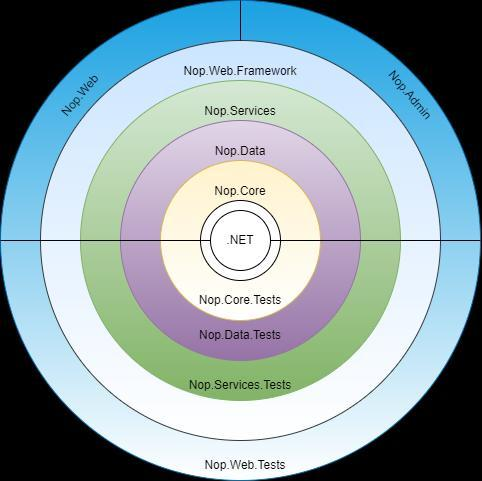

**nopCommerce** es una plataforma de comercio electrónico ***open source*** basada en **.NET**
que incorpora desde el inicio las funcionalidades habituales de una tienda online (catálogo,
pedidos, clientes, pagos y envíos) y ofrece una interfaz personalizable. Su código está
organizado en capas, con una estructura orientada a facilitar la extensibilidad y el
mantenimiento.

Uno de los principales puntos fuertes de nopCommerce es, precisamente, su **arquitectura
flexible y extensible**, junto con una estructura de código bien definida. Su diseño sigue un
enfoque muy próximo al modelo de **arquitectura onion**, cuyo principio fundamental es el
**control del acoplamiento entre capas**. En este tipo de arquitectura, las dependencias deben
orientarse siempre hacia el núcleo de la aplicación: las capas más externas pueden depender de
las más internas, pero nunca al contrario.

Dicho de otro modo, los componentes más centrales contienen la lógica esencial del sistema y
permanecen aislados de los detalles externos, como la interfaz de usuario o determinados
mecanismos de infraestructura. Este planteamiento mejora la mantenibilidad, favorece la
reutilización del código y facilita la evolución de la aplicación, ya que permite realizar
cambios en capas externas sin comprometer el funcionamiento del núcleo del sistema.

Este planteamiento implica que cada proyecto solo puede depender de otros proyectos situados en
una capa más interna que la suya. Por ejemplo, **Nop.Data** puede depender de **Nop.Core**, ya
que este último se encuentra más próximo al núcleo de la aplicación. Sin embargo, **Nop.Core**
no puede depender de **Nop.Data**, porque eso supondría invertir el sentido correcto de las
dependencias. Del mismo modo, **Nop.Services** puede apoyarse tanto en **Nop.Data** como en
**Nop.Core**, mientras que estos proyectos no deben depender de **Nop.Services**.

En consecuencia, la regla general es que un proyecto únicamente puede referenciar a otro si
este se encuentra en una posición más interna dentro de la arquitectura. Este principio es
fundamental para lograr un sistema **desacoplado**, en el que cada capa mantiene claramente
delimitadas sus responsabilidades y evita depender de elementos de mayor nivel o más próximos a
la presentación.

La principal ventaja de este enfoque arquitectónico es que el **núcleo de la aplicación** puede
desarrollarse, mantenerse y probarse de forma independiente del resto de capas. Por ejemplo, es
posible validar el funcionamiento del **Application Core** sin necesidad de disponer de una
interfaz de usuario, ya que la lógica central no depende de la capa de presentación. Esto
simplifica enormemente las pruebas, favorece la mantenibilidad del sistema y reduce el impacto
de los cambios.

Además, esta separación permite sustituir o evolucionar la tecnología de interfaz de usuario
sin afectar al núcleo funcional de la aplicación. Por ejemplo, podría reemplazarse una
implementación basada en **Razor** y **jQuery** por otra construida con **Angular**, **React**
o **Vue**, sin necesidad de modificar la lógica de negocio central. Del mismo modo, ese mismo
núcleo podría reutilizarse para desarrollar aplicaciones móviles, de escritorio o incluso
nuevas interfaces de acceso al sistema. En definitiva, este modelo arquitectónico aporta
**flexibilidad, escalabilidad y capacidad de reutilización**, al tiempo que preserva la
estabilidad del núcleo de la aplicación.

La imagen anterior refleja con precisión cómo se organizan las dependencias en nopCommerce.
.NET ocupa el núcleo absoluto del sistema, sobre el que se construye Nop.Core. A partir de ahí,
cada capa envuelve a la anterior siguiendo una dirección de dependencia estricta hacia el
interior. Los proyectos de pruebas se sitúan en el exterior del diagrama, lo que confirma que
pueden depender de cualquier capa interna sin que esas capas dependan de ellos.

Esta organización conceptual tiene su traducción directa en la estructura física de la
solución, que se organiza en cuatro directorios principales:

```text
nopCommerce/
├── Build/
├── Libraries/
│   ├── Nop.Core/
│   ├── Nop.Data/
│   └── Nop.Services/
├── Presentation/
│   ├── Nop.Web.Framework/
│   └── Nop.Web/
│       └── Areas/Admin/
├── Plugins/
│   └── Nop.Plugin.{Grupo}.{Nombre}/
└── Tests/
    └── Nop.Tests/                  único proyecto .csproj de la solución
        ├── Nop.Core.Tests/
        ├── Nop.Data.Tests/
        ├── Nop.Services.Tests/
        └── Nop.Web.Tests/
```

`Libraries` contiene el Application Core, `Presentation` agrupa los proyectos de interfaz de
usuario, `Tests` contiene el único proyecto de pruebas de la solución (`Nop.Tests`),
organizado en carpetas por capa, y `Plugins` es donde deben ubicarse los proyectos de plugins
durante el desarrollo. Este último directorio no debe confundirse con `Nop.Web/Plugins`, que es
el directorio de despliegue donde nopCommerce carga los plugins ya compilados en tiempo de
ejecución.

## Capítulo 6 — Proyectos de la solución nopCommerce {#capitulo-6}

Describe los tres proyectos del Application Core —Nop.Core, Nop.Data y Nop.Services— y las responsabilidades de cada uno.

**Parte II — Fundamentos** · Nivel: Intermedio

Este capítulo cubre la composición del Application Core: entidades de dominio sobre BaseEntity en Nop.Core, acceso a datos con Linq2db, FluentMigrator e IRepository genérico en Nop.Data, y servicios con interfaz e implementación en Nop.Services; Sirve para ubicar la lógica de negocio y la persistencia en el proyecto correcto; Los conceptos clave incluyen BaseEntity, IRepository<TEntity>, el enfoque code-first y el patrón interfaz-servicio con registro AddScoped; Prerrequisitos: capítulos 1 y 2; Caso de uso típico: añadir una entidad y su servicio siguiendo la estructura de la plataforma.

**Trampas frecuentes:**

> - En nopCommerce no se definen propiedades de navegación entre entidades; no es una limitación de Linq2db, que admite asociaciones, sino una decisión de diseño del núcleo.
> - Las relaciones entre entidades se resuelven en la capa de servicios mediante consultas explícitas, no mediante referencias directas entre objetos.
> - Nop.Data depende exclusivamente de Nop.Core y Nop.Services depende de ambos; ninguna otra dirección de dependencia es válida.
> - Nop.Data registra automáticamente IRepository<TEntity> para cualquier entidad que herede de BaseEntity, sin necesidad de registrar repositorios uno por uno.

---

La solución **nopCommerce** se organiza en distintas capas y proyectos, siguiendo una
arquitectura orientada a la separación de responsabilidades. Esta estructura permite distribuir
de forma clara la lógica de negocio, el acceso a datos, la presentación y las pruebas,
facilitando así el mantenimiento, la escalabilidad y la evolución del sistema.

### Application Core

El **Application Core** constituye la capa más interna de la arquitectura de nopCommerce y
representa el núcleo funcional de la aplicación. En esta capa se concentra la lógica esencial
del sistema, incluyendo tanto el acceso a datos como la lógica de negocio principal. Dentro de
la solución nopCommerce, los proyectos que forman esta capa se encuentran en el directorio

**Libraries**.

El **Application Core** está compuesto por tres proyectos principales:

#### Nop.Core

Es el proyecto más central de toda la arquitectura. No depende de ningún otro proyecto de la
solución, lo que refuerza su papel como base del sistema. En él se incluyen las clases
fundamentales compartidas por el resto de la aplicación, como las **entidades de dominio**, los
mecanismos de **caché**, la gestión de **eventos** y diversas clases auxiliares de uso común.

Su función es proporcionar los elementos esenciales sobre los que se construyen las capas
superiores, manteniendo un diseño independiente y estable.

Todas las entidades de dominio de nopCommerce heredan de ***BaseEntity***, clase definida en
Nop.Core que proporciona la propiedad Id común a todos los objetos persistibles del sistema. El
siguiente ejemplo muestra la estructura básica de una entidad real:

```csharp
namespace Nop.Core.Domain.Catalog
{

///<summary>
/// Representa un fabricante de productos en el catálogo.
/// Hereda de BaseEntity, lo que la convierte en una entidad
/// persistible mediante el repositorio genérico de Nop.Data.
///</summary>
public partial class Manufacturer : BaseEntity
{
    public string Name { get; set; }
    public string Description { get; set; }
    public bool Published { get; set; }
    public bool Deleted { get; set; }
    public int DisplayOrder { get; set; }
    public DateTime CreatedOnUtc { get; set; }
    public DateTime UpdatedOnUtc { get; set; }
}


}
```

**Un detalle importante**: en nopCommerce no se definen propiedades de navegación entre
entidades. No es una limitación de **linq2db** —que admite asociaciones (`[Association]`) y
carga diferida (`LoadWith`)—, sino una decisión de diseño del núcleo: las relaciones entre
entidades se resuelven en la capa de servicios mediante consultas explícitas, no mediante
referencias directas entre objetos.

#### Nop.Data

El proyecto **Nop.Data** depende exclusivamente de **Nop.Core**. Su responsabilidad principal
es encapsular la lógica de acceso a datos, proporcionando los mecanismos necesarios para leer,
escribir y gestionar información en la base de datos o en otros sistemas de almacenamiento.

Esta separación permite aislar la capa de persistencia respecto de la lógica de negocio,
favoreciendo un diseño más limpio, mantenible y fácilmente testeable. En otras palabras,
**Nop.Data** actúa como la capa encargada de la comunicación con el almacenamiento de datos,
evitando que esta responsabilidad se mezcle con otras partes del sistema.

nopCommerce utiliza un enfoque Code-First basado en Linq2DB y FluentMigrator. Linq2DB permite
trabajar con la base de datos usando objetos .NET y consultas LINQ, que se traducen a SQL en
tiempo de ejecución. FluentMigrator se encarga de generar y evolucionar el esquema de la base
de datos a partir de las clases C\# definidas en Nop.Core.

Todo el trabajo con los datos de una tabla se realiza a través de la interfaz genérica
IRepository<TEntity>, que proporciona las operaciones básicas de lectura, escritura,
actualización y eliminación sin exponer directamente los mecanismos internos de Linq2DB. El
funcionamiento detallado de ese ORM y su configuración en esta capa se documenta en los
capítulos 7 y 8. El siguiente ejemplo muestra cómo se consume este repositorio desde una clase
que necesita acceder a datos:

```csharp
// El repositorio se recibe mediante inyección de dependencias.
// Nop.Data registra automáticamente IRepository<TEntity>
// para cualquier entidad que herede de BaseEntity.
// Extracto: la clase real ManufacturerService (Nop.Services.Catalog)
// implementa IManufacturerService y declara más miembros.
public class ManufacturerService
{
    private readonly IRepository<Manufacturer> _manufacturerRepository;
    public ManufacturerService(IRepository<Manufacturer> manufacturerRepository)
    {
        _manufacturerRepository = manufacturerRepository;
    }
    public async Task<Manufacturer> GetManufacturerByIdAsync(int id)
    {
        // GetByIdAsync es uno de los métodos base del repositorio genérico.
        // Internamente ejecuta un SELECT por clave primaria.
        return await _manufacturerRepository.GetByIdAsync(id);
    }
    public async Task<IList<Manufacturer>> GetAllManufacturersAsync()
    {
        // GetAllAsync admite un predicado opcional para filtrar resultados.
        return await _manufacturerRepository.GetAllAsync(
            query => query.Where(m => m.Published && !m.Deleted)
        );
    }
}
```

#### Nop.Services

Representa la capa más externa dentro del **Application Core** y depende tanto de **Nop.Core**
como de **Nop.Data**. En este proyecto se ubican los **servicios principales de la
aplicación**, donde se implementan la lógica de negocio, las validaciones, los cálculos y las
operaciones funcionales sobre los datos.

Esta capa también puede identificarse como **Business Logic Layer (BLL)** o **Business Access
Layer (BAL)**, ya que actúa como intermediaria entre el núcleo de la aplicación y las capas
externas. A través de sus servicios, expone funcionalidades que pueden ser consumidas por la
capa de presentación y por otros componentes del sistema.

Además, **Nop.Services** se apoya en patrones como el **repositorio** y está especialmente
preparado para trabajar con **inyección de dependencias**, lo que favorece el desacoplamiento,
mejora la capacidad de prueba y reduce el impacto de los cambios en la lógica interna de la
aplicación.

En nopCommerce cada servicio se define mediante una interfaz pública y una implementación
concreta. Esta separación es la que permite que la inyección de dependencias funcione
correctamente y que las pruebas unitarias puedan sustituir implementaciones reales por dobles
de prueba. El patrón es consistente en toda la solución:

```csharp
namespace Nop.Services.Catalog
{
/// <summary>
/// Contrato público del servicio de fabricantes.
/// Los controladores y otros servicios dependen de esta interfaz,
/// nunca de la implementación concreta.
/// </summary>
public partial interface IManufacturerService
{
    Task<Manufacturer> GetManufacturerByIdAsync(int id);
    Task<IList<Manufacturer>> GetAllManufacturersAsync();
    Task InsertManufacturerAsync(Manufacturer manufacturer);
    Task UpdateManufacturerAsync(Manufacturer manufacturer);
    Task DeleteManufacturerAsync(Manufacturer manufacturer);
}
}
```

El registro de este servicio en el contenedor de dependencias se realiza en una clase que
implementa INopStartup, siguiendo siempre el mismo patrón:

```csharp
// Registro real en Presentation/Nop.Web.Framework/Infrastructure/NopStartup.cs.
// Al usar AddScoped, el servicio comparte el ciclo de vida
// de la solicitud HTTP, que es el comportamiento esperado
// para servicios que acceden a datos.
services.AddScoped<IManufacturerService, ManufacturerService>();
```

## Capítulo 7 — linq2db: qué es y cómo se usa {#capitulo-7}

Explica qué es linq2db, el modelo de conexión y de mapeo que ofrece y las operaciones principales con las que trabaja una base de datos desde C#. Los conceptos generales de este capítulo proceden de la documentación oficial de linq2db; las citas se recogen en el Apéndice A.8.

**Parte II — Fundamentos** · Nivel: Intermedio

- **Servicio:** describir la biblioteca de acceso a datos sobre la que se apoya la persistencia de nopCommerce.
- **Utilidad:** entender el código de la capa Nop.Data antes de entrar en ella.
- **Conceptos clave:** biblioteca LINQ de acceso a datos tipado; `DataConnection` y `DataContext`; mapeo POCO-tabla con `MappingSchema`; consultas LINQ y operaciones CRUD; inserciones masivas con `BulkCopy`; operación `Merge`; transacciones.
- **Prerrequisitos:** capítulo 6.
- **Caso de uso típico:** leer o escribir código de persistencia basado en linq2db y reconocer qué hace cada pieza.

**Trampas frecuentes:**

> - Devolver un `IQueryable` de un bloque `using` de `DataConnection` y enumerarlo fuera: la consulta se ejecuta con la conexión ya devuelta al *pool* y se obtiene un `ObjectDisposedException`.
> - Suponer que linq2db hace seguimiento de cambios (*change tracking*) como EF Core: no lo hace; el estado de las entidades se gestiona fuera de la biblioteca.
> - Crear un `MappingSchema` nuevo por cada conexión en lugar de un único compartido: la documentación advierte de que daña seriamente el rendimiento.
> - Pedir `KeepIdentity` en un modo o proveedor que no lo admite: linq2db lanza `LinqToDBException`.

---

### Qué es linq2db

LINQ to DB se define como una biblioteca de acceso a datos LINQ: ofrece una capa ligera, rápida y tipada entre los POCO y la base de datos. Se sitúa un paso por encima de los micro-ORM como Dapper —se trabaja con expresiones LINQ, no con cadenas de texto— pero es más ligera que LINQ to SQL o Entity Framework: no incorpora seguimiento de cambios ni un modelo de entidades, y a cambio el desarrollador gana control y acceso más directo a los datos. La propia documentación lo resume como SQL tipado por el compilador: las consultas se escriben en C#, el compilador las valida y solo después se traducen a SQL.

| Aspecto | linq2db | EF Core | Dapper |
|---------|---------|---------|--------|
| Tipo de consultas | expresiones LINQ traducidas a SQL | expresiones LINQ con modelo de entidades | SQL literal en cadenas de texto |
| Seguimiento de cambios | no | sí | no |
| Peso de la abstracción | capa fina entre POCO y base de datos | más pesada | la más ligera |

nopCommerce figura entre los proyectos de código abierto destacados que utilizan linq2db, según la propia documentación de la biblioteca.

### Conexiones: DataConnection y DataContext

Al conectar con una base de datos, los proveedores ADO.NET de .NET usan un *pool* de conexiones para evitar el coste de abrir y cerrar conexiones; una conexión no devuelta al *pool* acaba agotando el límite disponible. linq2db ofrece dos formas de trabajar con esa conexión:

| Clase | Comportamiento | Uso |
|-------|----------------|-----|
| `DataConnection` | abre la conexión con la primera consulta y la retiene hasta el `Dispose` | la opción recomendada; siempre dentro de un bloque `using` |
| `DataContext` | abre y cierra una conexión real por cada consulta | solo si se necesita ese comportamiento; `KeepConnectionAlive = true` la hace equivalente a `DataConnection` |

La regla de oro con `DataConnection` es que la consulta se ejecute antes de disponer de la conexión. Si se devuelve un `IQueryable` sin materializar —por ejemplo, `return db.GetTable<Person>();` dentro del bloque `using`—, la enumeración ocurre después del `Dispose` y linq2db lanza `ObjectDisposedException`. La configuración —cadena de conexión, proveedor y esquema de mapeo— se declara una sola vez con la clase `DataOptions` y se pasa al constructor.

```csharp
// Configuración y consulta con DataConnection (ejemplo de la documentación oficial)
var db = new DataConnection(
    new DataOptions().UseSqlServer(@"Server=.\;Database=Northwind;Trusted_Connection=True;"));

var products = from p in db.GetTable<Product>()
               where p.ProductID > 25
               orderby p.Name descending
               select p;

var list = products.ToList(); // la consulta se ejecuta aquí, dentro de la vida de la conexión
```

### Modelo de mapeo: POCO y tabla

linq2db admite tres formas de asociar una clase con una tabla, intercambiables en capacidades:

| Forma | Cómo se declara | Observaciones |
|-------|-----------------|---------------|
| Por atributos | `[Table]`, `[Column]`, `[PrimaryKey]`, `[Identity]` sobre la clase | si un POCO lleva un atributo, todas las propiedades persistentes deben llevarlo; las que no lo hacen, se ignoran |
| Mapeo fluido | `FluentMappingBuilder` sobre una instancia de `MappingSchema` | admite varias configuraciones e inferir lo no declarado; el `MappingSchema` se crea una vez y se comparte entre conexiones |
| Inferido | sin declaraciones: nombres de clase = nombres de tabla | no recomendado: no infiere la clave primaria aunque exista una propiedad `Id`, ni la nulabilidad, ni las asociaciones |

El `MappingSchema` es el centro del mapeo: se construye una sola vez, se asocia a las conexiones que lo necesiten y contiene la traducción completa clase-tabla-columna.

### Consultas y operaciones CRUD

`db.GetTable<T>()` devuelve un `ITable<T>`, una tabla consultable. Sobre ella se aplica LINQ con composición —cada cláusula `Where`, `OrderBy` o `Select` añadida se traduce a una única consulta SQL—, proyecciones a objetos anónimos o a la propia entidad, paginación con `Skip`/`Take` y uniones entre tablas. Las consultas se materializan con `ToList`, `First` o `Count` y sus equivalentes asíncronos —`ToListAsync`, `FirstOrDefaultAsync`, `CountAsync`—.

La escritura se resuelve con operaciones directas:

| Operación | API de linq2db |
|-----------|----------------|
| Insertar | `db.Insert(entity)`, `db.InsertWithInt32Identity(entity)` o `.Value(...).Insert()` para columnas concretas |
| Actualizar | `db.Update(entity)` o por consulta: `.Where(...).Set(p => p.Campo, valor).Update()` |
| Borrar | por consulta: `.Where(...).Delete()` |

Las variantes por consulta —`Set` y `Delete` encadenados— modifican o eliminan múltiples filas con un solo comando SQL, sin cargarlas en memoria.

### Inserciones masivas: Bulk Copy

El *bulk copy* transfiere grandes volúmenes de datos a una tabla de forma más eficiente que los `INSERT` convencionales. linq2db unifica la operación con `BulkCopy` y `BulkCopyAsync` y define cuatro métodos internos: `Default` —elige según el proveedor—, `RowByRow` —un `INSERT` por fila—, `MultipleRows` —inserción por lotes— y `ProviderSpecific` —mecanismo nativo del motor, el más rápido—. El soporte varía por proveedor: SQL Server usa por defecto `ProviderSpecific`, y MySQL y PostgreSQL admiten los modos por lotes y el específico. La opción `KeepIdentity`, que inserta conservando los valores de identidad proporcionados, está soportada en SQL Server, MySQL y PostgreSQL, entre otros motores.

### Operación Merge

`Merge` es una operación atómica que actualiza una tabla destino usando una tabla, una consulta o una colección como origen. Se define una regla de coincidencia —por defecto, la clave primaria— y operaciones por grupo: actualización o borrado para los registros que coinciden e inserción para los que solo aparecen en el origen. La API está disponible para SQL Server, DB2, Firebird, Oracle, Sybase ASE, Informix, HANA 2 y PostgreSQL 15; MySQL no figura entre los motores soportados, lo que explica su uso condicionado a SQL Server en nopCommerce (Capítulo 8).

### Transacciones

linq2db admite transacciones explícitas —`BeginTransaction`, `CommitTransaction`, `RollbackTransaction`— y transacciones ambientales con la clase `TransactionScope` de .NET. La salvedad es temporal: una `DataConnection` se asocia a la transacción ambiental en el momento en que se abre, de modo que las `TransactionScope` creadas después no la afectan. Para que una transacción ambiental envuelva la operación, la conexión debe abrirse dentro del ámbito.

**Enlace:** Capítulo 8.

## Capítulo 8 — linq2db en nopCommerce (capa Nop.Data) {#capitulo-8}

Describe cómo la capa Nop.Data configura y utiliza linq2db en nopCommerce 4.90.8: selección del proveedor de base de datos, mapeo derivado de FluentMigrator, consultas y escritura a través de `IRepository` y funcionalidades de linq2db aprovechadas por la plataforma. Se apoya en el código fuente de la versión de referencia y en la documentación de linq2db citada en el Apéndice A.8.

**Parte II — Fundamentos** · Nivel: Intermedio

- **Servicio:** documentar la cadena completa de acceso a datos de nopCommerce.
- **Utilidad:** saber en qué punto ocurre cada operación al depurar o extender la persistencia.
- **Conceptos clave:** cadena `IRepository` → `INopDataProvider` → linq2db; `DataConfig` y selección de proveedor; FluentMigrator como origen del esquema y del mapeo; consultas asíncronas y caché en el repositorio; funcionalidades de linq2db utilizadas y no utilizadas.
- **Prerrequisitos:** capítulos 6 y 7.
- **Caso de uso típico:** seguir una consulta desde el servicio hasta el SQL ejecutado y escribir consultas nuevas sin romper las capas.

**Trampas frecuentes:**

> - Escribir SQL pensando solo en SQL Server: el ajuste `WithNoLock` y el hint `NOLOCK` son exclusivos de SQL Server, y cada motor traduce de forma distinta tipos, identidades y tablas temporales.
> - Modificar una migración ya aplicada: nopCommerce no la vuelve a ejecutar; hay que crear una nueva con fecha posterior (Capítulo 17).
> - Esperar un `DbContext` o un seguimiento de cambios en memoria: la capa de datos no los tiene; los eventos de entidad se publican después de persistir (Capítulo 20 y Capítulo 22).
> - Conducir el comportamiento según `ConfigurationName` sin probar los tres motores: el código ramificado por proveedor puede romper en MySQL o PostgreSQL.

---

### Cadena de acceso a datos

La persistencia de nopCommerce se resuelve en la capa `Nop.Data` con una cadena corta de componentes, registrados en DI por `NopDbStartup`:

| Componente | Fichero | Responsabilidad |
|------------|---------|-----------------|
| `IRepository<TEntity>` | `Libraries/Nop.Data/IRepository.cs` | contrato de repositorio con opciones de caché y de borrado lógico |
| `EntityRepository<TEntity>` | `Libraries/Nop.Data/EntityRepository.cs` | implementación genérica del contrato |
| `INopDataProvider` y `BaseDataProvider` | `Libraries/Nop.Data/INopDataProvider.cs`, `DataProviders/BaseDataProvider.cs` | CRUD, SQL crudo y acceso a tablas sobre linq2db |
| `DataProviderManager` | `Libraries/Nop.Data/DataProviderManager.cs` | elige el proveedor según `DataConfig` |
| Proveedores concretos | `DataProviders/MsSqlDataProvider.cs`, `MySqlDataProvider.cs`, `PostgreSqlDataProvider.cs` | traducción a cada motor y sus particularidades |
| `NopDbStartup` | `Libraries/Nop.Data/NopDbStartup.cs` | registro de servicios: `IRepository<>` → `EntityRepository<>` |

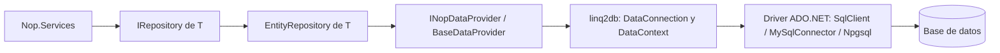

Los servicios de `Nop.Services` solo ven `IRepository`; no importan tipos de linq2db en sus ficheros, salvo usos puntuales de `INopDataProvider` para operaciones que no caben en el repositorio —consultas con tablas temporales, mantenimiento—.

### Configuración y selección del proveedor

La configuración de datos vive en `DataConfig` y se persiste en `App_Data/appsettings.json`, bajo la sección `ConfigurationManager.ConnectionStrings`:

| Ajuste | Función |
|--------|---------|
| `ConnectionString` | cadena de conexión al motor elegido |
| `DataProvider` | motor: `SqlServer`, `MySql` o `PostgreSQL` (no hay soporte de Oracle) |
| `SQLCommandTimeout` | tiempo de espera de los comandos; se aplica tanto a linq2db como a FluentMigrator |
| `WithNoLock` | añade el hint `NOLOCK` a las consultas; solo tiene efecto en SQL Server |
| `Collation`, `CharacterSet` | colación y juego de caracteres durante la instalación |

`DataSettingsManager` carga y cachea ese ajuste —con migración de los formatos antiguos `Settings.txt` y `dataSettings.json`— y expone utilidades como `IsDatabaseInstalled()` y `UseNoLock()`. A partir de `DataProvider`, `DataProviderManager` instancia el proveedor correspondiente (`MsSqlNopDataProvider`, `MySqlNopDataProvider` o `PostgreSqlDataProvider`), y cada uno aporta el `IDataProvider` de linq2db y el driver ADO.NET —`Microsoft.Data.SqlClient`, `MySqlConnector` y `Npgsql`—.

### Mapeo: FluentMigrator como origen del esquema

nopCommerce no declara el mapeo con atributos de linq2db. La única definición del esquema son las clases de migración de FluentMigrator, y el mapeo de linq2db se deriva de ellas en tiempo de ejecución:

1. Cada entidad tiene un `IEntityBuilder` —por ejemplo `Mapping/Builders/Catalog/ProductBuilder.cs`— que describe columnas y tipos sobre las expresiones `CreateTable` de FluentMigrator. Las propiedades no descritas se completan con un mapa de tipos CLR y la clave primaria `Id` identidad se añade por convención.
2. `NopMappingSchema.GetEntityDescriptor(Type)` ejecuta esos descriptores en memoria —sin tocar la base de datos— y cachea el resultado: nombre de tabla, columnas, claves, identidad, longitudes y tipos.
3. `GetMappingSchema(configuration, provider)` crea el `MappingSchema` de linq2db correspondiente y le añade un lector de metadatos propio, `FluentMigratorMetadataReader`, que implementa la interfaz `IMetadataReader` de linq2db y traduce el descriptor a los atributos que linq2db entiende —`TableAttribute`, `ColumnAttribute`, `SequenceNameAttribute` para las identidades de PostgreSQL—.
4. `NameCompatibilityManager` resuelve los renombres históricos de tablas y columnas —por ejemplo, `ProductCategory` corresponde a la tabla `Product_Category_Mapping`—.

El resultado es que el mismo descriptor genera el DDL de las migraciones y el mapeo de las consultas: si cambia una columna, cambia en los dos sitios a la vez.

### Consultas y escritura a través del repositorio

| Aspecto | Implementación |
|---------|----------------|
| Tabla consultable | `EntityRepository.Table` devuelve `_dataProvider.GetTable<TEntity>()`, un `DataContext` de linq2db construido con `DataOptions` —cadena de conexión y `MappingSchema`— |
| Hints de tabla | el proveedor de SQL Server convierte la tabla a `ITable<TEntity>` y aplica `.With("NOLOCK")` cuando `WithNoLock` está activo |
| Consultas asíncronas | `Extensions/AsyncIQueryableExtensions.cs` envuelve las extensiones asíncronas de linq2db —`ToListAsync`, `CountAsync`, `AsAsyncEnumerable`—; la capa no usa Entity Framework |
| Caché | `GetByIdAsync` y `GetAllAsync` aceptan una función de clave de caché; el repositorio coopera con `IStaticCacheManager` e `IShortTermCacheManager` (Capítulo 27) |
| Escritura | `InsertAsync`, `UpdateAsync`, `DeleteAsync` y `TruncateAsync` sobre linq2db; después de persistir, el repositorio publica los eventos de entidad (Capítulo 20) |
| Transacciones | las rutas de escritura masiva usan `TransactionScope` sobre `EntityRepository` |

```csharp
// EntityRepository.cs (4.90.8): la tabla consultable es una tabla de linq2db
public virtual IQueryable<TEntity> Table => _dataProvider.GetTable<TEntity>();
```

### Funcionalidades de linq2db aprovechadas

| Funcionalidad | Uso en nopCommerce | Dónde |
|----------------|--------------------|-------|
| Consulta LINQ sobre `ITable<T>` | todas las consultas del repositorio | `EntityRepository.Table` |
| Extensiones asíncronas | consultas `*Async` de toda la plataforma | `Extensions/AsyncIQueryableExtensions.cs` |
| `BulkCopy` con `KeepIdentity` | inserciones masivas preservando identidades | `BaseDataProvider.cs` |
| `Merge` | actualización masiva por clave; solo SQL Server | `MsSqlDataProvider.cs` |
| Tablas temporales | borrados masivos con conjuntos grandes | `TempSqlDataStorage.cs`, `CustomerService.cs` |
| `Set(...).Update()` por consulta | migraciones de datos | `Migrations/UpgradeTo490/DataMigration.cs` |
| SQL condicional por proveedor | hash SHA-2 calculados en la propia base de datos | `BaseDataProvider.cs` (`SqlSha2`, `GetFieldHashesAsync`) |
| Hints de tabla (`.With`) | `NOLOCK` en SQL Server | `MsSqlDataProvider.cs` |
| SQL crudo (`CommandInfo`) | mantenimiento: copias, reindexado, `VACUUM` | `BaseDataProvider.cs` |
| Caché de consultas de linq2db | activable o desactivable desde administración | `NopDbStartup.cs`, ajuste `LinqDisableQueryCache` |

No se detectan usos en el núcleo de otras funciones de linq2db, como las funciones de ventana vía `Sql.Ext` o la carga múltiple de entidades (`LoadWith`); su ausencia es una búsqueda en los proyectos `Libraries`, no una limitación de la biblioteca.

### Migraciones de esquema

El esquema lo crea y evoluciona FluentMigrator 7.1.0, no linq2db. Las migraciones de instalación —`Migrations/Installation/SchemaMigration.cs`— crean todas las tablas con `Create.TableFor<T>()`, que resuelve el `IEntityBuilder` de cada entidad; las de actualización —`UpgradeTo440` a `UpgradeTo490`— evolucionan esquema y datos. `IMigrationManager` aplica las migraciones del ensamblado `Nop.Data` con una tabla de versiones (`MigrationVersionInfo`), y el mismo mecanismo descubre las migraciones que un plugin pueda incluir (Capítulo 17). Existe además un segundo puente con linq2db: las migraciones de datos consultan y actualizan filas con LINQ sobre `INopDataProvider.GetTable<T>()`.

**Enlace:** Capítulo 6, Capítulo 7, Capítulo 17 y Capítulo 22.

## Capítulo 9 — UI Layer {#capitulo-9}

Detalla la capa de presentación, dividida en la biblioteca compartida Nop.Web.Framework y la aplicación web Nop.Web con su área de administración.

**Parte II — Fundamentos** · Nivel: Básico

Este capítulo cubre la organización del directorio Presentation: Nop.Web.Framework como biblioteca de componentes compartidos y Nop.Web como aplicación ASP.NET Core que contiene la tienda pública y el área Admin; Sirve para localizar las clases base de controlador y los atributos administrativos; Los conceptos clave incluyen BasePublicController, BaseAdminController, BasePluginController y el atributo AuthorizeAdmin; Prerrequisitos: capítulos 2 y 3; Caso de uso típico: crear un controlador que herede de la clase base correcta según el entorno.

**Trampas frecuentes:**

> - El atributo AutoValidateAntiforgeryToken pertenece a ASP.NET Core (Microsoft.AspNetCore.Mvc) y no a nopCommerce, aunque se declare habitualmente junto a AuthorizeAdmin.
> - El área de administración forma parte del mismo proyecto Nop.Web como área diferenciada, no es una aplicación separada, y requiere autenticación y autorización.
> - Nop.Web.Framework centraliza los componentes que la tienda pública y el panel de administración necesitan compartir, como los controladores base y los atributos de autorización.

---

La **UI Layer** o capa de presentación se sitúa fuera del **Application Core**. En la solución
nopCommerce, sus proyectos se encuentran dentro del directorio **Presentation**. Esta capa es
responsable de todo lo relacionado con la interfaz de usuario y la presentación de la
información, es decir, de la parte visible con la que interactúan los usuarios del sistema.

En nopCommerce, la capa de presentación se divide en dos niveles principales:

### Nop.Web.Framework

Constituye la parte interna de la capa de presentación y depende del **Application Core**. Se
trata de una biblioteca de clases que proporciona funcionalidades comunes para la interfaz de
usuario.

Su propósito es centralizar la lógica compartida entre el **sitio público** y el **panel de
administración**, evitando duplicidades y facilitando la reutilización de componentes dentro de
la capa de presentación.

En términos prácticos, Nop.Web.Framework contiene componentes que tanto la tienda pública como
el panel de administración necesitan compartir. Entre ellos se encuentran los filtros de acción
personalizados, los atributos de autorización administrativa, los controladores base de los que
heredan los controladores de la plataforma, los helpers de Razor, la infraestructura de
localización aplicada a la capa de presentación y los mecanismos de arranque que registran
servicios específicos del entorno web.

Un ejemplo concreto son las clases base de controlador: **BasePublicController**
(`Nop.Web.Controllers`) para la tienda pública, **BaseAdminController**
(`Nop.Web.Areas.Admin.Controllers`) para el área de administración y **BasePluginController**
(`Nop.Web.Framework.Controllers`) para los plugins. Estas clases centralizan comportamiento
común como la gestión de notificaciones al usuario, el acceso a datos del contexto web y otros
mecanismos que de otro modo habría que duplicar en cada controlador.

Del mismo modo, el atributo **AuthorizeAdmin**, definido en este proyecto, aparece de forma
recurrente en los controladores del área de administración. El atributo
`AutoValidateAntiforgeryToken`, igualmente habitual en esa capa, pertenece a ASP.NET Core
(`Microsoft.AspNetCore.Mvc`) y no a nopCommerce.

### Nop.Web

**Nop.Web** es la capa más externa de la presentación y contiene la aplicación web principal
con la que interactúan los usuarios finales. Se trata de una aplicación **ASP.NET Core** que
depende tanto de **Nop.Web.Framework** como del **Application Core**.

Este proyecto utiliza **Nop.Web.Framework** para aprovechar la lógica de presentación común,
mientras que recurre al **Application Core** para acceder a los datos y ejecutar las
operaciones de negocio necesarias. En términos prácticos, **Nop.Web** es el punto de entrada
principal de la tienda online y donde se materializa la experiencia de usuario del sitio de
comercio electrónico.

### Admin

El área de **administración** forma parte de la misma capa que **Nop.Web**, aunque se
implementa dentro de este proyecto como un **área** diferenciada. Desde el punto de vista
funcional, también es una interfaz de usuario, pero orientada a la gestión interna del sistema.

El panel de administración permite mantener el contenido del sitio web público, configurar la
tienda y supervisar las distintas operaciones de la plataforma. A diferencia de la tienda
pública, que puede ser accesible libremente por los usuarios, el área de administración
requiere **autenticación y autorización**, ya que proporciona acceso a funciones e información
reservadas exclusivamente para usuarios con privilegios administrativos.

## Capítulo 10 — Inyección de dependencias y desacoplamiento {#capitulo-10}

Explica el uso del contenedor de dependencias de ASP.NET Core en nopCommerce, el registro mediante INopStartup y los ciclos de vida de los servicios.

**Parte II — Fundamentos** · Nivel: Intermedio

Este capítulo cubre el modelo de inyección de dependencias de nopCommerce, el registro de servicios en clases INopStartup y el orden de ejecución mediante la propiedad Order, además de la comunicación entre componentes mediante el patrón publicador-consumidor; Sirve para registrar y sustituir servicios sin modificar el núcleo; Los conceptos clave incluyen IServiceProvider, INopStartup, AddScoped, AddSingleton, AddTransient, IEventPublisher e IConsumer<T>; Prerrequisitos: capítulos 3 y 4; Caso de uso típico: registrar el servicio de un plugin y hacer que reaccione a cambios de entidades del núcleo.

**Trampas frecuentes:**

> - Elegir el ciclo de vida incorrecto es una fuente común de errores difíciles de depurar: inyectar un servicio Scoped dentro de uno Singleton provoca una excepción captive dependency con la validación de ámbitos activada.
> - Sin la validación de ámbitos, el Singleton conserva silenciosamente la primera instancia Scoped y el fallo permanece latente hasta que esa solicitud desaparece.
> - La propiedad Order se ejecuta en orden ascendente; un registro con Order int.MaxValue prevalece sobre el del núcleo sin modificar una sola línea del código central.
> - nopCommerce descubre las implementaciones de IConsumer<T> mediante reflexión durante el arranque, igual que con INopStartup e IRouteProvider, por lo que no es necesario registrar manualmente ningún consumidor.
> - AddTransient se usa en muy pocos casos de la plataforma porque su coste de creación repetida rara vez se justifica.

---

Uno de los principios más importantes en la arquitectura de **nopCommerce** es el
**desacoplamiento entre componentes**, y uno de los mecanismos clave para conseguirlo es la
**inyección de dependencias**. Este enfoque permite que las distintas partes del sistema
colaboren entre sí sin quedar unidas de forma rígida, lo que mejora la mantenibilidad, la
capacidad de prueba y la extensibilidad general de la aplicación.

### Concepto general

En un sistema fuertemente acoplado, una clase crea directamente las instancias de las clases
que necesita para funcionar. Este planteamiento provoca dependencias rígidas, dificulta la
sustitución de componentes y complica notablemente las pruebas unitarias. En cambio, con la
**inyección de dependencias**, una clase recibe desde el exterior los servicios o componentes
que necesita, en lugar de crearlos por sí misma.

Aplicado a nopCommerce, esto significa que los controladores, servicios y otros elementos del
sistema no dependen directamente de implementaciones concretas, sino de **abstracciones**,
normalmente expresadas mediante interfaces. De este modo, la lógica de cada componente se
centra en su responsabilidad funcional, mientras que la creación y resolución de dependencias
queda delegada al contenedor de servicios de la aplicación.

#### Papel de la inyección de dependencias en nopCommerce

nopCommerce utiliza el contenedor de inyección de dependencias propio de ASP.NET Core,
representado por la interfaz IServiceProvider. Este contenedor es responsable de mapear las
dependencias a sus tipos concretos y de inyectarlas en los distintos objetos que las necesitan.
Una vez escrito un servicio junto con la interfaz que implementa, debe registrarse en una clase
que implemente la interfaz INopStartup, perteneciente al espacio de nombres
Nop.Core.Infrastructure. El método ConfigureServices de esa clase es el responsable de instalar
los servicios en la aplicación.

El siguiente ejemplo muestra cómo nopCommerce registra parte de sus propios servicios centrales
siguiendo este patrón:

```csharp
namespace Nop.Web.Framework.Infrastructure
{
	/// <summary>
	/// Esta clase es descubierta automáticamente por nopCommerce
	/// durante el arranque, sin necesidad de registrarla manualmente
	/// en ningún otro lugar de la aplicación.
	/// </summary>
	public class NopStartup : INopStartup
	{
	    public void ConfigureServices(IServiceCollection services, IConfiguration configuration)
	    {
	        services.AddScoped<IWebHelper, WebHelper>();
	        services.AddScoped<IWorkContext, WebWorkContext>();
	        services.AddScoped<IStoreContext, WebStoreContext>();
	        // El resto de servicios del núcleo se registran siguiendo
	        // el mismo patrón: interfaz, implementación, ciclo de vida.
	    }
	    public void Configure(IApplicationBuilder application)
	    {
	        // Configuración del pipeline HTTP, si el módulo lo requiere.
	    }
	    public int Order => 2000;
	}
}
```

Cada clase que implementa INopStartup expone una propiedad Order, que permite sustituir
dependencias ya existentes en el sistema. nopCommerce ordena estas clases y las ejecuta en
orden ascendente, de modo que cuanto mayor es el número, más tarde se registran sus objetos.
Esta propiedad es la que hace posible que un plugin sustituya una implementación del núcleo por
la suya propia: si el plugin registra su versión de un servicio con un Order superior al de la
clase original, su registro se ejecuta después y prevalece sobre el anterior, sin necesidad de
modificar ni una línea del código central de nopCommerce. Es el mismo mecanismo que se describe en las secciones «Estructura completa de un plugin» y
«Cómo crear un widget desde cero en nopCommerce», donde
Order => int.MaxValue garantizaba que el plugin se registrara siempre después de los servicios
principales.

La arquitectura de nopCommerce está especialmente orientada a este modelo. La capa de
presentación necesita utilizar servicios de negocio, pero no debería conocer los detalles
internos de su implementación. Del mismo modo, la lógica de negocio puede depender de
componentes de acceso a datos, validadores, proveedores o servicios auxiliares sin necesidad de
instanciarlos manualmente.

Este enfoque aporta una ventaja esencial: cada pieza del sistema puede cambiar internamente sin
obligar a modificar todas las capas que la utilizan, siempre que mantenga el mismo contrato
público. Por ejemplo, si un servicio cambia su implementación interna, pero sigue respetando la
misma interfaz, el resto de la aplicación podrá seguir utilizándolo sin alteraciones.

#### Relación con la arquitectura por capas

La inyección de dependencias encaja de forma natural con la arquitectura por capas de
nopCommerce. Dado que las dependencias deben orientarse hacia el núcleo, las capas superiores
consumen servicios definidos en capas más internas o en contratos accesibles para ellas. La
resolución concreta de esas dependencias se realiza de forma centralizada, lo que permite
mantener limpia la relación entre componentes y evitar referencias innecesarias o acoplamientos
directos.

En la práctica, esto significa que un controlador de **Nop.Web** puede depender de un servicio
de **Nop.Services** a través de una interfaz, sin preocuparse de cómo se construye internamente
ese servicio ni de qué dependencias adicionales requiere. Esa gestión queda resuelta por la
infraestructura de la aplicación.

#### Ventajas prácticas

El uso de inyección de dependencias en nopCommerce aporta varias ventajas importantes:

**Separación clara de responsabilidades.**

Cada clase se ocupa de su función concreta, sin asumir la creación o configuración de otros
componentes.

**Mayor facilidad para las pruebas.**

Al depender de interfaces o abstracciones, es más sencillo sustituir implementaciones reales
por dobles de prueba, simulaciones o servicios controlados en un entorno de testing.

**Mejor mantenibilidad.**

Los cambios internos de una implementación tienen menos impacto en el resto del sistema, lo que
reduce el coste de evolución del software.

**Mayor extensibilidad.**

La plataforma puede ampliarse con nuevos servicios, proveedores o plugins sin necesidad de
modificar drásticamente la estructura existente.

**Reutilización de componentes.**

Un mismo servicio puede ser consumido desde varios puntos del sistema, como la tienda pública,
el área de administración o distintos plugins.

#### Ejemplo conceptual en nopCommerce

Supongamos un controlador encargado de mostrar información de productos. Ese controlador
necesita acceder a la lógica de negocio que recupera, valida y prepara los datos del producto.
En lugar de crear directamente una instancia concreta del servicio, el controlador recibe dicho
servicio ya preparado mediante inyección de dependencias.

Gracias a ello, el controlador solo necesita saber que dispone de un componente capaz de
realizar esa tarea. No necesita conocer cómo accede a la base de datos, qué validaciones aplica
ni qué otros servicios internos utilizan. Toda esa complejidad queda encapsulada dentro del
servicio correspondiente.

Este mismo principio puede aplicarse a otros muchos casos dentro de nopCommerce: métodos de
pago, proveedores de envío, servicios de clientes, gestión de pedidos, proveedores de impuestos
o componentes propios de un plugin.

```csharp
// Esquema conceptual con nombres ilustrativos: el CatalogController real
// (Nop.Web.Controllers) inyecta fábricas de modelos y otros servicios,
// no IProductService. En este esquema el controlador depende de IProductService.
public partial class CatalogController : BasePublicController
{
    private readonly IProductService _productService;

    public CatalogController(IProductService productService)
    {
        _productService = productService;
    }
}
```

```csharp
// Nivel 2: ProductService se apoya en IRepository<Product>.
// Tampoco conoce los detalles de linq2db ni de la base de datos.
// Extracto: la implementación real de IProductService declara decenas de miembros.
public partial class ProductService
{
    private readonly IRepository<Product> _productRepository;

    public ProductService(IRepository<Product> productRepository)
    {
        _productRepository = productRepository;
    }

    public async Task<Product> GetProductByIdAsync(int productId)
    {
        return await _productRepository.GetByIdAsync(productId);
    }
}
```

```csharp
// Nivel 3: IRepository<Product> se registra de forma genérica
// para cualquier entidad que herede de BaseEntity, sin necesidad
// de registrar IRepository<Product> uno por uno.
services.AddScoped(typeof(IRepository<>), typeof(EntityRepository<>));
```

Cuando el contenedor de DI resuelve CatalogController, detecta que su constructor necesita un
IProductService. Para construirlo, detecta a su vez que ProductService necesita un
IRepository<Product>. El contenedor resuelve toda esta cadena de forma automática y
transparente, sin que ninguna de las tres clases conozca cómo se construyen las demás. Esto es
precisamente lo que se describía más arriba: "toda esa complejidad queda encapsulada dentro del
servicio correspondiente".

Un aspecto que conviene aclarar es el ciclo de vida con el
que se registran los servicios. AddScoped es, con diferencia, el más utilizado en nopCommerce,
y significa que se crea una única instancia del servicio por cada solicitud HTTP, compartida
por todos los componentes que la necesiten durante esa solicitud. AddSingleton se reserva para
servicios sin estado relacionado con el usuario o la solicitud, como mecanismos de caché en
memoria. AddTransient crea una instancia nueva cada vez que el servicio se solicita, y se usa
en muy pocos casos dentro de la plataforma porque su coste de creación repetida rara vez se
justifica. Elegir el ciclo de vida incorrecto al registrar un servicio propio en un plugin es
una fuente común de errores difíciles de depurar. El caso típico es inyectar un servicio Scoped
dentro de uno Singleton: con la validación de ámbitos (*scope validation*) activada —activada
por defecto en el entorno de desarrollo— ASP.NET Core lanza en tiempo de ejecución una excepción
conocida como *captive dependency*; sin esa validación, el Singleton conserva silenciosamente la
primera instancia Scoped y el fallo permanece latente hasta que la solicitud que creó ese
objeto desaparece.

#### Importancia para plugins y extensiones

La inyección de dependencias resulta especialmente importante en el desarrollo de **plugins**,
ya que permite integrar nuevas funcionalidades dentro del ecosistema de nopCommerce sin romper
la arquitectura existente. Un plugin puede consumir servicios ya disponibles en la plataforma,
así como registrar sus propias implementaciones para incorporarse al flujo general del sistema.

Esto favorece un modelo de extensión mucho más limpio, donde las nuevas funcionalidades se
integran mediante contratos y servicios, en lugar de recurrir a modificaciones directas del
núcleo. Por ello, comprender este mecanismo es fundamental para desarrollar plugins bien
diseñados y compatibles con la filosofía arquitectónica de nopCommerce.

#### Relación con el desacoplamiento

La inyección de dependencias no es solo una técnica de construcción de objetos; en realidad, es
una herramienta decisiva para mantener el **desacoplamiento** del sistema. Cuanto menos conozca
una clase acerca de la implementación concreta de las demás, más fácil será sustituir
componentes, aislar comportamientos, evolucionar funcionalidades y mantener la aplicación a
largo plazo.

En nopCommerce, este principio se alinea directamente con la filosofía de la arquitectura
onion:

Las capas externas pueden apoyarse en el núcleo, pero sin introducir dependencias innecesarias
hacia detalles concretos de implementación. La inyección de dependencias ayuda precisamente a
conservar esa dirección correcta de dependencias y a evitar un diseño rígido o difícil de
mantener.

La consecuencia práctica para el desarrollador de plugins es que un plugin puede ampliar o
sustituir servicios del núcleo registrando sus propias implementaciones desde una clase
INopStartup, sin modificar el código central.

### Comunicación entre componentes mediante eventos

La inyección de dependencias resuelve cómo un componente obtiene lo que necesita para
funcionar, pero no resuelve el problema inverso: cómo un componente avisa a otros de que algo
ha ocurrido sin necesidad de conocerlos. Para eso, nopCommerce dispone de un segundo mecanismo
de desacoplamiento, basado en el patrón publicador/consumidor, articulado alrededor de las
interfaces IEventPublisher e IConsumer<T>.

nopCommerce publica automáticamente eventos genéricos de entidad cada vez que se inserta,
actualiza o elimina un registro a través de IRepository<T>: EntityInsertedEvent<T>,
EntityUpdatedEvent<T> y EntityDeletedEvent<T>. Esto significa que un plugin puede reaccionar
ante cambios en cualquier entidad del sistema, incluidas las del núcleo, sin que el código que
realiza ese cambio sepa que el plugin existe. El siguiente ejemplo muestra un consumidor que
reacciona cada vez que se crea un nuevo pedido:

```csharp
using Nop.Core.Domain;
using Nop.Services.Logging;

namespace Nop.Plugin.Misc.MiPlugin.Events
{
    // nopCommerce descubre automáticamente las clases que implementan
    // IConsumer<T> mediante reflexión, igual que ocurre con INopStartup
    // e IRouteProvider. No es necesario registrar este consumidor.
    public class PedidoRealizadoConsumer : IConsumer<EntityInsertedEvent<Order>>
    {
        // ILogger es la interfaz Nop.Services.Logging.ILogger, que nopCommerce
        // registra en el contenedor de dependencias.
        private readonly ILogger _logger;
        public PedidoRealizadoConsumer(ILogger logger)
        {
            _logger = logger;
        }
        // Se ejecuta automáticamente cada vez que se inserta un pedido
        // a través de IRepository<Order>, sin que ese código sepa
        // que este plugin existe.
        public async Task HandleEventAsync(EntityInsertedEvent<Order> eventMessage)
        {
            var order = eventMessage.Entity;
            await _logger.InformationAsync($"Nuevo pedido detectado por el plugin: #{order.Id}");
            // Aquí podría sincronizarse el pedido con un sistema externo
            // o registrar una métrica propia, sin tocar el núcleo.
        }
    }
}
```

Como ocurre con INopStartup, nopCommerce descubre las implementaciones de IConsumer<T> mediante
reflexión durante el arranque, por lo que no es necesario registrar manualmente ningún
consumidor. Cuando un plugin necesita notificar algo que no corresponde a una operación de
inserción, actualización o eliminación de una entidad, puede definir y publicar su propio
evento personalizado llamando a \_eventPublisher.PublishAsync(new MiEventoPersonalizado(...)),
que cualquier otro plugin podrá consumir de la misma forma. Este mecanismo, junto con la
inyección de dependencias, es lo que permite que distintas partes de nopCommerce, incluidos
plugins desarrollados por terceros sin relación entre sí, colaboren sin conocerse directamente.

# Parte III — Temas y presentación {#parte-iii}

Los temas constituyen el mecanismo principal para personalizar la apariencia visual de
nopCommerce sin modificar su núcleo. Esta parte aborda su estructura, el sistema de layouts
sobre el que se apoyan y las diferencias fundamentales entre la tienda pública y el panel de
administración.

## Capítulo 11 — Temas: alcance, estructura y personalización {#capitulo-11}

Define el alcance de los temas como mecanismo de personalización visual, su estructura de archivos y el mecanismo de sobreescritura de vistas.

**Parte III — Temas y presentación** · Nivel: Básico

Este capítulo cubre la finalidad de los temas, lo que puede y no debe personalizarse con ellos, la estructura del directorio Themes, el archivo theme.json y la sobreescritura de vistas siguiendo el orden de búsqueda de la plataforma; Sirve para decidir entre tema y plugin y para crear un tema nuevo a partir de uno existente; Los conceptos clave incluyen sobreescritura de vistas, hojas de estilo, recursos gráficos y la separación entre presentación y funcionalidad; Prerrequisitos: capítulos 4 y 5; Caso de uso típico: adaptar la identidad visual de la tienda sin modificar el núcleo.

**Trampas frecuentes:**

> - Solo deben copiarse al tema los archivos que realmente se van a modificar; copiar toda la carpeta Views de Nop.Web impide que las vistas del tema se actualicen al actualizar la plataforma.
> - Un tema no debe usarse para reglas de negocio, pagos, cálculos de envío ni integraciones técnicas: cambiar cómo funciona la tienda corresponde a un plugin.
> - Al crear un tema a partir de uno existente debe actualizarse correctamente theme.json para que nopCommerce lo reconozca como tema independiente.
> - La estructura de carpetas dentro del tema debe replicar exactamente la de Nop.Web/Views para que la sobreescritura de vistas funcione.

---

En **nopCommerce**, los **temas** constituyen uno de los principales mecanismos de
personalización de la plataforma. Su finalidad es permitir la adaptación visual de la tienda
sin necesidad de modificar directamente el núcleo funcional del sistema. Gracias a ellos, es
posible cambiar la apariencia del sitio, ajustar su identidad gráfica y reorganizar
determinados elementos de presentación, manteniendo separada la lógica de negocio de la capa
visual.

### Finalidad de los temas en nopCommerce

El uso de temas responde a una necesidad fundamental en cualquier aplicación web orientada al
comercio electrónico: disponer de una imagen visual coherente, personalizable y alineada con la
identidad de cada negocio. En este sentido, nopCommerce permite que la apariencia del sitio
pueda cambiarse mediante un conjunto organizado de recursos visuales, sin alterar por ello la
arquitectura base de la aplicación.

Un tema no modifica el funcionamiento interno de la tienda desde el punto de vista de la lógica
de negocio. Su ámbito de actuación se centra en la **presentación**: estilos, composición
visual, distribución de ciertos elementos, recursos gráficos y adaptación estética del entorno
de usuario.

#### Qué puede personalizarse mediante un tema

A través de un tema pueden personalizarse distintos aspectos de la interfaz pública de
nopCommerce. Entre ellos, destacan:

- las **hojas de estilo** que controlan colores, tipografías, márgenes,
espaciados, tamaños, bordes y comportamiento visual de los componentes;

- las **imágenes** y recursos gráficos utilizados en banners, iconos,
fondos o elementos decorativos;

- determinadas **vistas** o fragmentos visuales que permiten adaptar la
presentación de páginas concretas;

- la **maquetación** general del sitio, en función de los layouts
disponibles;

- recursos estáticos adicionales, como archivos de soporte visual o
scripts vinculados al diseño.

Esto significa que los temas no se limitan a cambiar colores o imágenes, sino que pueden
influir de manera más amplia en la experiencia visual del usuario, siempre dentro del ámbito de
la presentación.

#### Qué no debe modificarse mediante un tema

Aunque los temas ofrecen un margen de personalización considerable, su función no es sustituir
a los plugins ni alterar la lógica funcional central de la plataforma. Por ello, un tema no
debería utilizarse para implementar reglas de negocio, modificar procesos de pago, alterar
cálculos de envío, cambiar flujos funcionales del sistema o introducir integraciones técnicas
complejas.

En términos prácticos, si la necesidad consiste en **cambiar cómo se ve la tienda**, la vía
adecuada suele ser el tema. Si la necesidad consiste en **cambiar cómo funciona la tienda**, lo
correcto será normalmente desarrollar o adaptar un plugin. Esta distinción es importante porque
ayuda a mantener la arquitectura ordenada y evita introducir dependencias inadecuadas entre
presentación y funcionalidad.

**Sobreescritura de vistas desde un tema**

Una capacidad técnica de los temas que va más allá de los estilos y los recursos gráficos es la
posibilidad de sobrescribir vistas específicas de Nop.Web sin modificar los archivos originales
de la plataforma. Este mecanismo funciona porque nopCommerce busca las vistas siguiendo un
orden de prioridad: primero busca en la carpeta Views del tema activo y, si no encuentra la
vista allí, recurre a la carpeta Views principal de Nop.Web. Esto significa que cualquier vista
colocada en el tema con el mismo nombre y la misma estructura de carpetas que la original será
utilizada en lugar de la predeterminada.

La estructura de carpetas dentro del tema debe replicar exactamente la estructura de
`Nop.Web/Views`. Por ejemplo, si se quiere sobrescribir la vista de la página de producto,
ubicada en `Nop.Web/Views/Product/ProductTemplate.Simple.cshtml`, basta con crear el archivo en
la siguiente ruta dentro del tema:

```text
Themes/
└── MiTema/
    └── Views/
        └── Product/
            └── ProductTemplate.Simple.cshtml
```

A partir de ese momento, nopCommerce utilizará la versión del tema en lugar de la original para
todos los usuarios que tengan ese tema activo. El mismo principio se aplica a vistas parciales,
layouts compartidos y cualquier otro archivo .cshtml de la plataforma.

Es importante seguir una regla fundamental al usar este mecanismo: solo deben copiarse al tema
los archivos que realmente se van a modificar, nunca todos los archivos de `Nop.Web/Views`.
Copiar vistas innecesariamente tiene dos consecuencias negativas. La primera es que cuando
nopCommerce se actualiza a una versión nueva, las vistas del tema no se actualizan
automáticamente, lo que puede provocar incompatibilidades visuales o funcionales difíciles de
detectar. La segunda es que el tema se vuelve más difícil de mantener cuanto mayor es el número
de vistas que sobrescribe.

La siguiente tabla resume los casos de uso más habituales de este mecanismo y las rutas
correspondientes:

| **Vista a sobrescribir** | **Ruta original en Nop.Web** | **Ruta en el tema** |
| :-: | :-: | :-: |
| **Página de detalle de producto** | Views/Product/ProductTemplate.Simple.cshtml | Themes/MiTema/Views/Product/ProductTemplate.Simple.cshtml |
| **Página de inicio** | Views/Home/Index.cshtml | Themes/MiTema/Views/Home/Index.cshtml |
| **Cabecera compartida** | Views/Shared/_Header.cshtml | Themes/MiTema/Views/Shared/_Header.cshtml |
| **Layout raíz** | Views/Shared/\_Root.cshtml | Themes/MiTema/Views/Shared/\_Root.cshtml |

Este mecanismo es especialmente valioso cuando se necesita adaptar la presentación de una
página concreta sin tocar el núcleo de la plataforma, y representa la forma correcta de
realizar personalizaciones visuales profundas en nopCommerce.

#### Estructura general de un tema

En nopCommerce, los temas se ubican dentro de la carpeta:

\[nopCommerce root folder\]/Themes/

Cada tema dispone de su propio directorio, dentro del cual se agrupan los recursos necesarios
para definir su comportamiento visual. Aunque la estructura concreta puede variar, normalmente
un tema incluye elementos como los siguientes:

- archivos de configuración del propio tema;

- hojas de estilo CSS;

- imágenes y otros recursos gráficos;

- posibles vistas específicas o sobreescrituras visuales;

- recursos complementarios de cliente.

La organización de estos elementos permite encapsular la apariencia del sitio dentro de una
estructura independiente, facilitando tanto su mantenimiento como su sustitución por otros
temas.

#### Archivo de configuración del tema

Dentro de la estructura del tema, uno de los elementos más importantes es su archivo de
configuración, habitualmente theme.json. Este archivo cumple una función descriptiva similar,
en cierto modo, a la de plugin.json en los plugins, ya que identifica el tema y permite a
nopCommerce gestionarlo dentro de la lista de temas disponibles.

A través de este archivo, la plataforma reconoce el nombre del tema y puede mostrarlo como
opción seleccionable dentro del panel de administración. Por ello, cuando se crea un tema nuevo
a partir de uno existente, una de las primeras tareas consiste en actualizar correctamente esta
información para que nopCommerce lo detecte como un tema independiente.

#### Personalización a partir de un tema existente

Los temas se almacenan en la carpeta `Themes` del proyecto `Nop.Web`
(`Presentation/Nop.Web/Themes`). La siguiente imagen muestra esa ubicación en el sistema de
archivos, que es el punto de partida para copiar un tema existente.

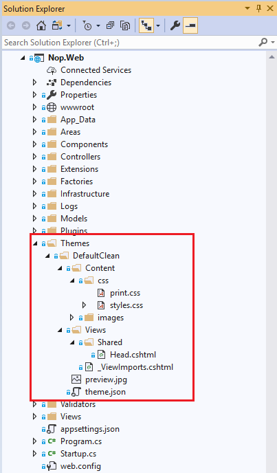

La forma más habitual de crear un tema nuevo en nopCommerce consiste en tomar como base un tema
ya existente, copiar su estructura y adaptarla a las nuevas necesidades. Este enfoque resulta
especialmente útil porque permite partir de una organización ya funcional y centrarse
directamente en la personalización visual.

En la práctica, el desarrollador selecciona un tema predeterminado o uno ya disponible, lo
copia dentro de la carpeta de temas, le asigna un nuevo nombre y ajusta tanto su archivo de
configuración como sus recursos visuales. A partir de ahí, puede modificar imágenes, estilos y
otros elementos de presentación para construir una nueva identidad visual sobre una base
estable.

#### Papel de las hojas de estilo

Las hojas de estilo **CSS** son uno de los componentes más relevantes dentro de un tema. A
través de ellas se define la mayor parte del comportamiento visual de la interfaz: estructura,
estética, respuesta visual de los componentes, organización de bloques, adaptación tipográfica
y consistencia gráfica general.

Dado que gran parte de la apariencia se controla desde estos archivos, una parte importante del
trabajo de personalización de un tema consiste en revisar y adaptar los estilos existentes.
Esto permite modificar la presentación del sitio sin necesidad de alterar la lógica del
servidor ni el comportamiento funcional de la aplicación.

#### Proceso de copia de un tema (capturas)

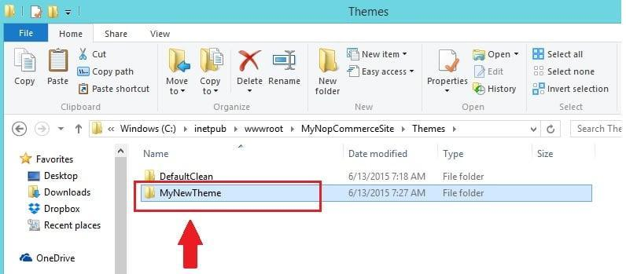

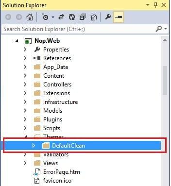

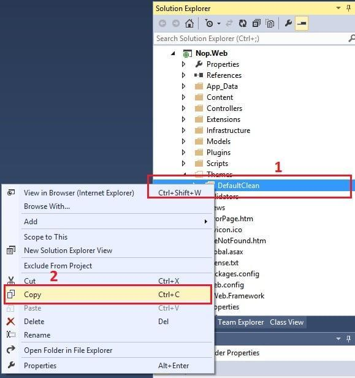

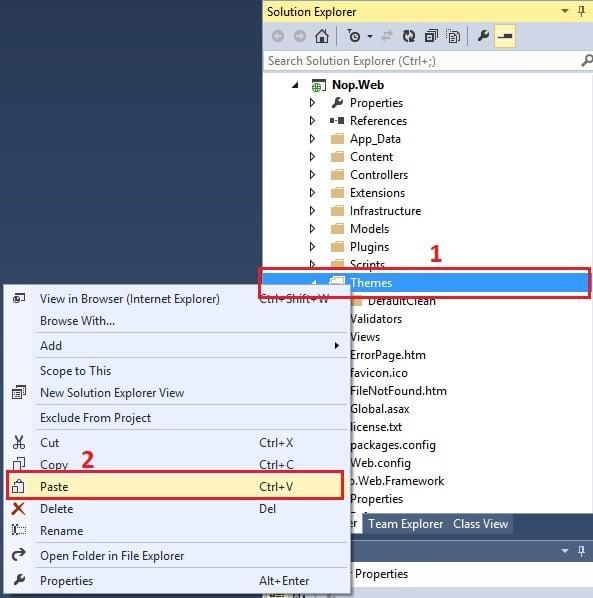

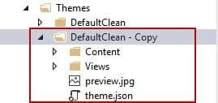

#### Papel de las imágenes y recursos gráficos

Junto con las hojas de estilo, los recursos gráficos desempeñan un papel decisivo en la
construcción de la identidad visual del tema. Elementos como logotipos, iconos, fondos, banners
o imágenes decorativas se almacenan normalmente dentro de carpetas específicas del propio tema.

La correcta organización de estos recursos facilita su mantenimiento y permite adaptar de forma
coherente la apariencia del sitio a la imagen de marca del proyecto. Además, al quedar
encapsulados dentro del directorio del tema, resulta más sencillo sustituirlos o evolucionarlos
sin afectar al resto de la aplicación.

#### Relación entre tema y layouts

Los temas se apoyan en la jerarquía de layouts para definir la distribución de los elementos
comunes del sitio y la inserción del contenido de cada vista. El capítulo «Layouts y jerarquía
de renderizado» describe esa estructura con detalle.

#### Alcance real de la personalización

Los temas permiten personalizar la apariencia visual de la tienda dentro del perímetro de la
capa de presentación: la apariencia puede evolucionar o reemplazarse sin reescribir la lógica
de negocio.

#### Ventajas de utilizar temas

El uso de temas aporta varias ventajas relevantes dentro de la plataforma:

- permite adaptar rápidamente la identidad visual de la tienda;

- facilita la reutilización de estructuras de diseño;

- reduce la necesidad de modificar archivos centrales de la aplicación;

- favorece la mantenibilidad al separar presentación y funcionalidad;

- hace posible sustituir o evolucionar la apariencia del sitio con menor
impacto técnico.

#### Relación entre temas y extensibilidad

Los temas constituyen el mecanismo de personalización de la apariencia visual y los plugins el
de ampliación de la funcionalidad; ambos son complementarios y conviene no mezclar sus
responsabilidades.

## Capítulo 12 — Layouts y jerarquía de renderizado {#capitulo-12}

Describe la jerarquía de layouts _Root.Head, _Root, _ColumnsOne y _ColumnsTwo sobre la que se renderizan las vistas de la tienda.

**Parte III — Temas y presentación** · Nivel: Intermedio

Este capítulo cubre la jerarquía de renderizado de nopCommerce, desde la cabecera técnica de _Root.Head.cshtml hasta las disposiciones de una y dos columnas, e introduce las Widget Zones declaradas en los layouts mediante WidgetViewComponent; Sirve para localizar el archivo correcto en cada personalización estructural; Los conceptos clave incluyen la cadena de herencia de layouts, PublicWidgetZones y el componente WidgetViewComponent; Prerrequisitos: capítulos 4 y 6; Caso de uso típico: insertar contenido dinámico en una zona concreta del layout sin modificar la plantilla.

**Trampas frecuentes:**

> - Desde la versión 4.60 el componente WidgetViewComponent se invoca pasando el Type y GetWidgetViewComponent devuelve el Type del ViewComponent; hasta la 4.50 existía GetWidgetViewComponentName, que devolvía un string.
> - Si ningún plugin activo ha registrado una Widget Zone, el componente devuelve contenido vacío; el coste de servidor residual es despreciable, pero no es nulo.
> - No todos los cambios visuales corresponden al mismo nivel de la jerarquía: algunos afectan a recursos globales y otros solo a la disposición de determinadas vistas.

---

Dentro de la capa de presentación de **nopCommerce**, los **layouts** desempeñan un papel
esencial, ya que definen la estructura general sobre la que se renderizan las distintas vistas
del sistema. Comprender su jerarquía permite interpretar mejor cómo se construye visualmente
cada página y cómo se integran en ella tanto los elementos comunes del sitio como el contenido
específico de cada pantalla.

### Función de los layouts en la presentación

En una aplicación web basada en **Razor**, un layout actúa como una plantilla compartida que
proporciona una estructura común a varias vistas. Gracias a este mecanismo, no es necesario
repetir en cada página elementos como la cabecera, el pie, la inclusión de estilos, los scripts
comunes o la distribución principal del contenido. En su lugar, estos elementos se definen una
sola vez en el layout y las vistas concretas insertan en él su contenido específico.

Este enfoque mejora la coherencia visual del sitio, reduce duplicidades y facilita enormemente
el mantenimiento de la interfaz. En nopCommerce, esta lógica se organiza mediante una jerarquía
de layouts que permite reutilizar una estructura base común y, al mismo tiempo, adaptar la
disposición final según las necesidades de cada tipo de página.

### Jerarquía principal de layouts en nopCommerce

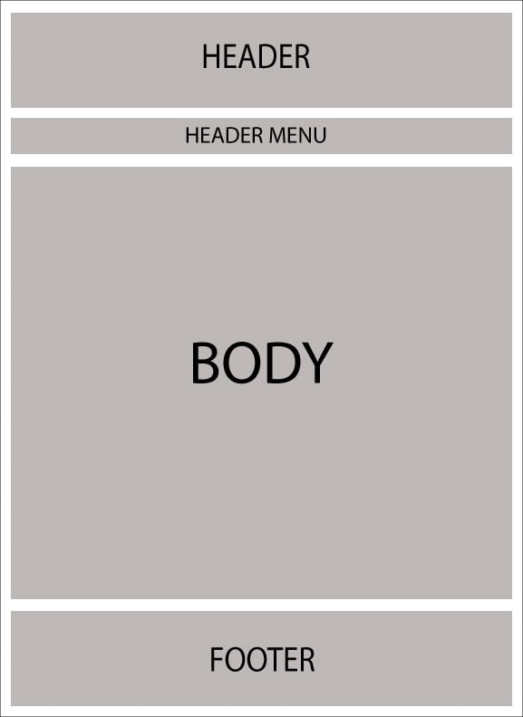

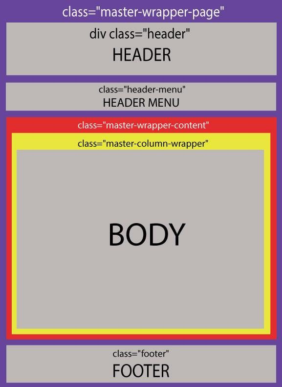

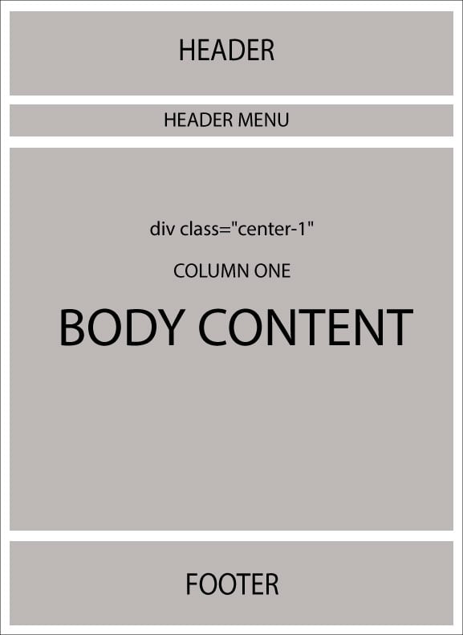

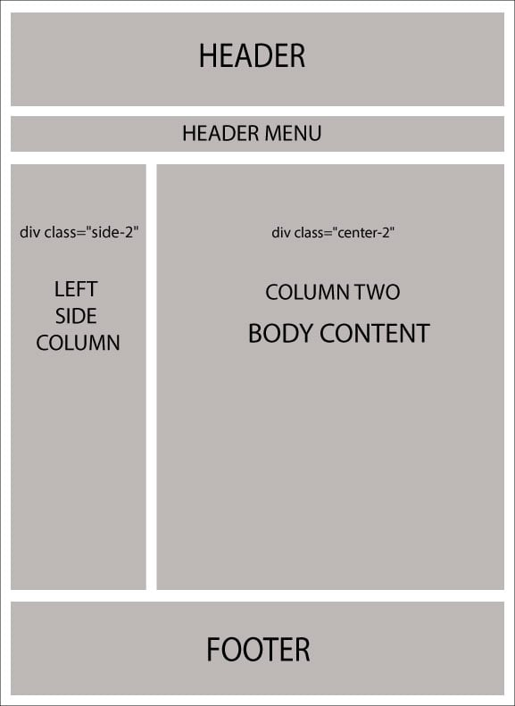

Los layouts principales de nopCommerce se organizan en varios
niveles. En la base de esta jerarquía se encuentra \_Root.Head.cshtml, que constituye el punto
donde se declaran elementos fundamentales de la cabecera del documento, como las referencias a
hojas de estilo, scripts y otros recursos comunes de cliente.

Sobre este archivo se apoya \_Root.cshtml, que actúa como layout principal del sitio. Este
archivo define la estructura general de la página y establece el marco base sobre el que
después se insertará el contenido específico de las distintas vistas.

A partir de ese layout raíz, nopCommerce dispone de dos layouts principales para la composición
del contenido:

- \_ColumnsOne.cshtml

- \_ColumnsTwo.cshtml

Ambos heredan de \_Root.cshtml, pero introducen diferencias en la disposición del contenido
dentro del cuerpo de la página.

### Papel de \_Root.Head.cshtml

El archivo **\_Root.Head.cshtml** debe entenderse como el punto central de la cabecera técnica
del sitio. En él se incluyen habitualmente los enlaces a los archivos **CSS**, las bibliotecas
**JavaScript**, metadatos y otros recursos necesarios para la correcta carga del entorno
visual.

Su importancia es especialmente alta cuando se trabaja en personalización visual o en ajustes
de cliente, ya que es el lugar natural para revisar cómo se incorporan los recursos compartidos
del sitio. Si se necesita añadir o enlazar nuevas hojas de estilo o scripts de soporte visual,
este archivo suele ser uno de los primeros puntos a revisar.

Desde una perspectiva de mantenimiento, concentrar aquí la inclusión de recursos comunes evita
duplicaciones y permite controlar de forma más ordenada la carga global de estilos y
dependencias de cliente.

### Papel de \_Root.cshtml

El archivo **\_Root.cshtml** constituye el layout principal del sitio y define la base
estructural sobre la que se apoyan los layouts de columnas y, en última instancia, las vistas
concretas. Su función es establecer la composición general del documento, sirviendo como
contenedor principal del contenido visual.

En este nivel suelen quedar organizados los grandes bloques estructurales del sitio, como la
envolvente principal de la página, determinadas zonas comunes de interfaz y la ubicación donde
se insertarán posteriormente los contenidos específicos de cada vista o de cada layout
derivado.

Por tanto, \_Root.cshtml actúa como la plantilla matriz de la presentación, garantizando una
base homogénea para el renderizado del resto de páginas.

### Papel de \_ColumnsOne.cshtml

El layout \_ColumnsOne.cshtml representa una estructura de página de **una sola columna**. En
este caso, la composición del contenido es más directa y mantiene una disposición sencilla,
normalmente pensada para páginas donde no resulta necesario incorporar una columna lateral
adicional.

Este layout no introduce cambios sustanciales respecto a la disposición general del cuerpo
definida en \_Root.cshtml: solo envuelve el contenido en una única sección (`center-1`) con las
zonas `MainColumnBefore`/`MainColumnAfter` antes y después del cuerpo de la vista.

Este tipo de layout resulta apropiado para páginas en las que se busca una presentación más
limpia, más centrada o menos fragmentada visualmente.

### Papel de \_ColumnsTwo.cshtml

Por su parte, \_ColumnsTwo.cshtml define una estructura de **dos columnas**, lo que permite
distribuir el contenido principal junto con una zona complementaria, normalmente utilizada para
navegación secundaria, filtros, bloques auxiliares o elementos contextuales.

Este layout modifica la disposición del cuerpo respecto al layout raíz y permite una
maquetación más compleja, adecuada para páginas que necesitan presentar información adicional
junto al contenido central. Su utilización resulta especialmente útil cuando la experiencia de
usuario requiere acompañar el contenido principal de bloques laterales de apoyo.

### Secuencia de herencia entre layouts

La relación jerárquica entre estos archivos puede entenderse de la siguiente forma:

**_Root.Head.cshtml** → **_Root.cshtml** → (**_ColumnsOne.cshtml** o **_ColumnsTwo.cshtml**) → vista específica

Esta secuencia refleja cómo se compone progresivamente la página:

1. primero se establece la cabecera técnica y los recursos comunes;

2. después se define la estructura base del sitio;

3. a continuación, se aplica la disposición concreta de columnas;

4. finalmente se inserta el contenido particular de la vista solicitada.

Comprender esta cadena de herencia es esencial para localizar correctamente dónde debe
realizarse cada tipo de modificación. No todos los cambios visuales corresponden al mismo
nivel: algunos afectan a recursos globales, otros a la estructura general y otros solo a la
disposición concreta de determinadas vistas.

### Relación entre layouts y vistas

Las vistas concretas no construyen toda la página desde cero, sino que se renderizan dentro del
layout que tengan asociado. Esto significa que una misma lógica estructural puede reutilizarse
en muchas páginas distintas, lo que refuerza la coherencia visual del sitio y simplifica la
gestión de la interfaz.

Desde un punto de vista técnico, el contenido específico de una vista se inserta en la zona
prevista por el layout correspondiente. De esta forma, la página final es el resultado de
combinar:

- la cabecera y recursos comunes;

- la estructura base de la página;

- la composición en una o dos columnas;

- el contenido concreto de la vista.

### Impacto en la personalización del tema

La jerarquía de layouts tiene una relación directa con el desarrollo y personalización de
**temas** en nopCommerce. Aunque gran parte de la apariencia pueda modificarse mediante CSS e
imágenes, la estructura general de la página depende de estos layouts. Por ello, cualquier
personalización visual profunda exige comprender no solo los estilos, sino también la forma en
que se organiza el renderizado.

En otras palabras, para modificar con criterio la presentación del sitio no basta con cambiar
colores o recursos gráficos; también es necesario conocer qué layout interviene en cada tipo de
página y cómo se encadena con la vista final.

**Widget Zones: puntos de extensión dentro de los layouts**

Los layouts de nopCommerce no solo definen la estructura visual del sitio, sino que también
actúan como puntos de extensión mediante las denominadas **Widget Zones**. Una Widget Zone es
una zona predefinida dentro de un layout o vista donde plugins y temas pueden inyectar
contenido dinámico sin necesidad de modificar los archivos originales de la plataforma.

En los layouts principales de nopCommerce, las Widget Zones se declaran mediante el componente
de vista `WidgetViewComponent`, que desde la 4.60 se invoca pasando el `Type`:

```razor
@await Component.InvokeAsync(typeof(WidgetViewComponent),
    new { widgetZone = PublicWidgetZones.NombreZona })
```

Esta llamada le indica a nopCommerce que en ese punto debe renderizar el contenido de todos los
plugins que hayan declarado querer intervenir en esa zona concreta. Si ningún plugin activo ha
registrado esa zona, el componente devuelve contenido vacío; el coste de servidor residual —la
preparación del modelo— es despreciable, pero no es nulo.

Las zonas disponibles están definidas como constantes en las clases estáticas PublicWidgetZones
y AdminWidgetZones del proyecto Nop.Web.Framework, lo que evita el uso de cadenas literales
dispersas por el código. Algunas de las zonas más utilizadas en los layouts públicos son las
siguientes:

```csharp
// Zona en la cabecera del documento HTML, antes del cierre de </head>.
// Útil para inyectar scripts de seguimiento, meta tags o recursos CSS.
PublicWidgetZones.HeadHtmlTag

// Zona en la parte superior del contenido principal de la página,
// justo después de abrir el contenedor principal del body.
PublicWidgetZones.ContentBefore

// Zona en la parte inferior del contenido principal de la página,
// antes de cerrar el contenedor principal del body.
PublicWidgetZones.ContentAfter

// Zona en la columna lateral izquierda, antes de su contenido.
PublicWidgetZones.LeftSideColumnBefore

// Zona en la columna lateral izquierda, después de su contenido.
PublicWidgetZones.LeftSideColumnAfter

// Zona en la parte superior de la página de inicio.
PublicWidgetZones.HomepageTop

// Zona en la parte inferior de la página de inicio.
PublicWidgetZones.HomepageBottom
```

Desde el punto de vista del desarrollo de plugins, un plugin participa en una Widget Zone
implementando la interfaz IWidgetPlugin y proporcionando un ViewComponent que genera el
contenido visual. La conexión entre ambos se establece mediante dos métodos:

```csharp
// Declara en qué Widget Zones debe intervenir el plugin.
Task<IList<string>> GetWidgetZonesAsync();

// Devuelve el Type del ViewComponent que debe renderizarse.
Type GetWidgetViewComponent(string widgetZone);
```

En nopCommerce 4.90 el método devuelve el `Type` del ViewComponent directamente. El cambio se
introdujo en la **4.60**: hasta la **4.50** existía `GetWidgetViewComponentName`, que devolvía
un `string` con el nombre del componente; desde entonces la firma es
`Type GetWidgetViewComponent(string widgetZone)`. El desarrollo completo de un plugin de
widget —proyecto, ViewComponent, modelo y vista— se trata en detalle en el capítulo «Cómo crear
un widget desde cero en nopCommerce».

Este mecanismo es el que hace que los layouts de nopCommerce sean verdaderos puntos de
extensión y no simples plantillas estáticas. Cualquier plugin puede inyectar contenido en las
zonas definidas por los layouts sin que sea necesario modificar ni el layout ni el resto de la
aplicación. Esto refuerza directamente el principio de extensibilidad sin modificación del
núcleo que es el eje central de la arquitectura de nopCommerce.

### Cuando revisar cada archivo

Desde una perspectiva práctica, puede decirse que:

- **\_Root.Head.cshtml** debe revisarse cuando el cambio afecta a la
inclusión de estilos, scripts o recursos comunes;

- **\_Root.cshtml** debe revisarse cuando se quiere modificar la
estructura general compartida del sitio;

- **\_ColumnsOne.cshtml** debe revisarse cuando la página utiliza una
composición simple de una columna;

- **\_ColumnsTwo.cshtml** debe revisarse cuando la página requiere una
distribución más compleja con una columna adicional.

Esta distinción ayuda a localizar mejor el punto correcto de intervención y evita realizar
cambios en archivos que no controlan realmente el nivel de presentación que se desea modificar.

### Ventajas de esta jerarquía

La organización jerárquica de layouts aporta varias ventajas importantes:

- centraliza la estructura común del sitio;

- reduce duplicidades entre páginas;

- permite reutilizar composiciones visuales;

- facilita el mantenimiento y la evolución del diseño;

- separa mejor los distintos niveles de responsabilidad dentro de la
presentación.

Gracias a esta estructura, nopCommerce puede mantener una interfaz coherente y flexible, al
tiempo que permite adaptar la maquetación según las necesidades de cada tipo de vista.

El detalle de cada archivo de esta jerarquía se ha descrito en las secciones anteriores del
capítulo.

## Capítulo 13 — Diferencia entre tienda pública y área de administración {#capitulo-13}

Contrasta la tienda pública y el área de administración en propósito, ubicación, seguridad, rutas y tipo de operaciones.

**Parte III — Temas y presentación** · Nivel: Básico

Este capítulo cubre las diferencias entre la tienda pública y el área de administración —propósito, usuarios, seguridad, rutas y operaciones— y la implementación técnica de la separación por áreas dentro de Nop.Web; Sirve para proteger y encuadrar correctamente los controladores administrativos, incluidos los de los plugins; Los conceptos clave incluyen el atributo Area(AreaNames.ADMIN), AuthorizeAdmin, AutoValidateAntiforgeryToken y el prefijo de ruta Admin/; Prerrequisitos: capítulos 4 y 5; Caso de uso típico: crear una pantalla de configuración de plugin accesible solo para administradores.

**Trampas frecuentes:**

> - Sin el atributo [Area(AreaNames.ADMIN)] ASP.NET Core no sabe que el controlador pertenece al área y las rutas no se resolverán correctamente.
> - Los controladores administrativos deben declarar a nivel de clase los atributos [AuthorizeAdmin], [Area(AreaNames.ADMIN)] y [AutoValidateAntiforgeryToken] para no repetirlos en cada acción.
> - Si falta alguno de estos elementos, la página de configuración de un plugin no será accesible desde el panel o no estará correctamente protegida.
> - En entornos de producción es habitual restringir /Admin/ por dirección IP en el servidor web, como capa adicional a la autenticación de la aplicación.

---

Dentro de **nopCommerce**, la capa de presentación no se limita a una única interfaz visual,
sino que se divide funcionalmente en dos entornos claramente diferenciados: la **tienda
pública** y el **área de administración**. Aunque ambas forman parte del mismo ecosistema de la
aplicación y comparten parte de su infraestructura, sus objetivos, usuarios, requisitos de
seguridad y modo de utilización son distintos. Comprender esta separación es esencial para
interpretar correctamente la organización de la plataforma.

### Dos interfaces con finalidades diferentes

La **tienda pública** es la parte visible del sistema orientada a los clientes o visitantes del
sitio. Su función principal es ofrecer acceso al catálogo, permitir la navegación por
categorías y productos, gestionar búsquedas, mostrar información comercial y facilitar el
proceso de compra. En términos funcionales, es el entorno que materializa la experiencia de
usuario del comercio electrónico y el que da acceso a las operaciones habituales que realiza el
comprador.

Por el contrario, el **área de administración** está orientada a la gestión interna de la
tienda. Su finalidad no es vender directamente, sino proporcionar al personal autorizado las
herramientas necesarias para configurar la plataforma, mantener el catálogo, gestionar pedidos,
administrar clientes, supervisar operaciones, controlar contenidos y realizar tareas de
mantenimiento o seguimiento.

Esta diferencia de propósito explica por qué, aun perteneciendo ambas a la capa de
presentación, requieren una organización distinta y un tratamiento específico en varios
niveles.

#### Ubicación dentro de la arquitectura

En nopCommerce, la tienda pública se implementa principalmente dentro del proyecto Nop.Web,
mientras que el área administrativa también forma parte de este mismo proyecto, pero se
organiza como un **área** diferenciada. Esto significa que no se trata de una aplicación
separada, sino de una parte específica de la misma aplicación web, estructurada para aislar
funcionalmente el entorno de administración del entorno público.

Este enfoque permite reutilizar parte de la infraestructura común de presentación, al tiempo
que mantiene una delimitación clara entre los dos contextos de uso.

#### Elementos compartidos entre ambos entornos

Aunque la tienda pública y el área de administración tienen objetivos distintos, comparten
varios elementos del sistema. Ambas se apoyan en la misma base arquitectónica, utilizan el
mismo **Application Core**, consumen servicios de Nop.Services, dependen del acceso a datos
gestionado por Nop.Data y se benefician de componentes comunes contenidos en Nop.Web.Framework.

Esto significa que los dos entornos operan sobre la misma lógica de negocio y el mismo núcleo
funcional. Por ejemplo, tanto una operación administrativa sobre productos como una consulta
pública del catálogo pueden apoyarse en servicios relacionados con productos, aunque cada una
lo haga desde una interfaz diferente y con objetivos distintos.

La reutilización de este núcleo compartido evita duplicidades y garantiza coherencia funcional
entre la gestión interna del sistema y la experiencia ofrecida al usuario final.

**Implementación técnica de la separación por áreas**

En nopCommerce, el área de administración se implementa como un área de ASP.NET Core dentro del
mismo proyecto Nop.Web. Físicamente, sus controladores y vistas se encuentran en
Nop.Web/Areas/Admin/, separados por completo de los controladores y vistas de la tienda pública
que residen en Nop.Web/Controllers/ y Nop.Web/Views/.

**Nop.Web/**

```text
├── Controllers/   ← Controladores de la tienda pública
├── Views/         ← Vistas de la tienda pública
└── Areas/
    └── Admin/
        ├── Controllers/   ← Controladores del área de administración
        └── Views/         ← Vistas del área de administración
```

La pertenencia de un controlador al área de administración se declara mediante el atributo
\[Area(AreaNames.ADMIN)\]. Sin este atributo, ASP.NET Core no sabrá que el controlador
pertenece al área y las rutas no se resolverán correctamente. Junto a él, los controladores
administrativos deben llevar siempre los atributos \[AuthorizeAdmin\] y
\[AutoValidateAntiforgeryToken\], que garantizan respectivamente que solo usuarios con permisos
administrativos pueden acceder y que el formulario está protegido contra ataques CSRF.

El siguiente ejemplo muestra la diferencia entre un controlador de la tienda pública y un
controlador del área de administración, para que la distinción quede clara:

```csharp
// Controlador de la tienda pública.
// No lleva atributo Area ni AuthorizeAdmin.
// Es accesible para cualquier visitante del sitio.
namespace Nop.Web.Controllers
{
    public partial class CatalogController : BasePublicController
    {
        public async Task<IActionResult> Category(int categoryId)
        {
            // Lógica de presentación del catálogo público.
            return View();
        }
    }
}
```

```csharp
// Controlador del área de administración.
// Los tres atributos son obligatorios y deben declararse
// a nivel de clase para no repetirlos en cada acción.
namespace Nop.Web.Areas.Admin.Controllers
{
    [AuthorizeAdmin]
    [Area(AreaNames.ADMIN)]
    [AutoValidateAntiforgeryToken]
    public partial class CategoryController : BaseAdminController
    {
        public async Task<IActionResult> List()
        {
            // Lógica de gestión de categorías en el panel de administración.
            return View();
        }
        public async Task<IActionResult> Create()
        {
            // Solo accesible para administradores autenticados.
            return View();
        }
    }
}
```

Esta misma distinción se aplica al desarrollar plugins. Cuando un plugin expone una página de
configuración en el área de administración, su controlador debe seguir el mismo patrón:
atributos \[AuthorizeAdmin\], \[AutoValidateAntiforgeryToken\] y \[Area(AreaNames.ADMIN)\], herencia de
BasePluginController y registro de la ruta bajo el prefijo Admin/. Si alguno de estos elementos falta, la página de configuración no será
accesible desde el panel administrativo o no estará correctamente protegida.

Desde el punto de vista del routing, las rutas del área de administración se registran con el
prefijo Admin/ en la URL, lo que las diferencia visualmente de las rutas públicas y facilita la
aplicación de políticas de seguridad a nivel de servidor o de proxy inverso. En entornos con rangos de IP fijos puede considerarse, como
medida opcional, restringir /Admin/ por dirección IP en el servidor o en el proxy, por encima
de la autenticación de la aplicación. No es un requisito de la plataforma.

#### Diferencias en los usuarios destinatarios

Una de las diferencias más evidentes entre ambos entornos está en el perfil de usuario al que
van dirigidos. La tienda pública está diseñada para clientes, visitantes o usuarios finales del
sitio, incluidos aquellos que navegan sin autenticación o que interactúan con la tienda como
compradores.

En cambio, el área de administración está reservada a usuarios con privilegios específicos,
normalmente administradores, gestores del catálogo, operadores o personal interno autorizado.
Por ello, la interfaz administrativa prioriza la gestión y el control del sistema, mientras que
la tienda pública prioriza la usabilidad, la navegación comercial y la conversión de compra.

#### Diferencias en seguridad y control de acceso

Desde el punto de vista de la seguridad, la separación entre tienda pública y área
administrativa es especialmente importante. La tienda pública puede incluir zonas abiertas al
acceso general, páginas de libre navegación y operaciones disponibles para cualquier visitante.
Aunque ciertas acciones del cliente sí requieran autenticación —como revisar pedidos o
gestionar una cuenta—, buena parte de la tienda está pensada para ser accesible sin
restricciones previas.

Por el contrario, el área de administración debe estar protegida mediante **autenticación y
autorización**. Solo los usuarios con permisos adecuados pueden acceder a esta parte del
sistema, ya que desde ella se manejan datos sensibles, configuraciones críticas y operaciones
que afectan al funcionamiento global de la tienda.

Esta diferencia implica que los controladores, rutas y vistas del área administrativa deben
diseñarse con especial atención a los mecanismos de protección, validación y control de
permisos.

#### Diferencias en rutas y organización interna

La organización por áreas también tiene implicaciones en el sistema de rutas. El entorno
administrativo utiliza una estructura diferenciada que permite agrupar sus controladores,
vistas y navegación bajo el contexto de administración. Esto facilita la separación lógica
respecto a la tienda pública y permite mantener una estructura más ordenada dentro del proyecto
Nop.Web.

En la práctica, esta organización ayuda a distinguir claramente qué componentes pertenecen al
entorno de cliente y cuáles forman parte del entorno interno de gestión. Además, simplifica el
mantenimiento del código y reduce el riesgo de mezclar responsabilidades entre ambos contextos.

#### Diferencias en la interfaz y experiencia de usuario

La **tienda pública** está diseñada para ofrecer una experiencia orientada al cliente, por lo
que su interfaz se centra en la presentación del catálogo, la navegación intuitiva, la claridad
visual y la conversión comercial. Aquí cobran especial importancia los temas, los layouts y los
recursos visuales, ya que la apariencia y usabilidad del sitio influyen directamente en la
experiencia del comprador.

En cambio, la **interfaz administrativa** está más orientada a la eficiencia operativa que a la
presentación comercial. Su objetivo es facilitar tareas de gestión, configuración y
supervisión, por lo que sus pantallas suelen responder a criterios de organización funcional,
claridad de datos y acceso rápido a herramientas de administración.

Aunque ambos entornos formen parte de la capa de presentación, su lógica de diseño responde a
necesidades muy diferentes.

#### Diferencias en el tipo de operaciones realizadas

En la tienda pública predominan las operaciones relacionadas con la navegación comercial:
visualización de productos, búsquedas, gestión de carrito, creación de cuenta, proceso de
compra y seguimiento del cliente. Estas acciones están pensadas para acompañar el recorrido del
comprador dentro del sitio.

En el área administrativa, en cambio, se concentran operaciones como la gestión de productos,
actualización de precios, configuración de métodos de pago, revisión de pedidos, mantenimiento
de clientes, parametrización de plugins, gestión de contenido y otras tareas de control del
sistema. Es decir, no se trata de consumir la tienda, sino de administrarla.

#### Relación entre ambos entornos

Aunque tienda pública y área administrativa estén claramente separadas, ambas forman parte del
mismo sistema y se influyen mutuamente. Muchas acciones realizadas en la administración
repercuten directamente en el comportamiento de la tienda pública. Por ejemplo, la creación de
un producto, la configuración de un método de pago, la activación de un plugin o el cambio de
un tema realizado desde el entorno administrativo afecta de forma inmediata a la experiencia
del usuario final en la tienda.

Por tanto, puede decirse que el área administrativa actúa como el espacio de **configuración,
mantenimiento y control**, mientras que la tienda pública actúa como el espacio de **consumo y
operación comercial**.

# Parte IV — Plugins {#parte-iv}

Los plugins son el mecanismo principal de extensibilidad en nopCommerce. A diferencia de los
temas, que solo modifican la presentación, los plugins pueden añadir nueva funcionalidad,
modificar comportamiento existente e integrar servicios externos. Esta parte cubre su
estructura completa, ciclo de vida y configuración.

## Capítulo 14 — Carga de ensamblados (.dll) y descubrimiento de plugins en runtime {#capitulo-14}

Explica cómo nopCommerce localiza los descriptores de plugin, carga sus ensamblados en tiempo de ejecución y detecta incompatibilidades, sobre la base del modelo de ensamblado de .NET.

**Parte IV — Plugins** · Nivel: Intermedio

Este capítulo cubre el modelo de ensamblado aplicado a nopCommerce, la localización de los descriptores `plugin.json` con PluginsInfo, la carga de ensamblados con Assembly.LoadFrom y ApplicationPartManager, la búsqueda de tipos mediante WebAppTypeFinder y la detección de colisiones y versiones; Sirve para entender por qué un plugin se detecta, se carga o se rechaza al arrancar; Los conceptos clave incluyen PluginDescriptor, PluginsInfo, InitializePlugins, ApplicationPartManager, WebAppTypeFinder, UseUnsafeLoadAssembly, SupportedVersions y PluginIncompatibleType; Prerrequisitos: capítulos 6 y 15; Caso de uso típico: diagnosticar por qué un plugin no aparece o no termina de cargar.

**Trampas frecuentes:**

> - El directorio de desarrollo y el de despliegue no son el mismo: el descriptor se declara en el proyecto, pero la aplicación carga los `.dll` de su propia carpeta de plugins.
> - Un ensamblado de plugin admite una sola clase `IPlugin`; si el ensamblado contiene varias, se toma la primera encontrada y el resto quedan ignoradas.
> - `SupportedVersions` debe contener la versión actual de la plataforma (`4.90`); si no, el descriptor se clasifica como no compatible con la versión.
> - Al compartir una biblioteca entre el núcleo y un plugin, si sus versiones difieren se detecta una colisión y el plugin se marca incompatible.
> - No existe *shadow copy* activo en 4.90.8: los ajustes `UsePluginsShadowCopy` perviven solo como cadenas de localización de versiones anteriores, y la carga real se realiza con `Assembly.LoadFrom`, gobernada por `PluginConfig.UseUnsafeLoadAssembly`.

---

### El modelo de ensamblado en .NET

Un ensamblado es la unidad de compilación y despliegue de .NET: el compilador produce normalmente un archivo `.dll` que contiene tipos y metadatos. La aplicación no «ve» el código fuente, sino los ensamblados cargados en el proceso.

Dos capacidades del runtime sostienen todo el sistema de extensiones:

- **Carga en tiempo de ejecución.** El proceso puede cargar un `.dll` que no estaba presente al compilar, mediante `Assembly.LoadFrom` y sus variantes.
- **Reflexión.** Sobre un ensamblado ya cargado se pueden recorrer sus tipos e identificar los que implementan una interfaz dada, sin conocerlos de antemano.

Con ambas, un núcleo puede descubrir y usar piezas opcionales —plugins— que desconocía cuando se compiló.

### Cómo se organiza la compilación

Cada proyecto de la solución compila su propio ensamblado. El resultado es relevante porque las dependencias entre capas se resuelven referenciando ensamblados, y porque un plugin se entrega como un conjunto de `.dll` independientes del ejecutable principal:

| Pieza | Ensamblado resultante |
|-------|------------------------|
| Bibliotecas del núcleo (`Nop.Core`, `Nop.Data`, `Nop.Services`) | una `.dll` por proyecto |
| Marco de presentación (`Nop.Web.Framework`) | una `.dll` |
| Aplicación web (`Nop.Web`) | la aplicación que aloja todo |
| Cada plugin (biblioteca de clases) | su `.dll` principal más sus referencias |

### Descubrimiento de los plugins: plugin.json y PluginsInfo

Antes de cargar ningún ensamblado, nopCommerce identifica qué plugins existen. La clase `PluginsInfo` (en `Nop.Services.Plugins`) realiza esta fase en `LoadPluginInfo`:

1. Lee los plugins instalados desde `~/App_Data/plugins.json` —o, en instalaciones antiguas, desde el fichero heredado de nombres de plugins—.
2. Busca recursivamente los archivos de descriptor `plugin.json` bajo la carpeta de plugins (`~/Plugins`) y los convierte en objetos `PluginDescriptor`.
3. Aplica las comprobaciones de validez y compatibilidad.

Un descriptor de ejemplo contiene los campos habituales:

| Campo | Contenido |
|-------|-----------|
| `SystemName` | identificador único e inmutable del plugin |
| `FriendlyName` / `Description` / `Author` | datos de presentación |
| `SupportedVersions` | versiones de nopCommerce admitidas |
| `FileName` | archivo `.dll` principal del plugin |
| `DisplayOrder` | orden en la interfaz |

Durante esta fase nopCommerce puede clasificar el plugin como incompatible por varias razones (`PluginIncompatibleType`):

- **No compatible con la versión**: `SupportedVersions` no contiene la versión actual.
- **Principal no encontrado**: no existe el `.dll` declarado en `FileName`.
- **Nombre duplicado**: dos descriptores comparten el mismo `SystemName`.

Solo los descriptores válidos pasan a la fase de carga. `PluginsInfo` determina además si cada plugin necesita desplegarse —está instalado o va a instalarse— a partir del estado guardado.

### Carga de los ensamblados: InitializePlugins

La carga real la ejecuta `InitializePlugins`, en `ApplicationPartManagerExtensions`, invocada durante el arranque al configurar MVC. Por cada plugin que necesita desplegarse:

1. Se carga el ensamblado principal con `Assembly.LoadFrom`; si el fichero está bloqueado y `PluginConfig.UseUnsafeLoadAssembly` está activado —viene activado por defecto—, se recurre a `Assembly.UnsafeLoadFrom`.
2. El ensamblado se registra como *application part* en el `ApplicationPartManager`, de modo que MVC conozca sus tipos.
3. Se elimina el fichero `.deps.json` asociado y se registra la versión de la biblioteca.
4. Se despliegan también las demás `.dll` del plugin, salvo que ya estén cargadas.
5. Se localiza el tipo del plugin: la primera clase —no interfaz, no abstracta— que implementa `IPlugin`. **Solo se admite una clase `IPlugin` por ensamblado.**

Los ficheros de un plugin se leen de su propia carpeta, y las subcarpetas de plugins recién subidos (`~/Plugins/Uploaded`) se mueven a la carpeta de plugins antes de empezar.

### Búsqueda de tipos: WebAppTypeFinder

En paralelo a la carga, la aplicación necesita localizar tipos que cumplan un contrato —por ejemplo, clases que implementan una interfaz de servicios o de arranque—. Esa tarea la realiza `WebAppTypeFinder`, una implementación de `ITypeFinder`:

- Mantiene un registro de ensamblados en un diccionario concurrente y se suscribe al evento `AssemblyLoad` del `AppDomain` para capturar las cargas.
- Al inicializar, recoge primero los ensamblados ya presentes en el proceso y después recorre los `.dll` del directorio base de la aplicación (`AppContext.BaseDirectory`), cargando con `AppDomain.CurrentDomain.Load` y, en su defecto, con `Assembly.LoadFrom`.
- Omite por patrón los ensamblados de plataforma —`System`, `Microsoft`, `Newtonsoft` y similares— que no interesa inspeccionar.
- Expone `FindClassesOfType<T>` para devolver los tipos que implementan un contrato, que es como el núcleo localiza, entre otros, los implementadores de `INopStartup`.

Este buscador no sustituye a la carga de plugins, sino que lo complementa: `InitializePlugins` registra los ensamblados de los plugins y `WebAppTypeFinder` permite después hallar en ellos los tipos que el resto del sistema necesita.

### Compatibilidad, colisiones y versiones

Compartir bibliotecas entre el núcleo y los plugins es la fuente principal de problemas de carga. nopCommerce lo vigila así:

- Antes de desplegar una referencia de plugin, comprueba si el mismo nombre de archivo ya forma parte del núcleo —carpeta `bin`, directorio actual o carpeta `refs`— o ya está cargado en el `AppDomain`.
- Si dos plugins —o un plugin y el núcleo— aportan versiones distintas de la misma biblioteca, se registra una **colisión**; el plugin implicado se marca incompatible y se excluye.
- Los plugins ya cargados se guardan en caché por clave de tienda y roles, de modo que no se recargan en cada petición.

### Flujo de arranque

1. Al configurar MVC se invoca `InitializePlugins`.
2. `InitializePlugins` llama a `PluginsInfo.LoadPluginInfo`, que descubre y valida los `plugin.json`.
3. Para cada plugin que necesita desplegarse se carga su ensamblado y se registra como *application part*.
4. Se localiza la clase `IPlugin` de cada ensamblado y se detectan colisiones entre bibliotecas.
5. `WebAppTypeFinder` permite hallar, sobre lo cargado, los tipos que implementan los contratos del sistema.

**Enlace:** Capítulo 15 (estructura del plugin), Capítulo 18 (ciclo de vida) y Capítulo 6 (proyectos de la solución).

## Capítulo 15 — Estructura completa de un plugin {#capitulo-15}

Detalla la estructura física y los archivos obligatorios de un plugin: proyecto, .csproj, plugin.json, clase principal, vistas y registro de servicios.

**Parte IV — Plugins** · Nivel: Intermedio

Este capítulo cubre la estructura completa de un plugin, desde el proyecto Class Library y la configuración del .csproj con OutputPath y ClearPluginAssemblies hasta plugin.json, la clase principal basada en BasePlugin, _ViewImports.cshtml, la vista Configure con layout _ConfigurePlugin y la clase NopStartup propia; Sirve para crear un plugin que nopCommerce pueda detectar, cargar y administrar; Los conceptos clave incluyen SystemName, SupportedVersions, FileName, la interfaz IMiscPlugin y la convención Nop.Plugin.{Grupo}.{Nombre}; Prerrequisitos: capítulos 4, 5 y 10; Caso de uso típico: montar el esqueleto de un plugin nuevo antes de escribir su lógica.

**Trampas frecuentes:**

> - El proyecto del plugin se crea en la carpeta Plugins de la raíz de la solución, no en Nop.Web/Plugins, que es el directorio de despliegue.
> - Un SystemName duplicado impide la instalación y un SupportedVersions que no incluya la versión actual de nopCommerce hace que el plugin no se cargue ni aparezca en Local Plugins.
> - plugin.json debe configurarse con Build Action = Content y Copy to Output Directory = PreserveNewest; sin esa configuración no se copia al directorio de salida y nopCommerce no puede leerlo.
> - FileName debe coincidir exactamente con el nombre de la DLL generada por la compilación.
> - Las vistas del plugin requieren _ViewImports.cshtml con la directiva @inherits NopRazorPage<TModel>; sin él no se resuelven los tag helpers nop-label y nop-editor.

---

El desarrollo de un plugin en **nopCommerce** debe entenderse como la creación de un módulo
funcional independiente que se integra en la plataforma respetando su arquitectura y sus
convenciones internas. Aunque el nivel de complejidad de un plugin puede variar mucho según su
finalidad, todos comparten una **estructura básica común** que permite a nopCommerce
reconocerlos, cargarlos, configurarlos y ejecutarlos correctamente.

Plugins/

```text
└── Nop.Plugin.Misc.MiPlugin/
    ├── Nop.Plugin.Misc.MiPlugin.csproj
    ├── plugin.json
    ├── MiPlugin.cs                ← Clase principal (hereda BasePlugin)
    ├── MiPluginDefaults.cs        ← Constantes del plugin (rutas, nombres)
    ├── MiPluginSettings.cs        ← Clase de configuración persistida
    ├── Controllers/
    │   └── MiPluginController.cs
    ├── Models/
    │   └── ConfigurationModel.cs
    ├── Views/
    │   ├── _ViewImports.cshtml
    │   └── Configure.cshtml
    ├── Services/                  ← Solo si el plugin tiene lógica propia
    │   ├── IMiPluginService.cs
    │   └── MiPluginService.cs
    └── Infrastructure/
        ├── RouteProvider.cs
        └── NopStartup.cs          ← Registro de servicios propios del plugin
```

Una vez compilado, el contenido de este directorio se copia automáticamente a:

Presentation\\Nop.Web\\Plugins\\Misc.MiPlugin\\

gracias a la configuración OutputPath del .csproj. Es en ese directorio de despliegue donde
nopCommerce busca el plugin en tiempo de ejecución, no en el directorio de desarrollo.

**El archivo \_ViewImports.cshtml**

Este archivo centraliza las directivas Razor y los espacios de nombres que necesitan todas las
vistas del plugin. Sin él, las vistas no pueden resolver los tags helpers de nopCommerce ni los
modelos propios del plugin. Se recomienda copiarlo directamente desde
cualquier plugin existente, ya que su contenido es prácticamente idéntico en todos ellos:

```razor
@inherits Nop.Web.Framework.Mvc.Razor.NopRazorPage<TModel>

@addTagHelper *, Microsoft.AspNetCore.Mvc.TagHelpers

@addTagHelper *, Nop.Web.Framework

@using Microsoft.AspNetCore.Mvc.Rendering

@using Nop.Web.Framework.UI

@using Nop.Web.Framework.Extensions

@using System.Text.Encodings.Web
```

La directiva @inherits es especialmente importante porque hace que todas las vistas del plugin
hereden de NopRazorPage<TModel>, la clase base de Razor de nopCommerce. Esto proporciona acceso
automático a helpers como @T("clave") para localización, @Html.NopEditorFor() y otros
componentes propios de la plataforma que no estarían disponibles con la clase base estándar de
ASP.NET Core.

**El archivo Configure.cshtml**

La vista de configuración debe usar el layout \_ConfigurePlugin, que proporciona la estructura
visual estándar de las pantallas de configuración del panel de administración. Usar un layout
diferente o no declarar ninguno haría que la pantalla no se integre correctamente con el resto
de la interfaz administrativa:

```razor
@model ConfigurationModel

@{
    // _ConfigurePlugin es el layout estándar para pantallas
    // de configuración de plugins en el área de administración.
    // Proporciona la estructura visual coherente con el resto del panel.
    Layout = "_ConfigurePlugin";
}

@* Formulario de configuración del plugin.
   asp-action apunta a la acción POST del controlador.
   asp-controller debe coincidir con el nombre del controlador
   sin el sufijo "Controller". *@

<form asp-controller="MiPlugin" asp-action="Configure" method="post">
<div class="cards-group">
    <div class="card card-default">
        <div class="card-body">
            <div class="form-group row">
                <div class="col-md-3">
                    <nop-label asp-for="Enabled" />
                </div>
                <div class="col-md-9">
                    <nop-editor asp-for="Enabled" />
                    <span asp-validation-for="Enabled"></span>
                </div>
            </div>
            <div class="form-group row">
                <div class="col-md-3">
                    <nop-label asp-for="ApiKey" />
                </div>
                <div class="col-md-9">
                    <nop-editor asp-for="ApiKey" />
                    <span asp-validation-for="ApiKey"></span>
                </div>
            </div>
        </div>
    </div>
</div>
<button type="submit" name="save" class="btn btn-primary">
    @T("Admin.Common.Save")
</button>
</form>
```

Los tag helpers `<nop-label>` y `<nop-editor>` son específicos de nopCommerce y están definidos en
Nop.Web.Framework. Generan automáticamente el HTML correcto para cada tipo de propiedad del
modelo, incluyendo etiquetas con el texto de localización correspondiente. Su disponibilidad
depende de que \_ViewImports.cshtml esté correctamente configurado, que es precisamente la
razón por la que ese archivo es obligatorio.

**La clase NopStartup del plugin**

Cuando el plugin define servicios propios que necesitan registrarse en el contenedor de
dependencias, debe incluir una clase que implemente INopStartup. Esta clase es descubierta
automáticamente por nopCommerce durante el arranque de la aplicación:

```csharp
namespace Nop.Plugin.Misc.MiPlugin.Infrastructure
{
/// <summary>
/// nopCommerce descubre automáticamente las clases que implementan
/// INopStartup y las ejecuta durante el arranque de la aplicación.
/// No es necesario registrarla manualmente en ningún sitio.
/// </summary>
public class NopStartup : INopStartup
{
    /// <summary>
    /// Order determina el orden de ejecución respecto a otros
    /// INopStartup del sistema. int.MaxValue garantiza que
    /// los servicios del plugin se registren después de los
    /// servicios principales de nopCommerce.
    /// </summary>
    public int Order => int.MaxValue;
    public void ConfigureServices(IServiceCollection services,
        IConfiguration configuration)
    {
        // Registro de servicios propios del plugin.
        // AddScoped es el ciclo de vida habitual para servicios
        // que acceden a datos dentro de una solicitud HTTP.
        services.AddScoped<IMiPluginService, MiPluginService>();
    }
    public void Configure(IApplicationBuilder application)
    {
        // Este método se usa para configurar el pipeline HTTP.
        // La mayoría de plugins no necesitan hacer nada aquí.
    }
}
}
```

### Finalidad de la estructura del plugin

La estructura de un plugin no responde solo a una cuestión organizativa. En realidad, define el
modo en que la extensión se integra en la plataforma. Un plugin necesita identificarse ante
nopCommerce, declarar su información básica, exponer su lógica funcional, ofrecer en su caso
una interfaz de configuración y registrar las rutas o componentes adicionales que requiera. Por
ello, su estructura debe ser clara, coherente y alineada con la forma de trabajo del sistema.

#### Proyecto del plugin

La base del plugin es un proyecto de tipo **Class Library**, creado dentro de la solución. Este
proyecto contiene el código fuente del plugin y todos los recursos necesarios para su
funcionamiento. Como ya se indicó, la ubicación recomendada para estos proyectos es la carpeta
\\Plugins situada en la raíz de la solución, y no la carpeta \\Nop.Web\\Plugins, que está
orientada al despliegue de plugins compilados.

A nivel de organización, conviene que el proyecto siga una convención de nombres del tipo:

Nop.Plugin.{Grupo}.{Nombre}

Esta nomenclatura facilita la clasificación funcional del plugin y mantiene la coherencia con
la estructura general de nopCommerce. Además, ayuda a identificar rápidamente si el plugin
pertenece, por ejemplo, al ámbito de pagos, envíos, autenticación, descuentos, widgets u otros
tipos de extensión.

#### Archivo .csproj

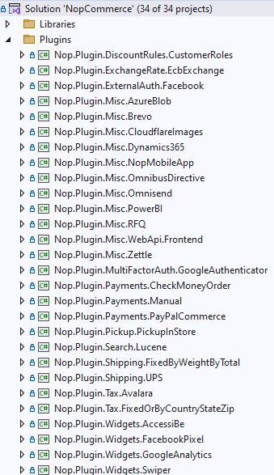

El archivo .csproj del plugin cumple una función esencial, ya que define cómo debe compilarse
el proyecto y hacia dónde deben copiarse sus archivos de salida. En este punto deben
configurarse aspectos como la versión de .NET utilizada por nopCommerce, las referencias
necesarias y la ruta de salida hacia el directorio donde la plataforma espera encontrar los
plugins ya compilados.

También es aquí donde se ajustan propiedades como CopyLocalLockFileAssemblies, especialmente
importante cuando el plugin utiliza paquetes NuGet cuyas dependencias deben copiarse
físicamente junto con las DLL del plugin. Una configuración incorrecta del archivo de proyecto
puede provocar que nopCommerce no detecte la extensión, aunque el código sea funcionalmente
correcto.

#### Archivo plugin.json

Uno de los elementos imprescindibles de cualquier plugin es el archivo plugin.json. Este
archivo contiene la **metainformación descriptiva** del plugin y es utilizado por nopCommerce
para identificarlo dentro del sistema. Entre otros datos, suele incluir el nombre visible, la
versión, el autor, la compatibilidad con versiones concretas de nopCommerce y otros parámetros
básicos de registro.

Sin este archivo, la plataforma no puede interpretar correctamente la existencia del plugin
como una extensión instalable y administrable. Por ello, constituye uno de los componentes
mínimos obligatorios de la estructura. En la práctica, suele tomarse como base el plugin.json
de otro plugin ya existente y adaptarlo al nuevo desarrollo.

### Estructura del plugin, archivos obligatorios y ubicaciones

Los aspectos básicos del proyecto del plugin —tipo Class Library, ubicación en la carpeta
\\Plugins de la raíz de la solución y convención de nombres Nop.Plugin.{Grupo}.{Nombre}— se
describieron en el apartado «Proyecto del plugin». Los plugins oficiales siguen esa convención,
por ejemplo Nop.Plugin.Payments.PayPalCommerce.

Una vez creado el proyecto del plugin, es necesario configurar correctamente su archivo
.csproj. Entre los ajustes principales, debe establecerse la versión de **.NET** utilizada por
nopCommerce —en este caso, **.NET 9**—, añadir la referencia al proyecto Nop.Web.Framework y
definir la carpeta de salida para que los archivos compilados se copien al directorio
correspondiente dentro de Presentation\\Nop.Web\\Plugins\\....

```xml
<Project Sdk="Microsoft.NET.Sdk">

  <PropertyGroup>
    <TargetFramework>net9.0</TargetFramework>
    <Copyright>Copyright © tu empresa</Copyright>
    <Company>Tu empresa</Company>
    <Authors>Tu nombre</Authors>
    <!--
      OutputPath define dónde se copiarán los archivos compilados.
      El valor de referencia en nopCommerce es:
      $(SolutionDir)\Presentation\Nop.Web\Plugins\{DirectorioSalida}
      donde {DirectorioSalida} es, por ejemplo, Payments.MiMetodoDePago
      o Misc.MiPlugin.
    -->
    <OutputPath>$(SolutionDir)\Presentation\Nop.Web\Plugins\{DirectorioSalida}</OutputPath>
    <OutDir>$(OutputPath)</OutDir>
    <!--
      Actívala en true solo si el plugin usa paquetes NuGet cuyas DLL
      deban copiarse físicamente al directorio de salida.
    -->
    <CopyLocalLockFileAssemblies>false</CopyLocalLockFileAssemblies>
    <ImplicitUsings>enable</ImplicitUsings>
  </PropertyGroup>

  <ItemGroup>
    <!--
      plugin.json y las vistas se copian al directorio de salida.
      Copy to Output Directory: PreserveNewest (copiar si es más reciente).
    -->
    <Content Include="plugin.json">
      <CopyToOutputDirectory>PreserveNewest</CopyToOutputDirectory>
    </Content>
    <Content Include="Views\Configure.cshtml">
      <CopyToOutputDirectory>PreserveNewest</CopyToOutputDirectory>
    </Content>
    <Content Include="Views\_ViewImports.cshtml">
      <CopyToOutputDirectory>PreserveNewest</CopyToOutputDirectory>
    </Content>
  </ItemGroup>

  <ItemGroup>
    <!-- Referencia obligatoria: sin ella el plugin no compila. -->
    <ProjectReference Include="$(SolutionDir)\Presentation\Nop.Web.Framework\Nop.Web.Framework.csproj" />
    <ClearPluginAssemblies Include="$(SolutionDir)\Build\ClearPluginAssemblies.proj" />
  </ItemGroup>

  <!-- Este target se ejecuta después del target Build. -->
  <Target Name="NopTarget" AfterTargets="Build">
    <!-- Elimina del directorio de salida las DLL que ya están en la aplicación principal. -->
    <MSBuild Projects="@(ClearPluginAssemblies)" Properties="PluginPath=$(OutDir)" Targets="NopClear" />
  </Target>

</Project>
```

Si el plugin utiliza paquetes **NuGet** cuyas bibliotecas deban copiarse físicamente al
directorio de salida, conviene habilitar la propiedad CopyLocalLockFileAssemblies, como se
explicó en el apartado «Archivo .csproj». En el ejemplo anterior, el marcador
{DirectorioSalida} debe sustituirse por el nombre real del directorio de salida del plugin,
por ejemplo, Payments.PayPalCommerce.

El siguiente ejemplo sigue la estructura del plugin oficial PayPal Commerce, con valores
sustituidos por marcadores de ejemplo que deben reemplazarse por los del plugin en desarrollo:

```json
{
  "Group": "Payment methods",
  "FriendlyName": "PayPal Commerce",
  "SystemName": "Payments.PayPalCommerce",
  "Version": "1.0.0",
  "SupportedVersions": [ "4.90" ],
  "Author": "Tu nombre o empresa",
  "DisplayOrder": 1,
  "FileName": "Nop.Plugin.Payments.PayPalCommerce.dll",
  "Description": "Descripción breve de la funcionalidad del plugin"
}
```

Cada campo tiene una función concreta dentro del sistema. **Group** es el nombre del grupo bajo
el que aparecerá el plugin en el listado de plugins del área de administración y puede usarse
como nombre de empresa o categoría funcional. **FriendlyName** es el nombre visible del plugin
en la interfaz. **SystemName** es el identificador único del plugin dentro de la plataforma y
no puede repetirse entre plugins instalados. **Version** es la versión interna del plugin, cuyo
cambio activa la llamada a UpdateAsync. SupportedVersions indica con qué versiones de
nopCommerce es compatible el plugin. FileName debe coincidir exactamente con el nombre de la
DLL generada por la compilación.

El archivo `plugin.json` debe situarse en la raíz del proyecto del plugin y configurarse en
Visual Studio con **Build Action = Content** y **Copy to Output Directory = PreserveNewest**
(«copiar si es más reciente»), que es el valor que emplean los plugins oficiales y el que
recomienda la documentación de nopCommerce. Sin esta configuración, el archivo no se copiará al
directorio de salida y nopCommerce no podrá leerlo.

A continuación se presenta una tabla detallada con todos los campos que admite el archivo
plugin.json, su descripción y el carácter obligatorio de cada uno:

| Campo | Descripción | Obligatorio |
| - | - | - |
| Group | Grupo funcional o nombre de empresa bajo el que aparece el plugin en el listado de administración. Para widgets suele ser "Widgets". | Sí |
| FriendlyName | Nombre visible del plugin en la interfaz de administración. | Sí |
| SystemName | Identificador único del plugin dentro de la plataforma. No puede repetirse entre plugins instalados. Se usa como clave en App\_Data/plugins.json. | Sí |
| Version | Versión interna del plugin (p.ej. "1.0.0"). Al incrementarla, nopCommerce invoca UpdateAsync en la clase principal la próxima vez que se arranca la aplicación. | Sí |
| SupportedVersions | Array con las versiones de nopCommerce con las que el plugin es compatible (p.ej. \["4.90"\]). Si la versión de la plataforma no está incluida, el plugin no se carga. | Sí |
| Author | Nombre del desarrollador o empresa que crea el plugin. | No |
| DisplayOrder | Orden de aparición en el listado de Local Plugins. | No |
| FileName | Nombre exacto de la DLL generada tras la compilación (p.ej. "Nop.Plugin.Widgets.Swiper.dll"). Si no se especifica, nopCommerce lo deduce del SystemName. | No |
| Description | Descripción breve de la funcionalidad del plugin. Se muestra en el listado de administración. | No |
| LimitedToStores | Array de IDs de tienda para restringir el plugin a tiendas concretas en instalaciones multi-store. | No |
| DependsOnSystemNames | Array de SystemName de otros plugins de los que este depende. nopCommerce los cargará antes. | No |

**Campos críticos**: la configuración incorrecta de estos tres campos invalida la carga del
plugin. Un `SystemName` duplicado impide la instalación. Un `SupportedVersions` que no incluya
la versión actual de nopCommerce hace que el archivo no pase el filtro de compatibilidad: el
plugin no se carga y por eso no aparece en Local Plugins.

#### Clase principal del plugin

Configurado el archivo `plugin.json`, el siguiente paso es la **clase principal**, que es el
núcleo funcional del plugin.

Los proyectos creados desde la plantilla *Class Library* de Visual Studio incluyen un archivo
`Class1.cs` que actúa como punto de partida y que se transforma en la clase principal del
plugin.

Esta clase funciona como el **interruptor general** de la extensión. Cuando nopCommerce necesita
instalar el plugin, desinstalarlo, mostrar su pantalla de configuración o determinar de qué tipo
es, consulta esta clase. Sin ella, nopCommerce no tiene forma de comunicarse con la extensión.

Lo primero es renombrar `Class1` por un nombre con significado para el plugin: si el plugin se
llama «MiPlugin», la clase se llamará `MiPlugin`.

Renombrarla no basta. Una clase normal de C# no basta por sí sola para integrarse en nopCommerce:
debe implementar la interfaz `IPlugin`, ya sea directamente o, como se hace en la práctica,
mediante la clase base `BasePlugin`. `BasePlugin` contiene el comportamiento básico que
nopCommerce espera de cualquier extensión: `InstallAsync`, `UninstallAsync`, `UpdateAsync` y
`GetConfigurationPageUrl` con implementación por defecto. Heredar de ella evita reimplementar
ese comportamiento desde cero y reduce el riesgo de errores; por eso se usa en todos los
ejemplos de este manual y en los plugins oficiales.

Además de heredar de `BasePlugin`, la clase debe indicar a nopCommerce de qué tipo es. Para un
plugin de propósito general se usa la interfaz `IMiscPlugin`. Una interfaz funciona como una
etiqueta que el sistema lee para saber cómo tratar la extensión. Existen otras etiquetas para
otros tipos de plugin: `IPaymentMethod` para métodos de pago, `IWidgetPlugin` para widgets que
muestran contenido visual, `ITaxProvider` para proveedores de impuestos, entre otras.

El siguiente ejemplo muestra la clase principal resultante para un plugin de propósito general,
partiendo del `Class1.cs` original y llegando al resultado final:

```csharp
namespace Nop.Plugin.Misc.MiPlugin
{
    /// <summary>
    /// Clase principal del plugin. Hereda de BasePlugin, que ya implementa
    /// parte del comportamiento común de IPlugin, y de IMiscPlugin,
    /// que indica a nopCommerce que es un plugin de propósito general.
    /// </summary>
    public class MiPlugin : BasePlugin, IMiscPlugin
    {
        private readonly ISettingService _settingService;
        private readonly IWebHelper _webHelper;
        public MiPlugin(
            ISettingService settingService,
            IWebHelper webHelper)
        {
            _settingService = settingService;
            _webHelper = webHelper;
        }
        /// <summary>
        /// Devuelve la URL de la página de configuración del plugin
        /// en el área de administración. Solo es necesario si el plugin
        /// tiene pantalla de configuración propia.
        /// </summary>
        public override string GetConfigurationPageUrl()
        {
            return $"{_webHelper.GetStoreLocation()}Admin/MiPlugin/Configure";
        }
        /// <summary>
        /// Se ejecuta cuando el administrador instala el plugin.
        /// Aquí se inicializan los valores de configuración por defecto.
        /// Si el plugin necesita cadenas localizadas, ese registro se hace
        /// con ILocalizationService y no forma parte de este ejemplo.
        /// </summary>
        public override async Task InstallAsync()
        {
            // Guardar configuración inicial con valores por defecto
            await _settingService.SaveSettingAsync(new MiPluginSettings
            {
                Enabled = false,
                ApiKey = string.Empty
            });
            // Opcional: registrar aquí las cadenas localizadas del plugin
            await base.InstallAsync();
        }
        /// <summary>
        /// Se ejecuta cuando el administrador desinstala el plugin.
        /// Limpia la configuración guardada durante la instalación.
        /// Siempre debe llamarse a base.UninstallAsync() al final.
        /// </summary>
        public override async Task UninstallAsync()
        {
            await _settingService.DeleteSettingAsync<MiPluginSettings>();
            await base.UninstallAsync();
        }
        /// <summary>
        /// Se ejecuta cuando cambia la versión en plugin.json.
        /// Útil para migraciones de configuración entre versiones del plugin.
        /// Siempre debe llamarse a base.UpdateAsync() al final.
        /// </summary>
        public override async Task UpdateAsync(string currentVersion, string targetVersion)
        {
            await base.UpdateAsync(currentVersion, targetVersion);
        }
    }
}
```

**Errores frecuentes en la clase principal:**

- **Heredar directamente de IPlugin en lugar de BasePlugin.** Aunque
técnicamente es posible, obliga a implementar métodos como `InstallAsync`, `UninstallAsync` y
`GetConfigurationPageUrl` desde cero. `BasePlugin` ya los resuelve, así que salvo que el plugin
requiera un comportamiento muy específico, no hay razón para evitarlo.
- **Dejar sin llamar a `base.InstallAsync()` al final de `InstallAsync`.** En nopCommerce 4.90
  `BasePlugin.InstallAsync()` es un método vacío que devuelve `Task.CompletedTask`, por lo que
  omitirlo no impide que el plugin se instale: la marca de instalado la gestiona el panel de
  administración en `App_Data/plugins.json`. Se recomienda mantener la llamada por si la clase
  base incorpora comportamiento en versiones posteriores y por consistencia con
  `UninstallAsync()` y `UpdateAsync()`, que sí realizan trabajo propio.
- **Dejar el nombre `Class1`.** El código funcionaría, pero al crecer el
proyecto resulta imposible recordar qué hace una clase llamada `Class1`. Conviene renombrarla
desde el primer momento.
- **No incluir el constructor con los servicios que el plugin
necesita.** nopCommerce entrega las herramientas (como ISettingService o IWebHelper) a través
del constructor. Si el constructor no los pide, el plugin no los recibe y no podrá usarlos.

## Capítulo 16 — Cómo crear un widget desde cero en nopCommerce {#capitulo-16}

Explica cómo construir un plugin widget completo, con clase principal IWidgetPlugin, ViewComponent público y página de configuración administrativa.

**Parte IV — Plugins** · Nivel: Intermedio

Este capítulo cubre la creación de un widget desde cero: plugin.json con Group Widgets, clase principal BasePlugin + IWidgetPlugin, métodos GetWidgetZonesAsync y GetWidgetViewComponent, ViewComponent basado en NopViewComponent y localización de recursos con AddOrUpdateLocaleResourceAsync; Sirve para insertar contenido visual en Widget Zones sin tocar el núcleo; Los conceptos clave incluyen HideInWidgetList, la resolución por Type del ViewComponent desde la 4.60 y la convención Plugins.{SystemName}.{Context}.{Field} para claves localizadas; Prerrequisitos: capítulos 5, 9 y 11; Caso de uso típico: desarrollar un banner o carrusel que se muestre en la página de inicio.

**Trampas frecuentes:**

> - La clase principal de un widget no se registra en el contenedor de dependencias: la obtiene PluginDescriptor.Instance<T>() mediante EngineContext.Current.ResolveUnregistered(PluginType), con inyección de servicios en el constructor.
> - En nopCommerce 4.90 el componente se resuelve por Type: GetWidgetViewComponent devuelve el ViewComponent que renderiza el widget; hasta la 4.50 existía GetWidgetViewComponentName, que devolvía un string.
> - El ViewComponent de un widget debe heredar de NopViewComponent e implementar InvokeAsync(string widgetZone, object additionalData), no la clase base estándar de ASP.NET Core.
> - DeleteLocaleResourcesAsync elimina en lote todas las filas cuyo ResourceName empiece por Plugins.{SystemName}; una clave fuera de esa convención queda huérfana al desinstalar.
> - GetWidgetZonesAsync y GetWidgetViewComponent son obligatorios porque la interfaz no les proporciona implementación por defecto; GetConfigurationPageUrl e InstallAsync sí la tienen en BasePlugin.

---

Un plugin de widget es, en su base, un plugin como cualquier otro: un proyecto Class Library
con plugin.json, un .csproj configurado como se describió en el apartado «Estructura completa
de un plugin», y una clase principal que hereda de BasePlugin. Lo que lo distingue es
que su clase principal implementa IWidgetPlugin además de BasePlugin, y que incorpora al menos
un ViewComponent encargado de generar el contenido visual que se inyectará en la zona del
layout correspondiente.

**`plugin.json` del widget**

El único cambio relevante respecto a un plugin estándar es el campo `Group`, que para widgets
suele ser `Widgets`:

```json
{
  "Group": "Widgets",
  "FriendlyName": "Mi Banner Promocional",
  "SystemName": "Widgets.MiBanner",
  "Version": "1.0.0",
  "SupportedVersions": [ "4.90" ],
  "Author": "Tu nombre o empresa",
  "FileName": "Nop.Plugin.Widgets.MiBanner.dll",
  "Description": "Inserta un banner promocional en la página de inicio"
}
```

**Clase principal del widget:**

```csharp
namespace Nop.Plugin.Widgets.MiBanner
{
    public class MiBannerPlugin : BasePlugin, IWidgetPlugin
    {
        private readonly ISettingService _settingService;

        public MiBannerPlugin(ISettingService settingService)
        {
            _settingService = settingService;
        }

        // HideInWidgetList controla si el widget aparece en el listado
        // de Content Management > Widgets del área de administración.
        public bool HideInWidgetList => false;

        // Declara en qué Widget Zones debe intervenir este plugin.
        public Task<IList<string>> GetWidgetZonesAsync()
        {
            return Task.FromResult<IList<string>>(new List<string>
            {
                PublicWidgetZones.HomepageTop
            });
        }

        // Devuelve el Type del ViewComponent que debe renderizarse.
        // Hasta la 4.50 el método era GetWidgetViewComponentName y devolvía
        // un string; desde la 4.60 devuelve el Type directamente.
        public Type GetWidgetViewComponent(string widgetZone)
        {
            return typeof(MiBannerViewComponent);
        }

        public override async Task InstallAsync()
        {
            await _settingService.SaveSettingAsync(new MiBannerSettings
            {
                ImageUrl = string.Empty,
                TargetUrl = string.Empty,
                Enabled = false
            });
            await base.InstallAsync();
        }

        public override async Task UninstallAsync()
        {
            await _settingService.DeleteSettingAsync<MiBannerSettings>();
            await base.UninstallAsync();
        }
    }
}
```

### Análisis detallado de la clase principal del plugin

La clase principal de un widget en nopCommerce sigue una estructura que combina herencia e
implementación de interfaces. Para el análisis se usa la clase `SwiperPlugin` del caso práctico
de la PARTE IV. A continuación se analiza en profundidad cada elemento.

#### Herencia: `BasePlugin, IWidgetPlugin`

```csharp
public class SwiperPlugin : BasePlugin, IWidgetPlugin
```

- **BasePlugin**: clase abstracta del namespace `Nop.Services.Plugins`
que implementa `IPlugin`. Proporciona implementaciones base (con cuerpo) para
`GetConfigurationPageUrl` (devuelve `null`), `InstallAsync`, `InstallSampleDataAsync`,
`UninstallAsync`, `UpdateAsync` y `PreparePluginToUninstallAsync` (todas devuelven
`Task.CompletedTask`). En los métodos de ciclo de vida (`InstallAsync`, `UninstallAsync`,
`UpdateAsync`, `PreparePluginToUninstallAsync`) la sobreescritura debe llamar al método base
correspondiente; `GetConfigurationPageUrl` se sobrescribe devolviendo la URL de la página de
configuración, sin llamada al base.

- **IWidgetPlugin**: interfaz del namespace `Nop.Services.Cms` (hereda de `IPlugin`, del
namespace `Nop.Services.Plugins`) que define los miembros específicos para plugins de tipo
widget. Todos sus miembros —`HideInWidgetList`, `GetWidgetZonesAsync` y
`GetWidgetViewComponent`— son obligatorios; la interfaz no incluye implementaciones por defecto.

#### Jerarquía de interfaces

BasePlugin implementa IPlugin, que define los métodos base del ciclo de vida. Por otro lado,
IWidgetPlugin hereda directamente de IPlugin y añade los miembros propios de los widgets.

```csharp
IPlugin (interfaz raíz)
├── IWidgetPlugin (interfaz de widget)
└── BasePlugin (clase abstracta que implementa IPlugin)
```

#### Métodos obligatorios vs. opcionales

No todos los métodos que aparecen en la interfaz o en la clase base deben implementarse. La
siguiente tabla aclara cuáles son obligatorios y cuáles opcionales:

| Método | ¿Obligatorio? | Observación |
| - | - | - |
| GetWidgetZonesAsync() | **Sí** (interfaz sin default) | Declara las zonas del layout donde el widget se inyecta |
| GetWidgetViewComponent(widgetZone) | **Sí** (interfaz sin default) | Devuelve el Type del ViewComponent que renderiza el widget |
| GetConfigurationPageUrl() | No (BasePlugin devuelve null) | Solo necesario si el plugin tiene pantalla de configuración en admin |
| InstallAsync() | No (BasePlugin tiene implementación base) | Se ejecuta al instalar; debe llamar a `await base.InstallAsync()` |
| UninstallAsync() | No (BasePlugin tiene implementación base) | Se ejecuta al desinstalar; debe llamar a `await base.UninstallAsync()` |
| UpdateAsync() | No (BasePlugin tiene implementación base) | Se ejecuta al cambiar la versión en plugin.json |
| HideInWidgetList | **Sí** (propiedad de IWidgetPlugin) | Controla si el widget aparece en Admin → Content Management → Widgets |

#### Inyección de dependencias en el constructor

El constructor de la clase principal recibe por parámetro los servicios que necesita.
nopCommerce los resuelve automáticamente mediante su contenedor DI (Autofac). Es importante:

- Los servicios deben solicitarse a través de **interfaces**, no de
implementaciones concretas.

- Los servicios más habituales son `ISettingService`, `IWebHelper`,
`IStoreContext`, `ILocalizationService` y `INopUrlHelper`.

- La clase principal no se registra en el contenedor de DI: la obtiene `PluginDescriptor.Instance<T>()`
mediante `EngineContext.Current.ResolveUnregistered(PluginType)`, con inyección de servicios en el constructor.

#### GetWidgetZonesAsync()

Declara en qué zonas del layout debe intervenir el widget. Devuelve `Task<IList<string>>`. Cada
string es el nombre de una Widget Zone definida en `PublicWidgetZones` o `AdminWidgetZones`.

Un widget puede registrarse en múltiples zonas. El mismo ViewComponent recibe el parámetro
`widgetZone` para adaptar su comportamiento según la zona en la que se esté ejecutando.

#### GetConfigurationPageUrl()

Devuelve la URL de la página de configuración en el área de administración. Solo debe
sobrescribirse si el plugin dispone de pantalla de configuración. BasePlugin devuelve `null`
por defecto, lo que oculta el botón de configuración en el listado de Local Plugins.

nopCommerce mostrará automáticamente el enlace "Configure" en Admin → Configuration → Local
Plugins si este método devuelve una URL no nula.

#### GetWidgetViewComponent(widgetZone)

Devuelve el `Type` del ViewComponent que se encarga de renderizar el widget. Es el método que
ha sustituido a `GetWidgetViewComponentName` (que devolvía un string). En nopCommerce 4.90
se usa el tipo directamente, lo que permite una resolución más fuerte en tiempo de compilación.

#### InstallAsync()

Se ejecuta una sola vez, cuando el administrador instala el plugin desde Admin → Configuration
→ Local Plugins. Tareas típicas:

1. Guardar valores de configuración por defecto mediante
`ISettingService.SaveSettingAsync()`

2. Registrar recursos de localización (locale resources) para que el
widget aparezca traducido en el panel de administración

3. Las tablas propias no se crean aquí: se definen en una clase de migración
de FluentMigrator (ver «Migraciones: cómo crea un plugin sus propias tablas»)

4. Dejar la llamada a `await base.InstallAsync()` al final del método. En la 4.90 la
implementación base no realiza ninguna acción, pero mantenerla evita perder el comportamiento
que la plataforma añada en versiones posteriores

#### Localización de recursos

nopCommerce utiliza un sistema de localización basado en la tabla LocaleStringResource para
mostrar textos traducibles en el panel de administración. Cada plugin debe registrar sus
propios recursos de localización (también llamados *locale resources*) durante la instalación.

El método AddOrUpdateLocaleResourceAsync permite registrar recursos en lote:

```csharp
await AddOrUpdateLocaleResourceAsync(new Dictionary<string, string> {
    ["Plugins.Widgets.Swiper.Fields.SlidesJson"] = "Slides (JSON)",
    ["Plugins.Widgets.Swiper.Fields.AutoPlay"] = "Auto play",
    ["Plugins.Widgets.Swiper.Fields.AutoPlayTimeout"] = "Auto play timeout (ms)",
    ["Plugins.Widgets.Swiper.AddNewSlide"] = "Add new slide",
    ["Plugins.Widgets.Swiper.EditSlide"] = "Edit slide",
    ["Plugins.Widgets.Swiper.Fields.ImageUrl"] = "Image URL",
    ["Plugins.Widgets.Swiper.Fields.Title"] = "Title",
    ["Plugins.Widgets.Swiper.Fields.Description"] = "Description",
    ["Plugins.Widgets.Swiper.Fields.LinkUrl"] = "Link URL",
    ["Plugins.Widgets.Swiper.Fields.DisplayOrder"] = "Display order",
    ["Plugins.Widgets.Swiper.Fields.Published"] = "Published",
});
```

**Convención de nombres**: la clave debe seguir el patrón
Plugins.{SystemName}.{Context}.{Field}. Por ejemplo, Plugins.Widgets.Swiper.Fields.AutoPlay
para el campo AutoPlay del widget Swiper.

**Limpieza al desinstalar**: durante UninstallAsync se eliminan todos los locale resources
registrados llamando a DeleteLocaleResourcesAsync con el prefijo «Plugins.» seguido del
SystemName del plugin. El método elimina de la tabla LocaleStringResource todas las filas cuyo
ResourceName empiece por ese prefijo; el prefijo se añade en la llamada, como hace el plugin
oficial Swiper: DeleteLocaleResourcesAsync("Plugins.Widgets.Swiper").

#### UninstallAsync()

Se ejecuta cuando el administrador desinstala el plugin. Tareas típicas:

1. Eliminar configuraciones:
`_settingService.DeleteSettingAsync<SwiperSettings>()`

2. Eliminar recursos de localización registrados durante la instalación

3. Eliminar tablas propias (si las hay)

4. Llamar siempre a `await base.UninstallAsync()` al final

#### HideInWidgetList

Propiedad booleana de solo lectura de la interfaz IWidgetPlugin. Controla si el widget aparece
en Admin → Content Management → Widgets.

- `false` (valor por defecto recomendado): el widget aparece en el
listado y puede activarse o desactivarse desde la administración.

- `true`: el widget se oculta del listado. Útil para widgets que no
necesitan activación manual o que se gestionan por otros medios.

## Capítulo 17 — Diseño interno de un plugin: modelos, controladores y servicios {#capitulo-17}

Profundiza en el diseño del plugin: modelos, controladores CRUD, capa de dominio, servicios internos, sistema de Settings, migraciones y rutas.

**Parte IV — Plugins** · Nivel: Avanzado

Este capítulo cubre el diseño interno de un plugin, desde modelos y controladores con operaciones CRUD hasta la capa de dominio, la elección entre JSON en la tabla Setting y tablas propias con FluentMigrator, el sistema ISettingService con soporte multi-tienda y el registro de rutas mediante IRouteProvider; Sirve para estructurar la lógica de un plugin con separación de responsabilidades; Los conceptos clave incluyen SaveSettingOverridablePerStoreAsync, el atributo NopMigration, la arquitectura dual Admin Controller y Public ViewComponent, y la clase de constantes del plugin; Prerrequisitos: capítulos 5, 11 y 12; Caso de uso típico: añadir datos propios y una pantalla de configuración multi-tienda a un widget.

**Trampas frecuentes:**

> - Los modelos del plugin no son entidades del dominio central: transportan datos hacia la vista y capturan parámetros de configuración.
> - La lógica de negocio no debe concentrarse en el controlador ni en la vista, sino en servicios internos del plugin.
> - Cada propiedad de una clase ISettings se guarda como una fila independiente de la tabla Setting con clave clase.propiedad en minúsculas; el identificador de tienda 0 significa valor global.
> - Si se modifican settings directamente en la base de datos, algo no recomendado, es necesario reiniciar la aplicación para que la caché se refresque.
> - Modificar una migración ya publicada es un error grave: nopCommerce no vuelve a ejecutar una migración cuya fecha ya ha registrado como aplicada; debe crearse una nueva con fecha posterior.

---

### Modelos del plugin

Si el plugin dispone de interfaz de configuración o necesita intercambiar datos entre
controlador y vista, normalmente incluirá una carpeta Models. En ella se definen los modelos
necesarios para representar la información que se mostrará o editará en la interfaz
administrativa del plugin.

Estos modelos no deben confundirse con las entidades del dominio central de nopCommerce. Su
función suele estar más relacionada con el transporte de datos hacia la vista, la captura de
parámetros de configuración o la organización de la información propia del plugin dentro de la
interfaz administrativa.

### Controladores del plugin

Cuando el plugin necesita responder a solicitudes HTTP, mostrar una pantalla de configuración o
exponer endpoints específicos, debe incorporar uno o varios **controladores**. Estos suelen
ubicarse en una carpeta Controllers y respetar una convención de nombres coherente, por ejemplo
{Grupo}{Nombre}Controller.

El controlador es el encargado de recibir las peticiones, coordinar la ejecución de los
servicios necesarios y devolver la respuesta adecuada, normalmente una vista de configuración o
un resultado técnico específico. En plugins con interfaz administrativa, una acción muy
habitual es Configure, utilizada para mostrar y procesar la pantalla de configuración del
plugin.

En este contexto, resulta importante aplicar los atributos adecuados, como los relacionados con
autorización administrativa, validación antiforgery y pertenencia al área de administración.
Esto garantiza que la interfaz del plugin quede correctamente integrada y protegida dentro del
entorno administrativo de nopCommerce.

```csharp
namespace Nop.Plugin.Misc.MiPlugin.Controllers
{
    /// <summary>
    /// Los atributos se declaran a nivel de clase para no repetirlos
    /// en cada acción. AuthorizeAdmin garantiza que solo usuarios
    /// con permisos administrativos puedan acceder. Area indica
    /// que este controlador pertenece al área de administración.
    /// AutoValidateAntiforgeryToken protege contra ataques CSRF.
    /// </summary>
    [AuthorizeAdmin]
    [Area(AreaNames.ADMIN)]
    [AutoValidateAntiforgeryToken]
    public class MiPluginController : BasePluginController
    {
        private readonly ISettingService _settingService;
        private readonly IStoreContext _storeContext;
        public MiPluginController(
            ISettingService settingService,
            IStoreContext storeContext)
        {
            _settingService = settingService;
            _storeContext = storeContext;
        }
        /// <summary>
        /// Acción GET: muestra la pantalla de configuración del plugin.
        /// La ruta física de la vista es obligatoria porque las vistas
        /// del plugin no están en la ruta estándar de Nop.Web.
        /// </summary>
        public async Task<IActionResult> Configure()
        {
            var storeScope = await _storeContext.GetActiveStoreScopeConfigurationAsync();
            var settings = await _settingService.LoadSettingAsync<MiPluginSettings>(storeScope);
            var model = new ConfigurationModel
            {
                Enabled = settings.Enabled,
                ApiKey = settings.ApiKey
            };
            return View("~/Plugins/Misc.MiPlugin/Views/Configure.cshtml", model);
        }
        /// <summary>
        /// Acción POST: procesa el formulario de configuración
        /// y guarda los nuevos valores.
        /// </summary>
        [HttpPost]
        public async Task<IActionResult> Configure(ConfigurationModel model)
        {
            var storeScope = await _storeContext.GetActiveStoreScopeConfigurationAsync();
            var settings = await _settingService.LoadSettingAsync<MiPluginSettings>(storeScope);
            settings.Enabled = model.Enabled;
            settings.ApiKey = model.ApiKey;
            // SaveSettingAsync ya invalida la caché de settings al final del guardado.
            await _settingService.SaveSettingAsync(settings, storeScope);
            return await Configure();
        }
    }
}
```

### Ejemplo avanzado: controlador con operaciones CRUD

Cuando un widget necesita gestionar datos propios (como slides de un carrusel), el controlador
debe incluir acciones adicionales además de Configure. El siguiente apartado describe los
elementos de un controlador con operaciones CRUD, incluyendo serialización JSON para datos
complejos y carga de datos específicos por tienda.

#### Atributos del controlador

```csharp
[AuthorizeAdmin]        // Solo usuarios admin
[Area(AreaNames.ADMIN)] // Área de administración
[AutoValidateAntiforgeryToken]  // Protección CSRF
public class WidgetsSwiperController : BasePluginController
```

Los atributos `AuthorizeAdmin`, `Area` y `AutoValidateAntiforgeryToken` se declaran a nivel de
clase y se aplican a todas las acciones del controlador.

#### Dependencias

El controlador recibe por inyección los servicios que necesita. Para un widget con datos
propios, las dependencias típicas son:

- `ISettingService`: para leer/guardar configuración del widget

- `IStoreContext`: para obtener el ámbito de tienda actual en entornos
multi-store

- `ILocalizationService` (opcional): para mostrar mensajes traducidos

#### Acciones del controlador

| Ruta | Método HTTP | Acción | Descripción |
| - | - | - | - |
| Admin/WidgetsSwiper/Configure | GET | Configure | Muestra la pantalla de configuración del widget con la lista de slides |
| Admin/WidgetsSwiper/Configure | POST | Configure | Guarda la configuración general del widget |
| Admin/WidgetsSwiper/SlideAdd | POST | SlideAdd | Añade un nuevo slide al carrusel |
| Admin/WidgetsSwiper/SlideList | POST | SlideList | Devuelve la lista de slides como JSON para DataTables |
| Admin/WidgetsSwiper/SlideDelete | POST | SlideDelete | Elimina un slide existente |
| Admin/WidgetsSwiper/SlideEdit | POST | SlideEdit | Edita un slide existente |

#### Carga de datos con GetSlidesForStoreAsync

Un patrón habitual en widgets multi-tienda es cargar los datos del ámbito de tienda activo en
el panel de administración (0 = todas las tiendas). El método `GetSlidesForStoreAsync`
encapsula esta lógica:

```csharp
private async Task<List<Slide>> GetSlidesForStoreAsync()
{
    var storeScope = await _storeContext.GetActiveStoreScopeConfigurationAsync();
    var swiperSettings = await _settingService.LoadSettingAsync<SwiperSettings>(storeScope);
    if (string.IsNullOrEmpty(swiperSettings.SlidesJson))
        return new List<Slide>();
    var slides = JsonConvert.DeserializeObject<List<Slide>>(swiperSettings.SlidesJson);
    return slides ?? new List<Slide>();
}
```

Este enfoque utiliza la tabla `Setting` como almacén para los slides serializados como JSON, en
lugar de crear una tabla independiente. Esto es adecuado cuando:

- Los datos son una lista de objetos que siempre se cargan y guardan
completos

- No es necesario hacer consultas SQL sobre los datos individuales

- El volumen de datos es pequeño (decenas o cientos de registros)

#### Configuración multi-store

En la acción Configure (POST), el patrón multi-store verifica si cada campo debe sobrescribirse
para la tienda actual o mantenerse a nivel global:

```csharp
var storeScope = await _storeContext.GetActiveStoreScopeConfigurationAsync();
var settings = await _settingService.LoadSettingAsync<SwiperSettings>(storeScope);
settings.AutoPlay = model.AutoPlay;
settings.AutoPlayTimeout = model.AutoPlayTimeout;
await _settingService.SaveSettingOverridablePerStoreAsync(
    settings, x => x.AutoPlay, model.AutoPlay_OverrideForStore, storeScope, false);
await _settingService.SaveSettingOverridablePerStoreAsync(
    settings, x => x.AutoPlayTimeout, model.AutoPlayTimeout_OverrideForStore, storeScope, false);
```

La propiedad `..._OverrideForStore` del modelo suele venir de una casilla de verificación en la
vista que indica «sobrescribir para esta tienda». El quinto parámetro (`clearCache`) es `false`
para no invalidar la caché en cada propiedad; al terminar el guardado de todas ellas, una única
llamada a `ClearCacheAsync` refresca la caché, como hace el plugin oficial Swiper.

### Capa de dominio del plugin

Cuando un widget gestiona datos estructurados, la entidad de dominio se define como una clase
simple dentro de una carpeta `Domain`:

```csharp
public class Slide
{
    public int Id { get; set; }
    public string ImageUrl { get; set; }
    public string Title { get; set; }
    public string Description { get; set; }
    public string LinkUrl { get; set; }
    public int DisplayOrder { get; set; }
    public bool Published { get; set; }
}
```

Esta entidad no hereda de `BaseEntity` porque los slides se almacenan como JSON dentro de la
tabla `Setting`, no en una tabla propia. Si se necesitara una tabla independiente (por ejemplo,
para consultas SQL sobre campos individuales), la entidad debería heredar de `BaseEntity` y
crearse una migración de FluentMigrator.

### JSON vs Tabla SQL: criterios de decisión

Un plugin puede almacenar sus datos en la tabla `Setting` (como JSON serializado) o en tablas
propias creadas con FluentMigrator. La decisión depende del caso de uso:

| Criterio | JSON en tabla Setting | Tabla SQL propia |
| - | - | - |
| Volumen de datos | Pequeño (KB, no MB) | Grande (miles de registros) |
| Consultas parciales | No necesario | Sí, se consultan registros individuales |
| Atomicidad | Se guarda todo el JSON | Se modifica una fila |
| Mantenimiento | Mínimo (sin migraciones) | Requiere migraciones de esquema |
| Indexación | No aplica | Sí, índices en columnas |
| Complejidad | Baja | Alta |

**Cuándo usar JSON en Settings**: listas cortas, configuración compleja, datos que siempre se
cargan completos, prototipos rápidos.

**Cuándo usar tabla SQL propia**: datos transaccionales, catálogos grandes, necesidad de
consultas SQL, relaciones con otras entidades.

### Arquitectura dual: Admin Controller y Public ViewComponent

Un widget en nopCommerce sigue una arquitectura de dos caras:

1. **Admin Controller** (`WidgetsSwiperController`): gestiona la
configuración en el área de administración. Usa atributos `[AuthorizeAdmin]` y
`[Area(AreaNames.ADMIN)]`. Las vistas se renderizan sobre el layout `_ConfigurePlugin` del
panel admin.

2. **ViewComponent público** (`SwiperViewComponent`): se ejecuta en la
tienda pública. nopCommerce lo invoca automáticamente cuando renderiza las Widget Zones donde
el plugin está registrado. No lleva atributos de autorización porque su salida se inserta en
páginas públicas.

El flujo completo es:

```csharp
Admin: Admin/WidgetsSwiper/Configure → Controller (GET/POST) → Settings
                                                                    ↓
Público: Widget Zone en layout → SwiperViewComponent.InvokeAsync() → Load Settings → Render View
```

El ViewComponent lee la configuración guardada por el admin y genera el HTML que se inyecta en
la zona correspondiente. Ambos lados comparten el mismo `ISettingService` y la misma clase de
settings.

### Servicios y lógica interna del plugin

En plugins de cierta complejidad, además de la clase principal, el controlador y las vistas,
puede ser necesario incorporar **servicios propios**, clases auxiliares, validadores,
proveedores o componentes internos que encapsulen la lógica funcional específica del plugin.

Esta práctica resulta recomendable para mantener una buena separación de responsabilidades. La
lógica de negocio del plugin no debería concentrarse en el controlador ni en la vista, sino en
servicios internos diseñados para tal fin. De este modo, la lógica de negocio queda aislada de
la capa web y puede reutilizarse desde distintas acciones o componentes del plugin.

**El sistema de Settings: cómo guarda nopCommerce la configuración**

A lo largo de los ejemplos de este manual han aparecido llamadas a
`_settingService.LoadSettingAsync` y `SaveSettingAsync` sin explicar formalmente qué hay detrás.
nopCommerce no almacena la configuración de cada plugin en tablas propias, sino en una única
tabla central de tipo clave-valor, gestionada a través de ISettingService. La forma recomendada
de trabajar con ella no es leer y escribir claves sueltas, sino definir una clase que
implemente la interfaz marcadora ISettings, con una propiedad por cada valor configurable, tal
como se hizo con MiBannerSettings en el ejemplo del widget.

Internamente, cada propiedad de esa clase se guarda como una fila independiente, con una clave
compuesta por el nombre de la clase y el nombre de la propiedad, por ejemplo
mibannersettings.imageurl. Esto explica por qué nunca es necesario crear una tabla propia solo
para guardar configuración: basta con definir la clase ISettings y nopCommerce se encarga del
resto. Un segundo detalle relevante es el parámetro storeId que aceptan tanto LoadSettingAsync
como SaveSettingAsync: si se omite o se pasa cero, el valor se guarda como configuración
compartida para toda la instalación; si se indica el identificador de una tienda concreta en
una instalación multi-tienda, ese valor sobrescribe al compartido únicamente para esa tienda,
sin afectar a las demás. Esta es la razón por la que muchas pantallas de configuración del
panel de administración muestran una casilla de "sobrescribir para esta tienda" junto a cada
campo.

#### ISettingService: métodos principales

`ISettingService` (namespace `Nop.Services.Configuration`) es el servicio central para trabajar
con la tabla `Setting`. Sus métodos principales son:

| Método | Descripción |
| - | - |
| `LoadSettingAsync<TSettings>(int storeId = 0) where TSettings : ISettings, new()` | Carga todas las propiedades de un tipo `TSettings` desde la tabla Setting y las devuelve como un objeto poblado |
| `SaveSettingAsync<TSettings>(TSettings settings, int storeId = 0) where TSettings : ISettings, new()` | Guarda o actualiza cada propiedad de `TSettings` como una fila independiente en la tabla |
| `SaveSettingOverridablePerStoreAsync<TSettings>(...)` | Similar a SaveSettingAsync, pero permite decidir por propiedad si se guarda para una tienda concreta o se usa el valor compartido |
| `GetSettingByKeyAsync<T>(string key, T defaultValue, int storeId = 0)` | Lee una única clave directamente sin necesidad de una clase ISettings |
| `DeleteSettingAsync<TSettings>()` | Elimina todas las filas de la tabla Setting asociadas al tipo `TSettings` |
| `ClearCacheAsync()` | Invalida la caché de settings para que la próxima lectura vuelva a consultar la base de datos |

#### Funcionamiento interno de LoadSettingAsync

Cuando se llama a `LoadSettingAsync<SwiperSettings>()`, nopCommerce:

1. Construye el prefijo de clave: `swipersettings.` (nombre de la clase
en minúsculas)

2. Para cada propiedad, busca la fila cuyo `Name` es la clave compuesta
`{Clase}.{Propiedad}` y cuyo `StoreId` coincide con el parámetro; si esa fila no existe,
utiliza el valor compartido (`StoreId = 0`)

3. Para cada fila, usa reflection para asignar el valor a la propiedad
correspondiente del objeto `SwiperSettings`

4. Si no encuentra ninguna fila (ni de la tienda ni compartida) para
alguna propiedad, deja esa propiedad con su valor por defecto (`default`)

Este proceso se ejecuta cada vez que se llama al método, a menos que los datos estén en caché.

#### Guardado multi-store con SaveSettingOverridablePerStoreAsync

El método `SaveSettingOverridablePerStoreAsync` es fundamental en entornos multi-store. Permite
especificar, para cada propiedad individual, si el valor debe guardarse:

- A nivel global (`storeId = 0`): el valor se aplica a todas las tiendas
por defecto.

- A nivel de una tienda concreta: se crea una fila adicional con ese
`StoreId`, que sobrescribe al valor global solo para esa tienda.

El patrón típico en el controlador de configuración para cada propiedad es:

```csharp
await _settingService.SaveSettingOverridablePerStoreAsync(
    settings, x => x.AutoPlay, model.AutoPlay_OverrideForStore, storeScope, false);
```

#### Caché de settings

nopCommerce cachea los settings en memoria para evitar consultas repetitivas a la base de
datos. La caché se invalida automáticamente cuando:

- Se guarda un setting mediante `SaveSettingAsync` (que difiere la invalidación hasta el final
del guardado; `SaveSettingOverridablePerStoreAsync` solo invalida la caché si su parámetro
`clearCache` es `true`)

- Se elimina un setting mediante `DeleteSettingAsync`

- Se llama explícitamente a `ClearCacheAsync`

La invalidación se realiza mediante `IStaticCacheManager.RemoveByPrefixAsync`, con un mecanismo
de caché en memoria, Redis o SQL Server según la configuración de la tienda. Si se modifican
los settings directamente en la base de datos (algo no recomendado), es necesario invalidar la
caché de settings —por ejemplo, llamando a `ClearCacheAsync`— o reiniciar la aplicación para que
la próxima lectura vuelva a consultar la base de datos.

#### Eliminación de datos al desinstalar

Cuando se llama a `DeleteSettingAsync<SwiperSettings>()`, nopCommerce elimina de la tabla
`Setting` todas las filas cuyo `Name` empiece por `swipersettings.`, independientemente del
`StoreId`. Esto garantiza una limpieza completa de la configuración del plugin sin dejar
residuos.

#### Estructura de la tabla Setting

La tabla `Setting` de la base de datos de nopCommerce (gestionada por la capa Nop.Data) tiene la siguiente estructura:

| Columna | Tipo | Descripción |
| - | - | - |
| Id | int (PK) | Identificador único |
| Name | nvarchar(200) | Clave en formato `clase.propiedad` (ej: `swipersettings.autoplay`) |
| Value | nvarchar(max) | Valor almacenado como string |
| StoreId | int | 0 = valor global; > 0 = valor específico de una tienda |

Cada propiedad de la clase Settings se almacena como una fila independiente. Esto significa que
modificar una única propiedad no requiere cargar y guardar todas las demás.

**Migraciones: cómo crea un plugin sus propias tablas**

El sistema de Settings resuelve la configuración, pero un plugin con cierta complejidad suele
necesitar también sus propias tablas de datos, algo que ya se mencionó al hablar de Nop.Data y
de FluentMigrator sin llegar a mostrarse. En nopCommerce, un plugin nunca crea sus tablas
mediante scripts SQL manuales, sino mediante una clase de migración que hereda de
AutoReversingMigration y se identifica mediante el atributo \[NopMigration\]. nopCommerce
ejecuta automáticamente esta migración durante la instalación del plugin, antes de que se
invoque InstallAsync.

```csharp
namespace Nop.Plugin.Misc.MiPlugin.Domain
{
// La entidad sigue las convenciones de Nop.Core:
// hereda de BaseEntity y no define propiedades de navegación.
public class RegistroVisita : BaseEntity
{
    public int ProductId { get; set; }
    public DateTime VisitedOnUtc { get; set; }
}
}
```

```csharp
namespace Nop.Plugin.Misc.MiPlugin.Migrations
{
// El primer parámetro es la fecha de creación de la migración,
// usada por nopCommerce para decidir el orden de ejecución.
[NopMigration("2026/01/01 00:00:00", "Misc.MiPlugin base schema")]
public class SchemaMigration : AutoReversingMigration
{
    // Create.TableFor<T> genera la tabla a partir de las
    // propiedades de la entidad, sin necesidad de describir
    // cada columna manualmente.
    public override void Up()
    {
        Create.TableFor<RegistroVisita>();
    }
}
}
```

nopCommerce descubre y ejecuta esta migración igual que descubre los plugins, los consumidores
de eventos o las clases INopStartup: mediante reflexión, sin registro manual. Si más adelante
el plugin necesita modificar esa tabla, por ejemplo para añadir una columna en una nueva
versión, no debe editarse esta migración, sino crear una segunda clase de migración con una
fecha posterior en el atributo \[NopMigration\], heredando de `Migration` (la clase base
reversible de FluentMigrator) en lugar de AutoReversingMigration, y comprobando con
Schema.Table(...).Column(...).Exists() si el cambio
ya se aplicó antes de ejecutarlo. Modificar una migración ya publicada es un error frecuente y
grave, porque nopCommerce no vuelve a ejecutar una migración cuya fecha ya ha registrado como
aplicada.

### Configuración y página administrativa

Si el plugin dispone de parámetros configurables, debe poder exponer una página de
administración desde la que el usuario con permisos adecuados pueda gestionarlos. Para ello,
además de crear el controlador y la vista correspondientes, es necesario sobrescribir el
método:

GetConfigurationPageUrl()

en la clase principal del plugin.

Este método permite indicar a nopCommerce cuál es la URL que debe abrirse cuando el
administrador pulse sobre la opción de configuración del plugin dentro del listado de **Local
Plugins**. En el área de administración no hace falta registrar esa ruta: nopCommerce ya
registra la ruta convencional Admin/{controller}/{action}. Un proveedor de rutas solo es
necesario cuando el plugin expone rutas propias (endpoints, webhooks o páginas públicas).

### Registro de rutas

Cuando el plugin necesita exponer rutas propias, ya sea para páginas de configuración,
endpoints técnicos o integraciones externas, debe incluir un proveedor de rutas, normalmente
mediante un archivo como RouteProvider.cs. En él se implementa la interfaz correspondiente y se
registran las rutas mediante el sistema de routing de ASP.NET Core utilizado por nopCommerce.

Esto permite que el plugin disponga de URLs propias dentro de la aplicación, manteniendo el
control sobre su integración en la estructura general de rutas del sistema.

```csharp
namespace Nop.Plugin.Misc.MiPlugin
{
/// <summary>
/// Registra las rutas adicionales que expone el plugin.
/// nopCommerce descubre automáticamente las clases que implementan
/// IRouteProvider y las usa durante el arranque de la aplicación.
/// </summary>
public class RouteProvider : IRouteProvider
{
    /// <summary>
    /// Priority determina el orden en que nopCommerce invoca a los proveedores de rutas:
    /// los proveedores con un valor más alto se registran primero.
    /// </summary>
    public int Priority => 0;
    public void RegisterRoutes(IEndpointRouteBuilder endpointRouteBuilder)
    {
        // Ruta para la página de configuración del plugin
        endpointRouteBuilder.MapControllerRoute(
            name: MiPluginDefaults.ConfigurationRouteName,
            pattern: "Admin/MiPlugin/Configure",
            defaults: new
            {
                controller = "MiPlugin",
                action = "Configure",
                area = AreaNames.ADMIN
            }
        );
        // Ejemplo de ruta para un webhook o endpoint técnico externo.
        // Esta URL puede ser registrada en servicios externos como
        // punto de recepción de notificaciones o callbacks.
        endpointRouteBuilder.MapControllerRoute(
            name: MiPluginDefaults.WebhookRouteName,
            pattern: "Plugins/MiPlugin/Webhook",
            defaults: new
            {
                controller = "MiPluginWebhook",
                action = "Handle"
            }
        );
    }
}
}
```

El nombre de las rutas debe definirse como constantes en una clase de valores por defecto del
plugin, lo que evita el uso de cadenas literales dispersas por el código y facilita el
mantenimiento:

```csharp
namespace Nop.Plugin.Misc.MiPlugin
{
public static class MiPluginDefaults
{
    public const string ConfigurationRouteName = "Plugin.Misc.MiPlugin.Configure";
    public const string WebhookRouteName = "Plugin.Misc.MiPlugin.Webhook";
}
}
```

## Capítulo 18 — Ciclo de vida de un plugin {#capitulo-18}

Recorre las fases de un plugin, desde la compilación hasta la detección, instalación, configuración, actualización, desinstalación e incompatibilidad.

**Parte IV — Plugins** · Nivel: Intermedio

Este capítulo cubre el ciclo de vida completo del plugin en diez fases, detalladas en trece secciones, incluida la detección mediante plugin.json, el registro del estado en App_Data/plugins.json, la invocación de InstallAsync, UpdateAsync y UninstallAsync y los problemas habituales de cada fase; Sirve para diagnosticar por qué un plugin no aparece, no instala o falla tras una actualización; Los conceptos clave incluyen la lista InstalledPlugins, el SystemName huérfano y el campo SupportedVersions; Prerrequisitos: capítulos 11, 12 y 13; Caso de uso típico: seguir el recorrido de un plugin para localizar el origen de un fallo de integración.

**Trampas frecuentes:**

> - El plugin instalado queda registrado en App_Data/plugins.json con su SystemName; si un SystemName del archivo no existe físicamente en el directorio de despliegue, nopCommerce lo marca como huérfano y puede generar errores en el arranque.
> - Si el plugin no aparece en Local Plugins, el problema suele estar en una fase previa (salida mal configurada, metadatos ausentes, caché persistente, incompatibilidad de versión o dependencias no copiadas), no en la lógica funcional.
> - Actualizar solo SupportedVersions tras una actualización de nopCommerce solo es válido si el plugin sigue siendo realmente compatible a nivel funcional y técnico.
> - Incrementar el campo Version en plugin.json activa la llamada a UpdateAsync en el siguiente arranque, reservada para migraciones de configuración entre versiones del plugin.
> - Al retirar un plugin debe usarse el panel de administración en lugar de borrar su carpeta, para que nopCommerce elimine también su entrada de App_Data/plugins.json.

---

Para comprender por completo cómo funcionan los plugins en **nopCommerce**, no basta con
conocer su estructura interna; también es necesario entender su **ciclo de vida**, es decir,
las distintas fases por las que pasa un plugin desde su desarrollo hasta su uso real dentro de
la plataforma. Este enfoque permite interpretar mejor cómo detecta nopCommerce las extensiones,
cómo las carga, en qué momento se instalan, cómo se actualizan y qué ocurre cuando dejan de ser
compatibles.

**CICLO DE VIDA DE UN PLUGIN**

**1. DESARROLLO Y COMPILACIÓN**

```text
   .csproj copia DLL y recursos a Nop.Web/Plugins/
 ▼
```

**2. DETECCIÓN**

```text
   nopCommerce lee plugin.json en el directorio de salida
   Si plugin.json falta o es incorrecto → el plugin no aparece
 ▼
```

**3. CARGA EN LA APLICACIÓN**

```text
   La plataforma identifica la clase principal y su tipo funcional
   (IPaymentMethod, IMiscPlugin, IWidgetPlugin u otros)
 ▼
```

**4. VISIBLE EN LOCAL PLUGINS**

```text
   Admin → Configuration → Local Plugins
   El plugin aparece como disponible pero no instalado
 ▼
```

**5. INSTALACIÓN**

```text
   Se ejecuta InstallAsync()
   Se registra en App_Data/plugins.json
 ▼
```

**6. CONFIGURACIÓN**

```text
   El administrador accede a la pantalla de configuración
   GetConfigurationPageUrl() devuelve la URL correcta
 ▼
```

**7. EJECUCIÓN FUNCIONAL**

```text
   El plugin participa en el flujo normal de la aplicación
   según su tipo: pagos, envíos, widgets, autenticación...
 ▼
```

**8. ACTUALIZACIÓN**

```text
   Se detecta una nueva versión en plugin.json
   nopCommerce invoca UpdateAsync(currentVersion, targetVersion)
 ▼
```

**9. DESINSTALACIÓN**

```text
   Se ejecuta UninstallAsync()
   Se elimina el registro de App_Data/plugins.json
 ▼
```

**10. INCOMPATIBILIDAD TRAS ACTUALIZAR nopCommerce**

```text
 ├── Caso simple: actualizar SupportedVersions en plugin.json
 └── Caso complejo: adaptar código o instalar versión nueva
```

### Desarrollo y compilación del plugin

El ciclo de vida del plugin comienza durante su desarrollo, cuando se crea el proyecto, se
configuran sus archivos y se implementa su lógica. Sin embargo, para que nopCommerce pueda
reconocerlo, no basta con que el código exista dentro de la solución: es imprescindible que el
plugin se **compile correctamente** y que sus archivos de salida se copien al directorio que la
plataforma utiliza para cargar plugins en tiempo de ejecución.

En este punto, el archivo .csproj tiene un papel decisivo, ya que define tanto las referencias
necesarias como la carpeta de salida. Si la compilación se realiza correctamente pero las DLL,
vistas u otros recursos no se copian al directorio esperado, nopCommerce no podrá detectar el
plugin como disponible.

### Detección por parte de nopCommerce

Una vez compilado y ubicado en el directorio de salida correspondiente, nopCommerce puede
detectar la existencia del plugin. Para ello, la plataforma examina la carpeta de plugins y
busca la información necesaria para identificar extensiones válidas. En este proceso, el
archivo plugin.json es fundamental, ya que contiene la metainformación que permite clasificar,
mostrar y gestionar el plugin dentro del sistema.

Si este archivo falta, está mal configurado o no coincide con la estructura esperada, la
detección puede fallar. Del mismo modo, si la DLL principal del plugin no se encuentra en la
ruta correcta, nopCommerce no podrá cargar la extensión aunque el archivo plugin.json esté
presente.

### Carga del plugin en la aplicación

Una vez detectado, el plugin pasa a formar parte del conjunto de extensiones que nopCommerce
puede cargar dentro de la aplicación. En esta fase, la plataforma identifica su clase
principal, interpreta su tipo funcional y determina cómo debe integrarlo en el sistema. Según
el tipo de plugin, podrá intervenir en flujos como pagos, envíos, autenticación, widgets,
impuestos u otras capacidades soportadas por la plataforma.

La carga no implica necesariamente que el plugin esté instalado o activo a nivel funcional,
pero sí que la aplicación lo reconoce como una extensión válida que puede ser administrada
desde el panel correspondiente.

### Aparición en el listado de Local Plugins

Cuando nopCommerce detecta y carga correctamente un plugin, este pasa a mostrarse en la sección
**Admin → Configuration → Local Plugins**. Este paso es importante porque representa la
visibilidad administrativa de la extensión: desde aquí puede instalarse, desinstalarse,
configurarse o actualizarse según corresponda.

Si el plugin no aparece en este listado, normalmente el problema no está en la lógica
funcional, sino en alguna fase previa del ciclo: salida incorrecta, metadatos ausentes, caché
persistente, incompatibilidad de versión o dependencias no copiadas.

### Instalación del plugin

El siguiente paso en el ciclo de vida es la **instalación**. Aunque el plugin ya sea visible
para la plataforma, no se considera plenamente incorporado al sistema hasta que se instala.
Durante esta fase, nopCommerce ejecuta la lógica de inicialización necesaria para dejar el
plugin operativo.

Si la clase principal sobrescribe el método InstallAsync, este se ejecutará durante la
instalación. En él pueden realizarse tareas como registrar valores de configuración, insertar
recursos de localización, inicializar datos auxiliares, crear tablas propias o dejar preparado
cualquier elemento adicional que la extensión necesite para funcionar correctamente.

La instalación marca, por tanto, el momento en que el plugin deja de ser solo un componente
detectado y pasa a ser una extensión funcional integrada en la plataforma.

### Registro interno del estado del plugin

Una vez instalado, nopCommerce mantiene información sobre el estado del plugin dentro de su
configuración interna. La relación de plugins instalados se almacena en
`App_Data\plugins.json`, archivo que actúa como referencia para la gestión interna de las
extensiones.

Este registro permite a la plataforma saber qué plugins están instalados, cuáles están
disponibles, pero no activos y cómo debe tratarlos en el arranque o en la administración del
sistema.

El contenido real de este archivo refleja el estado de cada plugin registrado en la plataforma.
Su estructura es la siguiente:

```json
{
  "InstalledPlugins": [
    "Payments.PayPalCommerce",
    "Misc.MiPlugin",
    "Tax.FixedOrByCountryStateZip"
  ]
}
```

El campo InstalledPlugins contiene exclusivamente los SystemName de los plugins instalados, tal
como están definidos en sus respectivos archivos plugin.json. Este archivo no debe editarse
manualmente en condiciones normales, pero conocer su existencia y estructura resulta muy útil
en situaciones de depuración, especialmente cuando un plugin instalado no se comporta como se
espera tras una actualización de nopCommerce o tras una migración del entorno.

Cuando nopCommerce arranca, cruza la lista de SystemName de este archivo con los plugins
detectados físicamente en el directorio de despliegue. Si un SystemName aparece en el archivo,
pero no existe ningún plugin con ese identificador en el directorio, la entrada permanece en el archivo:
la carga (LoadPluginInfo) solo recorre los plugins físicos y no elimina los registros sin plugin asociado.
Este es uno de los motivos por los que al
desinstalar un plugin correctamente desde el área de administración, en lugar de simplemente
borrar su carpeta, nopCommerce elimina también su entrada de este archivo.

### Configuración del plugin

Tras la instalación, muchos plugins necesitan una fase de **configuración**, especialmente si
dependen de claves externas, credenciales, parámetros comerciales, reglas de integración o
ajustes técnicos específicos. En estos casos, el plugin debe ofrecer una página de
configuración accesible desde el área de administración.

Cuando el método GetConfigurationPageUrl() devuelve una URL accesible (registrada mediante
un RouteProvider o construida directamente), nopCommerce muestra el enlace de configuración en la sección de **Local
Plugins**. Desde ese momento, el administrador podrá acceder a la pantalla correspondiente e
introducir los datos necesarios para terminar de preparar el plugin.

En muchos plugins, esta fase es esencial, ya que la instalación por sí sola no basta para dejar
operativa la funcionalidad.

### Ejecución funcional dentro del sistema

Una vez instalado y configurado, el plugin entra en su fase de **ejecución funcional**. A
partir de ese momento, puede participar en el comportamiento normal de la aplicación según el
tipo de extensión que represente.

Por ejemplo, un plugin de pago podrá intervenir durante el proceso de checkout; un plugin de
envío podrá calcular costes logísticos; un widget podrá insertar contenido visual en
determinadas zonas del sitio; y un proveedor de autenticación podrá integrarse en el proceso de
inicio de sesión. En todos estos casos, nopCommerce resuelve la integración del plugin dentro
del flujo general mediante sus interfaces, rutas, servicios y puntos de extensión.

### Actualización del plugin

Con el tiempo, el plugin puede evolucionar y requerir una **actualización**, ya sea para añadir
nuevas funcionalidades, corregir errores o adaptarse a una nueva versión de nopCommerce. Cuando
se modifica la versión declarada en plugin.json, la plataforma puede invocar el método
UpdateAsync, siempre que este haya sido sobrescrito en la clase principal.

Durante esta fase, el plugin puede ejecutar tareas de migración o adaptación, como actualizar
configuraciones, modificar estructuras auxiliares o registrar nuevos recursos. La actualización
debe realizarse con cuidado, ya que puede afectar a instalaciones ya existentes y a
configuraciones previamente guardadas.

### Desinstalación del plugin

Si el plugin deja de ser necesario, puede iniciarse su **desinstalación** desde el área
administrativa. En este proceso, nopCommerce ejecuta el método UninstallAsync, si este ha sido
sobrescrito, permitiendo que la extensión limpie los recursos que haya generado durante su
ciclo de vida.

Dependiendo del diseño del plugin, esta fase puede incluir la eliminación de configuraciones,
recursos de localización, datos auxiliares o tablas específicas. No obstante, la decisión de
borrar datos funcionales debe valorarse cuidadosamente, ya que en algunos casos puede interesar
conservar cierta información para futuras reinstalaciones o auditorías.

### Incompatibilidad tras actualizaciones de nopCommerce

Una situación especialmente relevante dentro del ciclo de vida de un plugin se produce cuando
**nopCommerce se actualiza**. En esos casos, el plugin puede dejar de ser compatible si la
nueva versión introduce cambios que afectan a sus interfaces, rutas, contratos o mecanismos
internos.

En algunos escenarios puede bastar con actualizar el campo `SupportedVersions` del archivo
`plugin.json`. Sin embargo, esto solo será válido si el plugin
sigue siendo realmente compatible a nivel funcional y técnico. Si existen cambios más profundos
en la plataforma, puede ser necesario adaptar el código del plugin o instalar una versión nueva
desarrollada expresamente para la versión actual de nopCommerce.

### Problemas habituales durante el ciclo de vida

Comprender el ciclo de vida del plugin también ayuda a detectar problemas frecuentes. Muchos
errores no se deben a la lógica del plugin en sí, sino a fallos en una fase concreta de ese
ciclo, como por ejemplo:

- compilación correcta pero salida mal configurada;

- plugin.json ausente o incorrecto;

- dependencias no copiadas;

- caché persistente tras recompilar;

- rutas no registradas;

- método de configuración no definido;

- incompatibilidad de versión.

Por ello, conocer cada fase permite localizar mejor el origen de los fallos y agiliza su
resolución.

### Valor arquitectónico del ciclo de vida

Desde el punto de vista arquitectónico, el ciclo de vida de los plugins refuerza el carácter
**modular y extensible** de nopCommerce. La plataforma no obliga a modificar su núcleo para
añadir nuevas capacidades, sino que permite incorporar funcionalidades como unidades
independientes con un proceso claro de detección, instalación, configuración, ejecución y
retirada.

El modelo modular permite añadir capacidades sin modificar el núcleo, de modo que las
actualizaciones de la plataforma afectan solo a las extensiones que dependan de APIs
modificadas.

En definitiva, el ciclo de vida de un plugin en nopCommerce comprende un proceso ordenado que
comienza con su desarrollo y compilación, continúa con su detección, carga, instalación y
configuración, y se prolonga durante su ejecución, actualización o desinstalación. Comprender
este recorrido es esencial para desarrollar extensiones robustas, mantener su compatibilidad y
resolver con mayor precisión los problemas que puedan surgir durante su uso dentro de la
plataforma.

# Parte V — Caso práctico {#parte-v}

## Capítulo 19 — Caso práctico: widget Swiper {#capitulo-19}

Aplica todo lo aprendido al desarrollo completo de un widget de carrusel, desde la interfaz administrativa hasta las rutas y la compatibilidad.

**Parte V — Caso práctico: widget Swiper** · Nivel: Avanzado

Este capítulo cubre el caso práctico del widget Swiper: gestión de solicitudes con el patrón MVC, implementación de InstallAsync, UninstallAsync y UpdateAsync, registro de rutas con RouteProvider y compatibilidad tras actualizar nopCommerce; Sirve como recorrido íntegro que integra los capítulos anteriores; Los conceptos clave incluyen la ruta física de la vista Configure.cshtml, el layout _ConfigurePlugin, el uso de INopUrlHelper en GetConfigurationPageUrl y la propiedad Priority de IRouteProvider; Prerrequisitos: capítulos 11 a 14; Caso de uso típico: tomar este widget como plantilla de partida para un plugin propio.

**Trampas frecuentes:**

> - La vista Configure.cshtml debe declararse en el .csproj como `<Content Include="Views\Configure.cshtml">` con `<CopyToOutputDirectory>PreserveNewest</CopyToOutputDirectory>` para que se copie al directorio de salida.
> - Al sobrescribir InstallAsync, UninstallAsync o UpdateAsync no debe omitirse la implementación base: la lógica propia se realiza primero y se llama a await base.InstallAsync() al final.
> - La incompatibilidad tras actualizar nopCommerce puede resolverse en algunos casos actualizando SupportedVersions, pero la recomendación inicial es eliminar el plugin y comprobar si existe una versión actualizada en el sitio oficial.
> - En nopCommerce 4.90 GetWidgetViewComponent devuelve directamente el Type y la plataforma resuelve el ViewComponent por tipo; la atribución ViewComponent(Name = "...") ya no se usa.

---

Esta parte ilustra todos los conceptos anteriores mediante un caso real: la creación de un
widget de carrusel Swiper. El ejemplo recorre el proceso completo desde la estructura del
plugin hasta la gestión de configuración y el renderizado en tienda.

### Gestión de solicitudes: controladores, modelos y vistas

Una vez creado e identificado correctamente por la plataforma, el plugin puede visualizarse en
el área de administración, dentro de la ruta **Admin area → Configuration → Local Plugins**.
Sin embargo, en este punto el plugin todavía no dispone, por sí mismo, de una **interfaz de
configuración** que permita al administrador interactuar con él, definir parámetros o gestionar
su comportamiento desde la aplicación.

Para dotar al plugin de esta capacidad, es necesario implementar los elementos básicos del
patrón **MVC**: un **controlador**, un **modelo** y una **vista**. Esta estructura permite
organizar de forma clara la lógica de interacción con el usuario y mantener una correcta
separación de responsabilidades dentro del desarrollo del plugin.

La guía insiste en respetar este enfoque arquitectónico. En este contexto, el **controlador**
es el componente encargado de recibir y procesar las solicitudes HTTP, coordinar la interacción
entre la interfaz y la lógica interna, y devolver la respuesta adecuada. La **vista** contiene
la estructura visual que se envía al navegador, normalmente en forma de HTML generado por
Razor, y es la responsable de presentar la información al usuario. Por su parte, el **modelo**
concentra los datos y la lógica relacionada con la operación concreta que se desea exponer,
siempre que dicha lógica no deba residir ni en la vista ni en el controlador.


Aplicar correctamente esta separación no solo mejora la organización del código, sino que también
facilita su mantenimiento, reutilización y escalabilidad. En el caso de los plugins de nopCommerce,
seguir este esquema resulta especialmente importante para integrar nuevas funcionalidades de forma
limpia y coherente con la arquitectura general de la plataforma.

Los pasos recomendados para dotar al plugin de una interfaz de configuración siguen una
estructura ordenada y coherente con el patrón **MVC**. En primer lugar, debe crearse una
carpeta Models para alojar el modelo o modelos necesarios. A continuación, se debe crear una
carpeta Views e incorporar en ella una vista denominada habitualmente Configure.cshtml, que
será la encargada de mostrar la interfaz de configuración del plugin al administrador. Esta
vista debe declararse en el archivo .csproj como `<Content Include="Views\Configure.cshtml">`
con `<CopyToOutputDirectory>PreserveNewest</CopyToOutputDirectory>`, de forma que se copie
correctamente al directorio de salida y quede disponible en tiempo de ejecución.

Asimismo, esta vista suele utilizar el layout \_ConfigurePlugin, diseñado específicamente para
las pantallas de configuración de plugins dentro del panel de administración. También es
importante comprobar que exista el archivo \_ViewImports.cshtml dentro de la carpeta Views, ya
que este archivo centraliza las directivas Razor y los espacios de nombres necesarios para las
vistas. Finalmente, debe crearse una carpeta Controllers y añadir un controlador cuyo nombre
siga una convención clara, normalmente con el formato:

{Grupo}{Nombre}Controller, como por ejemplo PaymentPayPalStandardController.

La acción encargada de mostrar la configuración suele llamarse Configure, y la vista se
devuelve normalmente indicando una ruta física similar a:

~/Plugins/{DirectorioSalida}/Views/Configure.cshtml.

Conviene además proteger y estructurar adecuadamente estos controladores mediante
atributos como AutoValidateAntiforgeryToken, AuthorizeAdmin y Area(AreaNames.ADMIN). Estos
atributos pueden declararse directamente sobre el controlador completo en lugar de repetirlos
en cada acción, lo que contribuye a mantener un código más limpio y menos redundante.

En aquellos plugins que disponen de página de configuración, es necesario definir expresamente
su URL. Para ello, se sobrescribe el método GetConfigurationPageUrl() en la clase del plugin. Esta
implementación suele apoyarse en INopUrlHelper o IWebHelper, mientras que los nombres de las
rutas se almacenan habitualmente como constantes en una clase de valores por defecto del
plugin, por ejemplo PayPalCommerceDefaults.Route.Configuration. Cuando se usan rutas con nombre,
estas se registran mediante MapControllerRoute(...) en un IRouteProvider, especificando el
controlador, la acción y el área administrativa correspondiente. Una vez realizado este proceso e instalado el plugin,
nopCommerce mostrará automáticamente el enlace de configuración en **Admin → Configuration →
Local Plugins**.

### Métodos InstallAsync, UninstallAsync y UpdateAsync

La implementación de los métodos InstallAsync, UninstallAsync y UpdateAsync es opcional, pero
resulta muy útil cuando el plugin necesita ejecutar lógica específica durante su ciclo de vida.
InstallAsync se invoca durante la instalación del plugin, UninstallAsync durante
su desinstalación y UpdateAsync cuando se actualiza el plugin, normalmente a raíz de un cambio
de versión en el archivo plugin.json.

Estos métodos permiten realizar tareas como inicializar valores de configuración, registrar
recursos de localización o ejecutar procesos de adaptación cuando el plugin evoluciona. Si se
sobrescribe alguno de ellos, no debe omitirse la ejecución de la implementación base: el patrón
habitual consiste en realizar la lógica personalizada y finalizar con
`await base.InstallAsync();`. La relación de plugins instalados se almacena en
`App_Data\plugins.json` (véase la sección «Registro interno del estado del plugin»).

### Rutas

Cuando el plugin necesita exponer rutas personalizadas, debe añadirse un archivo
RouteProvider.cs. Este archivo informa a nopCommerce de las rutas adicionales que el plugin
pone a disposición del sistema. Para ello, normalmente se implementa la interfaz
IRouteProvider, desde la cual se registran las rutas mediante

endpointRouteBuilder.MapControllerRoute(...).

Este mecanismo resulta especialmente útil en escenarios donde el plugin necesita exponer puntos
de entrada específicos, como por ejemplo un **webhook**, una devolución de llamada de un
proveedor externo o una ruta administrativa adicional. La guía muestra, por ejemplo, el caso de
una URL del tipo

[http://www.yourStore.com/Plugins/PayPalCommerceWebhook/WebhookHandler](http://www.yourStore.com/Plugins/PayPalCommerceWebhook/WebhookHandler).

Además, el proveedor de rutas define una propiedad Priority, que permite establecer el orden en
el que las rutas deben registrarse o evaluarse dentro del sistema.

### Compatibilidad tras actualizar nopCommerce

Ver «Incompatibilidad tras actualizaciones de nopCommerce». Cuando un plugin deja de
funcionar tras actualizar nopCommerce, la recomendación inicial es eliminar el plugin afectado
y comprobar si existe una versión actualizada en el sitio oficial.

### Conclusión

En conjunto, este proceso proporciona una base suficiente para comenzar el desarrollo de
plugins en **nopCommerce**. A partir de esta estructura inicial, es posible crear extensiones
más simples o utilizarlas como punto de partida para construir plugins más avanzados,
integrados y adaptados a necesidades funcionales específicas. La clave está en respetar la
arquitectura de la plataforma, mantener una correcta separación de responsabilidades y seguir
las convenciones recomendadas por la propia solución.

A modo de recordatorio, la clase de ajustes del ejemplo MiBanner descrito en «Cómo crear un
widget desde cero en nopCommerce» (Parte IV) es:

```csharp
public class MiBannerSettings : ISettings
{
    public string ImageUrl { get; set; }
    public string TargetUrl { get; set; }
    public bool Enabled { get; set; }
}
```

**El ViewComponent del plugin MiBanner (adaptado a 4.90)**

Este componente pertenece al ejemplo del widget MiBanner descrito en «Cómo crear un widget
desde cero en nopCommerce» (Parte IV).

El ViewComponent debe heredar de **NopViewComponent**, no de la clase base estándar de ASP.NET
Core. El método que debe implementar es `InvokeAsync(string widgetZone, object
additionalData)`. A diferencia de versiones antiguas (hasta la 4.50), en 4.90 **ya no se usa**
ViewComponent(Name = "...") ni GetWidgetViewComponentName. El método
`GetWidgetViewComponent` devuelve directamente el `Type` del ViewComponent, y nopCommerce lo
resuelve automáticamente por el tipo:

```csharp
namespace Nop.Plugin.Widgets.MiBanner.Components
{
    public class MiBannerViewComponent : NopViewComponent
    {
        private readonly ISettingService _settingService;
        private readonly IStoreContext _storeContext;

        public MiBannerViewComponent(
            ISettingService settingService,
            IStoreContext storeContext)
        {
            _settingService = settingService;
            _storeContext = storeContext;
        }

        // El parámetro widgetZone permite que el mismo componente
        // adapte su contenido según en qué zona se esté renderizando,
        // si el plugin está registrado en más de una.
        public async Task<IViewComponentResult> InvokeAsync(string widgetZone, object additionalData)
        {
            var store = await _storeContext.GetCurrentStoreAsync();
            var settings = await _settingService.LoadSettingAsync<MiBannerSettings>(store.Id);
            if (!settings.Enabled)
                return Content("");
            return View("~/Plugins/Widgets.MiBanner/Views/PublicInfo.cshtml", settings);
        }
    }
}
```

# Parte VI — Temas avanzados {#parte-vi}

Esta parte cubre mecanismos internos de nopCommerce que no son visibles en el desarrollo
cotidiano pero resultan esenciales para construir extensiones robustas y eficientes.

## Capítulo 20 — Sistema de eventos (pub-sub) {#capitulo-20}

Explica el patrón publicador-suscriptor de nopCommerce, los eventos automáticos de entidad y la creación de consumidores y eventos personalizados.

**Parte VI — Temas avanzados** · Nivel: Avanzado

Este capítulo cubre la arquitectura del sistema de eventos, los eventos predefinidos EntityInsertedEvent<T>, EntityUpdatedEvent<T> y EntityDeletedEvent<T>, la creación de consumidores con IConsumer<T> y el uso de eventos personalizados mediante IEventPublisher.PublishAsync; Sirve para que un plugin reaccione a cambios del núcleo sin acoplarse a él; Los conceptos clave incluyen HandleEventAsync, el descubrimiento de consumidores y las buenas prácticas para consumidores ligeros; Prerrequisitos: capítulos 3 y 5; Caso de uso típico: sincronizar un pedido o un producto con un sistema externo en el momento en que se crea.

**Trampas frecuentes:**

> - Los consumidores deben ser rápidos y ligeros; si la operación es pesada, debe encolarse un trabajo en segundo plano.
> - No debe asumirse el orden de ejecución de los consumidores: `EventPublisher` los invoca en el orden en que el contenedor de DI los resuelve y, si el orden es relevante, la lógica de ordenación se centraliza en un único consumidor.
> - EntityInsertedEvent<T> está pensado para lógica posterior a la persistencia, no para validación previa.
> - Los eventos se manejan como async Task y deben procesarse correctamente para no encadenar fallos silenciosos en el publicador.

---

nopCommerce incorpora un sistema de eventos de tipo publicador-suscriptor (pub-sub) que permite
a los componentes reaccionar ante cambios en el sistema sin acoplarse directamente. Este
mecanismo es fundamental para la extensibilidad: cualquier plugin puede escuchar y responder a
eventos del núcleo sin modificar el código fuente de la plataforma.

### Arquitectura del sistema de eventos

El sistema gira en torno a dos interfaces: `IEventPublisher` (namespace `Nop.Core.Events`, en
el proyecto Nop.Core) y `IConsumer<T>` (namespace `Nop.Services.Events`, en el proyecto
Nop.Services).

- `IEventPublisher`: define los métodos para publicar eventos. Su
implementación concreta `EventPublisher` recorre todos los consumidores registrados para un
tipo de evento y los invoca.

- `IConsumer<T>`: interfaz genérica que deben implementar los
consumidores de eventos. Recibe el tipo de evento como parámetro genérico.

El flujo es el siguiente:

1. Cualquier componente del sistema (un servicio, un controlador u otro componente)
publica un evento llamando a `IEventPublisher.PublishAsync<T>(T eventMessage)`.

2. El publicador localiza todos los `IConsumer<T>` registrados en el
contenedor de DI para ese tipo `T`.

3. El publicador invoca el método `HandleEventAsync` de cada consumidor.

### Eventos predefinidos del núcleo

Nop.Core define los tipos de evento, y el repositorio genérico de Nop.Data (`EntityRepository<T>`)
los publica automáticamente al persistir entidades:

| Evento | Momento de disparo |
| - | - |
| `EntityInsertedEvent<T>` | Tras insertar una entidad |
| `EntityUpdatedEvent<T>` | Tras actualizar una entidad |
| `EntityDeletedEvent<T>` | Tras eliminar una entidad |

Estos eventos se publican desde el repositorio genérico de Nop.Data (`EntityRepository<T>`)
cuando se inserta, actualiza o elimina una entidad. Cualquier plugin puede suscribirse a ellos implementando
`IConsumer<EntityInsertedEvent<Product>>`, por ejemplo, para ejecutar lógica adicional cuando
se añada un nuevo producto.

### Creación de un consumidor

Para crear un consumidor, basta con implementar `IConsumer<T>`. nopCommerce detecta todas las
implementaciones de esta interfaz durante el arranque y las registra en el contenedor de
dependencias con ciclo de vida `Scoped`, sin registro manual:

```csharp
using Nop.Core.Domain.Catalog;
using Nop.Core.Events;
using Nop.Services.Events;
using Nop.Services.Logging;

public class ProductCreatedConsumer :
    IConsumer<EntityInsertedEvent<Product>>
{
    private readonly ILogger _logger;
    public ProductCreatedConsumer(ILogger logger)
    {
        _logger = logger;
    }
    public async Task HandleEventAsync(
        EntityInsertedEvent<Product> eventMessage)
    {
        var product = eventMessage.Entity;
        await _logger.InformationAsync(
            $"Nuevo producto creado: {product.Name}");
    }
}
```

Ese registro automático lo realiza la clase `NopStartup`
(`Presentation/Nop.Web.Framework/Infrastructure/NopStartup.cs`), que localiza por reflexión todas
las implementaciones de `IConsumer<>` de la solución y las registra como servicios `Scoped`.

### Eventos personalizados

Los plugins también pueden definir eventos propios. Basta con crear una clase que actúe como
mensaje:

```csharp
public class SlideImageUploadedEvent
{
    public int SlideId { get; init; }
    public string ImagePath { get; init; }
}
```

Publicar el evento:

```csharp
await _eventPublisher.PublishAsync(
    new SlideImageUploadedEvent
    {
        SlideId = slide.Id,
        ImagePath = slide.ImagePath
    });
```

Y otros componentes del sistema (incluyendo otros plugins) pueden suscribirse implementando
`IConsumer<SlideImageUploadedEvent>`.

### Buenas prácticas

- Los consumidores deben ser rápidos y ligeros. Si la operación es
pesada, encolar un trabajo en segundo plano.

- No asumir el orden de ejecución de los consumidores: `EventPublisher` invoca a los consumidores
en el orden en que el contenedor de DI los resuelve. Si el orden es relevante, encargar la
lógica de ordenación a un único consumidor.

- Las excepciones lanzadas por un consumidor no llegan al publicador: se registran en el log (salvo
en `AppStartedEvent`); usar `IStopProcessingEvent` para detener la cadena de consumidores.

- Usar `EntityInsertedEvent<T>` para lógica posterior a la persistencia,
no para validación previa.

## Capítulo 21 — Widget Zones personalizadas {#capitulo-21}

Muestra cómo declarar Widget Zones personalizadas en temas con el tag helper nop-widget y cómo registrarlas en un plugin.

**Parte VI — Temas avanzados** · Nivel: Intermedio

Este capítulo cubre las Widget Zones predefinidas del núcleo y el proceso para crear zonas propias con el tag helper nop-widget, registrarlas en GetWidgetZonesAsync y asociarlas a un ViewComponent en GetWidgetViewComponent; Sirve para colocar widgets en ubicaciones concretas del tema; Los conceptos clave incluyen el parámetro additional-data, el formato de nombre {plugin}_ubicacion y la disponibilidad de las zonas en tienda pública y administración; Prerrequisitos: capítulos 9 y 12; Caso de uso típico: ofrecer una zona de inserción documentada en un tema comercial para plugins de terceros.

**Trampas frecuentes:**

> - Si el tema cambia y la zona se elimina, el widget deja de visualizarse sin provocar errores; por ello las zonas personalizadas deben documentarse.
> - Las zonas personalizadas deben usar nombres únicos y descriptivos, con el formato {plugin}_ubicacion.
> - La lista completa de zonas predefinidas puede consultarse en el código fuente de nopCommerce, en las vistas del tema DefaultClean.
> - Un plugin que quiera usar una zona personalizada debe devolver su nombre en GetWidgetZonesAsync; si no, su ViewComponent nunca se invoca en esa zona.

---

Las Widget Zones son puntos de inserción en las vistas de nopCommerce donde los plugins pueden
inyectar contenido. Aunque nopCommerce proporciona numerosas zonas predefinidas, a menudo es
necesario definir zonas nuevas para colocar widgets en ubicaciones específicas del tema.

### Zonas predefinidas del núcleo

nopCommerce define decenas de Widget Zones en su capa de presentación. Las más utilizadas
incluyen:

| Nombre de zona | Ubicación |
| - | - |
| `head_html_tag` | Dentro de la etiqueta `<head>` |
| `body_start_html_tag_after` | Tras la apertura de `<body>` |
| `header_menu_before` | Antes del menú principal |
| `header_menu_after` | Después del menú principal |
| `content_before` | Antes del contenido principal |
| `content_after` | Después del contenido principal |
| `footer` | Pie de página |
| `productdetails_top` | Arriba de la página de detalle de producto |
| `categorydetails_before_product_list` | Antes del listado de productos de la categoría |

La lista completa está en `Nop.Web.Framework/Infrastructure/PublicWidgetZones.cs` (tienda
pública) y en `Nop.Web.Framework/Infrastructure/AdminWidgetZones.cs` (administración); las
vistas del tema solo invocan esas zonas.

### Creación de una Widget Zone personalizada

Para renderizar una Widget Zone en una vista Razor se invoca el ViewComponent
`WidgetViewComponent` con el nombre de la zona:

```razor
@await Component.InvokeAsync(typeof(WidgetViewComponent), new { widgetZone = "mi_zona_personalizada" })
```

Opcionalmente, pueden pasarse datos adicionales mediante el parámetro `additionalData`:

```razor
@await Component.InvokeAsync(typeof(WidgetViewComponent), new { widgetZone = "homepage_banner", additionalData = new { ShowOnlyFeatured = true } })
```

### Registro de la nueva zona en un plugin

Un plugin que quiera hacer uso de una zona personalizada debe devolver su nombre en el método
`GetWidgetZonesAsync`:

```csharp
public async Task<IList<string>> GetWidgetZonesAsync()
{
    return await Task.FromResult(
        new List<string> { "mi_zona_personalizada" });
}
```

Y en el `GetWidgetViewComponent`, asociar la zona al ViewComponent que la renderizará:

```csharp
public Type GetWidgetViewComponent(string widgetZone)
{
    if (widgetZone == "mi_zona_personalizada")
        return typeof(MiComponentViewComponent);
    return typeof(WidgetsMiPluginViewComponent);
}
```

### Consideraciones de diseño

- Las zonas personalizadas deben tener nombres únicos y descriptivos.
Usar el formato `{plugin}\_ubicacion`.

- Si el tema cambia y la zona se elimina, el widget dejará de
visualizarse sin provocar errores.

- Las zonas personalizadas funcionan tanto en la tienda pública como en
el área de administración.

- Es posible pasar datos adicionales mediante el parámetro `additionalData` de la invocación
para que el ViewComponent reciba contexto.

- Para temas comerciales distribuidos externamente, documentar las zonas
personalizadas para que los plugins de terceros puedan usarlas.

## Capítulo 22 — Change Tracker: EF Core y nopCommerce {#capitulo-22}

Contrasta el Change Tracker de EF Core con el mecanismo equivalente de nopCommerce basado en eventos de dominio posteriores a la persistencia.

**Parte VI — Temas avanzados** · Nivel: Avanzado

Este capítulo cubre el concepto de Change Tracker de EF Core, sus estados de entidad y su equivalencia en nopCommerce, que al usar Linq2db no dispone de este mecanismo y notifica los cambios mediante eventos de dominio; Sirve para elegir el enfoque correcto al rastrear modificaciones de entidades; Los conceptos clave incluyen SavingChanges, ChangeTracker.Clear, EntityUpdatedEvent<T> y la comparación explícita contra el repositorio; Prerrequisitos: capítulos 3, 5 y 16; Caso de uso típico: reaccionar a actualizaciones de una entidad o validar cambios antes de persistirlos.

**Trampas frecuentes:**

> - nopCommerce no utiliza Change Tracker porque Linq2db no lo implementa; sus eventos de dominio se disparan después de la persistencia, mientras que EF Core detecta el cambio en memoria antes de guardar.
> - Introducir EF Core en un plugin es posible, aunque no recomendado para los datos del dominio principal.
> - Para extensiones estándar, los eventos de dominio son el mecanismo correcto; leer el valor original desde el repositorio y comparar es el enfoque de respaldo.
> - El consumidor de EntityUpdatedEvent<T> recibe la entidad con los valores ya persistidos, no con los valores anteriores al cambio.

---

Aunque nopCommerce utiliza Linq2DB como ORM principal, el conocimiento del Change Tracker de EF
Core resulta útil porque muchos conceptos son análogos y porque nopCommerce expone mecanismos
similares para rastrear cambios en las entidades mediante su sistema de eventos.

**Ver también:** Capítulos 7 y 8 (linq2db y capa Nop.Data).

### Concepto de Change Tracker

El Change Tracker es el componente de EF Core responsable de supervisar el estado de las
entidades gestionadas por el `DbContext`. Su función principal es detectar qué entidades han
sido modificadas, añadidas o eliminadas desde la última vez que se guardaron los cambios, para
generar las sentencias SQL correspondientes.

Cada entidad rastreada tiene uno de estos estados:

| Estado | Significado |
| - | - |
| `Detached` | La entidad no está siendo rastreada |
| `Unchanged` | La entidad no ha cambiado desde su carga |
| `Added` | La entidad existe solo en memoria, se insertará en base de datos |
| `Modified` | La entidad ha sido modificada, se actualizará |
| `Deleted` | La entidad será eliminada |

### Equivalencia en nopCommerce

nopCommerce no utiliza Change Tracker porque Linq2DB no implementa este mecanismo. En su lugar,
proporciona eventos del dominio (`EntityInsertedEvent`, `EntityUpdatedEvent`,
`EntityDeletedEvent`) que cumplen una función similar: notificar a los componentes del sistema
cuándo una entidad cambia de estado en la base de datos.

La diferencia fundamental es:

- **EF Core Change Tracker**: trabaja en memoria, antes de la
persistencia. El cambio se detecta cuando se modifica una propiedad de la entidad.

- **Eventos de nopCommerce**: se disparan después de la persistencia. La
notificación llega una vez que los datos ya están en la base de datos.

### Cuándo usar cada enfoque

Si en algún momento se introduce EF Core en un plugin de nopCommerce (lo cual es posible,
aunque no recomendado para datos del dominio principal), el Change Tracker permite:

- Validar cambios antes de guardarlos mediante el evento `SavingChanges`
del `DbContext`.

- Obtener el valor original y el valor actual de las propiedades
modificadas mediante `dbContext.Entry(entity)`.

- Rechazar cambios llamando a `dbContext.ChangeTracker.Clear()`.

Sin embargo, para extensiones estándar de nopCommerce, los eventos del dominio son el mecanismo
correcto.

### Acceso programático en nopCommerce

Para inspeccionar el estado de una entidad en nopCommerce sin EF Core, se puede recurrir a:

```csharp
// Leer el valor actual desde base de datos para comparar
var original = await _repository.GetByIdAsync(entity.Id);
var hasChanged = original.Name != entity.Name;
```

O mediante el sistema de eventos:

```csharp
public class ProductChangeMonitor :
    IConsumer<EntityUpdatedEvent<Product>>
{
    public async Task HandleEventAsync(
        EntityUpdatedEvent<Product> eventMessage)
    {
        var productoActualizado = eventMessage.Entity;
        // productoActualizado contiene los valores tras la
        // persistencia
    }
}
```

Esta segunda opción es la alineada con la arquitectura de nopCommerce y la que debe preferirse.

# Parte VII — Calidad y buenas prácticas {#parte-vii}

El desarrollo sobre nopCommerce no termina en la escritura del código. Las pruebas
automatizadas y las buenas prácticas arquitectónicas son esenciales para mantener la calidad
del sistema a lo largo del tiempo.

## Capítulo 23 — Estrategia de pruebas {#capitulo-23}

Describe la organización de la capa de pruebas de la solución y las técnicas de inicialización y sustitución de dependencias.

**Parte VII — Calidad y buenas prácticas** · Nivel: Intermedio

Este capítulo cubre la estructura de la capa de pruebas —Nop.Tests como base compartida y los proyectos por capa Nop.Core.Tests, Nop.Data.Tests, Nop.Services.Tests y Nop.Web.Tests—, la distinción entre OneTimeSetUp y SetUp y el uso puntual de mocks; Sirve para diseñar pruebas alineadas con la arquitectura por capas; Los conceptos clave incluyen el contenedor de pruebas de BaseNopTest y la preferencia por implementaciones reales; Prerrequisitos: capítulos 3 y 5; Caso de uso típico: probar un servicio propio del plugin resolviendo del contenedor lo disponible y simulando el contexto que falta.

**Trampas frecuentes:**

> - El contenedor de DI de BaseNopTest no registra automáticamente los servicios de plugins propios; esos objetos deben construirse manualmente en la prueba.
> - El uso de mocks no es un patrón general en nopCommerce: se reserva para dependencias como IWorkContext que no están disponibles en el entorno de pruebas.
> - [OneTimeSetUp] ejecuta el método una sola vez antes de todos los tests y es el patrón para resolver servicios del contenedor; [SetUp] se ejecuta antes de cada prueba.
> - nopCommerce 4.90 utiliza NUnit 4.x, en concreto la versión 4.4.0, como framework de pruebas de la solución.

---

La capa de pruebas valida cada componente de forma aislada; su organización interna se describe a
continuación.

### Finalidad de la capa de pruebas

La **Test Layer** tiene como objetivo comprobar el funcionamiento de los distintos componentes
de nopCommerce sin depender innecesariamente del resto de capas. Esto permite validar el núcleo
funcional, el acceso a datos, los servicios de negocio y parte de la presentación de manera
ordenada, reduciendo el riesgo de errores y facilitando la evolución del sistema.

En una plataforma modular y extensible como nopCommerce, las pruebas no solo ayudan a detectar
fallos, sino que también proporcionan seguridad al realizar cambios, refactorizaciones o
ampliaciones funcionales. Cuanto mejor estructurada está la arquitectura, más sencillo resulta
probar cada parte de forma aislada, y precisamente ahí reside una de las ventajas del diseño
por capas seguido en nopCommerce.

#### Organización de los proyectos de prueba

Dentro de la solución, la capa de pruebas se encuentra en el directorio Tests, que contiene el
proyecto único `Nop.Tests`, organizado en carpetas por área. Esta división permite
mantener separadas las pruebas del núcleo, del acceso a datos, de los servicios y de la
presentación.

El proyecto `Nop.Tests` organiza sus pruebas en las siguientes carpetas:

- Nop.Core.Tests: pruebas del núcleo;

- Nop.Data.Tests: pruebas de persistencia;

- Nop.Services.Tests: pruebas de los servicios de negocio;

- Nop.Web.Tests: pruebas de la capa web.

Cada una cumple una función distinta dentro de la estrategia general de validación del sistema.

#### Papel de Nop.Tests

El proyecto Nop.Tests actúa como base o soporte general para la capa de pruebas. En él suele
concentrarse infraestructura común, lógica auxiliar y componentes necesarios para facilitar la
ejecución de los distintos conjuntos de pruebas. Su existencia permite evitar duplicación de
utilidades entre proyectos y proporciona una base compartida para organizar mejor el entorno de
testing.

**OneTimeSetUp vs SetUp: cuándo usar cada atributo**

NUnit ofrece dos atributos de inicialización con comportamientos distintos que conviene entender
antes de escribir cualquier prueba.

**\[OneTimeSetUp\]:** ejecuta el método de inicialización una sola vez antes de que comiencen
todos los tests de la clase. Es el atributo adecuado cuando la inicialización es costosa o
cuando el objeto que se obtiene puede reutilizarse sin estado entre pruebas, como ocurre
habitualmente al resolver un servicio desde el contenedor de DI. Este es el patrón que usa
nopCommerce en sus propias pruebas.

**\[SetUp\]:** en cambio ejecuta el método antes de cada test individual. Es útil cuando cada
prueba necesita partir de un estado limpio o cuando la inicialización crea objetos con estado
que podrían contaminarse entre pruebas.

```csharp
[TestFixture]
public class ScheduleTaskServiceTests : ServiceTest
{
    private IScheduleTaskService _scheduleTaskService;
    private ScheduleTask _task;

    [OneTimeSetUp]
    public async Task SetUp()
    {
        _scheduleTaskService = GetService<IScheduleTaskService>();
        // La tarea se inserta una sola vez: el estado es compartido
        // por todos los tests de la clase.
        _task = new ScheduleTask
        {
            Enabled = true,
            Name = "Test task",
            Seconds = 60,
            Type = "nop.test.task"
        };
        await _scheduleTaskService.InsertTaskAsync(_task);
    }

    [Test]
    public async Task InsertScheduleTask_WithValidTask_ShouldPersist()
    {
        // Arrange: se reinicia el Id para insertar un registro nuevo
        _task.Id = 0;
        // Act
        await _scheduleTaskService.InsertTaskAsync(_task);
        // Assert: se verifica que el objeto fue persistido correctamente
        var savedTask = await _scheduleTaskService
            .GetTaskByIdAsync(_task.Id);
        Assert.That(savedTask, Is.Not.Null);
        Assert.That(savedTask.Name, Is.EqualTo(_task.Name));
        Assert.That(savedTask.Seconds, Is.EqualTo(_task.Seconds));
    }

    [Test]
    public async Task DeleteScheduleTask_WithExistingTask_ShouldRemove()
    {
        // Act: la tarea ya está insertada en SetUp
        await _scheduleTaskService.DeleteTaskAsync(_task);
        // Assert
        var deletedTask = await _scheduleTaskService
            .GetTaskByIdAsync(_task.Id);
        Assert.That(deletedTask, Is.Null);
    }
}
```

**Cuando y cómo usar mocks en nopCommerce**

Las pruebas de nopCommerce trabajan preferentemente contra implementaciones reales resueltas
desde el contenedor de DI. Sin embargo, hay escenarios donde sustituir una dependencia por un
doble de prueba es necesario, principalmente cuando el servicio a probar depende de un contexto
que no está disponible en el entorno de pruebas, como el contexto HTTP, el cliente actual o la
tienda activa.

El contenedor de DI de BaseNopTest no registra automáticamente los servicios de los plugins
propios del desarrollador. Esto significa que si se quiere probar un servicio propio que
depende de otros servicios del plugin, esos objetos deben construirse manualmente en la prueba,
sin pasar por el contenedor.

El siguiente ejemplo muestra cómo sustituir **IWorkContext** por un mock/simulación cuando el
servicio a probar depende del cliente actual y ese contexto no está disponible en el entorno de
pruebas:

```csharp
[TestFixture]
public class MiServicioTests : ServiceTest
{
    private IMiPluginService _miServicio;

    [OneTimeSetUp]
    public void SetUp()
    {
        // Cuando el servicio propio del plugin no está registrado
        // en el contenedor de DI de BaseNopTest, se construye manualmente.
        // Las dependencias que sí están en el contenedor se resuelven
        // con GetService<T>(); las que no, se simulan con un mock.
        var workContextMock = new Mock<IWorkContext>();
        // Se configura el mock para devolver un cliente de prueba
        // cuando el servicio solicite el cliente actual.
        workContextMock
            .Setup(wc => wc.GetCurrentCustomerAsync())
            .ReturnsAsync(new Customer
            {
                Id = 1,
                Email = "test@test.com",
                Active = true
            });
        // Las dependencias reales se obtienen del contenedor.
        // Solo se mockean las que no están disponibles en el entorno de pruebas.
        _miServicio = new MiPluginService(
            workContextMock.Object,
            GetService<IRepository<MiEntidad>>(),
            GetService<ISettingService>()
        );
    }

    [Test]
    public async Task ObtenerDatos_ConClienteActivo_DevuelveResultados()
    {
        var resultado = await _miServicio.ObtenerDatosAsync();
        Assert.That(resultado, Is.Not.Null);
        Assert.That(resultado, Is.Not.Empty);
    }
}
```

Un detalle importante que este ejemplo pone de manifiesto es que el uso de mocks en nopCommerce
no es un patrón general, sino una solución específica para dependencias que no pueden
resolverse desde el contenedor de pruebas. La filosofía del sistema favorece probar contra
implementaciones reales siempre que sea posible, reservando los mocks para los casos donde el
contexto de ejecución no puede reproducirse en un entorno de pruebas estándar.

#### Pruebas sobre Nop.Core

Las pruebas incluidas en Nop.Core.Tests se centran en validar los elementos más internos y
fundamentales de la plataforma. Dado que Nop.Core contiene entidades de dominio, componentes de
caché, eventos y utilidades básicas, estas pruebas tienen una relevancia especial, ya que
verifican comportamientos sobre los que se apoya gran parte del resto del sistema.

En este nivel, las pruebas suelen orientarse a comprobar que las entidades responden
correctamente, que los mecanismos centrales funcionan como se espera y que los componentes
compartidos del núcleo se comportan de forma estable ante distintos escenarios.

#### Pruebas sobre Nop.Data

Las pruebas de la carpeta Nop.Data.Tests (dentro del proyecto Nop.Tests) validan la capa de
persistencia. Su finalidad es
comprobar que las operaciones de acceso a datos —como inserciones, actualizaciones,
eliminaciones y consultas— funcionan de manera correcta y coherente con las entidades del
dominio.

Estas pruebas son especialmente importantes porque permiten detectar problemas relacionados con
la persistencia de información, la integridad de los datos o la compatibilidad con distintos
proveedores. Dado que Nop.Data representa el puente entre la lógica interna del sistema y la
base de datos, cualquier error en esta capa puede afectar de forma significativa al
comportamiento global de la aplicación.

#### Pruebas sobre Nop.Services

La carpeta Nop.Services.Tests (dentro del proyecto Nop.Tests) ocupa un lugar central dentro de
la estrategia de pruebas, ya
que la mayor parte de la **lógica de negocio** reside en Nop.Services. Estas pruebas permiten
verificar que los servicios aplican correctamente las reglas funcionales del sistema, que las
validaciones se ejecutan en el orden esperado y que las operaciones de negocio generan los
resultados previstos.

En términos prácticos, este tipo de pruebas suele centrarse en comprobar comportamientos como
la gestión de productos, clientes, pedidos, descuentos, configuraciones o cualquier otra
funcionalidad implementada mediante servicios. Dado que esta capa es la que articula gran parte
del funcionamiento real de nopCommerce, sus pruebas cubren las reglas de negocio de
los servicios y detectan regresiones al modificarlos.

#### Pruebas sobre Nop.Web

Por su parte, Nop.Web.Tests permite validar aspectos de la capa de presentación. Estas pruebas
pueden orientarse a comprobar el comportamiento de controladores, la correcta respuesta de
determinadas acciones, la vinculación con servicios o el funcionamiento general de componentes
propios del entorno web.

Aunque la capa de presentación suele depender más del contexto visual y de la integración con
otras partes del sistema, estas pruebas siguen siendo útiles para verificar que la interacción
entre interfaz y lógica interna se produce de manera adecuada, especialmente en acciones
críticas o recorridos funcionales importantes.

#### Ventajas de una arquitectura desacoplada para las pruebas

Uno de los grandes beneficios de la arquitectura de nopCommerce es que las pruebas pueden
diseñarse sobre responsabilidades concretas. Al estar el sistema organizado en capas con
dependencias orientadas hacia el núcleo, resulta mucho más sencillo probar cada componente sin
necesidad de levantar toda la aplicación o de depender de elementos que no forman parte de su
responsabilidad directa.

Por ejemplo, puede probarse la lógica de un servicio sin necesidad de validar al mismo tiempo
la interfaz de usuario. Del mismo modo, pueden diseñarse pruebas sobre entidades o mecanismos
internos del núcleo sin involucrar el sistema web completo. Esta separación hace que las
pruebas sean más rápidas, más precisas y más fáciles de mantener.

#### Relación con la inyección de dependencias

La **inyección de dependencias** también desempeña un papel importante en la estrategia de
pruebas. Como los componentes del sistema no crean directamente sus dependencias, sino que las
reciben desde el exterior, resulta más sencillo sustituir implementaciones reales por
componentes controlados durante los tests.

Esto facilita la creación de pruebas más aisladas y reduce el acoplamiento del código de prueba
con detalles de infraestructura. En consecuencia, la arquitectura no solo mejora el diseño del
sistema en producción, sino también su capacidad para ser validado de forma sistemática y
robusta.

#### Qué se prueba normalmente en nopCommerce

Las subsecciones anteriores describen, para cada carpeta de pruebas, los aspectos concretos que se
validan: núcleo, persistencia, servicios de negocio y capa web.

#### Valor de las pruebas en una plataforma extensible

En una plataforma como nopCommerce, que puede ampliarse mediante **plugins**, configurarse
extensamente y adaptarse a necesidades muy diversas, disponer de una estrategia de pruebas
clara es especialmente importante. Por ejemplo, una actualización de nopCommerce puede modificar interfaces, rutas o
comportamientos que utilizan plugins y temas ya instalados, de modo que la extensión deje de
funcionar aunque su código no haya cambiado.

Las pruebas ayudan a mitigar ese riesgo, ya que ofrecen una base de validación sobre la que
apoyar nuevas implementaciones. Además, en desarrollos personalizados o integraciones
complejas, seguir una estrategia de pruebas coherente con la arquitectura original de
nopCommerce contribuye a mantener la calidad y la estabilidad del sistema a largo plazo.

#### Pruebas y mantenibilidad

La relación entre pruebas y mantenibilidad es directa. Un sistema bien probado puede
evolucionar con mayor seguridad, ya que los cambios pueden contrastarse frente a un conjunto de
validaciones que alertan cuando se rompe un comportamiento esperado. En este sentido, la capa
de pruebas no debe verse como un elemento accesorio, sino como una parte esencial de la
robustez del proyecto.

En nopCommerce, la división de las pruebas por carpetas refuerza esta idea, porque permite
identificar con mayor claridad qué parte del sistema se está validando y dónde puede
encontrarse el origen de un fallo.

La organización de las pruebas por carpetas (núcleo, datos, servicios y presentación) dentro del
proyecto Nop.Tests permite comprobar cada nivel por separado, y la inyección de dependencias
facilita la creación de pruebas aisladas.

## Capítulo 24 — Buenas prácticas y errores frecuentes {#capitulo-24}

Reúne buenas prácticas de desarrollo, errores frecuentes en temas, plugins y arquitectura, y una lista de verificación previa al despliegue.

**Parte VII — Calidad y buenas prácticas** · Nivel: Básico

Este capítulo cubre las buenas prácticas de nopCommerce —respetar las capas, no modificar el núcleo, distinguir tema de plugin, mantener convenciones y compatibilidad—, los errores frecuentes organizados por síntoma, causa y solución, y el checklist de verificación antes de desplegar un plugin; Sirve como referencia rápida de diagnóstico y de auditoría previa a producción; Los conceptos clave incluyen el ciclo completo de carga del plugin, CopyLocalLockFileAssemblies y ClearPluginAssemblies; Prerrequisitos: capítulos 11 a 15 y 19; Caso de uso típico: auditar un plugin antes de llevarlo a un entorno de producción.

**Trampas frecuentes:**

> - Si la vista de configuración no se encuentra, la ruta física devolvida por la acción Configure debe ser ~/Plugins/{DirectorioSalida}/Views/Configure.cshtml.
> - Los cambios de código sin efecto tras recompilar suelen deberse a caché de compilación persistente: debe limpiarse la solución y eliminarse manualmente el contenido de Nop.Web/Plugins/{NombrePlugin}.
> - La página de configuración devuelve 404 cuando la ruta no está registrada o cuando GetConfigurationPageUrl() devuelve una URL distinta de la registrada en RouteProvider.
> - Un error de dependencia en tiempo de ejecución se corrige habilitando CopyLocalLockFileAssemblies = true en el .csproj del plugin.
> - Si el plugin aparece como instalado pero no funciona, el SystemName de App_Data/plugins.json puede no coincidir con el del plugin.json actual; debe desinstalarse desde el panel, corregirse y reinstalarse.

---

Además de comprender la arquitectura, los temas, los plugins y la estrategia de pruebas,
resulta especialmente útil identificar una serie de **buenas prácticas de desarrollo** y los
**errores más habituales** que suelen aparecer al trabajar con **nopCommerce**. Este tipo de
recomendaciones aporta una visión más práctica del sistema y ayuda a evitar problemas comunes,
especialmente en fases de personalización, mantenimiento o ampliación funcional.

### Respetar la arquitectura de la plataforma

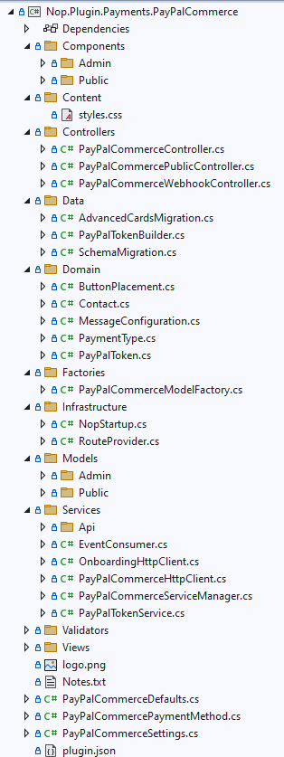

Una de las principales buenas prácticas en nopCommerce consiste en **respetar la separación por
capas** definida por la solución. La lógica de negocio debe mantenerse en los servicios, el
acceso a datos en su capa correspondiente y la presentación en la interfaz. Cuando esta
organización se rompe, el sistema tiende a volverse más difícil de mantener, más frágil ante
cambios y menos coherente con el diseño original de la plataforma.

Un error frecuente consiste en introducir lógica de negocio directamente en controladores o
incluso en vistas. Aunque pueda parecer una solución rápida en un primer momento, este enfoque
genera acoplamiento innecesario y complica enormemente la evolución posterior del proyecto.

#### Evitar modificar el núcleo cuando no sea imprescindible

Otra recomendación fundamental es **evitar modificar directamente el núcleo de nopCommerce**
siempre que exista una alternativa más adecuada. La plataforma está diseñada para ser
extensible mediante temas y plugins, precisamente para reducir la necesidad de intervenir sobre
el código central.

Modificar el núcleo puede parecer una solución sencilla a corto plazo, pero suele generar
problemas importantes en el futuro, sobre todo cuando se actualiza la plataforma. Cada cambio
directo sobre la base del sistema incrementa la dificultad de mantenimiento, complica la
compatibilidad entre versiones y hace más costoso incorporar mejoras oficiales del producto.

Por ello, cuando una necesidad pueda resolverse mediante un plugin o una personalización visual
a través de un tema, esa vía debe ser la opción preferente.

#### Elegir correctamente entre tema y plugin

Uno de los errores conceptuales más frecuentes en nopCommerce es no distinguir bien **cuándo
utilizar un tema y cuándo desarrollar un plugin**. La regla general es sencilla:

- si se desea cambiar la **apariencia** del sitio, la herramienta
adecuada es el **tema**;

- si se desea cambiar la **funcionalidad** del sistema, la vía adecuada
es el **plugin**.

Confundir ambos mecanismos suele llevar a diseños poco limpios. Por ejemplo, introducir lógica
funcional en elementos pensados para la presentación o intentar resolver una necesidad de
integración compleja solo con cambios visuales termina generando soluciones poco mantenibles y
difíciles de escalar.

#### Mantener convenciones de nombres y organización

Respetar una organización clara y coherente dentro de la solución es otra buena práctica muy
importante. Esto afecta tanto al nombrado de proyectos y clases como a la disposición de
carpetas, vistas, controladores y archivos de configuración.

En el caso de los plugins, seguir una nomenclatura del tipo Nop.Plugin.{Grupo}.{Nombre} ayuda a
identificar rápidamente su propósito y a mantener el proyecto alineado con la estructura
general de la plataforma. Del mismo modo, organizar correctamente carpetas como Controllers,
Models, Views o archivos como plugin.json y RouteProvider.cs reduce confusiones y mejora la
mantenibilidad.

Un error frecuente en proyectos personalizados es crear estructuras improvisadas o
inconsistentes, lo que dificulta la localización del código y complica el trabajo futuro sobre
la extensión.

#### Aprovechar la inyección de dependencias

nopCommerce está pensado para trabajar con **inyección de dependencias**, por lo que conviene
apoyarse en este mecanismo siempre que sea posible. Utilizar servicios a través de interfaces o
contratos adecuados mejora el desacoplamiento, facilita las pruebas y permite sustituir
implementaciones con menor impacto.

Un error habitual consiste en crear dependencias rígidas entre componentes o en instanciar
manualmente servicios dentro de clases que deberían recibirlos desde el exterior. Este tipo de
prácticas debilita la arquitectura y dificulta la reutilización del código.

#### Diseñar plugins modulares y autocontenidos

Cuando se desarrolla un plugin, es recomendable que su estructura sea lo más **modular y
autocontenida** posible. Esto significa que el plugin debería concentrar en su propio ámbito
sus controladores, vistas, modelos, rutas, configuración y lógica específica, reduciendo al
mínimo la necesidad de tocar otras partes de la solución.

Cuanto más encapsulada esté la extensión, más fácil será mantenerla, actualizarla o retirarla
sin efectos secundarios. Además, esta organización favorece la compatibilidad con futuras
versiones de nopCommerce y simplifica la detección de problemas cuando algo falla.

Un error común consiste en repartir la lógica de un plugin en múltiples puntos del proyecto
principal, lo que hace que la extensión deje de ser realmente modular y se vuelva más
dependiente del resto del sistema.

#### Revisar siempre el ciclo completo de carga del plugin

Cuando un plugin no aparece o no funciona correctamente, es importante revisar su ciclo de
integración completo: compilación, salida de DLL, presencia del archivo plugin.json, copia de
dependencias, limpieza de caché, registro de rutas y compatibilidad de versión.

Un error muy frecuente es centrarse únicamente en el código del plugin y olvidar que muchos
fallos se producen por cuestiones de configuración o despliegue. En nopCommerce, una extensión
puede estar bien implementada a nivel funcional y, aun así, no ser reconocida por la plataforma
si sus archivos no se encuentran donde corresponde o si faltan recursos esenciales.

#### Gestionar con cuidado la compatibilidad entre versiones

Mantener la compatibilidad entre el plugin, el tema o cualquier personalización y la versión
concreta de nopCommerce es una buena práctica crítica. Las actualizaciones de la plataforma
pueden introducir cambios que afecten a rutas, interfaces, dependencias o comportamientos
internos.

Por ello, antes de asumir que una extensión seguirá funcionando en una versión nueva, conviene
revisar su compatibilidad real. En algunos casos, bastará con actualizar el campo
SupportedVersions del archivo correspondiente; en otros, será necesario adaptar el código.

Un error frecuente es forzar la compatibilidad solo a nivel declarativo sin verificar que la
funcionalidad siga siendo válida en la nueva versión.

#### Mantener separada la lógica de configuración

En los plugins que disponen de interfaz de configuración, conviene mantener claramente
separadas la lógica de la pantalla administrativa y la lógica funcional interna del plugin. La
vista y el controlador deben encargarse de la interacción administrativa, pero el
comportamiento real del plugin debe permanecer encapsulado en sus servicios o en su clase
principal.

Un error frecuente es convertir la pantalla de configuración en un lugar donde también se
concentra la lógica funcional, lo que dificulta el mantenimiento y rompe la separación de
responsabilidades.

#### Utilizar pruebas como apoyo al mantenimiento

Siempre que el desarrollo lo permita, resulta recomendable acompañar las personalizaciones y
extensiones con pruebas coherentes con la arquitectura de nopCommerce. Esto es especialmente
relevante en servicios, reglas de negocio, integraciones o componentes reutilizables.

Un error habitual en desarrollos rápidos o muy orientados a personalización es omitir
totalmente la validación técnica, lo que aumenta el riesgo de errores ocultos y hace mucho más
costosa la evolución del sistema.

#### Errores frecuentes en temas

En el ámbito de los temas, algunos de los errores más habituales son:

- modificar archivos sin comprender antes la jerarquía de layouts;

- realizar cambios visuales en ubicaciones incorrectas;

- mezclar personalización estética con alteraciones funcionales;

- sobrescribir recursos sin mantener una organización clara;

- partir de un tema existente sin actualizar correctamente su
configuración.

Estos problemas suelen provocar incoherencias visuales, dificultades de mantenimiento y errores
al activar o desplegar el tema.

#### Errores frecuentes en plugins

En el desarrollo de plugins, algunos fallos aparecen con especial frecuencia:

- salida del proyecto mal configurada;

- ausencia o configuración incorrecta de plugin.json;

- dependencias no copiadas al directorio de salida;

- rutas no registradas;

- vista de configuración no encontrada;

- atributos de administración ausentes en el controlador;

- métodos de instalación o actualización mal implementados;

- incompatibilidad con la versión actual de nopCommerce.

Muchos de estos errores no se deben a la lógica funcional del plugin, sino a detalles de
integración con la plataforma. Por eso, revisar la estructura completa y el ciclo de vida de la
extensión es tan importante como revisar su código.

La siguiente tabla recoge los problemas más habituales en el desarrollo de plugins, organizados
por síntoma observable, causa probable y solución:

| **Síntoma** | **Causa probable** | **Solución** |
| :-: | :-: | :-: |
| **El plugin no aparece en Local Plugins** | plugin.json ausente, mal configurado o con Build Action incorrecto | Verificar que plugin.json tiene Build Action = Content y Copy to Output Directory = Copy if newer (PreserveNewest) |
| **El plugin aparece pero no instala** | DLL no copiada al directorio de salida | Verificar OutputPath en .csproj y recompilar |
| **La página de configuración devuelve 404** | Ruta no registrada o GetConfigurationPageUrl() devuelve URL incorrecta | Verificar RouteProvider.cs y que la ruta coincide con la devuelta por GetConfigurationPageUrl() |
| **La vista de configuración no se encuentra** | Ruta física de la vista incorrecta en la acción Configure | La ruta debe ser ~/Plugins/{DirectorioSalida}/Views/Configure.cshtml |
| **Los tag helpers no funcionan en las vistas del plugin** | \_ViewImports.cshtml ausente o incorrecto | Copiar \_ViewImports.cshtml desde un plugin existente al directorio Views del plugin |
| **El plugin falla tras actualizar nopCommerce** | Interfaces o contratos modificados en la nueva versión | Revisar el changelog de nopCommerce y actualizar las implementaciones afectadas |
| **Los cambios en el código no tienen efecto** | Caché de compilación persistente | Limpiar la solución y eliminar manualmente el contenido del directorio Nop.Web/Plugins/{DirectorioSalida} antes de recompilar |
| **Error de dependencia en tiempo de ejecución** | DLL de un paquete NuGet no copiada al directorio de salida | Establecer CopyLocalLockFileAssemblies = true en el .csproj del plugin |
| **InstallAsync no se ejecuta** | El plugin no está instalado: nopCommerce invoca InstallAsync únicamente durante la instalación desde Local Plugins | Ejecutar primero la lógica propia y llamar a base.InstallAsync() al final |
| **El plugin aparece como instalado pero no funciona** | SystemName en plugins.json no coincide con el SystemName del plugin.json actual | Desinstalar el plugin desde el panel de administración, corregir el SystemName y reinstalar |

#### Errores frecuentes en arquitectura

Desde una perspectiva más general, también conviene evitar errores como:

- mezclar responsabilidades entre capas;

- acoplar en exceso la presentación con la lógica de negocio;

- acceder a datos desde lugares no adecuados;

- introducir dependencias innecesarias entre componentes;

- crear personalizaciones difíciles de reutilizar o mantener.

Estos problemas suelen no ser evidentes al principio, pero terminan afectando de forma
significativa a la calidad del proyecto cuando este crece o necesita evolucionar.

#### Enfoque recomendado para desarrolladores nuevos

Para quienes se incorporan por primera vez a un proyecto nopCommerce, el enfoque más
recomendable es avanzar de forma gradual:

Primero comprender la arquitectura y el papel de cada capa.

Después identificar si la necesidad es visual o funcional; a continuación elegir correctamente
entre tema, plugin o ajuste interno y finalmente implementar la solución respetando las
convenciones y el desacoplamiento de la plataforma.

Este enfoque reduce errores de diseño y facilita que las ampliaciones encajen mejor en la
filosofía del sistema.

**Checklist de verificación antes de desplegar un plugin**

Antes de desplegar un plugin en un entorno de producción o de entregarlo para su instalación,
conviene verificar sistemáticamente los siguientes puntos. Muchos de los problemas que aparecen
tras el despliegue tienen su origen en alguno de estos elementos pasados por alto durante el
desarrollo:

**Estructura y archivos obligatorios**

- El archivo plugin.json existe, está correctamente configurado y tiene
Build Action = Content y Copy to Output Directory = Copy if newer (PreserveNewest)

- El campo SystemName en plugin.json es único y no coincide con ningún
otro plugin del sistema

- El campo SupportedVersions en plugin.json incluye la versión de
nopCommerce del entorno de destino

- El campo FileName en plugin.json coincide exactamente con el nombre de
la DLL generada

- El archivo \_ViewImports.cshtml existe en la carpeta Views del plugin

**Compilación y despliegue**

- El OutputPath en el .csproj apunta al directorio correcto dentro de
Nop.Web/Plugins/

- Tras compilar, el directorio de salida contiene la DLL principal,
plugin.json y las vistas

- Si el plugin usa paquetes NuGet adicionales,
CopyLocalLockFileAssemblies = true está habilitado y las DLL de esas dependencias están
presentes en el directorio de salida

- Se ha ejecutado ClearPluginAssemblies para eliminar DLL redundantes
del directorio de salida

**Funcionalidad**

- El plugin aparece correctamente en Admin → Configuration → Local
Plugins

- El plugin instala sin errores y InstallAsync llama a
base.InstallAsync() al final

- Si tiene página de configuración, el enlace aparece en Local Plugins y
la página carga correctamente

- Las rutas registradas en RouteProvider.cs se resuelven sin errores 404

- UninstallAsync limpia correctamente los recursos generados durante la
instalación y llama a base.UninstallAsync() al final

**Seguridad**

- Los controladores administrativos tienen los atributos
\[AuthorizeAdmin\], \[Area(AreaNames.ADMIN)\] y \[AutoValidateAntiforgeryToken\]

- No hay lógica de negocio sensible expuesta en rutas públicas sin
protección

**Compatibilidad**

- El plugin ha sido probado contra la versión concreta de nopCommerce
del entorno de destino

- Si se han introducido cambios de versión, UpdateAsync gestiona
correctamente la migración de configuración existente

Trabajar correctamente con nopCommerce no depende solo de conocer sus proyectos o sus archivos,
sino también de aplicar criterios adecuados de diseño, extensión y mantenimiento. Respetar la
arquitectura, evitar modificar el núcleo innecesariamente, distinguir bien entre temas y
plugins, mantener una organización clara y revisar cuidadosamente la compatibilidad y el ciclo
de vida de las extensiones son prácticas fundamentales para desarrollar soluciones más limpias,
robustas y sostenibles en el tiempo.

# Parte VIII — Capacidades transversales {#parte-viii}

## Capítulo 25 — Multi-tienda {#capitulo-25}

Describe el modelo de varias tiendas dentro de una instalación, el contexto de tienda activo, el alcance de configuración por tienda y el mapeo de entidades.

**Parte VIII — Capacidades transversales** · Nivel: Intermedio

Este capítulo cubre la gestión multi-tienda, el contexto de tienda activo, el alcance de configuración por ajuste y el mapeo de entidades por tienda; Sirve para operar varias tiendas desde una instalación única de nopCommerce; Los conceptos clave incluyen Store, StoreMapping, IStoreContext y SaveSettingOverridablePerStoreAsync; Prerrequisitos: capítulos 13 (tienda pública y administración) y 17 (diseño interno de un plugin); Caso de uso típico: definir qué ajustes son globales y cuáles dependen de cada tienda.

**Trampas frecuentes:**

> - `GetActiveStoreScopeConfigurationAsync()` devuelve `0` cuando no hay alcance seleccionado; en ese caso solo se debe modificar la configuración global.
> - Guardar un ajuste con `SaveSettingAsync` cuando se esperaba un valor por tienda sobrescribe el valor global de todas las tiendas.
> - Una entidad sin `IStoreMappingSupported` no puede filtrarse por tienda; `ApplyStoreMapping` no es aplicable a esos tipos.
> - `StoreMapping` y `AclRecord` son tablas distintas con finalidad distinta; no se deben usar de forma intercambiada.
> - `DeleteStoreAsync` elimina la tienda sin limpiar sus `StoreMapping` ni sus sobrescrituras de configuración; esas filas quedan huérfanas.
> - `DeleteStoreAsync` lanza una excepción si la tienda que se intenta borrar es la única configurada.

---

nopCommerce admite varias tiendas dentro de una misma instalación. Cada tienda tiene su propio dominio o ruta, y comparte la base de datos con el resto. El capítulo describe el modelo de datos, el contexto de tienda activo, el alcance de la configuración y el mapeo de entidades por tienda.

Toda la verificación se realizó sobre la rama 4.90.8. Cuando un símbolo citado en documentación previa no existe en esta versión, se indica su equivalente real.

### Modelo de datos de tienda

La entidad `Store` vive en el namespace `Nop.Core.Domain.Stores` y representa una tienda física de la instalación. El servicio de acceso es `IStoreService` (`Nop.Services.Stores`).

| Método (`IStoreService`) | Responsabilidad |
|---------------------------|-----------------|
| `GetAllStoresAsync()` | Devuelve todas las tiendas configuradas |
| `GetStoreByIdAsync(int storeId)` | Recupera una tienda por identificador |
| `InsertStoreAsync(Store)` / `UpdateStoreAsync(Store)` / `DeleteStoreAsync(Store)` | Persiste cambios |
| `GetNotExistingStoresAsync(string[])` | Valida nombres o identificadores inexistentes |

La entidad `StoreMapping` (`Nop.Core.Domain.Stores`) asocia una entidad de negocio con una o varias tiendas. Sus campos son `EntityId`, `EntityName` y `StoreId`. El rol de cliente no interviene en esta tabla; se gestiona en la ACL (Capítulo 29).

> Nota: la configuración general se almacena en la tabla `Setting`, cuya columna `StoreId` vale `0` cuando el valor es global.

### Contexto de tienda activo

`IStoreContext` (`Nop.Core`) resuelve la tienda de la petición actual. Su implementación en la 4.90.8 es `Nop.Web.Framework.WebStoreContext`.

Métodos relevantes:

- `GetCurrentStoreAsync()`: tienda derivada de la petición en curso.
- `GetActiveStoreScopeConfigurationAsync()`: identificador de tienda utilizado para el alcance de configuración en el panel de administración.

El valor del alcance se transporta con el atributo `NopCustomerDefaults.AdminAreaStoreScopeConfigurationAttribute` y se establece en la acción `ChangeStoreScopeConfiguration` de `SettingController`.

```csharp
var storeScopeId = await _storeContext.GetActiveStoreScopeConfigurationAsync();
```

### Alcance de configuración por tienda

`ISettingService` (`Nop.Services.Configuration`) permite sobrescribir un ajuste global por tienda:

- `SaveSettingOverridablePerStoreAsync<T, TPropType>(setting, keySelector, overrideForStore, storeId)`.

El comportamiento es el siguiente (verificado en `SettingService.cs`, línea 780):

1. Si `overrideForStore` es verdadero o `storeId` es `0`, guarda el ajuste con `SaveSettingAsync` en ese ámbito.
2. Si `overrideForStore` es falso y `storeId` es mayor que `0`, elimina la sobrescritura de la tienda con `DeleteSettingAsync` y queda vigente el valor global (`StoreId = 0`).

La lectura de un ajuste en el panel de administración debe combinar el valor global con la sobrescritura de tienda; el detalle de ese patrón se describe más arriba, en la sección «Alcance de configuración por tienda».

### Mapeo de entidades por tienda

`IStoreMappingService` (`Nop.Services.Stores`) controla qué entidades son visibles en cada tienda. Requiere que la entidad implemente `IStoreMappingSupported`.

| Método | Responsabilidad |
|--------|-----------------|
| `ApplyStoreMapping<TEntity>(IQueryable<TEntity>, int storeId)` | Filtra una consulta por tienda |
| `GetStoreMappingsAsync<TEntity>(TEntity)` | Lista los mapeos de una entidad |
| `GetStoresIdsWithAccessAsync<TEntity>(TEntity)` | Identificadores de tienda con acceso |
| `InsertStoreMappingAsync<TEntity>(TEntity, int storeId)` | Añade un mapeo |
| `SaveStoreMappingsAsync<TEntity>(TEntity, IEnumerable<int>)` | Sustituye el conjunto de tiendas |
| `AuthorizeAsync<TEntity>(TEntity, int storeId)` | Comprueba acceso de la entidad a la tienda |

Este servicio es paralelo a `IAclService` (Capítulo 29): uno filtra por tienda, el otro por rol de cliente.

### Consideraciones operativas

- Cada tienda declara su propia URL; `TaskScheduler` construye la dirección de ejecución de tareas con la URL de la tienda actual (Capítulo 28).
- El idioma disponible por tienda se resuelve con `ILanguageService.GetAllLanguagesAsync(storeId: storeId)`.
- La caché de entidades por tienda usa claves que incorporan el identificador de tienda (Capítulo 27).

### Fuentes verificadas

- `Libraries/Nop.Core/Domain/Stores/Store.cs`
- `Libraries/Nop.Core/Domain/Stores/StoreMapping.cs`
- `Libraries/Nop.Services/Stores/IStoreService.cs`
- `Libraries/Nop.Services/Stores/IStoreMappingService.cs`
- `Libraries/Nop.Services/Configuration/SettingService.cs`
- `Presentation/Nop.Web.Framework/WebStoreContext.cs`
- `Presentation/Nop.Web/Areas/Admin/Controllers/SettingController.cs`

> Fecha de consulta: 2026-10-17.

## Capítulo 26 — Localización, monedas y regionalización {#capitulo-26}

Describe la separación entre idioma de interfaz, moneda y formato regional, sus servicios, recursos de texto y la resolución del idioma de la petición.

**Parte VIII — Capacidades transversales** · Nivel: Intermedio

Este capítulo cubre la localización de textos, la gestión de monedas y tipos de cambio y la adaptación regional de la tienda; Sirve para preparar la plataforma para varios idiomas, monedas y regiones; Los conceptos clave incluyen Language, LocaleStringResource, LocalizedProperty, Currency e IExchangeRateProvider; Prerrequisitos: capítulos 10 (inyección de dependencias) y 17 (diseño interno de un plugin); Caso de uso típico: adaptar una tienda existente a nuevos mercados.

**Trampas frecuentes:**

> - Guardar fechas en la zona horaria del cliente en lugar de UTC rompe la comparación con tareas programadas y registros (Capítulos 28 y 30).
> - `LocaleStringResource` y `LocalizedProperty` son tablas distintas: la primera para cadenas de interfaz, la segunda para propiedades de entidades.
> - Un idioma deshabilitado sigue existiendo en base de datos; `GetAllLanguagesAsync()` sin `showHidden` lo excluye, pero las consultas directas no.
> - Cambiar `CurrencySettings.ActiveExchangeRateProviderSystemName` sin instalar el plugin correspondiente deja la conversión sin proveedor.
> - `PriceFormatter` formatea; no convierte. La conversión depende de `ExchangeRate` y del proveedor activo.

---

La localización separa tres conceptos: idioma (interfaz), moneda (precios) y formato regional (fechas y números). Cada uno tiene su entidad, su servicio y sus ajustes. Este capítulo describe únicamente los componentes de la plataforma; la traducción de plantillas de mensajes se trata en el Capítulo 31.

### Idiomas

La entidad `Language` (`Nop.Core.Domain.Localization`) define un idioma disponible. `ILanguageService` (`Nop.Services.Localization`) expone entre otros métodos:

- `GetAllLanguagesAsync(bool showHidden = false, int storeId = 0)`: idiomas visibles, opcionalmente filtrados por tienda.
- `GetLanguageByIdAsync(int languageId)`.

`LocalizationSettings` (`Nop.Core.Domain.Localization`) guarda los ajustes de localización, entre ellos el idioma por defecto del panel de administración.

### Recursos de texto

Dos niveles distintos de traducción:

| Componente | Namespace | Alcance |
|------------|-----------|---------|
| `LocaleStringResource` | `Nop.Core.Domain.Localization` | Cadenas de interfaz por clave e idioma |
| `ILocalizationService` | `Nop.Services.Localization` | Lectura de claves de recurso |
| `ILocalizedEntityService` | `Nop.Services.Localization` | Traducción de propiedades de entidades |

`ILocalizationService.GetResourceAsync(string resourceKey)` devuelve el recurso del idioma activo; la sobrecarga completa admite idioma, valor por defecto y logueo si la clave no existe.

`ILocalizedEntityService` almacena traducciones de propiedades (nombre de producto, descripción) en `LocalizedProperty`.

```csharp
var title = await _localizationService.GetResourceAsync("ShoppingCart.CartIsEmpty");
```

### Monedas y tipos de cambio

La entidad `Currency` (`Nop.Core.Domain.Directory`) incluye `DisplayLocale` y `CustomFormatting` para controlar el formato del símbolo y los decimales. El servicio correspondiente es `ICurrencyService`.

| Elemento | Propósito |
|----------|-----------|
| `Currency` | Moneda habilitada y su formato |
| `ExchangeRate` | Tipo de cambio entre monedas |
| `CurrencySettings` | Ajustes, entre ellos el proveedor de tipos de cambio activo |
| `IExchangeRateProvider` | Interfaz de proveedor de tipos de cambio (`Nop.Services.Directory`, hereda de `IPlugin`) |

`CurrencySettings.ActiveExchangeRateProviderSystemName` identifica el plugin proveedor en uso. El valor vacío indica que no hay proveedor automático configurado.

### Formato de precios y fechas

- `IPriceFormatter` (`Nop.Services.Catalog`, implementación `PriceFormatter`) formatea precios mediante `FormatPriceAsync`.
- `IDateTimeHelper` (`Nop.Services.Helpers`) convierte entre UTC y la zona horaria del cliente.
- `DateTimeSettings` (`Nop.Services.Helpers`) define la zona horaria por defecto y si se permite la elección por cliente.
- `Customer.TimeZoneId` (`Nop.Core.Domain.Customers`) almacena la zona horaria seleccionada por el cliente.

El servidor almacena fechas en UTC; la conversión a zona horaria ocurre en la capa de presentación.

### Idioma de la petición

`WebWorkContext` (`Nop.Web.Framework`) resuelve el idioma de la petición consultando `ILanguageService.GetAllLanguagesAsync(storeId: storeId)` con la tienda activa. Si no hay coincidencia, selecciona el primer idioma registrado en la instalación.

### Fuentes verificadas

- `Libraries/Nop.Core/Domain/Localization/Language.cs`
- `Libraries/Nop.Core/Domain/Localization/LocaleStringResource.cs`
- `Libraries/Nop.Core/Domain/Directory/Currency.cs`
- `Libraries/Nop.Core/Domain/Directory/CurrencySettings.cs`
- `Libraries/Nop.Services/Localization/ILocalizationService.cs`
- `Libraries/Nop.Services/Localization/NopLocalizationDefaults.cs`
- `Libraries/Nop.Services/Directory/IExchangeRateProvider.cs`
- `Presentation/Nop.Web.Framework/WebWorkContext.cs`

> Fecha de consulta: 2026-10-17.

## Capítulo 27 — Caché e invalidación {#capitulo-27}

Describe los dos niveles de caché de la 4.90.8, sus implementaciones registradas, las claves y el flujo de invalidación automática.

**Parte VIII — Capacidades transversales** · Nivel: Avanzado

Este capítulo cubre la caché entre peticiones y durante la petición, la selección del proveedor según DistributedCacheConfig y las estrategias de invalidación; Sirve para decidir qué datos cachear y cómo invalidarlos de forma coherente; Los conceptos clave incluyen IStaticCacheManager, IShortTermCacheManager, DistributedCacheConfig y la invalidación por prefijo; Prerrequisitos: capítulos 10 (inyección de dependencias), 17 (diseño interno de un plugin) y 20 (sistema de eventos); Caso de uso típico: reducir consultas a base de datos sin servir datos obsoletos tras un cambio de configuración o de entidades.

**Trampas frecuentes:**

> - Usar `IShortTermCacheManager` para datos que deben sobrevivir a la petición produce lecturas obsoletas en la siguiente petición.
> - Claves sin el identificador de tienda o de idioma devuelven datos de otra tienda o idioma (Capítulos 25 y 26).
> - `RemoveByPrefixAsync` solo elimina lo que cuelga del prefijo exacto; un prefijo mal formado no invalida nada y no lanza error.
> - Con `DistributedCacheConfig.Enabled = false`, cada proceso usa su propia memoria: en un despliegue con varias instancias la caché no se comparte (Capítulo 34).
> - Al activar la caché distribuida cambia el bloqueo disponible (`DistributedCacheLocker` en lugar de `MemoryCacheLocker`), de lo que dependen las tareas programadas (Capítulo 28).
> - `ClearAsync()` purga la caché del proveedor activo; con varias instancias y Redis, el borrado llega a todas, pero con memoria local no.

---

nopCommerce separa la caché en dos niveles: una caché de largo plazo entre peticiones y una caché de corto plazo dentro de la petición en curso. Ambas comparten el sistema de claves. Este capítulo describe las interfaces reales de la 4.90.8, los proveedores disponibles y el mecanismo de invalidación.

### Interfaces de caché

En la 4.90.8 no existe ninguna interfaz denominada `ICacheManager`. Las interfaces reales son:

| Interfaz | Namespace | Alcance |
|----------|-----------|---------|
| `IStaticCacheManager` | `Nop.Core.Caching` | Entre peticiones (largo plazo); hereda de `IDisposable` y `ICacheKeyService` |
| `IShortTermCacheManager` | `Nop.Core.Caching` | Durante la petición HTTP |

`IStaticCacheManager` expone:

```csharp
Task<T> GetAsync<T>(CacheKey key, Func<Task<T>> acquire);
Task<T> GetAsync<T>(CacheKey key, T defaultValue = default);
Task SetAsync<T>(CacheKey key, T data);
Task RemoveAsync(CacheKey cacheKey, params object[] cacheKeyParameters);
Task RemoveByPrefixAsync(string prefix, params object[] prefixParameters);
Task ClearAsync();
```

`IShortTermCacheManager` es síncrono para la invalidación (`Remove`, `RemoveByPrefix`) y asíncrono para la lectura (`GetAsync`).

### Implementaciones

La selección se hace en `NopStartup.cs` (`Presentation/Nop.Web.Framework/Infrastructure/NopStartup.cs`, líneas 91–132) a partir de `DistributedCacheConfig`:

| Condición | `IStaticCacheManager` registrado | Fichero |
|-----------|----------------------------------|---------|
| `DistributedCacheConfig.Enabled = false` (por defecto) | `MemoryCacheManager` | `Libraries/Nop.Core/Caching/MemoryCacheManager.cs` |
| `Enabled` y tipo `Memory` | `MemoryDistributedCacheManager` | `Libraries/Nop.Services/Caching/MemoryDistributedCacheManager.cs` |
| `Enabled` y tipo `SqlServer` | `MsSqlServerCacheManager` | `Libraries/Nop.Services/Caching/MsSqlServerCacheManager.cs` |
| `Enabled` y tipo `Redis` | `RedisCacheManager` | `Libraries/Nop.Services/Caching/RedisCacheManager.cs` |
| `Enabled` y tipo `RedisSynchronizedMemory` | `SynchronizedMemoryCacheManager` | `Libraries/Nop.Core/Caching/SynchronizedMemoryCacheManager.cs` |

`DistributedCacheManager` (`Libraries/Nop.Core/Caching/DistributedCacheManager.cs`) es la clase abstracta de la que heredan los proveedores distribuidos. `PerRequestCacheManager` se registra siempre como `IShortTermCacheManager`.

El bloqueo asociado cambia también: `MemoryCacheLocker` sin caché distribuida y `DistributedCacheLocker` con ella; ambos implementan `ILocker`, que utilizan `ScheduleTaskRunner` (Capítulo 28).

`RedisCacheManager` usa `IRedisConnectionWrapper` (`Libraries/Nop.Services/Caching/`). En el modo `RedisSynchronizedMemory`, `SynchronizedMemoryCacheManager` se apoya en `RedisSynchronizedMemoryCache` (implementación de `ISynchronizedMemoryCache`). `CacheConfig.DefaultCacheTime` fija la expiración por defecto en minutos (valor por defecto: 60).

### Claves de caché

- `CacheKey` (`Nop.Core.Caching`) representa una clave con su prefijo y tiempo de expiración.
- `ICacheKeyService` encapsula la construcción de claves a partir de plantilla y parámetros.
- `NopEntityCacheDefaults` (`Nop.Core.Caching`) define las claves y prefijos de las entidades por defecto.

Las claves deben incorporar el identificador de tienda, el de idioma y los identificadores de entidad cuando apliquen, para que la invalidación por prefijo sea efectiva.

### Invalidación automática

`CacheEventConsumer<TEntity>` (`Nop.Services.Caching`) escucha los eventos de inserción, actualización y borrado publicados por `IEventPublisher` y limpia las claves relacionadas con `TEntity`.

Flujo de invalidación:

1. Un servicio persiste un cambio y publica el evento.
2. `CacheEventConsumer<TEntity>` recibe el evento.
3. El consumer elimina las claves por prefijo mediante `RemoveByPrefixAsync` o `RemoveByPrefix`.
4. La siguiente lectura vuelve a cargar el dato con `GetAsync(acquire)`.

La invalidación manual directa sobre `IStaticCacheManager.ClearAsync()` purga toda la caché; se reserva a operaciones de mantenimiento.

### Configuración

`DistributedCacheConfig` (`Nop.Core.Configuration`) se lee de `appsettings.json` (Capítulo 34):

| Propiedad | Contenido | Valor por defecto |
|-----------|-----------|-------------------|
| `Enabled` | Activa la caché distribuida | `false` |
| `DistributedCacheType` | `Memory`, `SqlServer`, `Redis` o `RedisSynchronizedMemory` | `RedisSynchronizedMemory` |
| `ConnectionString` | Conexión de Redis o SQL Server | `127.0.0.1:6379,ssl=False` |
| `SchemaName` / `TableName` | Esquema y tabla en SQL Server | `dbo` / `DistributedCache` |
| `InstanceName` | Instancia Redis | `nopCommerce` |
| `PublishIntervalMs` | Intervalo de publicación de eventos Redis | `500` |

`CacheConfig` aporta `DefaultCacheTime` (60 minutos) y `LinqDisableQueryCache` (`false`).

### Fuentes verificadas

- `Libraries/Nop.Core/Caching/IStaticCacheManager.cs`
- `Libraries/Nop.Core/Caching/IShortTermCacheManager.cs`
- `Libraries/Nop.Core/Caching/CacheKey.cs`
- `Libraries/Nop.Core/Caching/MemoryCacheManager.cs`
- `Libraries/Nop.Core/Caching/PerRequestCacheManager.cs`
- `Libraries/Nop.Core/Caching/DistributedCacheManager.cs`
- `Libraries/Nop.Core/Configuration/DistributedCacheConfig.cs`
- `Libraries/Nop.Services/Caching/RedisCacheManager.cs`
- `Libraries/Nop.Services/Caching/CacheEventConsumer.cs`
- `Presentation/Nop.Web.Framework/Infrastructure/NopStartup.cs`

> Fecha de consulta: 2026-10-17.

## Capítulo 28 — Tareas programadas {#capitulo-28}

Describe el modelo de tarea, el planificador de hilos, el ciclo de ejecución con bloqueo y el procedimiento para añadir tareas propias.

**Parte VIII — Capacidades transversales** · Nivel: Intermedio

Este capítulo cubre las tareas programadas de nopCommerce: entidad ScheduleTask, TaskScheduler, ScheduleTaskRunner y las tareas instaladas por defecto; Sirve para ejecutar de forma periódica procesos propios de la plataforma o de un plugin; Los conceptos clave incluyen ScheduleTask, TaskScheduler, ScheduleTaskRunner y la tabla ScheduleTask; Prerrequisitos: capítulos 15 (estructura completa de un plugin) y 17 (diseño interno de un plugin); Caso de uso típico: programar un proceso propio de un plugin sin bloquear la respuesta a las solicitudes.

**Trampas frecuentes:**

> - El planificador no arranca si la base de datos no está instalada; `InitializeAsync()` retorna sin crear hilos en ese caso.
> - Las tareas se ejecutan por HTTP contra `scheduletask/runtask` de la URL de la tienda; una URL mal configurada impide la ejecución silenciosamente.
> - Ejecutar una tarea antes de que complete su periodo no se ejecuta (retorno silencioso) por `ensureRunOncePerPeriod`, salvo que se use `forceRun`.
> - Si `StopOnError` es verdadero, un único fallo desactiva la tarea hasta que se reactive manualmente.
> - Resolver el tipo de la tarea solo por nombre corto funciona, pero falla si hay dos tipos homónimos en ensamblados distintos.
> - Los hilos se calculan al arrancar; añadir o modificar una tarea en base de datos no surte efecto hasta reiniciar la aplicación.

---

Las tareas programadas ejecutan procesos periódicos (envío de correo, limpieza, sincronizaciones). En la 4.90.8 el motor se compone de `ITaskScheduler`, que crea un hilo por tarea, y de `IScheduleTaskRunner`, que ejecuta cada tarea con bloqueo. No existe ninguna clase `TaskManager` ni interfaz `IWorker` en esta versión.

### Modelo de tarea

La entidad `ScheduleTask` (`Nop.Core.Domain.ScheduleTasks`) define:

| Campo | Significado |
|-------|-------------|
| `Name` | Nombre visible en el panel de administración |
| `Type` | Nombre de tipo CLR que implementa `IScheduleTask` |
| `Seconds` | Periodo en segundos |
| `Enabled` | Si la tarea está activa |
| `StopOnError` | Si debe desactivarse tras un error |
| `LastStartUtc`, `LastEndUtc`, `LastSuccessUtc` | Marcas de última ejecución |
| `LastEnabledUtc` | Marca de última activación |

La interfaz `IScheduleTask` (`Nop.Services.ScheduleTasks`) declara `ExecuteAsync()`. El acceso a datos lo proporciona `IScheduleTaskService` con `GetAllTasksAsync()` y `UpdateTaskAsync(ScheduleTask)`.

### Planificador

`ITaskScheduler` / `TaskScheduler` (`Nop.Services.ScheduleTasks`) prepara y arranca los hilos:

1. `InitializeAsync()` comprueba que la base de datos esté instalada (`DataSettingsManager.IsDatabaseInstalled()`) y que aún no haya hilos creados.
2. Ordena las tareas por `Seconds`.
3. Crea un `TaskThread` por tarea con la URL de ejecución `{store.Url}/scheduletask/runtask` (`NopTaskDefaults.ScheduleTaskPath`).
4. Calcula `InitSeconds`: ejecución inmediata si la última arrancada está vencida, o el tiempo restante hasta completar el periodo.
5. `StartSchedulerAsync()` inicia todos los hilos con `Task.WhenAll`.

El tiempo de espera de cada ejecución procede de `CommonConfig.ScheduleTaskRunTimeout`, expresado en milisegundos y `null` por defecto (Capítulo 34).

### Ejecución

`IScheduleTaskRunner` / `ScheduleTaskRunner` ejecuta la tarea:

```csharp
await _locker.PerformActionWithLockAsync(
    scheduleTask.Type, expiration, () => PerformTaskAsync(scheduleTask));
```

Puntos del flujo `ExecuteAsync(ScheduleTask, forceRun, throwException, ensureRunOncePerPeriod)`:

- Si la tarea está deshabilitada y no se fuerza la ejecución, no hace nada.
- `IsTaskAlreadyRunning` descarta ejecuciones concurrentes comparando `LastStartUtc` con `LastEndUtc` y el periodo `Seconds`.
- El bloqueo (`ILocker`) tiene una expiración de `min(Seconds, 300) - 1` segundos.
- `PerformTaskAsync` resuelve el tipo con `Type.GetType` o `AppDomain.CurrentDomain.GetAssemblies()`, lo resuelve del contenedor y actualiza `LastStartUtc`, `LastEndUtc` y `LastSuccessUtc`.
- En caso de error, desactiva la tarea si `StopOnError` es verdadero y registra el fallo con `ILogger.ErrorAsync`.

### Tareas incluidas

La instalación crea las tareas en `InstallRequiredData.InstallScheduleTasksAsync()` (`Libraries/Nop.Services/Installation/`, línea 3422), invocado desde `InstallationService`. Entre ellas está `QueuedMessagesSendTask`, responsable del envío de la cola de correo (Capítulo 31).

El arranque del planificador lo hace `AppStartedConsumer` (`Presentation/Nop.Web.Framework/Infrastructure/AppStartedConsumer.cs`), que al recibir `AppStartedEvent` llama a `_taskScheduler.InitializeAsync()` y `StartSchedulerAsync()`.

### Cómo añadir una tarea

1. Implementar `IScheduleTask` con `ExecuteAsync()`.
2. Registrar el tipo en el contenedor de dependencias.
3. Insertar una fila en la tabla `ScheduleTask` con el nombre de tipo completo y el periodo.

Los plugins crean esa fila en su migración. Ejemplo verificado: `Plugins/Nop.Plugin.Tax.Avalara/Data/ScheduleTaskMigration.cs`.

### Fuentes verificadas

- `Libraries/Nop.Core/Domain/ScheduleTasks/ScheduleTask.cs`
- `Libraries/Nop.Services/ScheduleTasks/TaskScheduler.cs`
- `Libraries/Nop.Services/ScheduleTasks/ScheduleTaskRunner.cs`
- `Libraries/Nop.Services/ScheduleTasks/NopTaskDefaults.cs`
- `Libraries/Nop.Services/Installation/InstallRequiredData.cs`
- `Presentation/Nop.Web.Framework/Infrastructure/AppStartedConsumer.cs`
- `Plugins/Nop.Plugin.Tax.Avalara/Data/ScheduleTaskMigration.cs`

> Fecha de consulta: 2026-10-17.

## Capítulo 29 — Permisos, ACL y roles {#capitulo-29}

Describe la definición de permisos en código, su asignación a roles de cliente, la autorización en el panel de administración y el ACL de entidades.

**Parte VIII — Capacidades transversales** · Nivel: Intermedio

Este capítulo cubre el modelo de autorización de la 4.90.8: PermissionConfig, PermissionRecord, los atributos del área de administración y el control de acceso por entidad; Sirve para restringir quién puede operar cada parte del sistema; Los conceptos clave incluyen PermissionConfig, PermissionRecord, AuthorizeAdminAttribute y AclRecord; Prerrequisitos: capítulos 13 (tienda pública y administración) y 17 (diseño interno de un plugin); Caso de uso típico: restringir el acceso al panel de administración y controlar la visibilidad de entidades por rol.

**Trampas frecuentes:**

> - Un cliente sin rol asociado no supera `AuthorizeAsync`, aunque su correo esté verificado.
> - `InsertPermissionsAsync()` crea permisos según `PermissionConfig`; eliminar permisos desde la base de datos sin retirar los mapeos deja filas huérfanas.
> - `ApplyAcl` filtra consultas; no autoriza puntualmente. Para comprobar un solo elemento se usa `AuthorizeAsync`.
> - `AuthorizeAdminAttribute` solo exige `ACCESS_ADMIN_PANEL`; los permisos de sección se comprueban con `CheckPermissionAttribute`.
> - Los `AclRecord` y `StoreMapping` de una entidad se gestionan por separado: olvidar uno de los dos deja la entidad visible donde no corresponde.

---

El modelo de autorización tiene dos ejes independientes: permisos de panel de administración asignados a roles de cliente, y ACL de entidades que controla la visibilidad de un elemento por rol. En la 4.90.8 los permisos se definen en `PermissionConfig` mediante `IPermissionConfigManager`; no existe la clase `StandardPermissionProvider` de versiones anteriores.

### Definición de permisos

| Tipo | Namespace | Responsabilidad |
|------|-----------|-----------------|
| `PermissionRecord` | `Nop.Core.Domain.Security` | Permiso persistido con `SystemName` |
| `PermissionConfig` | `Nop.Services.Security` | Definición en código: `Name`, `SystemName`, `Category`, `DefaultCustomerRoles` |
| `StandardPermission` | `Nop.Services.Security` | Constantes de nombre del sistema |
| `IPermissionConfigManager` / `DefaultPermissionConfigManager` | `Nop.Services.Security` | Expone la configuración de permisos |

`PermissionConfig` recibe en su constructor nombre, nombre de sistema, categoría y los nombres de rol de cliente que reciben el permiso por defecto.

### Asignación a roles

- `PermissionRecordCustomerRoleMapping` (`Nop.Core.Domain.Security`) relaciona permiso y rol.
- `CustomerRole` (`Nop.Core.Domain.Customers`) es el rol de cliente.
- `IPermissionService` (`Nop.Services.Security`) gestiona el ciclo de vida.

Métodos principales de `IPermissionService`:

```csharp
Task<IList<PermissionRecord>> GetAllPermissionRecordsAsync();
Task InsertPermissionsAsync();                            // crea permisos desde PermissionConfig
Task InsertPermissionMappingAsync(int customerRoleId, params string[] permissions);
Task<bool> AuthorizeAsync(string permissionRecordSystemName);
Task<bool> AuthorizeAsync(string permissionRecordSystemName, Customer customer);
Task<IList<PermissionRecordCustomerRoleMapping>> GetMappingByPermissionRecordIdAsync(int permissionId);
```

### Autorización en el panel de administración

- `AuthorizeAdminAttribute` exige el permiso `StandardPermission.Security.ACCESS_ADMIN_PANEL`.
- `CheckPermissionAttribute` comprueba un permiso concreto y admite `CheckPermissionResultType` para decidir la respuesta ante denegación.
- Ambos atributos se aplican sobre acciones y controladores de `Nop.Web.Areas.Admin`.

El flujo de comprobación es: identificar al cliente, obtener sus roles, contrastarlos con los mapeos del permiso y devolver `true` o `false`.

### ACL de entidades

`IAclService` (`Nop.Services.Security`) aplica control de acceso a entidades que implementan `IAclSupported`. La entidad de persistencia es `AclRecord` (`Nop.Core.Domain.Security`).

| Método | Responsabilidad |
|--------|-----------------|
| `ApplyAcl<TEntity>(IQueryable<TEntity>, Customer)` | Filtra una consulta |
| `GetAclRecordsAsync<TEntity>(TEntity)` | Lista los registros ACL de una entidad |
| `InsertAclRecordAsync<TEntity>(TEntity, int customerRoleId)` | Añade un registro |
| `SaveAclAsync<TEntity>(TEntity, IList<int>)` | Sustituye los roles permitidos |
| `GetCustomerRoleIdsWithAccessAsync(int entityId, string entityName)` | Roles con acceso |
| `AuthorizeAsync<TEntity>(TEntity, Customer)` | Comprueba autorización |

No existe `GetAccessControlList`; el método equivalente para lectura es `GetAclRecordsAsync`.

### Relación con tiendas

El filtrado por tienda (Capítulo 25) es un eje adicional, no una sustitución: una entidad puede estar publicada en una tienda y, dentro de ella, visible solo para determinados roles.

### Fuentes verificadas

- `Libraries/Nop.Core/Domain/Security/PermissionRecord.cs`
- `Libraries/Nop.Core/Domain/Security/AclRecord.cs`
- `Libraries/Nop.Services/Security/PermissionConfig.cs`
- `Libraries/Nop.Services/Security/IPermissionService.cs`
- `Libraries/Nop.Services/Security/IAclService.cs`
- `Libraries/Nop.Services/Security/DefaultPermissionConfigManager.cs`
- `Presentation/Nop.Web.Framework/Mvc/Filters/AuthorizeAdminAttribute.cs`
- `Presentation/Nop.Web.Framework/Mvc/Filters/CheckPermissionAttribute.cs`

> Fecha de consulta: 2026-10-17.

## Capítulo 30 — Diagnóstico y registro {#capitulo-30}

Describe la interfaz de registro, los niveles con su valor numérico, la entidad de registro, los eventos internos y el manejo de excepciones.

**Parte VIII — Capacidades transversales** · Nivel: Intermedio

Este capítulo cubre el registro de diagnóstico con ILogger y DefaultLogger, los niveles de registro, la publicación y consumo de eventos y el manejador de excepciones de la aplicación; Sirve para diagnosticar errores en ejecución sin perder trazabilidad; Los conceptos clave incluyen ILogger, DefaultLogger, LogLevel e IEventPublisher; Prerrequisitos: capítulos 10 (inyección de dependencias) y 20 (sistema de eventos); Caso de uso típico: diagnosticar errores en producción y registrar eventos de dominio de forma controlada.

**Trampas frecuentes:**

> - `DefaultLogger.IsEnabled` desactiva `Debug`; cualquier dependencia de ese nivel no producirá salida.
> - Los mensajes de `ErrorAsync` con excepción incluyen el detalle completo; no deben contener datos sensibles del cliente.
> - Sin base de datos instalada, el manejador de excepciones no escribe en `Log`: el error solo llega a la página.
> - Una excepción en un consumidor de eventos queda registrada y no detiene el resto, salvo en `AppStartedEvent`, que sí se propaga.
> - Usar `InformationAsync` para errores distorsiona el filtro por nivel en el panel de administración.

---

El registro de diagnóstico se centraliza en `ILogger`, con `DefaultLogger` como implementación por defecto. En la 4.90.8 estos tipos viven en el namespace `Nop.Services.Logging`; no existe ningún namespace `Nop.Logging`. Este capítulo cubre el logger, los niveles, los eventos internos y el manejo de excepciones de la aplicación.

### Interfaz de registro

`ILogger` (`Nop.Services.Logging`) declara, entre otros:

```csharp
bool IsEnabled(LogLevel level);
Task InformationAsync(string message, Exception exception = null, Customer customer = null);
Task WarningAsync(string message, Exception exception = null, Customer customer = null);
Task ErrorAsync(string message, Exception exception = null, Customer customer = null);
Task InsertLogAsync(LogLevel logLevel, string shortMessage, string fullMessage = "", Customer customer = null);
```

La interfaz declara además las versiones síncronas `Information`, `Warning`, `Error` e `InsertLog`.

`DefaultLogger` escribe en la tabla `Log` y es la implementación registrada por defecto.

### Niveles de registro

`LogLevel` (`Nop.Core.Domain.Logging`) usa valores numéricos crecientes:

| Nivel | Valor |
|-------|-------|
| Debug | 10 |
| Information | 20 |
| Warning | 30 |
| Error | 40 |
| Fatal | 50 |

`DefaultLogger.IsEnabled(LogLevel)` devuelve `false` para `Debug`, de modo que los mensajes de depuración no se persisten en la instalación por defecto. `LogLevel.Fatal` existe como valor pero no tiene método de conveniencia en `ILogger`; se registra con `InsertLogAsync`.

### Entidad de registro

La entidad `Log` (`Nop.Core.Domain.Logging`) conserva nivel, mensaje corto, mensaje completo, identificador del cliente y marca temporal. El servicio de logging (`ILogger`) expone `GetAllLogsAsync(fromUtc, toUtc, message, logLevel, pageIndex, pageSize)`, que combina rango de fechas, nivel y texto para las consultas del panel de administración, ordenando por fecha descendente.

> No existe ajuste que restrinja el nivel mínimo persistido; la única limitación en la 4.90.8 es `IsEnabled`, que descarta `LogLevel.Debug`.

### Eventos internos

`IEventPublisher` (`Nop.Core.Events`) publica eventos de dominio. Los consumidores reaccionan a ellos, por ejemplo `CacheEventConsumer<TEntity>` para invalidar caché (Capítulo 27).

El patrón habitual de un consumidor:

1. Recibir el evento.
2. Obtener los datos necesarios.
3. Actualizar caché o disparar efectos secundarios.

`EventPublisher.PublishAsync<TEvent>` (`Nop.Services.Events`) resuelve todos los `IConsumer<TEvent>` y ejecuta `HandleEventAsync` de forma secuencial. Si el evento implementa `IStopProcessingEvent` con `StopProcessing = true`, se detiene la cadena. Una excepción en un consumidor se registra con `ILogger.ErrorAsync` y no interrumpe el resto; solo `AppStartedEvent` vuelve a lanzarla.

### Manejo de excepciones

- `UseNopExceptionHandler` (`ApplicationBuilderExtensions.cs`, línea 73) usa `UseDeveloperExceptionPage` si `CommonConfig.DisplayFullErrorStack` o el entorno es de desarrollo; en otro caso redirige a `/Error/Error`.
- El manejador registra el error con `ILogger.ErrorAsync` cuando la base de datos está instalada y vuelve a lanzar la excepción con `ExceptionDispatchInfo.Throw` para mostrar la página de error.
- Los errores de tareas programadas se registran con `ErrorAsync` y se reflejan en `ScheduleTask.StopOnError` (Capítulo 28).

### Fuentes verificadas

- `Libraries/Nop.Services/Logging/ILogger.cs`
- `Libraries/Nop.Services/Logging/DefaultLogger.cs`
- `Libraries/Nop.Core/Domain/Logging/Log.cs`
- `Libraries/Nop.Core/Domain/Logging/LogLevel.cs`
- `Libraries/Nop.Core/Events/IEventPublisher.cs`
- `Libraries/Nop.Services/Events/EventPublisher.cs`
- `Presentation/Nop.Web.Framework/Infrastructure/Extensions/ApplicationBuilderExtensions.cs`

> Fecha de consulta: 2026-10-17.

## Capítulo 31 — Correo electrónico y cola de mensajes {#capitulo-31}

Describe el envío de correo en dos fases: generación de mensajes, cola de correo, envío mediante tarea programada y administración desde el panel.

**Parte VIII — Capacidades transversales** · Nivel: Intermedio

Este capítulo cubre las cuentas de correo, la cola QueuedEmail, la generación de mensajes con WorkflowMessageService y el envío asíncrono por QueuedMessagesSendTask; Sirve para comprender y extender el correo transaccional de la tienda; Los conceptos clave incluyen EmailAccount, QueuedEmail, QueuedMessagesSendTask y WorkflowMessageService; Prerrequisitos: capítulos 17 (diseño interno de un plugin) y 26 (localización, monedas y regionalización); Caso de uso típico: enviar correos transaccionales de forma asíncrona y controlada.

**Trampas frecuentes:**

> - Crear un `QueuedEmail` no envía nada: sin la tarea `QueuedMessagesSendTask` habilitada los mensajes se acumulan.
> - Una cuenta con muchos pendientes tarda varios ciclos en vaciarse: cada ejecución se limita a `EmailAccount.MaxNumberOfEmails`.
> - Con `maxTries = 3`, un fallo persistente agota los intentos y el mensaje queda en la cola sin enviar y fuera de la siguiente búsqueda.
> - `DontSendBeforeDateUtc` en el pasado no desencadena envío inmediato fuera del ciclo de la tarea.
> - Reenviar un mensaje desde el panel conserva la plantilla ya sustituida; cambios posteriores en `MessageTemplate` no se aplican a ese mensaje.
> - `WorkflowMessageService` descarta las plantillas con `IsActive` falso y comprueba con `EnsureLanguageIsActiveAsync` que el idioma siga activo (Capítulo 26).

---

El envío de correo funciona en dos fases: creación de mensajes en una tabla de cola y envío posterior mediante una tarea programada. No existe una clase `MessageQueue`; en la 4.90.8 la cola es la tabla `QueuedEmail` junto con `QueuedMessagesSendTask` y la pantalla de administración `QueuedEmailController`.

### Cuentas de correo

La entidad `EmailAccount` (`Nop.Core.Domain.Messages`) declara `Email`, `DisplayName`, `Host`, `Port`, `Username`, `Password`, `EnableSsl`, `MaxNumberOfEmails` y `EmailAuthenticationMethodId`. Los campos `ClientId`, `ClientSecret` y `TenantId` habilitan la autenticación OAuth2. El servicio es `IEmailAccountService`.

`EmailAuthenticationMethod` (`Nop.Core.Domain.Messages`) admite `None`, `Ntlm`, `Login`, `GmailOAuth2` y `MicrosoftOAuth2`.

`SmtpBuilder` (`Nop.Services.Messages`, implementación de `ISmtpBuilder`) construye el cliente SMTP de MailKit a partir de la cuenta de correo y del método de autenticación.

### Cola de mensajes

| Campo (`QueuedEmail`) | Significado |
|-----------------------|-------------|
| `EmailAccountId` | Cuenta de correo utilizada |
| `Priority` | `QueuedEmailPriority` (Low, High) |
| `Subject`, `Body` | Asunto y contenido |
| `SentTries` | Intentos de envío realizados |
| `SentOnUtc` | Marca de envío correcto |
| `DontSendBeforeDateUtc` | Envío diferido |

`IQueuedEmailService` (`Nop.Services.Messages`) gestiona la cola: inserción, actualización, borrado y consulta de mensajes pendientes.

### Generación de mensajes

`MessageTemplate` (`Nop.Core.Domain.Messages`) define la plantilla por idioma. `WorkflowMessageService` (`Nop.Services.Messages`) compone y encola los mensajes:

- Filtra las plantillas con `IsActive` (línea 116).
- Verifica que el idioma esté activo con `EnsureLanguageIsActiveAsync(languageId, storeId)` antes de enviar.

El flujo es: elegir plantilla y idioma, sustituir variables, obtener la cuenta de correo activa, crear el `QueuedEmail` y devolver el identificador. El envío real no ocurre en este punto.

### Envío

`QueuedMessagesSendTask` (`Nop.Services.Messages`) implementa `IScheduleTask` y recorre la cola:

- `maxTries = 3`: la búsqueda (`SearchEmailsAsync`) solo selecciona mensajes no enviados con menos de tres intentos.
- Los mensajes se agrupan por `EmailAccountId` y se limitan a `EmailAccount.MaxNumberOfEmails` por ejecución.
- En cada intento se incrementa `SentTries`, con independencia del resultado.
- `SentOnUtc` solo se marca cuando el envío no lanza excepción; el fallo se registra con `ILogger.ErrorAsync`.
- Los mensajes que alcanzan los tres intentos dejan de seleccionarse y permanecen en la cola sin enviar.

`EmailSender` (`Nop.Services.Messages`, implementación de `IEmailSender`) compone el mensaje con MimeKit y lo entrega con el cliente SMTP (`MailKit.Net.Smtp`) construido por `SmtpBuilder`.

### Administración

El panel de administración expone la cola a través de `QueuedEmailController` (`Nop.Web.Areas.Admin.Controllers`), con acciones `List`, `Edit`, `Delete`, `DeleteSelected`, `DeleteAll`, `Requeue` y `RequeueSelected`. La tarea de envío está incluida en la instalación (Capítulo 28).

### Fuentes verificadas

- `Libraries/Nop.Core/Domain/Messages/QueuedEmail.cs`
- `Libraries/Nop.Core/Domain/Messages/EmailAccount.cs`
- `Libraries/Nop.Core/Domain/Messages/MessageTemplate.cs`
- `Libraries/Nop.Core/Domain/Messages/EmailAuthenticationMethod.cs`
- `Libraries/Nop.Services/Messages/QueuedMessagesSendTask.cs`
- `Libraries/Nop.Services/Messages/EmailSender.cs`
- `Libraries/Nop.Services/Messages/SmtpBuilder.cs`
- `Libraries/Nop.Services/Messages/WorkflowMessageService.cs`

> Fecha de consulta: 2026-10-17.

## Capítulo 32 — Gestión de medios {#capitulo-32}

Describe el almacenamiento de imágenes en base de datos o disco, los ajustes de imagen, la generación de miniaturas y el ciclo de vida de una imagen.

**Parte VIII — Capacidades transversales** · Nivel: Básico

Este capítulo cubre las entidades Picture y PictureBinary, la clave de ajuste Media.Images.StoreInDB, MediaSettings y las miniaturas de IThumbService; Sirve para almacenar y servir imágenes de forma eficiente; Los conceptos clave incluyen Picture, PictureBinary, Media.Images.StoreInDB y las miniaturas; Prerrequisitos: capítulos 17 (diseño interno de un plugin) y 19 (caso práctico: widget Swiper); Caso de uso típico: almacenar imágenes de forma eficiente y mantenerlas accesibles tras cambiar la configuración.

**Trampas frecuentes:**

> - No existe un tipo `MediaStorage`: la clave real es `Media.Images.StoreInDB` y los tipos son `Picture` y `PictureBinary`.
> - Cambiar `Media.Images.StoreInDB` con imágenes ya cargadas deja imágenes inaccesibles: no hay migración automática.
> - `AllowSvgUploads` activo permite archivos vectoriales que pueden contener scripts; revisar el contenido antes de habilitarlo en instalaciones abiertas.
> - `MaximumImageSize` no rechaza la imagen grande: la redimensiona. La calidad del resultado la fija `DefaultImageQuality`.
> - `UseAbsoluteImagePath` antepone la URL de la tienda a las rutas de imagen; un cambio de dominio obliga a revisar esas respuestas (Capítulo 33).
> - `DeletePictureAsync` borra las miniaturas y, si `Media.Images.StoreInDB` es falso, el fichero en disco; un fichero dejado por una configuración anterior no se elimina.

---

Las imágenes se almacenan como entidades `Picture` con su binario asociado, y pueden guardarse en base de datos o en disco según un ajuste. No existe ningún tipo `MediaStorage` en la 4.90.8: la alternativa real es la combinación de `Picture`, `PictureBinary` y la clave de ajuste `Media.Images.StoreInDB`.

### Modelo de almacenamiento

| Tipo | Namespace | Responsabilidad |
|------|-----------|-----------------|
| `Picture` | `Nop.Core.Domain.Media` | Metadatos: `MimeType`, `SeoFilename`, atributos `AltAttribute`/`TitleAttribute`, `VirtualPath` |
| `PictureBinary` | `Nop.Core.Domain.Media` | Binario de la imagen |
| `Download` | `Nop.Core.Domain.Media` | Archivos descargables |
| `MediaSettings` | `Nop.Core.Domain.Media` | Ajustes de imágenes |

`IPictureService` (`Nop.Services.Media`, implementación `PictureService`) gestiona inserción, actualización, borrado y obtención de imágenes.

### Selección del almacenamiento

`PictureService.IsStoreInDbAsync()` lee la clave `Media.Images.StoreInDB` y `SetIsStoreInDbAsync` la modifica:

- `true`: el binario se guarda en la tabla `PictureBinary`.
- `false`: el binario se guarda en disco mediante `SavePictureInFileAsync(pictureId, pictureBinary, mimeType)`, con nombre derivado del identificador de la imagen.

`Picture` guarda metadatos y, cuando el origen de la subida lo indica, la ruta virtual en `VirtualPath`.

Cambiar este ajuste después de cargar imágenes no migra el contenido existente.

### Ajustes de imagen

`MediaSettings` (`Nop.Core.Domain.Media`) incluye:

| Ajuste | Efecto |
|--------|--------|
| `MaximumImageSize` | Dimensión máxima de alto o ancho; las imágenes mayores se redimensionan |
| `DefaultImageQuality` | Calidad JPEG por defecto al recomprimir (instalación: 80) |
| `AllowSvgUploads` | Admite subida de archivos SVG |
| `MultipleThumbDirectories` | Organiza las miniaturas en subcarpetas de `NopMediaDefaults.MultipleThumbDirectoriesLength` caracteres |
| `UseAbsoluteImagePath` | Devuelve rutas absolutas de imagen |
| `PicturePath` | Ruta de almacenamiento en disco (instalación: `NopMediaDefaults.DefaultImagesPath`, «images») |

`NopMediaDefaults` (`Nop.Services.Media`) define valores por defecto, como la ruta de miniaturas.

### Generación de miniaturas

- `IThumbService` (`Nop.Services.Media`, implementación `ThumbService`) expone `SaveThumbAsync`, `GetThumbLocalPathAsync`, `GetThumbLocalPathByFileNameAsync`, `GeneratedThumbExistsAsync`, `GetThumbUrlAsync` y `DeletePictureThumbsAsync`. `DeleteAllThumbsAsync` y `GetThumbsInfoAsync` están solo en la clase `ThumbService` (los consumidores realizan casting desde `IThumbService`).
- Las miniaturas se guardan bajo `NopMediaDefaults.ImageThumbsPath` («thumbs»), en subcarpetas si `MultipleThumbDirectories` es verdadero.
- La calidad de recompresión la aplica `PictureService` con `MediaSettings.DefaultImageQuality`.
- `ThumbService` compone la URL de imagen con `MediaSettings.UseAbsoluteImagePath`.

### Ciclo de vida de una imagen

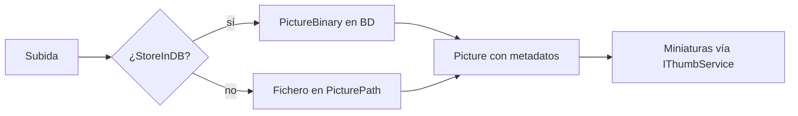

### Fuentes verificadas

- `Libraries/Nop.Core/Domain/Media/Picture.cs`
- `Libraries/Nop.Core/Domain/Media/PictureBinary.cs`
- `Libraries/Nop.Core/Domain/Media/MediaSettings.cs`
- `Libraries/Nop.Services/Media/PictureService.cs`
- `Libraries/Nop.Services/Media/IThumbService.cs`
- `Libraries/Nop.Services/Media/NopMediaDefaults.cs`

> Fecha de consulta: 2026-10-17.

## Capítulo 33 — Búsqueda y SEO {#capitulo-33}

Describe las URL amigables, el sitemap XML, el fichero robots.txt y los mecanismos de búsqueda de catálogo y de proveedor externo.

**Parte VIII — Capacidades transversales** · Nivel: Intermedio

Este capítulo cubre los slug con UrlRecord, la generación del sitemap y del robots.txt, la búsqueda sobre base de datos y la selección del proveedor de búsqueda externo; Sirve para mejorar el posicionamiento y la localización de contenido; Los conceptos clave incluyen UrlRecord, NopSeoDefaults, ISearchProvider y SearchPluginManager; Prerrequisitos: capítulos 17 (diseño interno de un plugin) y 20 (sistema de eventos); Caso de uso típico: mejorar el posicionamiento con URL amigables y sitemap, o integrar un proveedor de búsqueda externo.

**Trampas frecuentes:**

> - Un slug duplicado entre idiomas resuelve a la URL incorrecta; `UrlRecord` incluye `LanguageId` y debe respetarse.
> - Los slug reservados de `NopSeoDefaults` no pueden usarse como nombre de entidad.
> - Superar el límite de 50000 URLs divide el sitemap en varios ficheros; revisar la generación tras añadir grandes volúmenes de catálogo.
> - `robots.custom.txt` ausente deja el `robots.txt` sin personalización, no lo deshabilita.
> - Activar `ActiveSearchProviderSystemName` sin instalar el plugin deja la búsqueda sin proveedor.
> - Los términos de `SearchTerm` solo registran consultas y estadísticas; los resultados los producen `SearchProductsAsync` o el proveedor activo.

---

Este capítulo cubre las URL amigables, el sitemap XML, el fichero `robots.txt` y los dos mecanismos de búsqueda: la búsqueda de catálogo sobre la base de datos y el proveedor de búsqueda externo. No existe ninguna interfaz `ISearchManager` en la 4.90.8; el equivalente real combina `ISearchProvider`, `SearchPluginManager` e `IProductService.SearchProductsAsync`.

### URL amigables

- `UrlRecord` (`Nop.Core.Domain.Seo`) relaciona `EntityId`, `EntityName`, `LanguageId` y `Slug`.
- `IUrlRecordService` (`Nop.Services.Seo`) genera y consulta los slug.
- `NopSeoDefaults` (`Nop.Services.Seo`) define los slug reservados y valores por defecto.

`SlugRouteTransformer` (`Nop.Web.Framework.Mvc.Routing`) resuelve una URL a una entidad consultando los idiomas de la tienda activa con `ILanguageService.GetAllLanguagesAsync(storeId: storeId)`.

### Sitemap XML

| Tipo | Responsabilidad |
|------|-----------------|
| `SitemapSettings` | Ajustes generales del sitemap |
| `SitemapXmlSettings` | Ajustes específicos del XML |
| `SitemapXmlFilePattern` (`NopSeoDefaults`) | Nombre del fichero generado |

- El límite es de 50000 URLs por fichero (`NopSeoDefaults`).
- La ruta `sitemap.xml` se declara en `RouteProvider.cs` (`Presentation/Nop.Web/Infrastructure/RouteProvider.cs`, líneas 742–759).
- El controlador `CommonController.SitemapXml` genera la respuesta.
- `SitemapModelFactory` (`Presentation/Nop.Web/Factories/SitemapModelFactory.cs`) compone el modelo.

### robots.txt

- `RobotsTxtSettings` y `RobotsTxtDefaults` (`Nop.Core.Domain.Security`) configuran el contenido.
- Los ficheros complementarios son `robots.custom.txt` y `robots.additions.txt`.
- `CommonModelFactory.PrepareRobotsTextFileAsync` (`Presentation/Nop.Web/Factories/CommonModelFactory.cs`) construye el contenido final.
- La ruta `robots.txt` se declara en `RouteProvider.cs` y la atiende `CommonController.RobotsTextFile`.

### Búsqueda de catálogo

`IProductService.SearchProductsAsync(...)` (`Nop.Services.Catalog`) realiza la búsqueda sobre la base de datos con filtros de categoría, marca, precio, atributos y visibilidad. El resultado se transforma en modelo en las fábricas de catálogo del área de presentación.

En la fábrica de modelos del catálogo, `CatalogModelFactory` publica `ProductSearchEvent` (`Nop.Web.Framework.Events`) antes de devolver el modelo, consumible con `IEventPublisher` (Capítulo 20).

### Proveedor de búsqueda externo

| Componente | Namespace | Responsabilidad |
|------------|-----------|-----------------|
| `ISearchProvider` | `Nop.Services.Catalog` | Contrato del proveedor |
| `SearchPluginManager` | `Nop.Services.Catalog` | Selección del proveedor activo |
| `CatalogSettings.ActiveSearchProviderSystemName` | `Nop.Core.Domain.Catalog` | Nombre del sistema del proveedor activo |
| `ISearchTermService` / `SearchTerm` | `Nop.Services.Common` / `Nop.Core.Domain.Common` | Términos de búsqueda registrados |

`SearchPluginManager` devuelve el plugin indicado en `ActiveSearchProviderSystemName`; si el valor está vacío, no hay proveedor externo configurado y la búsqueda se resuelve con `SearchProductsAsync`.

`SearchTermService` actualiza el término buscado y su recuento en `CatalogModelFactory` al realizar una consulta, y expone estadísticas en el panel de administración.

### Fuentes verificadas

- `Libraries/Nop.Core/Domain/Seo/UrlRecord.cs`
- `Libraries/Nop.Core/Domain/Seo/SeoSettings.cs`
- `Libraries/Nop.Services/Seo/UrlRecordService.cs`
- `Libraries/Nop.Services/Seo/NopSeoDefaults.cs`
- `Libraries/Nop.Services/Catalog/SearchPluginManager.cs`
- `Libraries/Nop.Services/Common/ISearchTermService.cs`
- `Libraries/Nop.Core/Domain/Security/RobotsTxtSettings.cs`
- `Presentation/Nop.Web/Factories/CommonModelFactory.cs`
- `Presentation/Nop.Web/Infrastructure/RouteProvider.cs`

> Fecha de consulta: 2026-10-17.

## Capítulo 34 — Rendimiento, compresión y despliegue {#capitulo-34}

Describe las palancas de rendimiento, la configuración de host y de ficheros y el despliegue incluido con la fuente de nopCommerce.

**Parte VIII — Capacidades transversales** · Nivel: Avanzado

Este capítulo cubre la compresión de respuesta, la optimización de recursos estáticos, el limitador de tasa, los ficheros de configuración y el procedimiento de despliegue; Sirve para preparar la aplicación para producción; Los conceptos clave incluyen UseNopResponseCompression, WebOptimizerConfig, CommonConfig y App_Data/appsettings.json; Prerrequisitos: capítulos 4 (visión general) y 5 (visión general de la arquitectura); Caso de uso típico: preparar la aplicación para producción con compresión, límites de admisión y un despliegue reproducible.

**Trampas frecuentes:**

> - `UseResponseCompression` desactivado en `CommonSettings` no se compensa con `WebOptimizer`; son configuraciones independientes.
> - Desactivar a la vez `EnableCssBundling` y `EnableJavaScriptBundling` elimina los bundles sin error visible en la página.
> - `UseAutofac` cambia el comportamiento del contenedor; probar los plugins tras alternarlo.
> - `PermitLimit` vale `0` por defecto, lo que desactiva el límite; al activarlo, `RejectionStatusCode` por defecto es `503`.
> - El `docker-compose.yml` está fuera de la carpeta del repositorio; copiar solo la carpeta del proyecto no incluye la infraestructura.
> - `DataSettingsManager.IsDatabaseInstalled()` controla el arranque de componentes como el planificador; sin base de datos instalada, varios subsistemas quedan inactivos.

---

El capítulo describe las palancas de rendimiento de la aplicación: compresión de respuesta, optimización de recursos estáticos, límites de admisión y configuración de host. También recoge el esquema de ficheros de configuración y el despliegue incluido con la fuente. No existe un método `CompressResponse`; la compresión se activa con `UseNopResponseCompression`.

### Compresión de respuesta

- `CommonSettings.UseResponseCompression` (`Nop.Core.Domain.Common`) activa o desactiva la compresión.
- `UseNopResponseCompression` (`Presentation/Nop.Web.Framework/Infrastructure/Extensions/ApplicationBuilderExtensions.cs`, línea 224) añade el middleware de compresión a la canalización.

La compresión reduce el tamaño de las respuestas HTML, CSS y JavaScript enviadas al cliente.

### Recursos estáticos

- `NopStaticFilesStartup` (`Presentation/Nop.Web.Framework/Infrastructure/NopStaticFilesStartup.cs`) configura el servicio y el middleware de archivos estáticos, e invoca `UseNopResponseCompression`.
- `WebOptimizerConfig` (`Presentation/Nop.Web.Framework/WebOptimizer/WebOptimizerConfig.cs`) parametriza la sección `WebOptimizer` de `appsettings.json`: `EnableCssBundling` y `EnableJavaScriptBundling` valen `true` por defecto.
- Si ambas opciones son falsas, `ServiceCollectionExtensions` no registra `AddWebOptimizer` y no se generan bundles.
- `CommonConfig.StaticFilesCacheControl` define la cabecera `Cache-Control` de los ficheros estáticos (por defecto: `public,max-age=31536000`).

### Admisión y host

| Opción | Archivo | Efecto |
|--------|---------|--------|
| `PermitLimit`, `QueueCount`, `RejectionStatusCode` | `CommonConfig` | Límite de concurrencia del limitador de tasa |
| `UseAutofac` | `CommonConfig` | Uso del contenedor Autofac |
| `ScheduleTaskRunTimeout` | `CommonConfig` | Tiempo de espera de ejecución de tareas (Capítulo 28) |
| `DisplayFullErrorStack` | `CommonConfig` | Traza completa en errores (Capítulo 30) |

El limitador de tasa se registra en `ServiceCollectionExtensions.AddRateLimiter` (`Presentation/Nop.Web.Framework/Infrastructure/Extensions/ServiceCollectionExtensions.cs`, línea 123). Las opciones de alojamiento residen en `HostingConfig`.

### Ficheros de configuración

- `NopConfigurationDefaults` (`Nop.Core.Configuration`) fija `AppSettingsFilePath` (`App_Data/appsettings.json`) y `AppSettingsEnvironmentFilePath` (`App_Data/appsettings.{0}.json`).
- `AppSettingsHelper` carga el fichero principal; `Program.cs` (línea 17) añade el fichero del entorno con `builder.Environment.EnvironmentName`.
- `InstallationConfig` parametriza la instalación inicial.
- `DataSettingsManager` (`Libraries/Nop.Data`) gestiona la configuración de base de datos y expone `IsDatabaseInstalled()` (Capítulo 28).
- `Program.cs` (`Presentation/Nop.Web/Program.cs`) compone el host e invoca la canalización de arranque.

```json
{
  "CacheConfig": { "DefaultCacheTime": 60 },
  "CommonConfig": { "DisplayFullErrorStack": false, "ScheduleTaskRunTimeout": 300000 }
}
```

> Nota: el repositorio de fuente no incluye `appsettings.json`; el fichero se crea en `App_Data` durante la instalación. Las clases `IConfig` (`CacheConfig`, `CommonConfig`, `HostingConfig`) se leen de ese fichero; los ajustes del tipo `ISettings` (`CommonSettings`, `MediaSettings`) se almacenan en base de datos.

### Despliegue

- `Deploying.Readme.txt` (`Deploying.Readme.txt`, raíz del repositorio) indica el procedimiento de publicación: abrir la solución, recompilarla y publicar el proyecto `Nop.Web` con configuración `Release`.
- `Program.cs` compone el host; sobre él se aplica la canalización de `INopStartup` descrita en los capítulos anteriores.
- En la carpeta padre del repositorio existe un `docker-compose.yml` con un servicio `nopcommerce_database` (imagen SQL Server 2019). No está dentro de la carpeta del proyecto `nopCommerce`.
- `NopVersion.cs` (`Libraries/Nop.Core`) declara la versión `4.90.8`.

### Fuentes verificadas

- `Presentation/Nop.Web/Program.cs`
- `Libraries/Nop.Core/Configuration/CommonConfig.cs`
- `Libraries/Nop.Core/Configuration/NopConfigurationDefaults.cs`
- `Libraries/Nop.Core/Configuration/AppSettings.cs`
- `Libraries/Nop.Core/Configuration/AppSettingsHelper.cs`
- `Libraries/Nop.Core/Configuration/HostingConfig.cs`
- `Libraries/Nop.Data/DataSettingsManager.cs`
- `Presentation/Nop.Web.Framework/Infrastructure/Extensions/ServiceCollectionExtensions.cs`
- `Libraries/Nop.Core/NopVersion.cs`
- `Deploying.Readme.txt`
- `docker-compose.yml` (carpeta padre del repositorio, fuera de la ruta del proyecto)

> Fecha de consulta: 2026-10-17.

# Apéndices {#apendices}

## Apéndice A — Recursos y referencias {#apendice-a}

### A.1 Documentación oficial de nopCommerce

La documentación oficial de nopCommerce se encuentra en docs.nopcommerce.com y es la referencia principal para cualquier duda técnica. Está organizada en secciones diferenciadas
para usuarios, administradores y desarrolladores, por lo que conviene navegar directamente a la
sección de desarrolladores para encontrar guías de arquitectura, tutoriales de plugins,
referencia de temas y otros recursos técnicos.

Dentro de la sección de desarrolladores, los recursos más útiles para el trabajo diario son la
guía de cómo escribir un plugin para nopCommerce 4.90, disponible en:

docs.nopcommerce.com/en/developer/plugins/how-to-write-plugin-4.90.html,

la descripción de la estructura del archivo plugin.json en:

docs.nopcommerce.com/en/developer/plugins/plugin.json.html

y la guía de pruebas unitarias en:

docs.nopcommerce.com/en/developer/tutorials/unit-tests.html.

Estas tres referencias cubren la estructura del plugin, su archivo de metadatos y las pruebas
unitarias.

### A.2 Repositorio oficial en GitHub

El repositorio oficial de nopCommerce se encuentra en github.com/nopSolutions/nopCommerce y contiene el código fuente completo de la plataforma. El código fuente
real es siempre la referencia más precisa cuando la documentación no llega al nivel de detalle
necesario, especialmente en lo que respecta a las interfaces disponibles, los contratos entre
capas y los patrones de implementación utilizados por el equipo de nopCommerce.

La documentación oficial en formato Markdown, que incluye guías y tutoriales, se encuentra en
el repositorio complementario github.com/nopSolutions/nopCommerce-Docs. Este repositorio es
especialmente útil porque su historial de commits permite seguir la evolución de la
documentación entre versiones y detectar cambios introducidos en cada release.

### A.3 Plantilla de plugin para Visual Studio

El equipo de nopCommerce mantiene una plantilla oficial de Visual Studio para la creación de
nuevos plugins, disponible en github.com/nopSolutions/nopCommerce-plugin-template-VS. Esta
plantilla automatiza la creación de la estructura inicial del plugin, incluyendo las carpetas
Controllers, Views y Models, los archivos obligatorios como plugin.json, \_ViewImports.cshtml y PluginNopStartup.cs (clase que
implementa INopStartup; los plugins oficiales de 4.90 usan también NopStartup.cs), y la
configuración de referencias del proyecto.

Su uso es especialmente recomendable cuando se desarrolla el primer plugin, ya que reduce los errores de configuración iniciales frecuentes y favorece una estructura
coherente con las convenciones de nopCommerce.

### A.4 Marketplace de plugins de nopCommerce

El Marketplace oficial de nopCommerce se encuentra en nopcommerce.com/en/marketplace y contiene
tanto plugins como temas desarrollados por el equipo oficial y por terceros. Antes de
desarrollar un plugin nuevo, conviene verificar si la funcionalidad requerida ya existe en el
Marketplace, ya sea de forma gratuita o comercial, para evitar desarrollos innecesarios.

El Marketplace permite filtrar por versión de nopCommerce, categoría funcional, precio y
valoración. Esto es especialmente útil cuando se busca un punto de referencia para entender
cómo otros desarrolladores han resuelto un problema similar, ya que algunos plugins incluyen
código fuente o documentación técnica adicional.

### A.5 Foros oficiales

Los foros oficiales de nopCommerce están en nopcommerce.com/en/boards y constituyen el canal de soporte comunitario oficial. Aunque la documentación oficial cubre los casos más
habituales, los foros recogen soluciones a problemas específicos de implementación que
raramente aparecen documentados en otro lugar. La sección de desarrolladores del foro es la más
relevante para resolver dudas técnicas sobre arquitectura, plugins, temas y comportamientos
internos de la plataforma.

### A.6 Recursos de Microsoft

nopCommerce está construido sobre ASP.NET Core, por lo que la documentación de Microsoft es
igualmente necesaria para entender los mecanismos que la plataforma usa internamente. Los
recursos más relevantes para el trabajo con nopCommerce son la documentación de ASP.NET Core
MVC en:

learn.microsoft.com/en-us/aspnet/core/mvc

la referencia del sistema de routing en:

learn.microsoft.com/en-us/aspnet/core/fundamentals/routing

y la documentación de inyección de dependencias en:

learn.microsoft.com/en-us/aspnet/core/fundamentals/dependency-injection.

Estos tres recursos cubren los fundamentos sobre los que está construida la capa de
presentación y la infraestructura de servicios de nopCommerce.

### A.7 Referencias de la Parte I — Conceptos esenciales

Las fichas de la Parte I explican conceptos generales de C#, .NET y ASP.NET Core además del uso que hace nopCommerce de ellos. Las fuentes oficiales de Microsoft consultadas para esos conceptos, a través del servidor MCP de Microsoft Learn, se recogen en la siguiente tabla.

| Concepto | Artículo de Microsoft Learn | URL |
| - | - | - |
| Arquitectura por capas y dirección de dependencia | Common web application architectures | learn.microsoft.com/dotnet/architecture/modern-web-apps-azure/common-web-application-architectures |
| Principios arquitectónicos (separación de preocupaciones, encapsulamiento, inversión de dependencias, dependencias explícitas, DRY) | Architectural principles | learn.microsoft.com/dotnet/architecture/modern-web-apps-azure/architectural-principles |
| Inyección de dependencias y ciclos de vida (transitorio, con ámbito y singleton) | Dependency injection in ASP.NET Core | learn.microsoft.com/aspnet/core/fundamentals/dependency-injection |
| Ciclos de vida del contenedor de servicios y dependencias cautivas | Service lifetimes | learn.microsoft.com/dotnet/core/extensions/dependency-injection/service-lifetimes |
| Patrón repositorio como abstracción del acceso a datos | Design the infrastructure persistence layer | learn.microsoft.com/dotnet/architecture/microservices/microservice-ddd-cqrs-patterns/infrastructure-persistence-layer-design |
| Entidad de dominio: identidad, continuidad y comportamiento | Design a microservice domain model —sección «The Domain Entity pattern»— | learn.microsoft.com/dotnet/architecture/microservices/microservice-ddd-cqrs-patterns/microservice-domain-model |
| Reflection en .NET: inspección de tipos en tiempo de ejecución | Reflection in .NET | learn.microsoft.com/dotnet/fundamentals/reflection/overview |
| Carga de ensamblados en tiempo de ejecución | About System.Runtime.Loader.AssemblyLoadContext | learn.microsoft.com/dotnet/core/dependency-loading/understanding-assemblyloadcontext |
| Carga de un ensamblado por ruta | Assembly.LoadFrom Method | learn.microsoft.com/dotnet/api/system.reflection.assembly.loadfrom |
| Patrón fábrica (Factory) para modernizar aplicaciones monolíticas | Lay the foundation for application modernization —sección «Modernize monolithic applications using the Factory Design pattern»— | learn.microsoft.com/azure/app-modernization-guidance/foundation |
| Principio abierto/cerrado y extensibilidad del código | Write extensible code —sección «Open/closed»— | learn.microsoft.com/dynamics365/fin-ops-core/dev-itpro/extensibility/writing-extensible-code |
| Eventos en C#: declaración del miembro `event` | The `event` keyword (C# reference) | learn.microsoft.com/dotnet/csharp/language-reference/keywords/event |
| Manejadores, lanzamiento y suscripción de eventos | Events (C# Programming Guide) | learn.microsoft.com/dotnet/csharp/programming-guide/events/ |
| Patrón publicador-suscriptor | Publisher-Subscriber pattern | learn.microsoft.com/azure/architecture/patterns/publisher-subscriber |
| Comunicación entre componentes desacoplados | Communicating between loosely coupled components | learn.microsoft.com/dotnet/architecture/maui/communicating-between-components |
| Caché en memoria y su invalidación | Cache in-memory in ASP.NET Core | learn.microsoft.com/aspnet/core/performance/caching/memory |
| Patrón Cache-Aside: lectura y escritura diferida con caché | Cache-Aside pattern | learn.microsoft.com/azure/architecture/patterns/cache-aside |
| Options pattern: configuración tipada con `IOptions<T>` | Options pattern in ASP.NET Core | learn.microsoft.com/aspnet/core/fundamentals/configuration/options |
| Estado asíncrono y contexto de ejecución (`AsyncLocal<T>`) | Asynchronous state management | learn.microsoft.com/dotnet/core/extensions/async-state |
| Recursos localizables (archivos `.resx` y ensamblados satélite) | Provide localized resources for languages and cultures in an ASP.NET Core app | learn.microsoft.com/aspnet/core/fundamentals/localization/provide-resources |
| Contenido localizable con `IStringLocalizer` | Make an ASP.NET Core app's content localizable | learn.microsoft.com/aspnet/core/fundamentals/localization/make-content-localizable |
| Autorización basada en políticas | Policy-based authorization in ASP.NET Core | learn.microsoft.com/aspnet/core/security/authorization/policies |
| Autorización basada en roles | Role-based authorization in ASP.NET Core | learn.microsoft.com/aspnet/core/security/authorization/roles |

> Nota: los artículos se citan en su edición inglesa, que es la lengua de referencia de estas páginas técnicas. Fecha de consulta: 19 de octubre de 2026.

### A.8 Referencias de linq2db

La documentación de linq2db usada en los capítulos 7 y 8 procede de su sitio oficial de documentación:

| Contenido | URL |
| - | - |
| Sitio oficial de documentación de linq2db | https://linq2db.github.io/ |
| Gestión de la conexión de datos (modos `Dynamic` y `Static`) | https://linq2db.github.io/articles/general/Managing-data-connection.html |
| Operaciones de carga masiva (bulk copy) | https://linq2db.github.io/articles/sql/Bulk-Copy.html |
| API de combinación (`MERGE`) | https://linq2db.github.io/articles/sql/merge/Merge-API.html |

> Nota: los artículos se citan en su edición inglesa. Fecha de consulta: 19 de octubre de 2026.

## Apéndice B — Glosario de términos {#apendice-b}

| Término | Definición |
| - | - |
| **ACL** | Access Control List. Mecanismo de nopCommerce para restringir el acceso a recursos según el rol del usuario. |
| **Application Core** | Capa más interna de la arquitectura onion que contiene Nop.Core, Nop.Data y Nop.Services. |
| **BaseEntity** | Clase base de todas las entidades de dominio. Proporciona la propiedad `Id`. |
| **Consumer** | Clase que implementa `IConsumer<T>` y responde a eventos del sistema. |
| **DI** | Dependency Injection. Patrón de diseño que permite resolver dependencias externamente. |
| **FluentMigrator** | Herramienta de migraciones de base de datos utilizada por nopCommerce para crear y evolucionar el esquema. |
| **Generic Attribute** | Mecanismo de nopCommerce para asociar atributos clave-valor a cualquier entidad sin modificar su esquema. |
| **IWidgetPlugin** | Interfaz que deben implementar los widgets. Proporciona métodos como `GetWidgetZonesAsync` y `GetWidgetViewComponent`. |
| **Linq2DB** | ORM utilizado por nopCommerce para el acceso a datos mediante LINQ. |
| **Multi-store** | Capacidad de nopCommerce para gestionar múltiples tiendas desde una sola instalación. |
| **NopStartup** | Clase que implementa `INopStartup` y permite registrar servicios, middleware y rutas. |
| **NPL** | nopCommerce Public License. Licencia basada en AGPL v3.0 que rige el uso de la plataforma. |
| **Onion Architecture** | Patrón arquitectónico en el que las dependencias apuntan hacia el núcleo de la aplicación. |
| **Plugin** | Proyecto independiente que extiende la funcionalidad de nopCommerce sin modificar su núcleo. |
| **RouteProvider** | Clase que implementa `IRouteProvider` y registra rutas personalizadas para un plugin. |
| **Service** | Clase que implementa la lógica de negocio. Se define mediante una interfaz y se registra en DI. |
| **Setting** | Parámetro de configuración almacenado en la tabla `Setting` como clave-valor. |
| **Tag Helper** | Componente de Razor que extiende el motor de vistas con etiquetas personalizadas. |
| **Tema** | Conjunto de vistas, CSS e imágenes que personalizan la apariencia visual de la tienda. |
| **ViewComponent** | Componente de ASP.NET Core que encapsula lógica de presentación reutilizable con su propia vista. |
| **Widget** | Tipo de plugin que implementa `IWidgetPlugin` y se renderiza en Widget Zones específicas. |
| **Widget Zone** | Nombre (string) que identifica un punto de inserción en las vistas Razor donde se inyectan los widgets; se renderiza mediante el ViewComponent `WidgetViewComponent`. |

## Apéndice C — Índice de clases e interfaces {#apendice-c}

### Sistema de eventos

| Tipo | Ubicación | Propósito |
| - | - | - |
| `IEventPublisher` | Nop.Core.Events | Contrato para publicar eventos |
| `EventPublisher` | Nop.Services.Events | Implementación concreta que localiza e invoca consumidores |
| `IConsumer<T>` | Nop.Services.Events | Contrato que deben implementar los suscriptores de eventos |
| `EntityInsertedEvent<T>` | Nop.Core.Events | Evento disparado tras insertar una entidad |
| `EntityUpdatedEvent<T>` | Nop.Core.Events | Evento disparado tras actualizar una entidad |
| `EntityDeletedEvent<T>` | Nop.Core.Events | Evento disparado tras eliminar una entidad |

### Capa de dominio (Nop.Core)

| Tipo | Ubicación | Propósito |
| - | - | - |
| `BaseEntity` | Nop.Core | Clase base con propiedad `Id` para todas las entidades |
| `ISettings` | Nop.Core.Configuration | Interfaz que deben implementar las clases de configuración |
| `INopStartup` | Nop.Core.Infrastructure | Contrato para registrar servicios, middleware y rutas |
| `IStoreContext` | Nop.Core | Acceso al contexto de la tienda actual |
| `IWorkContext` | Nop.Core | Acceso al contexto del usuario actual |

### Capa de persistencia (Nop.Data)

| Tipo | Ubicación | Propósito |
| - | - | - |
| `IRepository<T>` | Nop.Data | Interfaz genérica del repositorio con operaciones CRUD básicas |
| `EntityRepository<T>` | Nop.Data | Implementación genérica de `IRepository<T>` sobre linq2db (`Table`, `BulkCopy`, transacciones) |
| `INopDataProvider` | Nop.Data | Contrato del proveedor de datos: crear e inicializar la base de datos y ejecutar operaciones CRUD sobre entidades |
| `BaseDataProvider` | Nop.Data.DataProviders | Base común de los proveedores: CRUD, SQL crudo (`CommandInfo`), `BulkCopy` con `KeepIdentity` y `SqlSha2` |
| `MsSqlNopDataProvider` | Nop.Data.DataProviders | Proveedor de SQL Server: `IDataProvider` de linq2db + `Microsoft.Data.SqlClient`; `Merge` y hints `NOLOCK` |
| `NopMappingSchema` | Nop.Data.Mapping | Descriptores de entidad en memoria y `MappingSchema` de linq2db cacheados |
| `FluentMigratorMetadataReader` | Nop.Data.Mapping | `IMetadataReader` de linq2db que traduce los descriptores FluentMigrator a atributos de mapeo |

### Capa de servicios (Nop.Services)

| Tipo | Ubicación | Propósito |
| - | - | - |
| `ISettingService` | Nop.Services.Configuration | Gestión de parámetros de configuración |
| `IGenericAttributeService` | Nop.Services.Common | Gestión de atributos genéricos |
| `ILocalizationService` | Nop.Services.Localization | Gestión de recursos de localización |
| `IPluginService` | Nop.Services.Plugins | Gestión del ciclo de vida de plugins |

### Plugins

| Tipo | Ubicación | Propósito |
| - | - | - |
| `BasePlugin` | Nop.Services.Plugins | Clase base para todos los plugins |
| `IPlugin` | Nop.Services.Plugins | Interfaz base de plugins |
| `IWidgetPlugin` | Nop.Services.Cms | Interfaz para widgets |
| `PluginDescriptor` | Nop.Services.Plugins | Metadatos que describen un plugin instalado |
| `IRouteProvider` | Nop.Web.Framework.Mvc.Routing | Contrato para el registro de rutas |

### Capa de presentación (Nop.Web.Framework)

| Tipo | Ubicación | Propósito |
| - | - | - |
| `BasePluginController` | Nop.Web.Framework.Controllers | Clase base de los controladores de plugins |
| `BaseNopModel` | Nop.Web.Framework.Models | Clase base de todos los modelos |
| `BaseNopEntityModel` | Nop.Web.Framework.Models | Modelo base para entidades con `Id` |
| `INopHtmlHelper` | Nop.Web.Framework.UI | Helpers de Razor para vistas |

### Framework de pruebas

| Tipo | Ubicación | Propósito |
| - | - | - |
| `BaseNopTest` | Nop.Tests | Clase base que expone el contenedor DI para los tests |
| `ServiceTest` | Nop.Tests | Clase intermedia que inicializa los descriptores de plugins de prueba (IPluginsInfo) y los ajustes por defecto |
