# Manual de usuario V01 de nopCommerce

> **Versión del documento:** V01
> **Versión de referencia de nopCommerce:** 4.90.8 (.NET 9)
> **Fuente de verdad de las referencias:** `Fuentes_nopCommerce.md`
> **Última revisión:** 18 de octubre de 2026
> **Naturaleza:** documento de uso personal y autoaprendizaje. No es un material editorial destinado a la venta.

## Índice general {#indice-general}

- **[Parte I — Puesta en marcha](#parte-i)**
  - [Capítulo 1 — Introducción, alcance y perfil del lector](#capitulo-1)
  - [Capítulo 2 — Requisitos del sistema y elección de alojamiento](#capitulo-2)
  - [Capítulo 3 — Instalación de nopCommerce](#capitulo-3)
  - [Capítulo 4 — Actualización de nopCommerce](#capitulo-4)
  - [Capítulo 5 — Visión general del panel de administración](#capitulo-5)
- **[Parte II — Configuración básica de la tienda](#parte-ii)**
  - [Capítulo 6 — Información de la tienda y cuentas de correo](#capitulo-6)
  - [Capítulo 7 — Localización, idiomas y traducción](#capitulo-7)
  - [Capítulo 8 — Seguridad, autenticación y SSL](#capitulo-8)
  - [Capítulo 9 — Privacidad y RGPD](#capitulo-9)
  - [Capítulo 10 — Ajustes globales, PDF y HTML personalizado](#capitulo-10)
  - [Capítulo 11 — Analítica y robots.txt](#capitulo-11)
- **[Parte III — Plugins y widgets](#parte-iii)**
  - [Capítulo 12 — Plugins en nopCommerce](#capitulo-12)
- **[Parte IV — Diseño y presentación](#parte-iv)**
  - [Capítulo 13 — Temas: elección e instalación](#capitulo-13)
  - [Capítulo 14 — Logo, favicon y ajustes de medios](#capitulo-14)
  - [Capítulo 15 — Slider de portada (Swiper)](#capitulo-15)
- **[Parte V — Catálogo de productos](#parte-v)**
  - [Capítulo 16 — Configuración del catálogo](#capitulo-16)
  - [Capítulo 17 — Categorías y fabricantes](#capitulo-17)
  - [Capítulo 18 — Productos: alta y gestión](#capitulo-18)
  - [Capítulo 19 — Atributos de producto y de especificación](#capitulo-19)
  - [Capítulo 20 — Variantes y productos agrupados](#capitulo-20)
  - [Capítulo 21 — Productos especiales: descargables, recurrentes y de alquiler](#capitulo-21)
  - [Capítulo 22 — Reseñas de producto y etiquetas](#capitulo-22)
  - [Capítulo 23 — Búsqueda de texto completo y directiva Omnibus](#capitulo-23)
- **[Parte VI — Pagos, monedas e impuestos](#parte-vi)**
  - [Capítulo 24 — Configuración de pagos](#capitulo-24)
  - [Capítulo 25 — Métodos de pago básicos: cheque y tarjeta manual](#capitulo-25)
  - [Capítulo 26 — Integraciones PayPal](#capitulo-26)
  - [Capítulo 27 — Monedas y restricciones de pago](#capitulo-27)
  - [Capítulo 28 — Impuestos: ajustes y proveedores](#capitulo-28)
- **[Parte VII — Envíos y logística](#parte-vii)**
  - [Capítulo 29 — Ajustes de envío generales](#capitulo-29)
  - [Capítulo 30 — Proveedores de envío](#capitulo-30)
  - [Capítulo 31 — Puntos de recogida y almacenes](#capitulo-31)
  - [Capítulo 32 — Países, provincias, medidas, fechas y rangos](#capitulo-32)
- **[Parte VIII — Gestión de pedidos](#parte-viii)**
  - [Capítulo 33 — Ajustes de pedidos y control de existencias](#capitulo-33)
  - [Capítulo 34 — Gestión de pedidos](#capitulo-34)
  - [Capítulo 35 — Gestión de envíos](#capitulo-35)
  - [Capítulo 36 — Gestión de devoluciones](#capitulo-36)
  - [Capítulo 37 — Atributos de pago](#capitulo-37)
  - [Capítulo 38 — Carritos de compra y listas de deseos](#capitulo-38)
  - [Capítulo 39 — Cotizaciones (RFQ)](#capitulo-39)
- **[Parte IX — Gestión de clientes](#parte-ix)**
  - [Capítulo 40 — Gestión de clientes](#capitulo-40)
  - [Capítulo 41 — Roles de cliente y control de acceso](#capitulo-41)
  - [Capítulo 42 — Ajustes de cliente, actividad y clientes en línea](#capitulo-42)
- **[Parte X — Gestión de contenido](#parte-x)**
  - [Capítulo 43 — Blog y noticias](#capitulo-43)
  - [Capítulo 44 — Foros y temas (páginas)](#capitulo-44)
  - [Capítulo 45 — Menú, plantillas de mensaje y encuestas](#capitulo-45)
- **[Parte XI — Herramientas de marketing](#parte-xi)**
  - [Capítulo 46 — Descuentos y precios por niveles](#capitulo-46)
  - [Capítulo 47 — Tarjetas regalo y puntos de recompensa](#capitulo-47)
  - [Capítulo 48 — Productos relacionados, cross-sells y afiliados](#capitulo-48)
  - [Capítulo 49 — Campañas de correo y boletín](#capitulo-49)
  - [Capítulo 50 — Integraciones de marketing: Facebook Pixel y Omnisend](#capitulo-50)
- **[Parte XII — Administración del sistema e informes](#parte-xii)**
  - [Capítulo 51 — Registro, cola de mensajes y tareas programadas](#capitulo-51)
  - [Capítulo 52 — Mantenimiento, información del sistema y avisos](#capitulo-52)
  - [Capítulo 53 — Plantillas y nombres amigables para buscadores](#capitulo-53)
  - [Capítulo 54 — SEO: ajustes generales y páginas](#capitulo-54)
  - [Capítulo 55 — Informes integrados](#capitulo-55)
  - [Capítulo 56 — Microsoft Power BI](#capitulo-56)
  - [Capítulo 57 — Gestión de proveedores](#capitulo-57)
- [Apéndice A — Recursos oficiales](#apendice-a)
- [Apéndice B — Glosario](#apendice-b)
- [Apéndice C — Mapa del menú de administración](#apendice-c)

# Parte I — Puesta en marcha {#parte-i}

## Capítulo 1 — Introducción, alcance y perfil del lector {#capitulo-1}

Establece para quién está escrito este manual, qué cubre y qué no, y cómo interpretar las rutas de administración que se utilizan a lo largo del texto.

**Parte I — Puesta en marcha** · Nivel: Básico

Este capítulo cubre el propósito del manual, el perfil del lector, la versión de referencia y las convenciones de lectura. Sirve para situar el alcance del documento antes de entrar en la configuración de la tienda. Los conceptos clave incluyen nopCommerce 4.90.8, el panel de administración y las rutas de menú. Prerrequisitos: conocimientos básicos de comercio electrónico y del uso general de un navegador web. Caso de uso típico: leer este capítulo una sola vez antes de utilizar el resto del manual.

**Trampas frecuentes:**

> - nopCommerce 5.00 está en beta sobre .NET 10; mientras no sea estable, sus datos no deben aplicarse a esta versión.
> - Las rutas de menú se escriben con el formato «Categoría > Subcategoría»; los nombres en inglés de la interfaz coinciden con los del panel si la tienda está en inglés, pero la interfaz se traduce a 56 idiomas.
> - Un ajuste que no aparece en modo *Básico* puede existir en modo *Avanzado*; consulte el Capítulo 5 antes de concluir que falta.

---

Este manual describe cómo configurar y administrar una tienda nopCommerce desde su **panel de administración**. No enseña a programar ni a modificar el código de la plataforma; esa tarea corresponde al *Manual de desarrollo de nopCommerce*, que documenta la arquitectura interna, los temas y los plugins. Aquí el foco está en el usuario que gestiona el negocio: quién da de alta productos, atiende pedidos, configura pagos y envíos, y publica contenido.

#### A quién va dirigido

El lector es un comerciante o administrador de tienda que necesita sacar partido a nopCommerce sin escribir código. No se requiere experiencia previa en la plataforma, pero sí comodidad con el uso de un navegador y con la terminología básica de una tienda en línea (producto, categoría, pedido, envío, impuesto). El manual tampoco asume conocimientos de servidores: los apartados de instalación y alojamiento explican lo necesario con detalle suficiente para seguirlos, y remiten a fuentes oficiales cuando conviene profundizar.

#### Qué cubre y qué no

El manual recorre el ciclo completo de una tienda: puesta en marcha, configuración básica, diseño, catálogo, pagos, monedas e impuestos, envíos, gestión de pedidos, clientes, contenido, marketing, administración del sistema e informes. Cierra con tres apéndices de consulta rápida: recursos, glosario y un mapa del menú de administración.

Quedan fuera del alcance el desarrollo de plugins y temas, la programación de páginas personalizadas y cualquier modificación del código fuente. Tampoco se documenta la tienda pública vista por el cliente más allá de lo necesario para entender el efecto de una configuración.

#### Cómo leer las rutas de menú

Cuando el manual indica una ruta, significa una secuencia de clics dentro del panel de administración. Por ejemplo:

> **Catálogo > Productos**

indica abrir el menú **Catálogo** y elegir **Productos**. El panel accede siempre por la dirección `<sudominio>/admin`, por ejemplo `www.ejemplo.com/admin`. El menú lateral puede colapsarse para ganar espacio; el detalle se explica en el Capítulo 5.

#### Tercera persona y verificación

El texto utiliza tercera persona del singular y voz activa. Toda afirmación sobre el comportamiento de la plataforma se ha contrastado con el código fuente oficial de nopCommerce 4.90.8 y con la documentación oficial de esa versión. Cuando un dato procede de una fuente concreta, se indica; cuando no puede confirmarse, se marca explícitamente.

---

## Capítulo 2 — Requisitos del sistema y elección de alojamiento {#capitulo-2}

Lista lo que necesita el servidor o el equipo para ejecutar nopCommerce 4.90.8 y orienta sobre el tipo de alojamiento adecuado.

**Parte I — Puesta en marcha** · Nivel: Básico

Este capítulo cubre los sistemas operativos, servidores web, bases de datos y navegadores compatibles, además de los criterios para elegir alojamiento. Sirve para comprobar el entorno antes de instalar. Los conceptos clave incluyen Windows, Linux, macOS, IIS, el runtime de ASP.NET Core 9 y SQL Server. Prerrequisitos: Capítulo 1. Caso de uso típico: verificar requisitos antes de contratar un proveedor de hosting.

**Trampas frecuentes:**

> - El runtime de ASP.NET Core 9 y el SDK de .NET 9 son requisitos distintos: el runtime basta para ejecutar, el SDK solo hace falta para compilar desde el código.
> - Si se usa multi-tienda con SSL en Windows, se necesita Windows Server 2012 con IIS 8 o superior por el soporte SNI.
> - Las imágenes oficiales de Docker usan SQL Server 2019 (`mssql/server:2019-latest`), aunque el requisito mínimo declarado es SQL Server 2012.

---

Para ejecutar nopCommerce 4.90.8 es necesario tener instalados ciertos componentes en el servidor o en el equipo donde se aloje la tienda. A continuación se detallan los componentes compatibles declarados oficialmente.

#### Sistemas operativos compatibles

nopCommerce se ejecuta sobre el runtime de .NET 9, que admite los siguientes sistemas operativos.

| Sistema operativo | Versiones compatibles |
|---|---|
| Windows | Windows 10 Client (1607 o superior), Windows 11 (23H2 o superior), Windows Server 2016 o superior |
| Linux | Red Hat Enterprise Linux 8+, Fedora 41+, Debian 12+, Ubuntu 22.04+, openSUSE Leap 15.6+, SUSE Enterprise Linux 15.6+, Alpine Linux 3.20+ |
| macOS | macOS 14.0 o superior |

#### Servidores web y runtime

- **Internet Information Services (IIS) 7.0** o superior en Windows.
- **Runtime de ASP.NET Core 9** para nopCommerce 4.90. Se instala mediante el instalador *ASP.NET Core 9.0 Hosting Bundle* disponible en el sitio oficial de descargas de .NET.
- En Linux y macOS se utiliza el servidor Kestrel, que forma parte del propio runtime, habitualmente delante de un proxy inverso como Nginx o Apache.

#### Bases de datos compatibles

| Sistema de base de datos | Versión mínima | Disponible desde |
|---|---|---|
| Microsoft SQL Server | 2012 o superior | Todas las versiones |
| MySQL | 5.7 o superior | nopCommerce 4.30 |
| PostgreSQL | 9.5 o superior | nopCommerce 4.40 |

nopCommerce utiliza **linq2db** como capa de acceso a datos, no Entity Framework. El comportamiento general es el mismo en los tres motores, pero ciertos detalles de la capa de datos pueden variar ligeramente entre proveedores.

#### Navegadores compatibles

Microsoft Edge, Mozilla Firefox 2.0 o superior, Google Chrome 1.x o superior y Apple Safari 12.x o superior. Internet Explorer se admite en versiones anteriores de nopCommerce, pero no es una opción recomendada.

#### Herramientas de desarrollo (solo si se modifica el código)

Para quien desee editar el código fuente, nopCommerce 4.90 requiere **Visual Studio 2022 (versión 17.14 o superior)** y el **SDK de .NET 9**. Este manual no entra en ese terreno; se incluye únicamente por completitud.

#### Elegir alojamiento

La elección del proveedor de hosting condiciona el rendimiento y la capacidad de mantenimiento de la tienda. Los criterios prácticos son:

- **Compatibilidad con .NET 9**: el proveedor debe permitir desplegar aplicaciones ASP.NET Core 9 o facilitar una imagen de contenedor compatible.
- **Base de datos**: decidir entre SQL Server, MySQL o PostgreSQL, y comprobar que el proveedor lo ofrece.
- **Copias de seguridad**: el proveedor debe permitir o facilitar la copia de seguridad de base de datos y de archivos, requisito imprescindible para las actualizaciones (Capítulo 4).
- **Certificado SSL**: necesario para la tienda en producción y obligatorio si se usa multi-tienda con SSL (Capítulo 8).

nopCommerce publica opciones de alojamiento gestionado, incluida una solución de nube privada, y existe documentación específica para desplegar en Microsoft Azure, en Windows y en Linux. La instalación local sobre un equipo propio es válida para pruebas y aprendizaje.

---

## Capítulo 3 — Instalación de nopCommerce {#capitulo-3}

Describe las rutas disponibles para instalar nopCommerce 4.90.8 y los pasos comunes a cualquier instalación.

**Parte I — Puesta en marcha** · Nivel: Básico

Este capítulo cubre las modalidades de instalación (preinstalada, manual, local, Windows, Linux, Microsoft Azure y granjas web) y el flujo general. Sirve para elegir la vía adecuada y ejecutarla. Los conceptos clave incluyen la instalación local, el despliegue en servidor y la configuración inicial. Prerrequisitos: Capítulo 2. Caso de uso típico: levantar la primera tienda o una instancia de pruebas.

**Trampas frecuentes:**

> - nopCommerce no admite actualizaciones automáticas; la instalación y la actualización se hacen manualmente.
> - La instalación local sirve para aprender, pero no es adecuada para una tienda en producción.
> - La contraseña del administrador que se define durante la instalación es crítica: no existe recuperación automática.

---

nopCommerce ofrece varias formas de obtener una tienda en funcionamiento. La elección depende de si se busca una puesta en marcha inmediata o un control total del entorno.

#### Modalidades de instalación

| Modalidad | Cuándo conviene |
|---|---|
| Preinstalada | Se quiere la solución más rápida; la ofrece el propio equipo de nopCommerce junto con un proveedor de hosting |
| Manual sobre hosting | Se ha elegido proveedor y se suben los archivos al servidor |
| Local | Se quiere probar o aprender en un equipo propio sin publicar la tienda |
| Windows | El servidor es Windows con IIS |
| Linux | El servidor es Linux con Kestrel y proxy inverso |
| Microsoft Azure | Se quiere una infraestructura en la nube de Microsoft |
| Granja web (web farm) | Se necesita alta disponibilidad con varios servidores |

#### Flujo general de una instalación manual

1. Descargar la última versión estable de nopCommerce desde la página oficial de descargas.
2. Comprobar que el servidor cumple los requisitos del Capítulo 2.
3. Crear la base de datos y un usuario con permisos sobre ella.
4. Subir los archivos de la aplicación al servidor.
5. Abrir la dirección de la tienda en el navegador; el asistente de instalación se ejecuta automáticamente.
6. Definir los datos de conexión a la base de datos y la cuenta del administrador.
7. Finalizar la instalación y acceder al panel de administración.

#### Instalación local para aprendizaje

La instalación local es la vía recomendada para este manual si el objetivo es aprender. Consiste en publicar la aplicación en el propio equipo y acceder a ella mediante `localhost`. Requiere el runtime de ASP.NET Core 9 y una base de datos accesible desde el equipo. Es el mismo entorno que se utiliza para generar las capturas de este documento.

> **Nota:** en el asistente de instalación se solicita el nombre de la tienda, la dirección de correo y la contraseña del administrador. Conviene registrar estas credenciales: son la única vía de acceso inicial.

#### Después de la instalación

Una vez completada la instalación, el panel de administración queda disponible en `<direccion>/admin`. El siguiente paso es recorrer su interfaz (Capítulo 5) y configurar la información básica de la tienda (Capítulo 6).

---

---

#### Capturas oficiales de la pantalla

> Capturas de pantalla de la documentación oficial de nopCommerce (nop Solutions Ltd), reproducidas con atribución para uso personal. Se muestran en el orden en que aparecen en la documentación original.

**Instalación local**

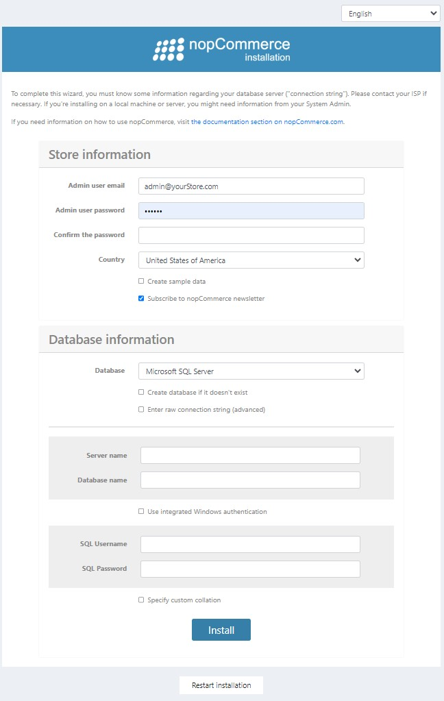

**Instalación en Windows**

**Instalación en Linux**

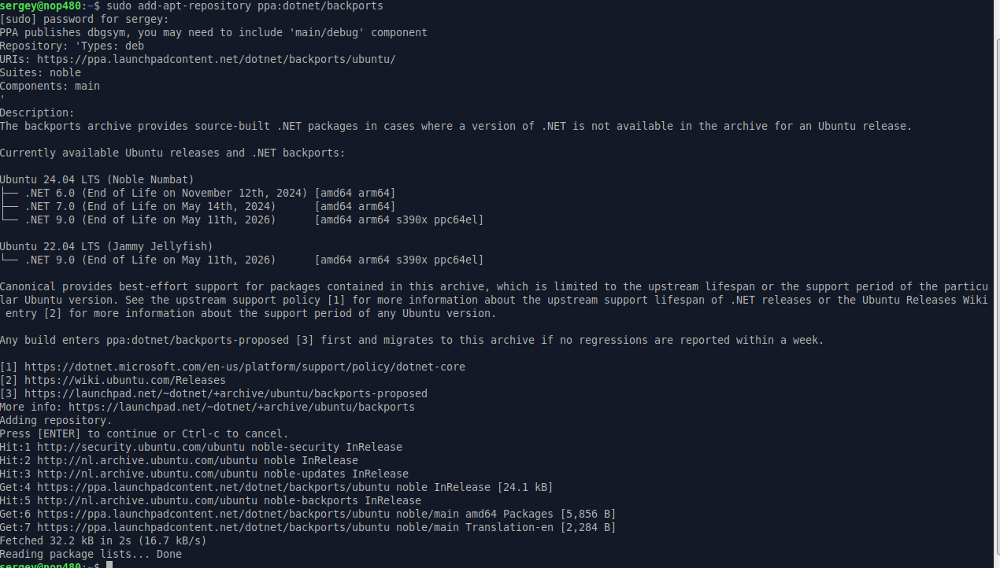

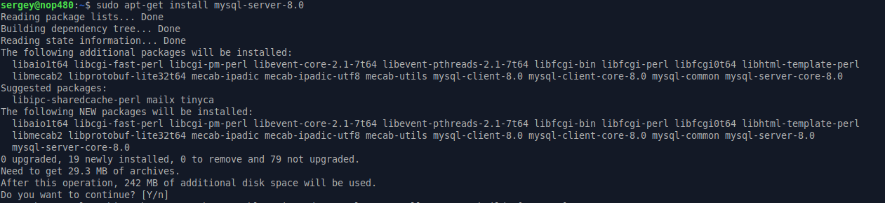

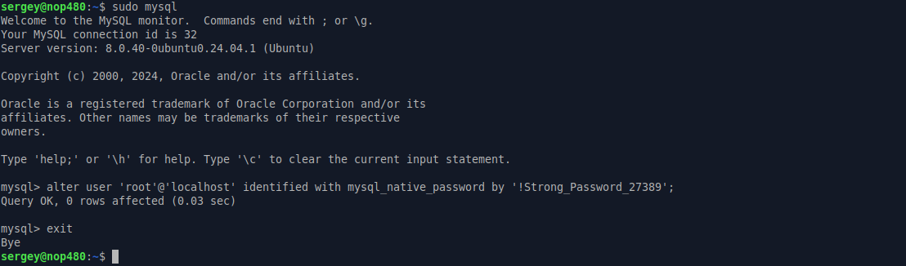

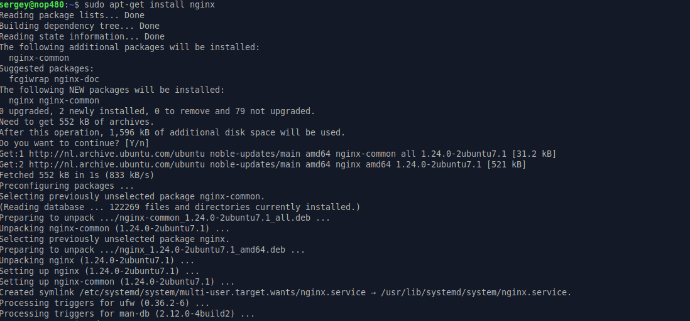

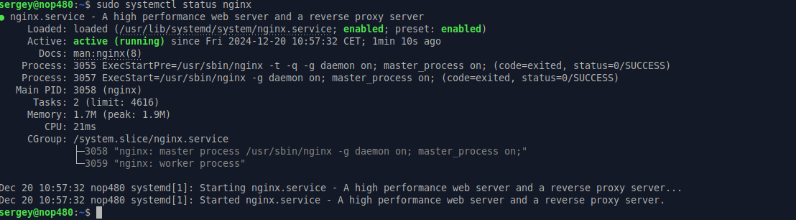

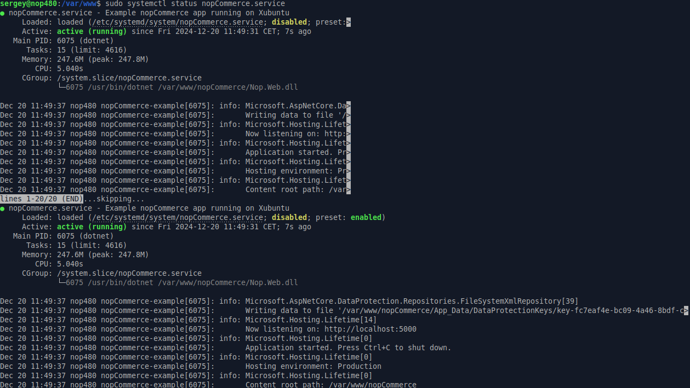

## Capítulo 4 — Actualización de nopCommerce {#capitulo-4}

Explica cómo pasar de una versión anterior a nopCommerce 4.90.8 y cómo actuar si la actualización falla.

**Parte I — Puesta en marcha** · Nivel: Intermedio

Este capítulo cubre el procedimiento manual de actualización, el papel de las migraciones y la recuperación ante fallos. Sirve para actualizar una tienda existente sin perder datos. Los conceptos clave incluyen las migraciones automáticas, la copia de seguridad y la preservación de los ficheros de configuración. Prerrequisitos: Capítulos 2 y 3. Caso de uso típico: actualizar una tienda en producción a una versión más reciente.

**Trampas frecuentes:**

> - Desde la versión 4.40 ya no se usan scripts de actualización SQL: el esquema se actualiza con migraciones automáticas en el primer arranque.
> - Hay que conservar los ficheros JSON de `App_Data` (`appsettings.json` y `plugins.json`); si se eliminan, se pierde la configuración.
> - Si las imágenes se almacenan en el sistema de archivos, deben respaldarse y restaurarse en `\wwwroot\Images\`.

---

nopCommerce anuncia las versiones nuevas en el panel de noticias del panel de administración, pero **no admite actualizaciones automáticas**: el proceso se realiza manualmente. Es una decisión deliberada porque una actualización toca la base de datos y debe hacerse con control.

#### Regla previa: la copia de seguridad

Antes de cualquier actualización hay que respaldar **todo** el sitio, incluida la base de datos. Esta copia es lo que permite volver a una tienda funcional pase lo que pase durante la migración. Si las imágenes están en el sistema de archivos, el respaldo debe incluir `\wwwroot\Images\`.

#### Procedimiento desde nopCommerce 4.40

1. Hacer una copia de seguridad completa del sitio y de la base de datos.
2. Eliminar todos los ficheros de la versión anterior, **excepto** los ficheros JSON de `App_Data` (`appsettings.json` y `plugins.json`).
3. Subir los ficheros de la nueva versión.
4. Arrancar la aplicación: las migraciones actualizan el esquema de la base de datos automáticamente en ese primer arranque.
5. Comprobar que la tienda funciona correctamente.

> **Importante:** al desplegar, hay que asegurarse de que el `appsettings.json` de destino apunta a la base de datos de producción. Debe conservarse también el `plugins.json`, que registra los plugins instalados.

#### Nota para saltos desde versiones anteriores a 4.40

Si la tienda parte de una versión anterior a la 4.40, la actualización se hace por tramos y antes debe ejecutarse el script SQL de actualización correspondiente, descargado de la página oficial de descargas. El script se aplica de forma progresiva: por ejemplo, de 3.90 a 4.20 hay que pasar primero por 4.00, después por 4.10 y finalmente por 4.20. En ese guion incluido (`Readme.txt`) pueden figurar indicaciones importantes que deben leerse antes de ejecutarlo.

#### Recuperación ante problemas

Si tras la actualización aparecen problemas, se restaura la copia de seguridad y se devuelven los ficheros de la versión anterior. La comunidad mantiene foros oficiales de soporte donde plantear dudas concretas sobre una actualización.

---

## Capítulo 5 — Visión general del panel de administración {#capitulo-5}

Presenta la interfaz de administración: el panel principal, el menú lateral, la búsqueda y los modos básico y avanzado.

**Parte I — Puesta en marcha** · Nivel: Básico

Este capítulo cubre los elementos comunes de todas las páginas del panel y la navegación por el menú. Sirve para orientarse antes de entrar en la configuración específica. Los conceptos clave incluyen el panel principal (*dashboard*), el menú lateral, el cuadro de búsqueda y el interruptor básico/avanzado. Prerrequisitos: Capítulo 3 (tener acceso al panel). Caso de uso típico: primer contacto con la interfaz.

**Trampas frecuentes:**

> - El menú lateral se colapsa con el icono de hamburguesa; si un apartado «desaparece», probablemente esté el menú plegado.
> - Muchos ajustes están ocultos en modo *Básico*; el interruptor *Básico-Avanzado* revela el resto.
> - El cuadro de búsqueda del menú permite ir directo a una sección escribiendo su nombre.

---

El panel de administración se abre añadiendo `/admin` a la dirección de la tienda, por ejemplo `www.ejemplo.com/admin`, o mediante el enlace **Administración** que aparece en la parte superior de la tienda pública una vez iniciada sesión.

#### El panel principal

La primera pantalla tras iniciar sesión es el **panel principal** (*dashboard*). Se divide en varias secciones:

| Sección | Contenido |
|---|---|
| Empezar a aceptar pedidos | Asistente que guía por la configuración principal de la tienda |
| Noticias de nopCommerce | Novedades, ofertas y promociones de la plataforma |
| Estadísticas comunes | Número de pedidos, solicitudes de devolución pendientes, clientes registrados y productos con stock bajo |
| Estadísticas del negocio | Pedidos, clientes nuevos, totales de pedidos, pedidos incompletos, últimos pedidos, palabras clave de búsqueda, más vendidos por cantidad y por importe |

Las secciones del panel pueden plegarse con el icono correspondiente para dejar solo las que interesan.

#### Elementos comunes de las páginas

**Menú lateral.** Situado a la izquierda de cada página, permite recorrer toda la funcionalidad de administración. Se pliega con el icono de hamburguesa que hay junto al logotipo, para ganar espacio de trabajo.

**Cuadro de búsqueda.** En la parte superior del menú lateral hay un campo de búsqueda. Al escribir el nombre de una sección, la interfaz sugiere automáticamente las opciones disponibles y lleva directamente a la elegida.

**Menú de sistema.** En la parte superior se muestra el nombre del usuario conectado, el botón de cierre de sesión, el enlace a la tienda pública y un menú breve desde el que se puede vaciar la caché o reiniciar la aplicación.

#### Modos básico y avanzado

Algunas páginas del panel incluyen un interruptor de dos posiciones **Básico-Avanzado**. El modo *Básico* muestra solo los ajustes más habituales para simplificar la pantalla; el modo *Avanzado* muestra todos los ajustes disponibles.

Junto al interruptor puede aparecer un botón **Ajustes**, que permite personalizar qué opciones forman parte del modo *Básico*: al pulsarlo se despliega la lista de ajustes disponibles y se marcan los deseados con sus casillas. Es la forma de dejar el modo básico a medida del trabajo habitual.

> **Nota:** este mecanismo explica por qué un ajuste documentado puede «no encontrarse» en pantalla. Antes de concluir que falta, conviene alternar al modo avanzado.

---

# Parte II — Configuración básica de la tienda {#parte-ii}

---

#### Capturas oficiales de la pantalla

**Panel de administración**

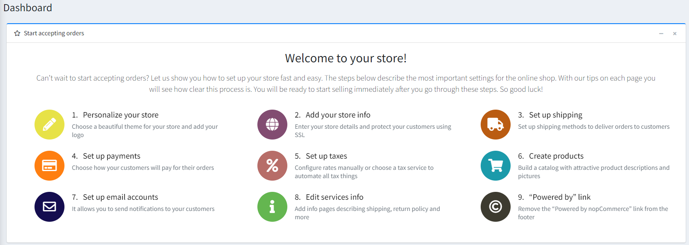

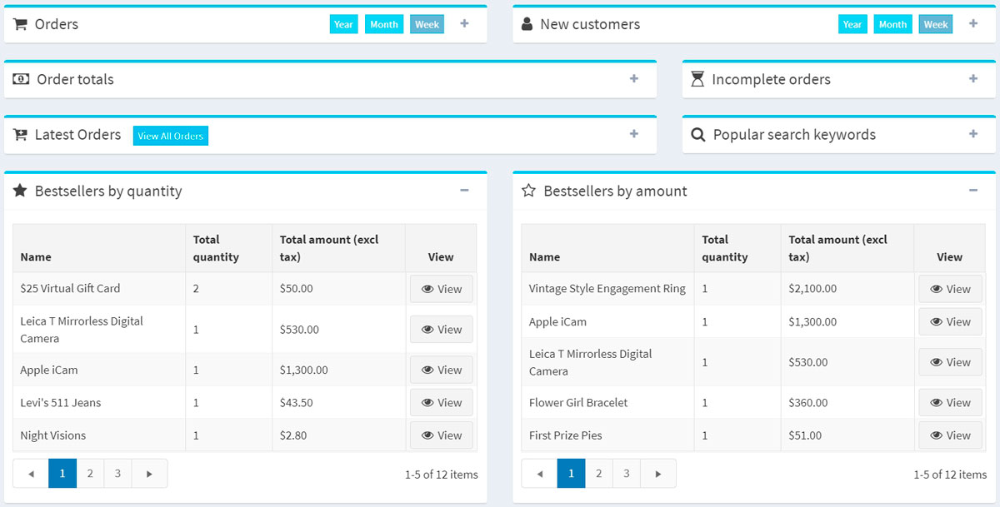

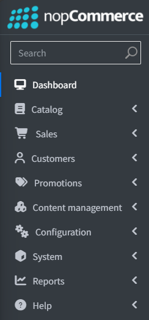

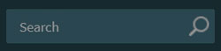

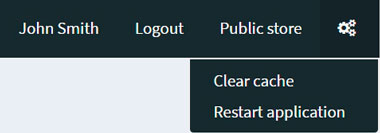

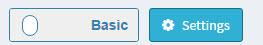

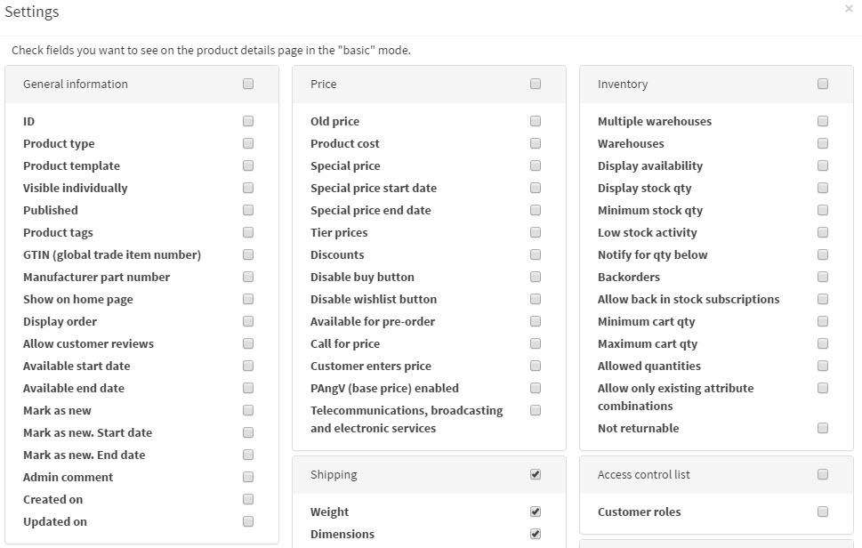

## Capítulo 6 — Información de la tienda y cuentas de correo {#capitulo-6}

Registra los datos de la tienda y de la empresa, y configura las cuentas de correo desde las que la plataforma se comunica con los clientes.

**Parte II — Configuración básica** · Nivel: Básico

Este capítulo cubre la configuración de la tienda principal y la creación de cuentas de correo salientes. Sirve para dejar identificada la tienda y habilitar la comunicación por correo. Los conceptos clave incluyen nombre de tienda, URL, SSL, idioma por defecto, datos fiscales de la empresa y cuentas SMTP. Prerrequisitos: Capítulos 3 y 5. Caso de uso típico: primera configuración tras instalar.

**Trampas frecuentes:**

> - El botón **SSL** solo debe pulsarse después de instalar el certificado SSL en el servidor; si se activa antes, se pierde el acceso al sitio y hay que corregirlo directamente en la tabla `[Store]` de la base de datos.
> - Algunos proveedores de correo no aceptan la dirección de origen salvo que figure como alias o cuenta remitente autorizada en la cuenta SMTP utilizada.
> - El campo de valores **HOST** solo es necesario en soluciones multi-tienda; en una tienda única puede dejarse vacío.

---

#### Datos de la tienda principal

En una instalación predeterminada de nopCommerce solo se crea una tienda, que se configura en **Configuración > Tiendas**. Al pulsar **Editar** junto a la tienda por defecto se abre su ficha.

En la pestaña de información se definen:

- **Nombre de tienda**: el nombre que identifica la tienda.
- **URL de la tienda**: la dirección pública, por ejemplo `www.ejemplo.com`.
- **SSL**: se activa únicamente si la tienda está protegida con certificado SSL ya instalado en el servidor.
- **Valores HOST**: lista de valores de `HTTP_HOST` posibles (por ejemplo `ejemplo.com` y `www.ejemplo.com`). Solo se rellena en soluciones multi-tienda para determinar qué tienda corresponde a cada petición. El valor actual se puede consultar en **Sistema > Información del sistema**.
- **Idioma por defecto**: puede dejarse sin seleccionar; en ese caso se usa el primero que se encuentre, según el orden de presentación.
- **Orden de presentación**: 1 coloca la tienda al principio de la lista.
- **Nombre de la empresa**, **dirección**, **teléfono** y **VAT** (número de IVA, utilizado en la Unión Europea).

La misma ficha incluye una pestaña **SEO** donde se localizan la palabra clave principal, el título meta y la descripción meta de la tienda.

#### Cuentas de correo

La tienda envía correos transaccionales (confirmaciones, notificaciones, recuperación de contraseña) desde cuentas SMTP que se gestionan en **Configuración > Cuentas de correo**.

Para añadir una cuenta se pulsa **Añadir nuevo** y se completan:

- **Dirección de correo**: la dirección de origen de los correos de la tienda, por ejemplo `ventas@ejemplo.com`.
- **Nombre para mostrar**: el nombre que aparece como remitente, por ejemplo «Servicio de ventas de mi tienda».
- **Servidor (host)**: el nombre de host o la dirección IP del servidor de correo.
- **Puerto**: el puerto SMTP del servidor.
- **SSL**: casilla para cifrar la conexión SMTP.
- **Número máximo de correos**: cantidad máxima de correos enviados en una sola tanda.
- **Método de autenticación**, con varias opciones:
  - *Sin autenticación*.
  - *NTLM* (credenciales de red predeterminadas).
  - *Usuario/contraseña*: requiere indicar el usuario y la contraseña del servidor de correo.
  - *Google (OAuth2)*: necesita el `Client ID` y el `Client Secret` de la aplicación.
  - *Microsoft (OAuth2)*: necesita el identificador de inquilino (GUID, nombre de dominio o uno de los valores reservados `organizations`, `consumers`, `common`), el `Client ID` y el `Client Secret`.

Tras guardar, la ficha se amplía y permite enviar un correo de prueba: basta con indicar una dirección en el campo **Enviar correo de a** y pulsar **Enviar correo de prueba**. Es el modo recomendado de verificar que la funciona antes de depender de ella.

> **Nota:** una vez configuradas, estas cuentas se seleccionan en la ficha de cada plantilla de mensaje (Capítulo 45), de modo que cada tipo de correo puede salir desde la cuenta que corresponda.

---

---

#### Capturas oficiales de la pantalla

**Información de la tienda**

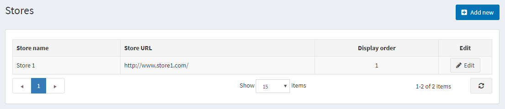

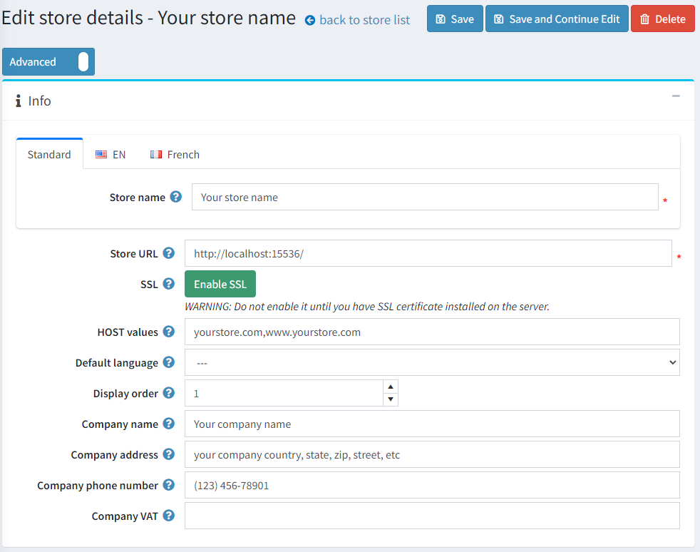

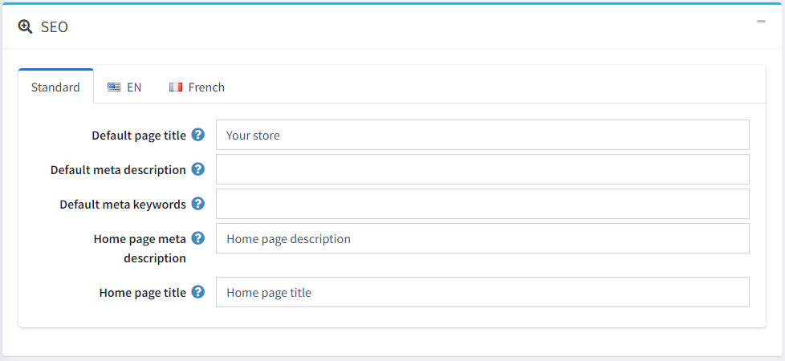

**Cuentas de correo**

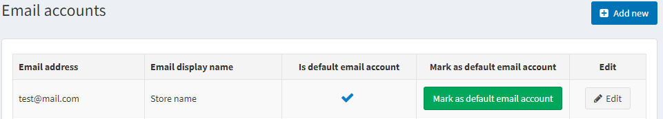

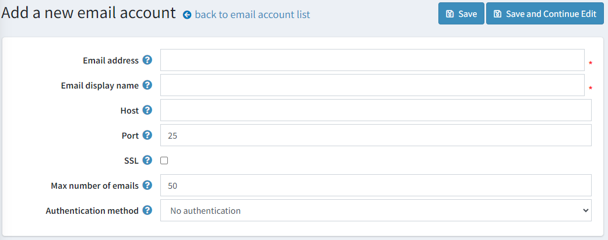

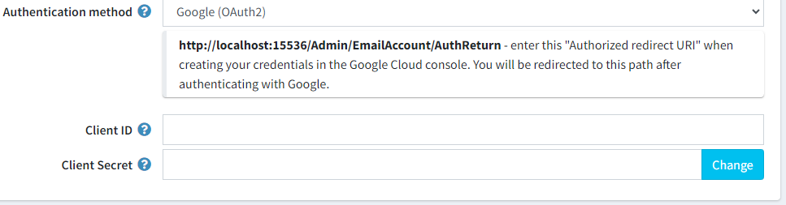

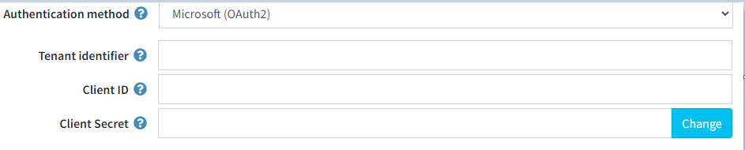

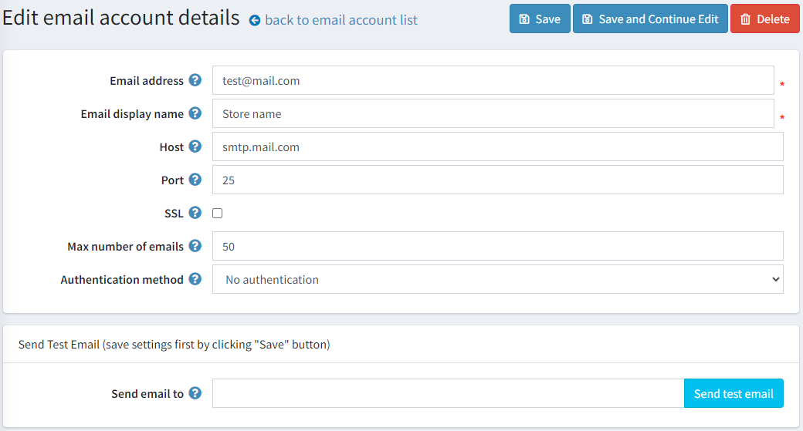

## Capítulo 7 — Localización, idiomas y traducción {#capitulo-7}

Añade idiomas a la tienda, importa paquetes de traducción y gestiona los recursos de cadenas.

**Parte II — Configuración básica** · Nivel: Intermedio

Este capítulo cubre la gestión de idiomas, la importación de paquetes de traducción y la edición de recursos de cadenas. Sirve para ofrecer la tienda en varios idiomas o corregir traducciones. Los conceptos clave incluyen cultura de idioma, código SEO único, recursos de cadenas y ajustes de localización. Prerrequisitos: Capítulo 6. Caso de uso típico: añadir español a una tienda instalada en inglés.

**Trampas frecuentes:**

> - Las culturas de idioma solo se cargan al arrancar la aplicación: tras añadir o eliminar un idioma hay que reiniciar la aplicación.
> - El campo de cultura requiere que el paquete CLDR correspondiente esté instalado.
> - Las URLs amigables con varios idiomas exigen reiniciar la aplicación tras activarlas; si no, pueden producirse errores.

---

nopCommerce se instala con el idioma inglés activo, pero permite tener varios idiomas. Cada cliente ve los datos definidos en el idioma que elija; los campos no traducidos muestran el valor del idioma predeterminado.

#### Gestión de idiomas

Los idiomas instalados se ven y se editan en **Configuración > Idiomas**. Para añadir uno se pulsa **Añadir nuevo** y se completan:

- **Nombre** del idioma.
- **Cultura del idioma**: código específico, por ejemplo `de-AT` para el alemán de Austria.
- **Código SEO único**: código de dos letras usado para generar direcciones como `http://www.ejemplo.com/es/` cuando hay más de un idioma publicado.
- **Nombre del fichero de la bandera**: imagen guardada en `./images/flags`, o elegida de la lista predefinida.
- **De derecha a izquierda**: para idiomas como el árabe o el hebreo; requiere que el tema activo soporte RTL.
- **Moneda por defecto** del idioma; si no se indica, se usa la de menor orden de presentación.
- **Limitado a tiendas**: permite restringir el idioma a tiendas concretas; se deja vacío si no se usa.
- **Publicar**: hace visible el idioma para los visitantes.
- **Orden de presentación**: 1 lo coloca primero.

#### Importar un paquete de traducción

1. Visitar la página oficial de traducciones de nopCommerce.
2. Elegir la versión de nopCommerce y descargar el paquete de idioma deseado.
3. Ir a **Configuración > Idiomas** y pulsar **Añadir nuevo**.
4. Rellenar los campos obligatorios y pulsar **Guardar y continuar editando**.
5. Pulsar **Importar recursos** e indicar la ruta del fichero del paquete (`.xml`).

#### Recursos de cadenas

Cualquier texto visible de la interfaz es un *recurso de cadenas* que se puede editar. Para cambiar, por ejemplo, la etiqueta «Administración» del panel por otra, se busca el recurso por su nombre en el panel **Recursos de cadenas** de la ficha del idioma, se pulsa **Editar** junto a él y se introduce el nuevo valor en **Valor**. Para crear un recurso nuevo se usa el panel **Añadir nuevo registro**, indicando el identificador (`Resource name`) y el valor.

#### Ajustes de localización

En **Configuración > Ajustes > Ajustes generales**, panel de localización, se controla el rendimiento y el comportamiento multilingüe:

- **CLDR para la cultura actual**: define el patrón de validación del lado del cliente.
- **Cargar todos los recursos de cadenas al arrancar**: al activarlo el arranque es más lento, pero las páginas se abren más rápido.
- **Cargar todas las propiedades localizadas al arrancar**: solo tiene sentido con dos o más idiomas y no se recomienda con catálogos grandes.
- **Cargar todos los nombres amigables para buscadores al arrancar**: mismo efecto anterior aplicado a los *slugs*; tampoco se recomienda con catálogos grandes.
- **Usar imágenes para la selección de idioma**: muestra banderas en lugar de nombres.
- **URLs amigables con varios idiomas**: genera direcciones como `/es/` o `/fr/`; exige reiniciar la aplicación tras cambiarla.
- **Detectar idioma automáticamente**: elige el idioma según la configuración del navegador del cliente.

#### Localizar entidades

Con varios idiomas instalados, muchos campos dirigidos al cliente admiten traducción. En la ficha del producto u otra entidad, la pestaña predeterminada contiene el texto que se muestra si no hay traducción, y las pestañas con el nombre de cada idioma permiten introducir el texto traducido.

---

---

#### Capturas oficiales de la pantalla

**Localización e idiomas**

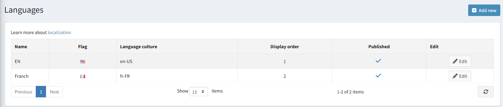

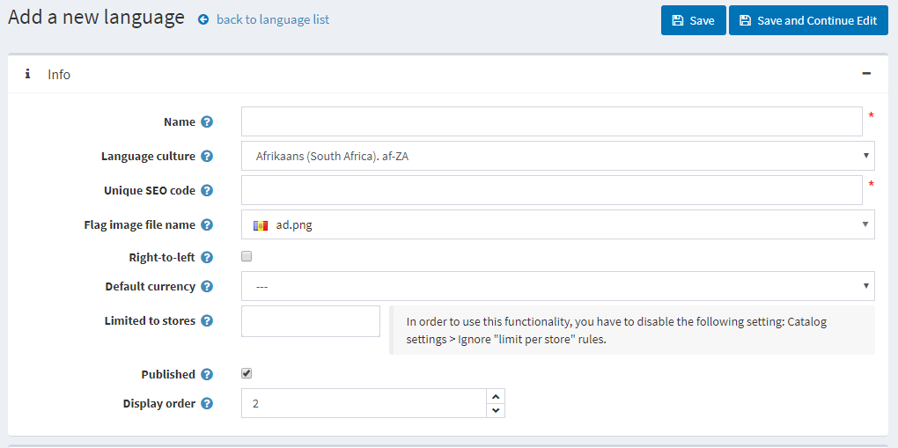

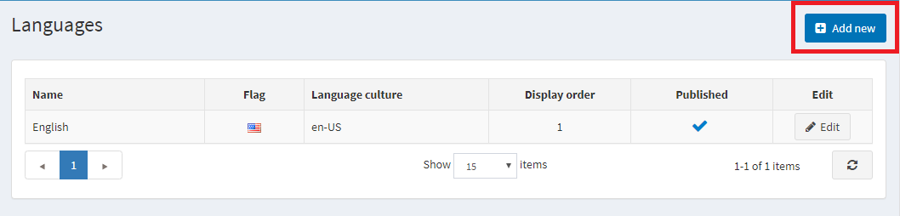

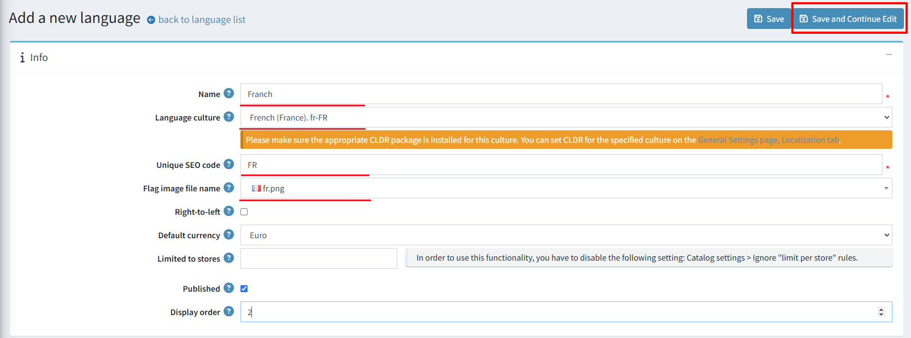

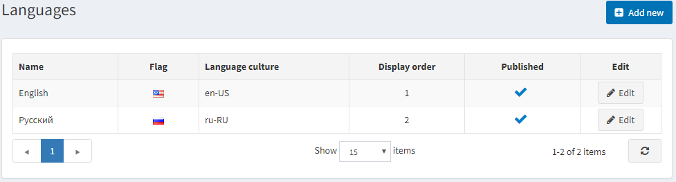

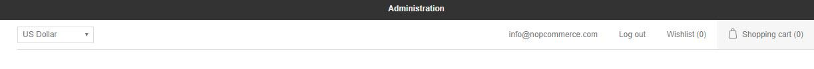

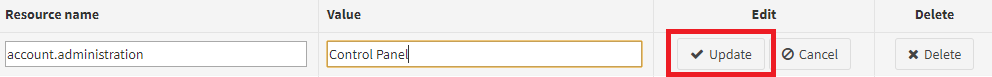

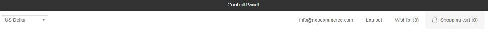

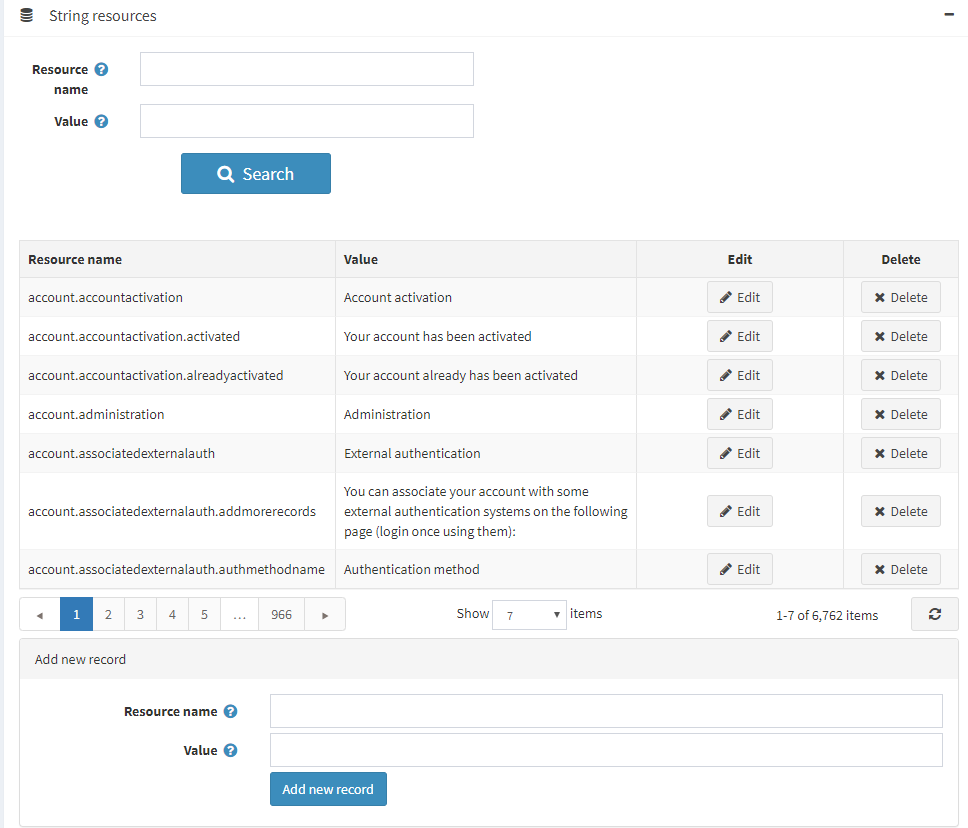

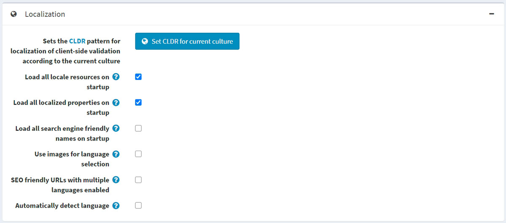

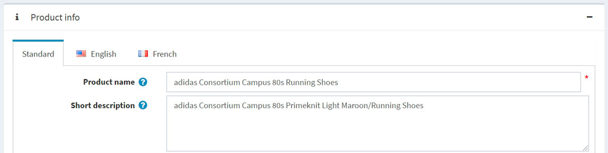

**Traducción automatizada**

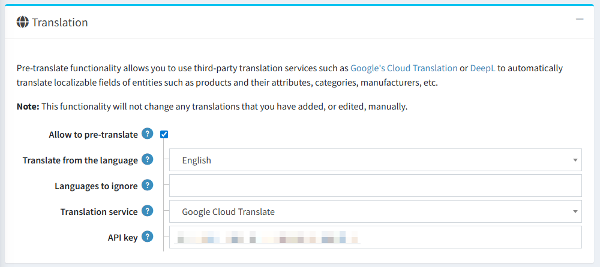

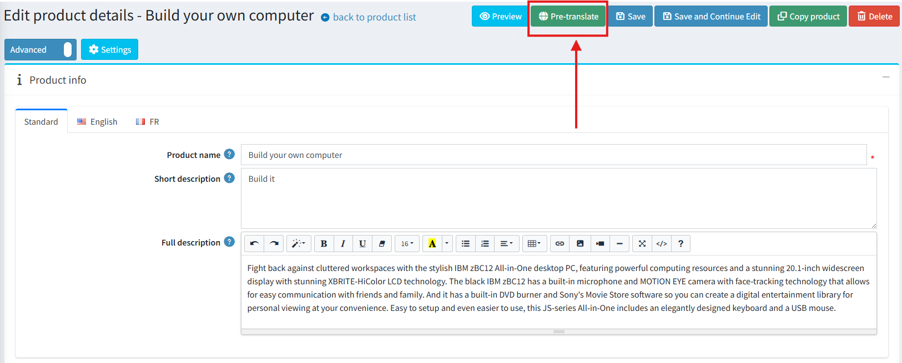

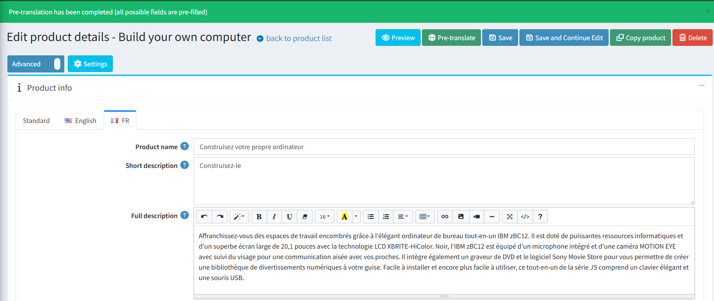

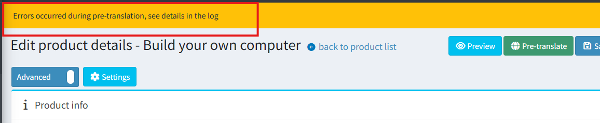

## Capítulo 8 — Seguridad, autenticación y SSL {#capitulo-8}

Refuerza el acceso al panel, configura la protección CAPTCHA y describe la instalación de certificados SSL.

**Parte II — Configuración básica** · Nivel: Intermedio

Este capítulo cubre los ajustes de seguridad general, el sistema CAPTCHA y el certificado SSL. Sirve para proteger el panel de administración y la tienda pública. Los conceptos clave incluyen restricción por IP, *honeypot*, clave privada de cifrado, reCAPTCHA y certificado SSL. Prerrequisitos: Capítulo 6. Caso de uso típico: endurecer la seguridad antes de abrir la tienda al público.

**Trampas frecuentes:**

> - Antes de cambiar la clave privada de cifrado conviene respaldar la base de datos; los datos sensibles se cifran con esa clave.
> - La versión 1 de reCAPTCHA ya no está soportada; solo v2 y v3.
> - Activar SSL en la ficha de la tienda sin certificado instalado bloquea el acceso al sitio.

---

#### Ajustes de seguridad

Los ajustes de seguridad se gestionan en **Configuración > Ajustes > Ajustes generales**, panel de seguridad. Esta página admite configuración multi-tienda, de modo que los valores pueden definirse igual para todas las tiendas o diferir entre ellas.

- **IP permitidas en el área de administración**: direcciones IP autorizadas a acceder al panel trasero. Se dejan varias separadas por comas. Vacío significa sin restricción.
- **Activar honeypot**: habilita una trampa destinada a detectar y desviar intentos de uso no autorizado automatizado.
- **Clave privada de cifrado**: clave usada para cifrar los datos sensibles almacenados. Se puede regenerar con **Cambiar** en cualquier momento.

> **Importante:** se recomienda respaldar la base de datos antes de cambiar la clave de cifrado. Los datos sensibles incluyen la información de tarjetas de crédito cuando esta se almacena en la base de datos de la tienda.

#### CAPTCHA

nopCommerce integra reCAPTCHA de Google para distinguir el acceso humano del automatizado. Tras activar el CAPTCHA se elige el tipo (`reCAPTCHA v2`, que muestra la casilla «no soy un robot», o `reCAPTCHA v3`, invisible) y, en el caso de v3, el umbral de puntuación. A continuación se marcan las páginas donde debe mostrarse:

- Inicio de sesión.
- Registro.
- Contraseña olvidada.
- Contacto.
- Enviar lista de deseos a un amigo.
- Enviar producto a un amigo.
- Comentarios del blog.
- Comentarios de noticias.
- Bloque de boletín.
- Reseñas de producto.
- Solicitud de cuenta de proveedor.
- Foro.
- Compra como invitado.

Finalmente se introducen la **clave pública** y la **clave privada** de reCAPTCHA.

#### Certificados SSL

El SSL cifra el enlace entre el servidor y el navegador, y es imprescindible en una tienda en producción. La instalación del certificado se realiza en el servidor, no desde el panel. Una vez instalado, se marca la casilla **SSL** en la ficha de la tienda (Capítulo 6). La documentación oficial dedica una página específica a instalar y configurar certificados SSL, que conviene seguir según el servidor utilizado.

---

---

#### Capturas oficiales de la pantalla

**Ajustes de seguridad**

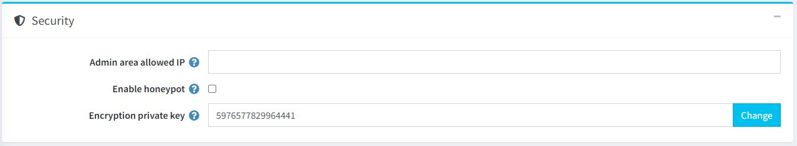

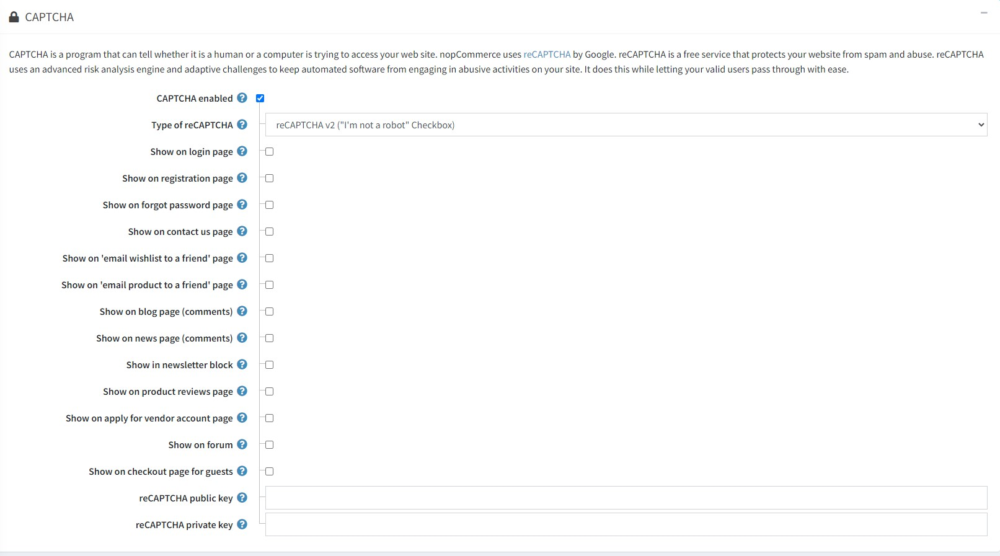

**Métodos de autenticación externa**

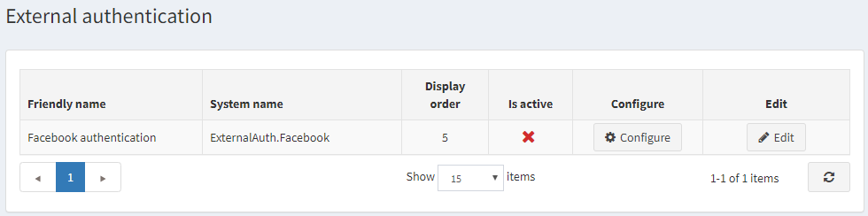

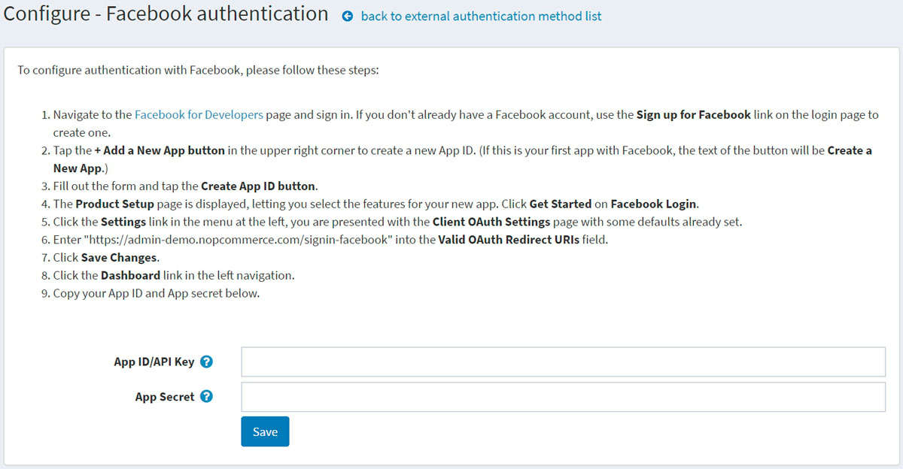

**Aut multifactor**

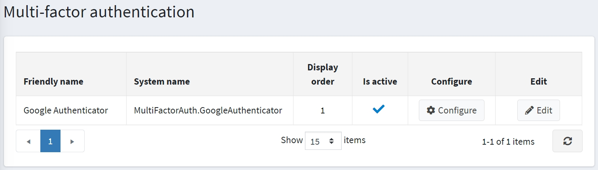

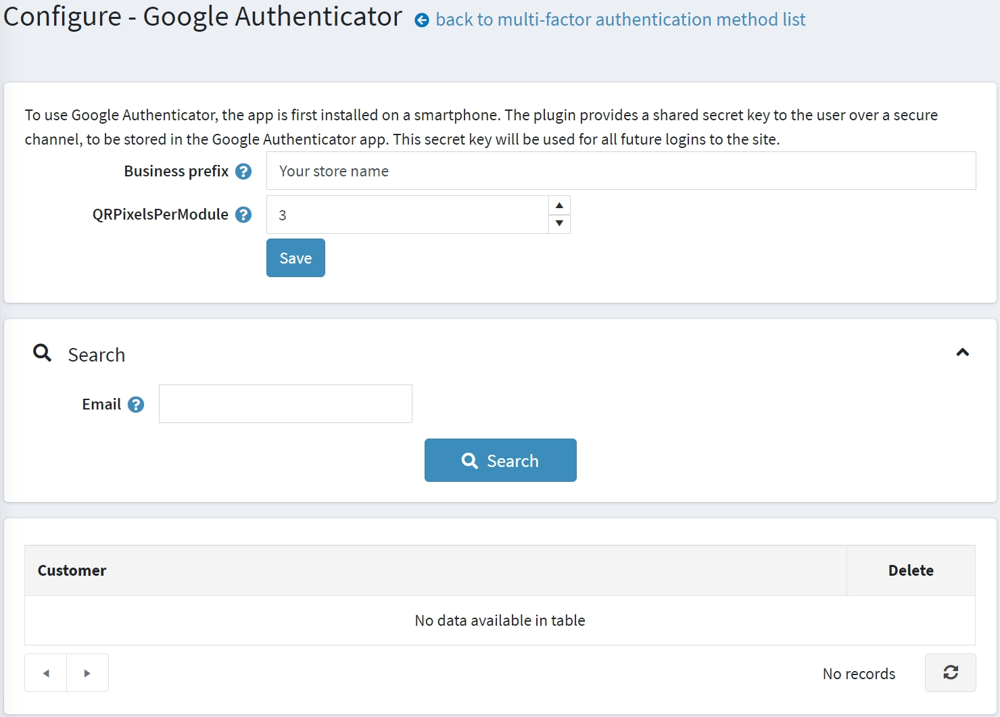

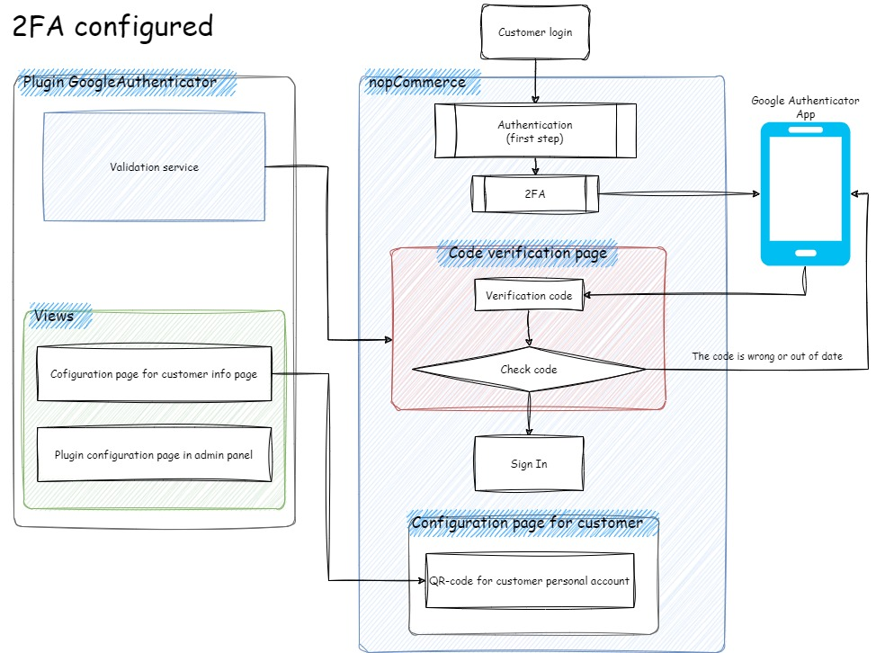

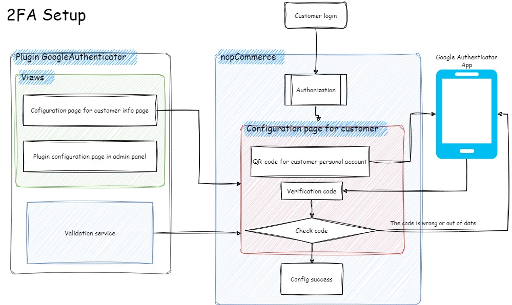

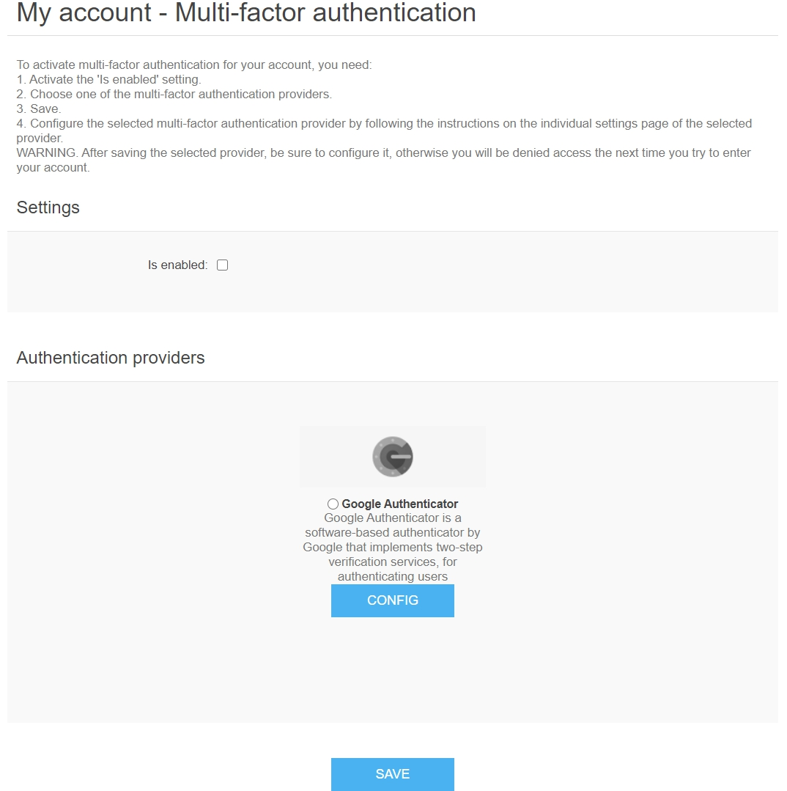

**Certificados SSL**

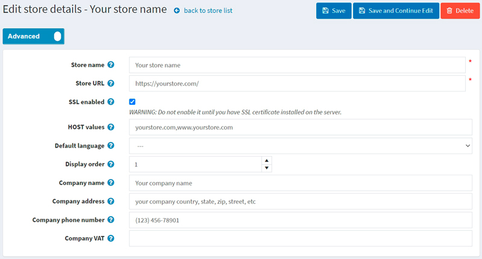

## Capítulo 9 — Privacidad y RGPD {#capitulo-9}

Configura el cumplimiento del Reglamento General de Protección de Datos: consentimientos, registro de actividad y derechos del cliente.

**Parte II — Configuración básica** · Nivel: Intermedio

Este capítulo cubre la activación del modo RGPD, la creación de consentimientos y las acciones sobre datos de clientes. Sirve para operar una tienda que atiende a clientes europeos. Los conceptos clave incluyen consentimiento, registro de consentimientos, exportación de datos y borrado definitivo. Prerrequisitos: Capítulo 6. Caso de uso típico: preparar la tienda para la normativa europea de protección de datos.

**Trampas frecuentes:**

> - El borrado de clientes inactivos tiene 36 meses por defecto; ese valor debe revisarse según el criterio del negocio.
> - El borrado definitivo de un cliente es una acción sin retorno; conviene confirmarla antes de ejecutarla.
> - El registro de consentimientos solo se activa marcando las casillas correspondientes al habilitar el RGPD.

---

El RGPD (Reglamento General de Protección de Datos) es la normativa europea que regula cómo se recogen, usan y comparten los datos personales de clientes en la Unión Europea. nopCommerce incluye herramientas para cumplirlo.

#### Activar el RGPD

Se activa en **Administración > Configuración > Ajustes > Ajustes de RGPD**, marcando la casilla **RGPD activado**. Aparecen opciones adicionales para registrar el consentimiento en distintas acciones:

- Registro del consentimiento de la **política de privacidad**.
- Registro del consentimiento del **boletín**.
- Registro de los **cambios del perfil de usuario**.
- **Eliminar clientes inactivos después de N meses** (36 por defecto).

#### Consentimientos

En el panel **Consentimientos** se pulsa **Añadir consentimiento** y se define:

- **Mensaje** o pregunta que se muestra al cliente.
- Si el consentimiento **es obligatorio**.
- Si se **muestra durante el registro**.
- Si se **muestra en la página de información del cliente**, dentro de «Mi cuenta».
- **Orden de presentación**; 1 lo coloca primero.

#### Registro y derechos del cliente

Si se activó el registro, la actividad se consulta en **Administración > Clientes > Solicitudes RGPD (registro)**. Con el RGPD habilitado, el propietario de la tienda puede ejecutar sobre cada cliente, desde **Administración > Clientes > Editar cliente**:

- **Borrado definitivo** del registro del cliente.
- **Exportar datos** del cliente.

> **Nota:** el borrado definitivo elimina el registro de forma permanente. Conviene verificar dos veces antes de ejecutarlo.

---

---

#### Capturas oficiales de la pantalla

**Ajustes de RGPD**

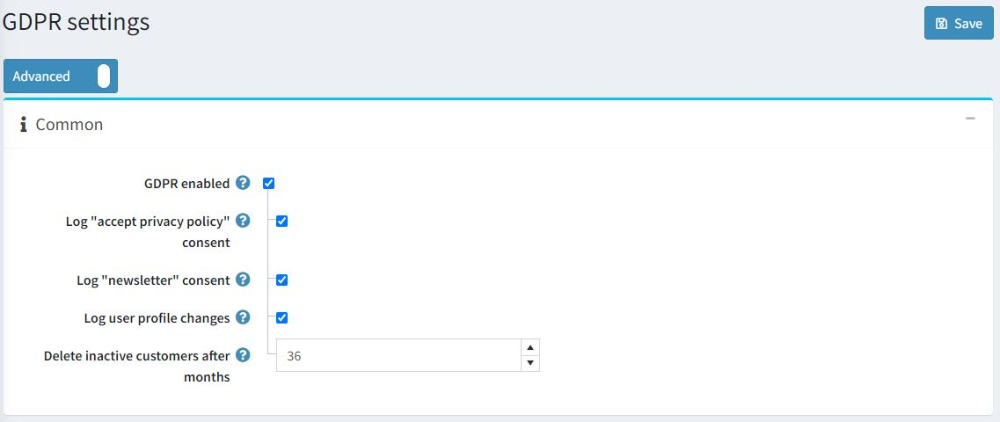

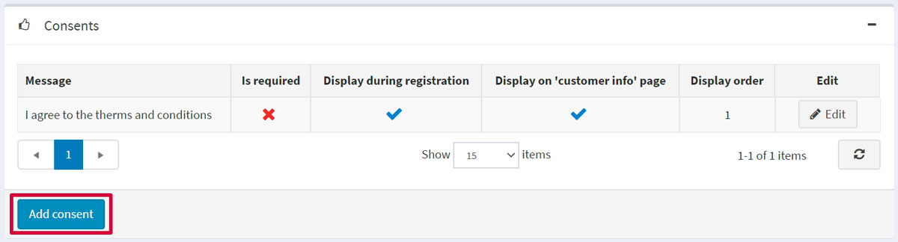

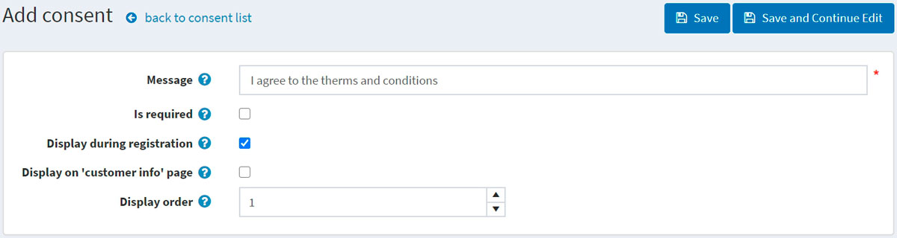

## Capítulo 10 — Ajustes globales, PDF y HTML personalizado {#capitulo-10}

Reúne los ajustes de alcance general: todos los ajustes, la generación de documentos PDF y la inyección de código en cabecera y pie.

**Parte II — Configuración básica** · Nivel: Intermedio

Este capítulo cubre la página de todos los ajustes, la configuración de PDF y el HTML personalizado. Sirve para alcanzar ajustes poco habituales y para añadir código de terceros. Los conceptos clave incluyen la página maestra de ajustes, los ajustes de PDF y el código de cabecera y pie. Prerrequisitos: Capítulo 5. Caso de uso típico: localizar un ajuste que no aparece en las pantallas habituales o insertar un script de seguimiento.

**Trampas frecuentes:**

> - La página de todos los ajustes lista cientos de opciones; conviene usar el filtro en lugar de recorrerla.
> - El código de cabecera carga antes que el cuerpo, y el de pie después; colocar un script donde no corresponde puede romper su funcionamiento.
> - Aunque no se requiere programar para usar nopCommerce, el HTML personalizado sí exige cuidado: un error ahí afecta a todas las páginas.

---

#### Todos los ajustes

Existe una página que reúne **todos** los ajustes de la plataforma en un único listado, con un cuadro de filtro para localizar cualquiera de ellos por nombre. Es el recurso de última instancia cuando un ajuste documentado no aparece en su pantalla habitual: muchos ajustes están agrupados por módulos y solo se muestran ahí en su totalidad.

#### Ajustes de PDF

nopCommerce genera documentos en formato PDF, por ejemplo los pedidos y las solicitudes de devolución. La configuración de esta generación se realiza en su panel de ajustes de PDF, donde se definen aspectos como el tamaño del papel y el logotipo que se incrusta. Aunque el detalle depende de la plantilla usada, estos ajustes afectan a todo documento PDF que emita la tienda.

#### HTML personalizado

Muchas herramientas externas (seguimiento, analítica, verificación de dominio) piden insertar un fragmento de código en la cabecera o el pie del sitio. nopCommerce lo permite sin tocar el código mediante los ajustes de **HTML personalizado**, en **Configuración > Ajustes > Ajustes generales**.

Una página web se divide, como un documento de texto, en tres bloques: cabecera, cuerpo y pie. El servidor carga la página de forma lineal, primero la cabecera, después el cuerpo y finalmente el pie. Por eso el código de cabecera se ejecuta antes que el resto y el de pie al final. Introducir el fragmento en el bloque que la herramienta indique garantiza que se ejecute en el momento correcto. El efecto es global: el código se añade a todas las páginas del sitio.

---

---

#### Capturas oficiales de la pantalla

**Todos los ajustes**

**Ajustes de PDF**

**HTML personalizado**

**Multitienda**

## Capítulo 11 — Analítica y robots.txt {#capitulo-11}

Integra Google Analytics y define las reglas del fichero `robots.txt` para los rastreadores de buscadores.

**Parte II — Configuración básica** · Nivel: Intermedio

Este capítulo cubre la activación del plugin de Google Analytics y la configuración del `robots.txt`. Sirve para medir el tráfico y controlar el rastreo por buscadores. Los conceptos clave incluyen el plugin de widgets, el ID de Analytics, el seguimiento de comercio electrónico y las reglas de rastreo. Prerrequisitos: Capítulo 10. Caso de uso típico: activar medición y definir qué parte del sitio indexan los buscadores.

**Trampas frecuentes:**

> - El plugin de Google Analytics debe activarse con **Está activo**; configurarlo no lo habilita por sí solo.
> - En métodos de pago con redirección, algunos clientes no llegan a la página de fin de pedido, por lo que el envío de datos de comercio electrónico puede perder eventos.
> - `robots.txt` no es un mecanismo para ocultar páginas de Google; para eso sirve `noindex` o la protección por contraseña.

---

#### Plugin de Google Analytics

La integración con Google Analytics se realiza mediante un plugin de widget, gestionado en **Configuración > Widgets**. Junto a **Google analytics** se pulsa **Editar** y se marca **Está activo**; después se pulsa **Actualizar** para guardar.

La configuración se abre con **Configurar** junto al plugin. Los pasos son:

1. Crear una cuenta de Google Analytics y añadir el sitio siguiendo el asistente.
2. Copiar el **ID de Google Analytics** en el campo **ID**.
3. Introducir el **código de seguimiento** generado por Google Analytics; los marcadores `{GOOGLEID}` y `{CUSTOMER_TRACKING}` se sustituyen dinámicamente.
4. Marcar **Activar comercio electrónico** para comunicar información de pedidos a la función de comercio electrónico de Google. Al marcarlo aparecen opciones adicionales:
   - **Usar JavaScript para enviar información de comercio electrónico**: envía los datos desde la página de pedido completado mediante código JavaScript. Con métodos de pago que redirigen, algunos clientes pueden saltarse esa página. Si no se marca, la información se envía mediante una petición HTTP; en este modo se informa cada vez que se paga un pedido, pero no se admite UTM.
   - **Incluir impuestos**: añade los impuestos al generar el código de seguimiento de comercio electrónico.
5. Marcar **Incluir el identificador de cliente** si se desea añadir el identificador al script.
6. Pulsar **Guardar**.

#### robots.txt

El fichero `robots.txt` indica a los rastreadores de buscadores qué direcciones pueden recorrer. Se configura en **Configuración > Ajustes > Ajustes generales**, panel `robots.txt`, y admite valores distintos por tienda. Los ajustes son:

- **Permitir sitemap.xml**: permite el acceso al fichero del mapa del sitio.
- **Idiomas restringidos**: lista de idiomas que no deben rastrearse; vacío si no se restringe ninguno.
- **Rutas restringidas**: lista de rutas bloqueadas.
- **Rutas localizables restringidas**: lista de rutas localizables bloqueadas.
- **Reglas adicionales**: instrucciones extra para el fichero.

> **Nota:** el fichero `robots.txt` puede ampliarse añadiendo un fichero `robots.additions.txt` al directorio `wwwroot` del sitio.

---

# Parte III — Plugins y widgets {#parte-iii}

---

#### Capturas oficiales de la pantalla

**Google Analytics**

**robots.txt**

## Capítulo 12 — Plugins en nopCommerce {#capitulo-12}

Instala, configura, personaliza y desinstala plugins desde el panel de administración.

**Parte III — Plugins y widgets** · Nivel: Intermedio

Este capítulo cubre el ciclo de vida completo de un plugin: instalación manual, configuración, personalización de su presentación y desinstalación. Sirve para ampliar la tienda con nuevas capacidades. Los conceptos clave incluyen el marketplace, la carpeta `/plugins`, la lista de plugins locales y los límites por rol o tienda. Prerrequisitos: Capítulo 5. Caso de uso típico: añadir un método de pago, un transportista o una integración externa.

**Trampas frecuentes:**

> - Tras instalar o desinstalar hay que pulsar **Reiniciar aplicación para aplicar cambios**; sin ese reinicio el plugin no queda operativo.
> - Un plugin sin botón **Configurar** no requiere configuración; no es un error.
> - Si nopCommerce se ejecuta en modo de confianza media, conviene vaciar el directorio `\Plugins\bin\`.

---

Los plugins son conjuntos de componentes que añaden capacidades concretas a la tienda: módulos de pago, métodos de cálculo de tarifas de envío, integraciones con servicios externos y más. El marketplace oficial recoge plugins desarrollados por el equipo de nopCommerce, por socios de soluciones o por terceros, con opciones gratuitas y de pago, ordenables por categoría, versión, nombre o valoración.

#### Instalar un plugin

Hay dos formas de cargar un plugin, y se puede usar cualquiera de las dos:

1. Subir el plugin a la carpeta `/plugins` del directorio de nopCommerce y reiniciar la aplicación, o pulsar **Recargar lista de plugins**.
2. Subir el plugin o tema con el botón **Subir plugin o tema**, indicando la ruta del archivo comprimido en el equipo local.

Después:

1. Desplazarse por la lista hasta localizar el plugin recién instalado.
2. Pulsar el enlace **Instalar**.
3. Pulsar **Reiniciar aplicación para aplicar cambios** en el panel superior para finalizar.

El plugin queda visible en la lista (**Configuración > Plugins locales**).

#### Configurar un plugin

En **Configuración > Plugins locales** se pulsa **Configurar** junto al plugin para abrir su página de configuración. Si el plugin no muestra ese botón, no requiere configuración.

#### Personalizar nombre, orden y límites

En **Configuración > Plugins locales**, con **Editar** junto al plugin, se pueden ajustar:

- **Nombre amigable** mostrado en la lista.
- **Orden de presentación**: 1 lo coloca al principio.
- **Está habilitado**: activa el plugin en la tienda.
- **Limitado a roles de cliente**: restringe el uso del plugin a ciertos roles.
- **Limitado a tiendas**: define las tiendas donde se usará.

#### Desinstalar un plugin

En **Configuración > Plugins locales** se pulsa **Desinstalar** junto al plugin. El enlace de la columna de instalación cambia a **Instalar**, lo que permite reinstalarlo en cualquier momento. Para finalizar se pulsa **Reiniciar aplicación para aplicar cambios**.

> **Nota:** el canal de mensajería SMS (por ejemplo Twilio) se gestiona como proveedor dentro de estos ajustes. La página oficial correspondiente a nopCommerce 4.90.8 está marcada como pendiente de redacción, por lo que este manual no describe su configuración concreta.

---

# Parte IV — Diseño y presentación {#parte-iv}

---

#### Capturas oficiales de la pantalla

**Plugins en nopCommerce**

**Jotform AI Agent**

## Capítulo 13 — Temas: elección e instalación {#capitulo-13}

Instala un tema nuevo y lo activa como apariencia predeterminada de la tienda.

**Parte IV — Diseño y presentación** · Nivel: Básico

Este capítulo cubre la instalación manual de un tema y su activación. Sirve para cambiar la apariencia de la tienda pública. Los conceptos clave incluyen el paquete del tema, la carpeta `Themes` y el tema por defecto. Prerrequisitos: Capítulo 5. Caso de uso típico: instalar un tema descargado y comprobar su aspecto.

**Trampas frecuentes:**

> - El tema debe extraerse y copiarse en la carpeta **Themes** antes de poder seleccionarlo.
> - Tras guardar el tema hay que visitar la tienda pública para comprobar el resultado; el panel no lo previsualiza.

---

El aspecto de la tienda pública se controla mediante temas. nopCommerce se instala con un tema predeterminado, pero permite usar otros.

#### Instalación

1. Descargar el tema, que viene en un archivo comprimido, y extraer su contenido.
2. Copiar el contenido extraído a la carpeta **Themes** del directorio de nopCommerce.
3. Ir a **Configuración > Ajustes > Ajustes generales**.
4. Seleccionar el tema nuevo en el campo **Tema de tienda por defecto** y pulsar **Guardar**.
5. Visitar la tienda pública para verificar que el tema se ha aplicado.

> **Nota:** los temas son extensibles mediante plantillas y CSS, pero esa personalización pertenece al ámbito de desarrollo y se documenta en el *Manual de desarrollo de nopCommerce*.

---

---

#### Capturas oficiales de la pantalla

**Elegir e instalar un tema**

## Capítulo 14 — Logo, favicon y ajustes de medios {#capitulo-14}

Sube el logotipo de la tienda, define los iconos del navegador y configura el tratamiento de las imágenes.

**Parte IV — Diseño y presentación** · Nivel: Básico

Este capítulo cubre la subida del logo, la generación y subida de favicons y los ajustes de medios. Sirve para personalizar la identidad visual y el rendimiento de las imágenes. Los conceptos clave incluyen logo, favicon, almacenamiento de imágenes, tamaño máximo y tamaños de miniatura. Prerrequisitos: Capítulo 13. Caso de uso típico: aplicar la marca de la tienda y ajustar las imágenes.

**Trampas frecuentes:**

> - Antes de cambiar el almacenamiento de imágenes (base de datos o sistema de archivos) conviene respaldar la base de datos.
> - Al modificar la calidad predeterminada de imagen hay que borrar manualmente las miniaturas ya generadas.
> - En multi-tienda, el favicon debe subirse por separado para cada tienda.

---

#### Subir el logotipo

El logo aparece normalmente en la cabecera de cada página. Para cambiarlo:

1. Ir a **Configuración > Ajustes > Ajustes generales**.
2. Buscar el campo **Logotipo** y pulsar **Examinar** para elegir el fichero de imagen.
3. Pulsar **Guardar** en la esquina superior derecha para activarlo.
4. Visitar el sitio público para comprobar cómo queda.

La imagen subida puede eliminarse con el botón de deshacer correspondiente.

#### Favicons

Desde la versión 4.20 los favicons se cargan desde el panel, en **Configuración > Ajustes > Ajustes generales**, panel **Iconos de favicon y aplicación**. Se pulsa **Subir un icono o archivo de iconos** y se indica la ruta donde se colocarán, por ejemplo `/icons/icons_0`.

Hay tres niveles de completitud:

- **Paquete completo con generador**: usar un generador de favicons (por ejemplo RealFaviconGenerator) que produce en pocos clics un paquete adaptado a todos los dispositivos (iOS, Android Chrome, Windows, macOS). En las opciones del generador hay que indicar que los ficheros no van en la raíz sino en la ruta elegida, y activar la generación del fichero HTML.
- **Solo `favicon.ico`**: la opción más simple; se copia el paquete de ejemplo de `wwwroot/icons/samples/`, se deja únicamente `favicon.ico` y `html_code.html`, se sustituye el icono y se ajusta la línea de `html_code.html` a la ruta elegida.
- **Paquete completo a mano**: copiar el paquete de ejemplo, sustituir las imágenes respetando sus tamaños y reemplazar la ruta en `html_code.html`.

El único requisito es que exista un fichero `html_code.html` con el código HTML que se coloca en el elemento `<head>` de las páginas. Tras subir el paquete, hay que vaciar la caché del panel y del navegador y recargar para ver el favicon nuevo.

#### Ajustes de medios

Los ajustes de medios se definen en **Configuración > Ajustes > Ajustes de medios** y controlan cómo trata la tienda las imágenes.

Panel **Común**:

- **Dónde se almacenan las imágenes**: elegir entre base de datos o sistema de archivos (recomendado respaldar antes de cambiarlo).
- **Tamaño máximo de imagen**: el lado más largo admitido, en píxeles.
- **Directorios de miniaturas múltiples**: útil cuando el alojamiento limita la cantidad de ficheros por directorio.
- **Calidad predeterminada de imagen (0-100)**: tras cambiarla hay que borrar las miniaturas ya generadas.
- **Importar imágenes de producto mediante hash**: usa `HASHBYTES` para comparar imágenes; no lo soportan todas las bases de datos.
- **Zoom de imagen**: habilita el acercamiento en la página de detalle de producto.
- **Permitir subidas SVG en el panel**: el formato SVG es vectorial y se describe en XML; por seguridad puede desactivarse su subida.

Panel **Producto**:

- **Tamaño de imagen de detalle de producto**.
- **Tamaño de miniatura (catálogo)**: para las páginas de categoría y fabricante.
- **Tamaño de miniatura (página de producto)**: cuando un producto tiene más de una imagen.
- **Tamaño de imagen de producto asociado**: para los productos de un grupo.
- **Imagen predeterminada**: se muestra en los productos sin imagen.

Panel **Otras páginas**:

- Tamaños de miniatura de categoría, fabricante y proveedor.
- **Tamaño de miniatura de carrito/lista de deseos**.
- **Tamaño de miniatura del mini-carrito**.
- **Tamaño de avatar**.

Esta página admite configuración multi-tienda, por lo que los valores pueden ser iguales en todas las tiendas o distintos por tienda.

---

---

#### Capturas oficiales de la pantalla

**Subir el logotipo**

**Favicon**

**Ajustes de medios**

## Capítulo 15 — Slider de portada (Swiper) {#capitulo-15}

Configura el widget Swiper para mostrar un carrusel de imágenes en la página principal.

**Parte IV — Diseño y presentación** · Nivel: Básico

Este capítulo cubre la activación del widget Swiper y la carga de diapositivas. Sirve para destacar imágenes o promociones en la portada. Los conceptos clave incluyen el widget Swiper, las diapositivas y su imagen, título y enlace. Prerrequisitos: Capítulo 12 (concepto de widget). Caso de uso típico: montar un carrusel promocional en la página principal.

**Trampas frecuentes:**

> - El widget debe activarse con **Está activo**; cargar las diapositivas no lo muestra si sigue inactivo.
> - Si el campo **URL** se deja vacío, la imagen no es clicable.

---

El widget Swiper muestra un carrusel de imágenes en la página principal de la tienda. Se gestiona como cualquier widget, en **Configuración > Widgets**.

#### Activar el widget

Junto a **Swiper** se pulsa **Editar**, se marca **Está activo** y se pulsa **Actualizar**. Después se abre **Configurar**.

#### Cargar diapositivas

Por cada diapositiva que se quiera mostrar se completan:

- **Imagen**: se pulsa **Examinar** para subirla.
- **Título**: texto superpuesto; se deja vacío si no se desea mostrar texto.
- **Texto alternativo de la imagen**: se añade a la imagen.
- **URL**: dirección a la que lleva la imagen; vacío si no debe ser clicable.

Tras completar cada diapositiva se pulsa **Añadir**. El carrusel queda visible en la página principal de la tienda pública.

---

# Parte V — Catálogo de productos {#parte-v}

---

#### Capturas oficiales de la pantalla

**Widget Swiper (slider)**

**Menú superior y pie**

## Capítulo 16 — Configuración del catálogo {#capitulo-16}

Ajusta el comportamiento general del catálogo: reseñas, rendimiento, comparación de productos, campos de producto y páginas de catálogo.

**Parte V — Catálogo** · Nivel: Intermedio

Este capítulo cubre los ajustes del catálogo que condicionan el resto de la parte. Sirve para definir cómo se muestran y filtran los productos. Los conceptos clave incluyen ajustes de rendimiento, comparación de productos, campos de producto, tipo de URL y secciones adicionales. Prerrequisitos: Capítulo 5. Caso de uso típico: afinar el catálogo antes de dar de alta muchos productos.

**Trampas frecuentes:**

> - Para usar descuentos, ACL o límites por tienda hay que desactivar las casillas **Ignorar ... (en todo el sitio)** del panel de rendimiento; si no, no se aplican.
> - **Cachear precios de producto** no debe activarse si se usan descuentos complejos o códigos de cupón.
> - Cambiar la calidad de imagen no regenera las miniaturas existentes; hay que borrarlas manualmente.

---

Los ajustes del catálogo se gestionan en **Configuración > Ajustes > Ajustes del catálogo**. Se organizan en varios paneles.

#### Reseñas de producto y tipos de reseña

El panel de reseñas permite mostrar la pestaña de reseñas en la página «Mi cuenta», definir el tamaño de página de reseñas y ordenarlas por fecha ascendente. El bloque de **tipos de reseña** permite añadir valoraciones adicionales más allá de la básica: cada tipo tiene nombre, descripción, orden de presentación, es obligatorio o no, y visibilidad para todos los clientes. Los clientes podrán cumplimentar esas valoraciones adicionales al reseñar.

#### Rendimiento

El panel de rendimiento contiene interruptores que mejoran notablemente el funcionamiento:

- **Ignorar reglas ACL (en todo el sitio)**: desactiva las reglas de acceso por entidad.
- **Ignorar límite por tienda (en todo el sitio)**: recomendado si solo hay una tienda.
- **Ignorar descuentos (en todo el sitio)**.
- **Ignorar productos destacados (en todo el sitio)**.
- **Cachear precios de producto**: no conviene activarlo con descuentos complejos, reglas de requisito o códigos de cupón.

> **Importante:** estos interruptores determinan si funcionan los descuentos, el control de acceso y los límites por tienda descritos en el resto del manual.

#### Compartir y comparar productos

El panel **Compartir** habilita botones para compartir productos en redes sociales (por defecto con el servicio ShareThis) y la opción «Enviar a un amigo», que puede permitirse también a usuarios anónimos.

El panel **Comparar productos** habilita la función de comparación, que muestra un botón «Añadir a la lista de comparación» en las páginas de producto y puede incluir las descripciones corta y completa en la página de comparación.

#### Secciones adicionales

Permiten activar: eliminación automática de productos requeridos al quitar el principal, mostradores de más vendidos y productos comprados también en la portada, productos vistos recientemente, página de productos nuevos y muestra de la fecha de disponibilidad en preventas.

#### Campos y página de producto

El panel **Campos de producto** controla la visibilidad del SKU, el GTIN, el número de pieza del fabricante y la descripción corta en las páginas de catálogo.

El panel **Página de producto** define el tipo de URL (`/Producto`, `/Categoria/Producto` o `/Fabricante/Producto`), el icono de envío gratuito, la visualización de productos no publicados y el mensaje de producto retirado.

#### Páginas de catálogo

Este panel regula el modo de vista (cuadrícula o lista), la inclusión de subcategorías, el número de productos distintos por categoría, la miga de pan, el uso de carga asíncrona con AJAX, y los filtros por fabricante, rango de precio y atributos de especificación. También permite mostrar todos los datos de una imagen en las páginas de catálogo y los precios «desde».

#### Etiquetas, impuestos, exportación e importación y ordenación

El panel **Etiquetas** fija el número de etiquetas de la nube y las opciones de tamaño de página de la página «Productos por etiqueta».

El panel **Impuestos** contiene opciones específicas de Alemania para mostrar información de impuestos y envío en distintas páginas.

El panel **Exportación/importación** define qué se incluye al exportar o importar: atributos de producto, atributos de especificación, miga de categoría, nombres de categoría, descarga de imágenes, división automática de ficheros grandes y límite por tiendas. Con dos o más idiomas, la exportación/importación admite datos multilingües.

El panel **Ordenación de productos** habilita y configura el orden disponible en las páginas de categoría y fabricante: posición, nombre, precio y fecha de creación.

---

---

#### Capturas oficiales de la pantalla

**Catálogo**

**Ajustes del catálogo**

## Capítulo 17 — Categorías y fabricantes {#capitulo-17}

Crea y organiza las categorías del catálogo y los fabricantes, y asigna productos a ellos.

**Parte V — Catálogo** · Nivel: Básico

Este capítulo cubre el alta y la edición de categorías y fabricantes, sus paneles de presentación, asignaciones y SEO, y su importación. Sirve para estructurar el catálogo. Los conceptos clave incluyen categoría, subcategoría, fabricante, plantilla y miga de pan. Prerrequisitos: Capítulo 16. Caso de uso típico: montar la estructura del catálogo antes de dar de alta productos.

**Trampas frecuentes:**

> - Conviene crear las categorías antes que los productos, para poder asignarlos después.
> - En una subcategoría, el campo **Incluir en el menú superior** solo funciona si la categoría padre también lo tiene activado.
> - La importación admite de 500 a 1000 registros por fichero; con más volumen conviene dividir el archivo.

---

#### Categorías

La gestión de categorías está en **Catálogo > Categorías**. El panel de búsqueda permite localizarlas por nombre, estado de publicación o tienda.

Para añadir una categoría se pulsa **Añadir nuevo**; la página admite modo básico y avanzado. Los paneles son:

- **Información de la categoría**: nombre, descripción (con editor de formato), categoría padre (si es subcategoría), imagen y **Restringir a proveedores**, que impide a los proveedores añadir productos en esa categoría, útil con multi-vendedor.
- **Presentación**: publicar, mostrar en la portada, incluir en el menú superior, permitir que el cliente elija el tamaño de página, filtrado por rango de precio, orden de presentación y plantilla de categoría.
- **Asignaciones**: descuentos asociados (solo visibles los del tipo «asignado a categorías»), roles de cliente que pueden verla y tiendas donde se muestra.
- **SEO**: nombre de página amigable, título meta, palabras clave meta y descripción meta.
- **Productos**: lista de productos de la categoría; se añaden con **Añadir nuevo producto** y se puede marcar cada uno como destacado y ordenarlo.

#### Fabricantes

La gestión está en **Catálogo > Fabricantes** y sigue la misma estructura que las categorías: información del fabricante (nombre, descripción, imagen), presentación, asignaciones, SEO y productos. El panel de asignaciones admite descuentos del tipo «asignado a fabricantes», límites por rol y por tienda.

#### Importar categorías y fabricantes

Tanto categorías como fabricantes admiten importación. Antes de importar hay que descargar la plantilla en Excel y nombrar las columnas exactamente como en la plantilla. No es obligatorio rellenar todos los campos; la entidad se crea con los rellenados. Dado que la importación consume mucha memoria, no se recomienda superar de 500 a 1000 registros por vez; con más volumen conviene dividirlos en varios ficheros.

---

---

#### Capturas oficiales de la pantalla

**Categorías**

**Fabricantes**

## Capítulo 18 — Productos: alta y gestión {#capitulo-18}

Da de alta productos completos y gestiona el listado: importación, exportación y catálogo en PDF.

**Parte V — Catálogo** · Nivel: Básico

Este capítulo cubre el formulario de alta de producto y sus paneles (información, precio, envío, inventario, multimedia, especificaciones, SEO), además del listado de productos. Sirve para publicar productos en la tienda. Los conceptos clave incluyen SKU, GTIN, tipo de producto, precio antiguo, preventa, «llamar para precio» y multimedia. Prerrequisitos: Capítulos 16 y 17. Caso de uso típico: añadir un producto nuevo a la venta.

**Trampas frecuentes:**

> - El producto no es visible hasta que se marca **Publicado**.
> - Un **Precio antiguo** mayor que cero se muestra junto al precio actual para comparar; conviene usarlo solo con sentido.
> - **Cachear precios de producto** (Capítulo 16) debe estar desactivado si se aplican descuentos por cupón.
> - Para subir imágenes en formato SVG hay que activar antes la opción correspondiente en los ajustes de medios.

---

La alta de productos se hace en **Catálogo > Productos**, con **Añadir nuevo**. El listado permite importar desde un fichero externo, exportar a XML o Excel (todo lo encontrado o solo lo seleccionado), descargar el catálogo en PDF y eliminar productos seleccionados.

El formulario admite modo **básico** y **avanzado**; con el botón **Ajustes** junto al interruptor se elige qué campos forman parte del modo básico.

#### Información del producto

- **Nombre**, **descripción corta** (para el catálogo) y **descripción completa** (para la página de detalle, con editor).
- **SKU**: identificador interno de seguimiento.
- **Categorías** y **fabricantes**: un producto puede pertenecer a varias de cada una.
- **Publicado**: hace visible el producto.
- **Etiquetas de producto**: palabras clave separadas por comas; alimentan la nube de etiquetas populares.
- **GTIN** (UPC, EAN, JAN o ISBN) y **número de pieza del fabricante**.
- **Mostrar en la portada** y su orden de presentación.
- **Tipo de producto**: *Simple* o *Agrupado*.
- **Visible individualmente**: si se desmarca, el producto solo se alcanza desde un producto agrupado.
- **Roles de cliente** y **limitado a tiendas** para restringir su visibilidad.
- **Proveedor**, **requiere otros productos** (con IDs, evitando referencias circulares), **permitir reseñas**, fechas de disponibilidad, **marcar como nuevo** y un comentario interno no visible para el cliente.

#### Precio

- **Precio** en la moneda predeterminada y **precio antiguo** para comparación.
- **Coste del producto**: suma de costes; no se muestra al cliente.
- **Deshabilitar botón de compra** (útil para productos «bajo consulta») y de lista de deseos.
- **Disponible para preventa**, con fecha de disponibilidad en UTC; el botón «Preventa» se sustituye por «Añadir al carrito» cuando llega la fecha.
- **Llamar para precio**: muestra «Llamar para precio» o «Pedir presupuesto».
- **Cliente introduce el precio**, con importe mínimo y máximo.
- **PAngV (precio base)**: requerido por la ley alemana; define cantidad, unidad, cantidad de referencia y unidad de referencia.
- **Descuentos** y **precios por niveles**.

#### Envío e inventario

Si el producto se envía, se activa **Envío habilitado** y se definen peso, largo, ancho y alto (las medidas predefinidas se gestionan en **Configuración > Envío > Medidas**), envío gratuito, envío por separado, cargo adicional y fecha de entrega. El inventario se detalla en el Capítulo 33.

#### Multimedia: imágenes y vídeos

En **Imágenes** se suben varias a la vez con **Subir ficheros**; para cada una se define el texto alternativo, el título y el orden de presentación. En **Vídeos** se pegan enlaces de vídeo incrustado de YouTube o Vimeo; los vídeos privados de YouTube no pueden incrustarse.

#### Atributos y especificaciones

El panel **Atributos de producto** añade atributos al producto, con su tipo de control, si es obligatorio y su orden. Las combinaciones de atributos permiten fijar stock, SKU, precio sobrescrito y una imagen asociada a cada combinación; se pueden generar todas las posibles de una vez. El panel **Atributos de especificación** añade características informativas (tamaño de pantalla, número de puertos) que no afectan al precio ni al inventario.

#### Clase de producto, SEO y paneles finales

El producto puede definirse como **tarjeta regalo**, **descargable**, **de alquiler** o **recurrente**. El panel **SEO** fija el nombre de página amigable y los datos meta. Los paneles **Productos relacionados y cross-sells**, **Comprado con pedidos** y **Historial de cantidad en stock** ofrecen referencias y trazabilidad.

---

---

#### Capturas oficiales de la pantalla

**Añadir productos**

**Edición masiva de productos**

**Importar/exportar productos**

## Capítulo 19 — Atributos de producto y de especificación {#capitulo-19}

Crea los atributos que definen las variaciones de un producto y los atributos informativos de sus características.

**Parte V — Catálogo** · Nivel: Intermedio

Este capítulo cubre la creación de atributos de producto y de atributos de especificación, con sus valores y opciones. Sirve para modelar tallas, colores y características. Los conceptos clave incluyen atributo, valor predefinido, ajuste de precio, grupo de especificación y opción de especificación. Prerrequisitos: Capítulo 18. Caso de uso típico: preparar atributos para aplicarlos a productos.

**Trampas frecuentes:**

> - Añadir o actualizar valores predefinidos **no afecta** a productos que ya usan ese atributo; hay que revisarlos.
> - Los atributos de especificación no definen precio ni controlan inventario; son informativos y de filtrado.
> - Los atributos de producto se crean en **Catálogo > Atributos > Atributos de producto**, no dentro del producto.

---

#### Atributos de producto

Los atributos de producto representan variaciones como el color o la talla, y se usan para el control de inventario y pueden modificar el precio. Se crean en **Catálogo > Atributos > Atributos de producto**; nopCommerce no incluye ninguno precreado.

Para añadir uno se pulsa **Añadir nuevo**, se rellenan nombre y descripción, y se guarda para pasar al panel de **valores predefinidos**. Cada valor tiene:

- **Nombre**.
- **Ajuste de precio**: cantidad o porcentaje (con **Usar porcentaje**).
- **Ajuste de peso**.
- **Coste** del valor.
- Si está **preseleccionado**.
- **Orden de presentación**.

El panel **Usado por productos** muestra qué productos aplican el atributo. Cabe recordar que muchos comerciantes prefieren crear un producto por variación; en ese caso conviene usar un producto agrupado para mostrar todas las variantes en una sola página (Capítulo 20).

#### Atributos de especificación

Los atributos de especificación son parecidos a los de producto, pero solo sirven para informar (en la página de detalle) y para filtrar en la categoría; no fijan precio ni controlan inventario. Se gestionan en **Catálogo > Atributos > Atributos de especificación**.

Primero se crea un **grupo** (nombre y orden); los atributos sin grupo van al grupo predeterminado. Después se añade un **atributo** con nombre y orden, y en su panel de **opciones** se define cada opción con nombre, orden y, opcionalmente, un color RGB que se muestra como un cuadrado de color. El panel **Usado por productos** lista los productos que aplican esa especificación.

---

---

#### Capturas oficiales de la pantalla

**Atributos de producto**

**Atributos de especificación**

## Capítulo 20 — Variantes y productos agrupados {#capitulo-20}

Organiza un producto principal con varias versiones o conjuntos asociados mediante el tipo agrupado.

**Parte V — Catálogo** · Nivel: Intermedio

Este capítulo cubre la creación de productos agrupados (con variantes) y su relación con los productos simples asociados. Sirve para vender un producto con complementos o conjuntos. Los conceptos clave incluyen producto agrupado, producto simple asociado y visibilidad individual. Prerrequisitos: Capítulo 18. Caso de uso típico: vender un cuerpo de cámara con varios objetivos, o un producto con varias presentaciones.

**Trampas frecuentes:**

> - Un producto **agrupado no se puede pedir directamente**; el cliente pide uno de sus productos simples asociados.
> - Un producto simple solo puede asociarse a **un** producto agrupado.
> - Cada producto asociado muestra su propio botón «Añadir al carrito» en la página del agrupado.

---

Un producto agrupado, o producto con variantes, es una herramienta cómoda para vender un producto con complementos o conjuntos de atributos. En la tienda aparece como una sola página de detalle que muestra todas las opciones, lo que resulta cómodo y favorece al posicionamiento.

#### Crear un producto agrupado

1. Crear varios productos de tipo **Simple**: serán las variantes del producto principal. Con el campo **Visible individualmente** se decide si aparecen por separado en el catálogo y la búsqueda, o solo en la página del producto principal.
2. Crear un producto de tipo **Agrupado (producto con variantes)** y, en el panel **Productos asociados (variantes)**, asignar los productos simples creados.

El resultado es que el cliente ve el producto principal y todas sus opciones en una misma página, cada una con su botón de compra y su precio.

---

---

#### Capturas oficiales de la pantalla

**Productos agrupados (variantes)**

## Capítulo 21 — Productos especiales: descargables, recurrentes y de alquiler {#capitulo-21}

Configura los tipos de producto con condiciones especiales de entrega o de cobro.

**Parte V — Catálogo** · Nivel: Intermedio

Este capítulo cubre los productos descargables, recurrentes y de alquiler, además de su relación con las tarjetas regalo. Sirve para vender bienes digitales, suscripciones y alquileres. Los conceptos clave incluyen descarga, suscripción, periodo de alquiler y tarjeta regalo. Prerrequisitos: Capítulo 18. Caso de uso típico: vender un software descargable o un alquiler temporal.

**Trampas frecuentes:**

> - Un producto descargable depende de la configuración de descargas y de los límites de acceso.
> - Los productos recurrentes definen periodos de cobro; su tratamiento fiscal y de envío difiere del producto normal.
> - Un producto de alquiler se marca con el periodo de alquiler, no con cantidad.

---

Además del producto simple, nopCommerce admite varias clases con lógica propia, activadas en la ficha del producto.

#### Producto descargable

Un producto descargable entrega bienes digitales (archivos) tras la compra. Su configuración controla el número máximo de descargas, la validez del enlace y los ficheros que se entregan. Depende de los ajustes de descargas de la tienda.

#### Producto recurrente (suscripción)

Un producto recurrente cobra de forma periódica, por ejemplo una suscripción mensual. Se define el periodo de cobro y el comportamiento de la suscripción. Conviene revisar su tratamiento fiscal y de envío, que difiere del producto normal.

#### Producto de alquiler

Un producto de alquiler se entrega por un periodo (por ejemplo, un equipo durante un fin de semana). Se configura el periodo de alquiler y la tarifa asociada; la compra se plantea en términos de periodo, no de unidades sueltas.

#### Tarjeta regalo

La tarjeta regalo es una clase de producto que genera un cupón de valor que el cliente puede canjear. Se trata en detalle en el Capítulo 47.

---

---

#### Capturas oficiales de la pantalla

**Productos descargables**

**Productos recurrentes**

**Productos de alquiler**

## Capítulo 22 — Reseñas de producto y etiquetas {#capitulo-22}

Gestiona las opiniones de los clientes y las etiquetas de producto que mejoran la navegación.

**Parte V — Catálogo** · Nivel: Básico

Este capítulo cubre la moderación de reseñas y la gestión de etiquetas de producto. Sirve para aprovechar la retroalimentación de los clientes y facilitar el descubrimiento. Los conceptos clave incluyen reseña, aprobación, respuesta y etiqueta. Prerrequisitos: Capítulos 16 y 18. Caso de uso típico: moderar reseñas entrantes y organizar etiquetas.

**Trampas frecuentes:**

> - Por defecto las reseñas requieren aprobación previa; puede desactivarse en los ajustes del catálogo.
> - La valoración de una reseña no puede editarse; solo su título, texto y respuesta.
> - A más productos con la misma etiqueta, más grande aparece en la nube de etiquetas.

---

#### Reseñas de producto

Las reseñas son comentarios de los clientes, con valoración, que se muestran en la página de detalle del producto. Tras ser aprobadas, otros clientes pueden marcarlas como útiles. Para gestionarlas se va a **Catálogo > Reseñas de producto**.

La búsqueda permite filtrar por rango de fechas, mensaje (título o fragmento), estado de aprobación, producto y tienda. Con las reseñas seleccionadas se usan los botones **Aprobar seleccionadas** o **Desaprobar seleccionadas**.

Al editar una reseña se ve el producto y la tienda de procedencia, el cliente que la escribió, y se pueden modificar el título, el texto y añadir un **texto de respuesta** visible bajo la reseña en la tienda. La valoración no es editable. El campo **Está aprobada** controla su publicación.

Si se crearon tipos de reseña personalizados (Capítulo 16), se muestran en un panel con las valoraciones adicionales, que tampoco son editables.

#### Etiquetas de producto

Las etiquetas son palabras clave asociadas a productos que alimentan la nube de etiquetas populares y la página «Productos por etiqueta». Se asignan en la ficha del producto y se gestionan desde el catálogo. Cuantos más productos compartan una etiqueta, más prominente será en la nube.

---

---

#### Capturas oficiales de la pantalla

**Reseñas de producto**

**Etiquetas de producto**

## Capítulo 23 — Búsqueda de texto completo y directiva Omnibus {#capitulo-23}

Mejora la búsqueda de la tienda con texto completo y adapta los precios a la normativa europea Omnibus.

**Parte V — Catálogo** · Nivel: Avanzado

Este capítulo cubre la búsqueda de texto completo mediante plugins y el cumplimiento de la directiva Omnibus de la UE. Sirve para una búsqueda más potente y para mostrar el precio más bajo reciente. Los conceptos clave incluyen Lucene, Elasticsearch, historial de precios y precio más bajo. Prerrequisitos: Capítulo 12 (plugins). Caso de uso típico: mejorar la búsqueda o cumplir la normativa europea de transparencia de precios.

**Trampas frecuentes:**

> - El plugin Omnibus debe obtenerse por separado; no viene incluido.
> - El historial de precios se refresca cada 24 horas o al cambiar el precio; tras configurar un descuento conviene refrescarlo a mano.
> - El plugin Omnibus solo admite descuentos estándar; los códigos de cupón personalizados no se soportan.

---

#### Búsqueda de texto completo

La búsqueda estándar de nopCommerce se basa en coincidencias exactas. La búsqueda de texto completo analiza el contenido para devolver resultados más relevantes, con autocompletado y tolerancia a errores de tecleo. Se implementa mediante dos plugins:

- **Búsqueda rápida basada en Lucene**.
- **Búsqueda rápida basada en Elasticsearch**.

Se instalan y configuran como cualquier plugin (Capítulo 12). Cada uno requiere su propia infraestructura, especialmente Elasticsearch, que necesita un servidor dedicado.

#### Directiva Omnibus de la UE

La Directiva (UE) 2019/2161, conocida como directiva Omnibus, obliga a que cualquier reducción de precio muestre tanto el precio anterior como el actual, y que el precio de referencia sea el más bajo registrado en los 30 días previos a la promoción. Aplica a todas las tiendas de comercio electrónico de la UE.

nopCommerce ofrece un plugin de integración Omnibus que da seguimiento a los cambios de precio durante un periodo configurable y muestra el precio más bajo al cliente, teniendo en cuenta los descuentos aplicados a productos, categorías o fabricantes. Debe obtenerse en el marketplace oficial.

Su configuración permite activar el refresco del historial, ajustar el periodo de cálculo y personalizar la visualización. Tras instalarlo conviene pulsar **Refrescar datos del historial de precios** para que calcule los precios normales. El historial se refresca automáticamente cada 24 horas para productos publicados, o al instante cuando cambia el precio de un producto. Entre los ajustes destacan:

- **Activar refresco programado del historial** (activo por defecto; puede desactivarse en tiendas con muchos productos).
- **Periodo de cálculo del precio más bajo** (30 días por defecto).
- **Mostrar precio más bajo**: *cuando el precio más bajo sea menor que el actual*, *siempre*, u *oculto* (recomendado durante los primeros 30 días).
- **Ocultar el precio más bajo para productos con atributos**, ya que no se guarda historial de atributos con ajuste de precio.

El plugin incluye un listado de productos con su precio actual y más bajo, y un bloque de historial de cambios de precio que permite borrar entradas erróneas.

---

# Parte VI — Pagos, monedas e impuestos {#parte-vi}

---

#### Capturas oficiales de la pantalla

**Elasticsearch**

**Lucene**

**Directiva UE Omnibus**

## Capítulo 24 — Configuración de pagos {#capitulo-24}

Presenta el subsistema de pagos y cómo activar y gestionar los métodos de pago disponibles.

**Parte VI — Pagos, monedas e impuestos** · Nivel: Básico

Este capítulo cubre la visión general de los pagos, la lista de métodos y las capacidades que cada uno puede soportar. Sirve para entender cómo cobra la tienda. Los conceptos clave incluyen método de pago, transacción en línea y sin conexión, y las capacidades de cobro, devolución y anulación. Prerrequisitos: Capítulo 12 (plugins). Caso de uso típico: revisar qué métodos de pago ofrece la tienda y activar los necesarios.

**Trampas frecuentes:**

> - Puede haber varios métodos de pago activos a la vez; el cliente elige en el paso de pago.
> - No todos los métodos soportan todas las capacidades; conviene comprobar las casillas de cada uno.
> - Para añadir métodos adicionales hay que instalar sus plugins del marketplace.

---

El pago es el núcleo del comercio electrónico. nopCommerce admite transacciones **en línea** y **sin conexión**. En los métodos en línea, la plataforma se integra con pasarelas de pago de terceros y envía los datos de la tarjeta del cliente a través de la pasarela, como autorización o como autorización y cobro, al completar un pedido.

#### Gestión de métodos de pago

Los métodos se gestionan en **Configuración > Métodos de pago**. nopCommerce trae varios métodos preinstalados; el marketplace ofrece más.

Para activar un método se pulsa **Editar**, se marca **Está activo** y se pulsa **Actualizar**. Con **Configurar** se abre su configuración específica.

#### Capacidades de un método

Cada método puede soportar o no varias capacidades, que se muestran como casillas:

- **Admite cobro**: permite procesar la transferencia del dinero después de cargar el importe.
- **Devolución**: permite devolver el dinero después de haber cobrado.
- **Devolución parcial**: permite devolver solo parte del importe cobrado.
- **Anulación**: permite devolver el dinero antes de cobrar, cuando el estado del pago está pendiente.
- **Soporte de pagos recurrentes**: admite cobros periódicos.

> **Nota:** la capacidad disponible determina qué acciones se pueden ejecutar sobre un pedido; por ejemplo, sin «devolución parcial» no se puede reembolsar una parte del pedido.

---

---

#### Capturas oficiales de la pantalla

**Métodos de pago**

## Capítulo 25 — Métodos de pago básicos: cheque y tarjeta manual {#capitulo-25}

Configura los métodos de pago incorporados que no requieren una pasarela en línea.

**Parte VI — Pagos, monedas e impuestos** · Nivel: Básico

Este capítulo cubre el pago por cheque o orden de dinero y el procesamiento manual de tarjetas. Sirve para cobrar sin pasarela automática. Los conceptos clave incluyen cheque, orden de dinero y tarjeta con procesamiento manual. Prerrequisitos: Capítulo 24. Caso de uso típico: empezar a cobrar antes de integrar una pasarela.

**Trampas frecuentes:**

> - El pago por cheque o tarjeta manual implica gestionar el cobro fuera de la plataforma; nopCommerce solo registra el pedido.
> - El método debe activarse con **Está activo** para aparecer en el paso de pago.
> - El procesamiento manual de tarjetas requiere cumplir las normas de seguridad aplicables; no es una pasarela certificada.

---

#### Pago por cheque o orden de dinero

Es el método más simple: el cliente paga mediante cheque u orden de dinero, y el comerciante lo gestiona manualmente. Se activa y configura en **Configuración > Métodos de pago**, junto a **Cheque/orden de dinero**. Al activarlo, los clientes podrán elegirlo en el paso de pago. La confirmación del cobro se hace fuera de la plataforma y se refleja en el estado del pedido.

#### Tarjeta de crédito (procesamiento manual)

Este método permite registrar pedidos pagados con tarjeta cuyo cobro se procesa manualmente, por ejemplo con un datáfono físico. Se activa en **Configuración > Métodos de pago**, junto a **Tarjeta de crédito (procesamiento manual)**.

> **Importante:** este método no envía los datos a una pasarela; el comerciante asume la gestión del cobro y su cumplimiento normativo. Para cobros automáticos conviene usar una pasarela en línea de las disponibles en el marketplace.

---

---

#### Capturas oficiales de la pantalla

**Cheque/orden de pago**

**Tarjeta (procesamiento manual)**

## Capítulo 26 — Integraciones PayPal {#capitulo-26}

Describe las distintas integraciones con PayPal disponibles como métodos de pago.

**Parte VI — Pagos, monedas e impuestos** · Nivel: Intermedio

Este capítulo cubre las variantes de pago con PayPal incluidas en nopCommerce. Sirve para elegir la integración adecuada. Los conceptos clave incluyen PayPal Commerce, PayPal Standard, Smart Payment Buttons y PayPal Zettle. Prerrequisitos: Capítulo 24. Caso de uso típico: cobrar con PayPal en la tienda.

**Trampas frecuentes:**

> - Cada variante de PayPal responde a un modelo distinto (en línea, botones inteligentes o punto de venta); conviene elegir según el negocio.
> - Todas requieren una cuenta de PayPal y su configuración específica en la pasarela correspondiente.
> - Existe una variante de PayPal Commerce marcada como versión antigua; se recomienda la actual.

---

nopCommerce integra varias formas de pago con PayPal, disponibles como métodos de pago independientes. La configuración concreta de cada una depende de la cuenta de PayPal del comerciante, por lo que este manual las describe a nivel funcional.

- **PayPal Commerce**: integración en línea completa, que permite al cliente pagar con tarjeta o con su cuenta PayPal. Existe una variante identificada como versión antigua de esta integración; conviene usar la versión vigente.
- **PayPal Standard**: el cliente es redirigido a la página de PayPal para completar el pago. Es la integración más directa.
- **PayPal Smart Payment Buttons**: muestra botones de pago inteligentes que se adaptan al dispositivo y al contexto, con experiencia optimizada.
- **PayPal Zettle**: orientada al punto de venta, integra el comercio físico con la tienda en línea.

Para usar cualquiera de ellas se activa el método en **Configuración > Métodos de pago** y se completa su configuración con las credenciales de la cuenta PayPal correspondiente. El marketplace oficial recoge además plugins de pasarelas de pago de otros proveedores.

---

---

#### Capturas oficiales de la pantalla

**PayPal Commerce**

**PayPal Commerce (versión antigua)**

**PayPal Smart Payment Buttons**

**PayPal Standard**

**PayPal Zettle**

## Capítulo 27 — Monedas y restricciones de pago {#capitulo-27}

Define las monedas de la tienda, sus tipos de cambio y las restricciones geográficas de los métodos de pago.

**Parte VI — Pagos, monedas e impuestos** · Nivel: Intermedio

Este capítulo cubre la gestión de monedas, el tipo de cambio y las restricciones de método de pago por país. Sirve para vender en varias monedas y limitar métodos por región. Los conceptos clave incluyen moneda primaria, tipo de cambio, redondeo y restricción por país. Prerrequisitos: Capítulo 24. Caso de uso típico: añadir el euro o restringir un método de pago a ciertos países.

**Trampas frecuentes:**

> - Solo existe **una moneda primaria** de tienda, la que se usa para fijar precios y para las transacciones con pasarelas.
> - El proveedor de tipos de cambio incorporado (ECB) exige elegir EUR como moneda primaria de referencia.
> - Si solo hay una moneda publicada, no se muestra selector ni símbolo de moneda.

---

#### Monedas

nopCommerce distingue la **moneda primaria de tienda**, usada por los administradores para fijar precios y por las pasarelas en línea, de las **monedas publicadas**, que el cliente puede elegir para ver los precios. Los importes se convierten mediante un **tipo de cambio** que se introduce al añadir o editar la moneda, o bien mediante un servicio de tipo de cambio en tiempo real.

La gestión está en **Configuración > Monedas**. Arriba se elige el **proveedor de tipo de cambio actual** (por defecto solo está ECB, que exige EUR como moneda primaria de referencia) y se puede activar la **actualización automática** horaria. La frecuencia se cambia en **Sistema > Programación de tareas**, tarea **Actualizar tipos de cambio de moneda**.

Para añadir una moneda se definen: nombre, **código de moneda** (estándar ISO 4217), **tipo de cambio** contra la moneda primaria, **configuración regional de presentación**, **formato personalizado** (símbolos, decimales), **limitado a tiendas**, **tipo de redondeo** (por defecto o por intervalos de 0,05, 0,10, 0,50 o 1,00, hacia arriba o hacia abajo), **publicado** y **orden de presentación**.

Con **Obtener tipos de cambio en vivo** se recuperan los valores actuales y se aplican con **Aplicar todos** o de forma manual.

#### Restricciones de método de pago

Las restricciones permiten impedir el uso de ciertos métodos de pago desde determinados países. Se gestionan en **Configuración > Restricciones de pago**: se marca la casilla del país o los países donde el método no estará disponible y se guarda. También puede seleccionarse la columna entera para aplicar la restricción a todos los países.

---

---

#### Capturas oficiales de la pantalla

**Monedas**

**Restricciones de pago**

## Capítulo 28 — Impuestos: ajustes y proveedores {#capitulo-28}

Configura cómo calcula y muestra los impuestos la tienda, y elige el proveedor de tipos de impuesto.

**Parte VI — Pagos, monedas e impuestos** · Nivel: Intermedio

Este capítulo cubre los ajustes generales de impuestos, el IVA de la UE y los proveedores de impuestos (manual y Avalara). Sirve para aplicar la fiscalidad correcta. Los conceptos clave incluyen base de cálculo, categorías de impuesto, IVA de la UE y proveedor de impuestos. Prerrequisitos: Capítulo 18 (categorías de impuesto de producto). Caso de uso típico: configurar IVA y aplicarlo a los pedidos.

**Trampas frecuentes:**

> - Solo puede usarse **un** proveedor de impuestos a la vez; se marca como primario.
> - Si se activa el IVA de la UE, los clientes deben proporcionar número de IVA, y el cálculo exime automáticamente en ciertos envíos.
> - Los productos deben tener asignada una categoría de impuesto; si no, no se les aplica la tasa.

---

#### Ajustes generales de impuestos

Los ajustes están en **Configuración > Ajustes > Ajustes de impuestos**. En el panel común se define:

- **Impuesto según**: dirección de facturación, dirección de envío o dirección predeterminada (si la del cliente es desconocida).
- **Detectar automáticamente el país por IP**: usa un servicio geográfico si el cliente aún no tiene dirección.
- **Categoría de impuesto predeterminada** de los productos.
- **Impuesto según dirección del punto de recogida**.
- **Los precios incluyen impuestos**: indica si los precios introducidos ya llevan impuesto.

Después se define la **dirección de impuesto predeterminada** (país, provincia, región, ciudad, dirección y código postal).

El panel **Presentación del impuesto** permite que el cliente elija el tipo de presentación (con o sin impuesto), mostrar el sufijo del impuesto, todas las tasas aplicadas, ocultar el impuesto cero y forzar la exclusión del impuesto en el subtotal.

Los paneles **Envío** y **Pago** definen si el envío y el cargo adicional del método de pago son gravados, si incluyen impuesto y con qué categoría se calculan.

#### IVA de la UE

El panel **VAT** configura el impuesto sobre el valor añadido europeo. Al activarlo, se pide al cliente el **número de IVA de empresa** durante el registro o en su cuenta. Puede validarse automáticamente mediante un servicio web o manualmente por el administrador. Entre los ajustes están: IVA de la UE para invitados, si el número es obligatorio, el país de la tienda, la exención de IVA para clientes elegibles, asumir siempre válido (omitiendo la validación), usar el servicio web y notificar al administrador cuando se envía un número nuevo.

> **Nota:** con el IVA activo se aplica un 0 % de impuesto al envío fuera de la UE y a quienes hayan validado un número de IVA y envíen dentro de la UE pero fuera del país de la tienda.

#### Proveedores de impuestos

Los proveedores se gestionan en **Configuración > Proveedores de impuestos**. Solo uno puede usarse para el cálculo; se marca con **Marcar como proveedor primario**. Los incorporados son:

- **Manual (fijo o por país/provincia/código postal)**: permite definir tasas de dos formas. En modo **fijo**, se edita el porcentaje de cada categoría de impuesto. En modo **por país**, se define una tasa por tienda, país, provincia, código postal, categoría de impuesto y porcentaje. Las categorías de impuesto se gestionan en **Configuración > Categorías de impuesto**.
- **Avalara**: integración con el servicio de cálculo de impuestos Avalara, que requiere una cuenta del servicio.

---

# Parte VII — Envíos y logística {#parte-vii}

---

#### Capturas oficiales de la pantalla

**Configuración de impuestos**

**Ajustes de impuestos**

**Proveedores de impuestos**

**Impuestos manual**

**Avalara**

## Capítulo 29 — Ajustes de envío generales {#capitulo-29}

Define cómo estima, calcula y presenta la tienda los gastos de envío.

**Parte VII — Envíos y logística** · Nivel: Intermedio

Este capítulo cubre los ajustes comunes y generales del envío: estimación en el carrito y la página de producto, el uso de almacenes, impuestos y puntos de recogida. Sirve para configurar la lógica base del envío. Los conceptos clave incluyen estimación de envío, envío gratuito, punto de recogida y gestión por almacén. Prerrequisitos: Capítulo 28 (impuestos de envío). Caso de uso típico: definir cómo se muestran y calculan los gastos de envío.

**Trampas frecuentes:**

> - La estimación de envío se activa por separado para el carrito y para la página de producto.
> - Para aplicar **impuestos de envío** hay que activar la casilla correspondiente y marcarla en los ajustes de impuestos (Capítulo 28).
> - Si solo se usa un almacén, puede desactivarse **Usar almacén** para simplificar.

---

Los ajustes de envío se gestionan en **Configuración > Ajustes > Ajustes de envío**. La página admite configuración multi-tienda.

#### Panel común

- **Estimación de envío habilitada (página de carrito)**: muestra una estimación de gastos según la dirección del cliente en la página del carrito.
- **Estimación de envío habilitada (página de producto)**: muestra la misma estimación en la ficha del producto.
- **Usar nombre de ciudad para la estimación de envío**: permite introducir la ciudad en el cuadro de estimación.
- **Tema oscuro de la estimación de envío**: aplica un estilo oscuro a ese cuadro.
- **Dirección predeterminada para la estimación de envío**: dirección usada si el cliente aún no ha indicado la suya (país, provincia, ciudad).

#### Panel general

- **Excluir el envío si el coste del envío es cero**.
- **Ignorar el cargo de envío (fijo)**: desactiva el cargo fijo de envío.
- **Habilitar el envío gratuito sobre el subtotal**: permite envío gratuito si el subtotal alcanza un umbral.
- **Usar almacén**: determina si se gestiona el inventario y el envío por almacén.
- **Usar impuestos**: aplica impuestos al envío (requiere los ajustes del Capítulo 28).
- **Mostrar el punto de recogida «Recoger en tienda»**: habilita la recogida física.
- **Ocultar el envío «cero»**: oculta las opciones de envío con coste cero.
- **Enviar todos los productos a la misma dirección**: útil con envíos parciales.
- **Dirección de facturación**: activa la dirección de facturación en el envío.

> **Nota:** el cuadro de estimación de envío usa un selector de país, provincia y ciudad, y calcula las tarifas disponibles con la dirección introducida.

---

---

#### Capturas oficiales de la pantalla

**Ajustes de envío**

## Capítulo 30 — Proveedores de envío {#capitulo-30}

Instala y configura los transportistas que calculan las tarifas de envío.

**Parte VII — Envíos y logística** · Nivel: Intermedio

Este capítulo cubre la gestión de proveedores de envío, con los métodos incorporados (manual y UPS) y la adición de otros mediante plugins. Sirve para ofrecer opciones de envío al cliente. Los conceptos clave incluyen proveedor de envío, método de tarifa, configuración y presentación. Prerrequisitos: Capítulo 29. Caso de uso típico: activar un transportista y definir sus tarifas.

**Trampas frecuentes:**

> - Un proveedor de envío debe activarse con **Está activo** para aparecer en el paso de pago.
> - El método manual permite introducir tarifas fijas por intervalo; el método por tasa real requiere credenciales del transportista.
> - Existen plugins de más transportistas (por ejemplo FedEx o USPS) en el marketplace.

---

Los proveedores de envío se gestionan en **Configuración > Proveedores de envío**. Para activar uno se pulsa **Editar**, se marca **Está activo** y se pulsa **Actualizar**; con **Configurar** se abre su configuración específica.

nopCommerce incorpora dos métodos de cálculo de tarifas:

#### Envío manual

Permite definir tarifas fijas sin depender de un transportista real. Es útil para pruebas o para envíos con tarifa plana. En su configuración se pueden establecer **métodos de tarifas** adicionales; por ejemplo, añadir un método de tarifa para «envío al extranjero» con un importe fijo superior, y otro para «envío gratuito» con importe cero. Cada método de tarifa admite una descripción y un importe.

#### Envío UPS

Se integra con el servicio de UPS para calcular tarifas reales. Requiere la instalación del plugin correspondiente y la configuración con las credenciales de la cuenta UPS, además de indicar el país de origen, la región y el código postal desde donde se envía.

#### Otros transportistas

El marketplace oficial ofrece plugins de otros proveedores (por ejemplo FedEx y USPS), que se instalan y configuran como cualquier plugin (Capítulo 12).

---

---

#### Capturas oficiales de la pantalla

**Envío manual (fijo/por peso/total)**

**UPS**

## Capítulo 31 — Puntos de recogida y almacenes {#capitulo-31}

Habilita la recogida en tienda y gestiona los almacenes desde los que se despacha.

**Parte VII — Envíos y logística** · Nivel: Intermedio

Este capítulo cubre la configuración de los puntos de recogida («Recoger en tienda») y de los almacenes. Sirve para ofrecer recogida física y gestionar el inventario por ubicación. Los conceptos clave incluyen punto de recogida, almacén, activación y presentación. Prerrequisitos: Capítulo 29. Caso de uso típico: habilitar la recogida en tienda o repartir el inventario entre varios almacenes.

**Trampas frecuentes:**

> - El punto de recogida necesita que la casilla **Mostrar el punto de recogida «Recoger en tienda»** esté activada en los ajustes de envío.
> - Cada almacén tiene su propia dirección, que condiciona el cálculo del envío.
> - Al usar un solo almacén puede simplificarse desactivando **Usar almacén**.

---

#### Puntos de recogida (recoger en tienda)

El punto de recogida es un servicio de envío «Recoger en tienda», que permite al cliente recoger el pedido físicamente en lugar de recibirlo por mensajería. Se configura en **Configuración > Puntos de recogida**. Para añadir uno se define la **dirección** (país, provincia, región, ciudad, código postal), un **nombre** y una **descripción** de la ubicación.

Además, puede personalizarse la presentación del servicio marcando **Personalizar presentación**, y con **Restringir a proveedores** se impide a los proveedores ofrecer esa opción.

#### Almacenes

Los almacenes se gestionan en **Configuración > Almacenes**. Cada almacén tiene nombre, dirección, activación y presentación. Se usan para llevar el control de existencias por ubicación y para despachar desde el punto más cercano. En el panel de presentación se puede personalizar el texto y el orden de cada almacén.

---

---

#### Capturas oficiales de la pantalla

**Puntos de recogida**

**Almacenes**

## Capítulo 32 — Países, provincias, medidas, fechas y rangos {#capitulo-32}

Configura los datos geográficos, las unidades de medida y las fechas de entrega.

**Parte VII — Envíos y logística** · Nivel: Básico

Este capítulo cubre la gestión de países y provincias, las medidas predeterminadas y el uso de fechas y rangos de envío. Sirve para adaptar la tienda a su mercado. Los conceptos clave incluyen país, provincia, medida y rango de fechas. Prerrequisitos: Capítulo 29. Caso de uso típico: limitar la tienda a ciertos países o definir unidades de medida.

**Trampas frecuentes:**

> - Desactivar un país elimina la posibilidad de enviar allí; conviene revisar las direcciones existentes.
> - Las medidas predeterminadas afectan al peso y dimensiones usados en el cálculo de envío.
> - Los rangos de fechas se usan junto con los proveedores de envío para ventanas de entrega.

---

#### Países y provincias

Los países y provincias se gestionan en **Configuración > Países y provincias**. La página lista los países con su nombre, abreviatura, provincia o división del país, y su estado de publicación, y permite editarlos con **Editar**, además de crear países nuevos.

En la ficha de un país, en la pestaña **Provincias**, se lista y administra su división territorial. Cuando un país admite provincias, estas se muestran en el paso de pago para que el cliente elija la dirección correcta.

#### Medidas

Las medidas predeterminadas (peso, largo, ancho, alto) se gestionan en **Configuración > Medidas**. Se usan al configurar productos y al calcular envíos por peso o dimensiones.

#### Fechas y rangos

Las fechas y rangos se usan junto con los métodos de tarifa de envío para definir ventanas de entrega disponibles. Se configuran en la sección de fechas y rangos de la configuración de envío y permiten ofrecer al cliente opciones concretas de fecha.

---

# Parte VIII — Gestión de pedidos {#parte-viii}

---

#### Capturas oficiales de la pantalla

**Países y provincias**

**Medidas**

**Fechas y rangos**

## Capítulo 33 — Ajustes de pedidos y control de existencias {#capitulo-33}

Define el comportamiento general de los pedidos y controla el inventario de productos.

**Parte VIII — Gestión de pedidos** · Nivel: Intermedio

Este capítulo cubre los ajustes de pedido y la gestión de existencias: cantidades, notificaciones de stock bajo y comportamiento en rotura de stock. Sirve para ajustar el proceso de compra y el inventario. Los conceptos clave incluyen términos del servicio, condiciones del pedido, gestionar inventario, umbral de stock bajo y pedidos en espera. Prerrequisitos: Capítulo 18. Caso de uso típico: afinar el proceso de pedido y el control de stock antes de operar.

**Trampas frecuentes:**

> - Un producto con **gestionar inventario** desactivado no descuenta stock al vender.
> - Las notificaciones de stock bajo se envían a administrador y/o proveedor; conviene activarlas con volumen alto.
> - La cancelación de pedidos completados puede habilitarse, pero anula acciones ya ejecutadas.

---

#### Ajustes de pedidos

Los ajustes de pedido se gestionan en **Configuración > Ajustes > Ajustes de pedido**. La página admite configuración multi-tienda. Entre los paneles y opciones destacan:

- **Condiciones de uso**: muestra los términos del servicio que el cliente debe aceptar en la página del carrito o en el paso de pago.
- **Subtotal mínimo de pedido**: define un importe mínimo para finalizar la compra.
- **Identificador de pedido**: permite prefijo y sufijo del número de pedido, y la numeración continua.
- **Cancelación de pedidos**: controla si el cliente puede cancelar su pedido y en qué condiciones.
- **Solicitudes de devolución**: define si se permiten, el número de días permitidos tras la entrega, el motivo y las condiciones.
- **Tarjetas regalo**: ajustes de caducidad, importes y comportamiento.
- **Pedido completado**: la condición por defecto de «Completado» es que el estado de pago sea «Pagado» y el estado de envío «Entregado».

#### Control de existencias

El inventario de cada producto se configura en su ficha, en el panel **Inventario** (Capítulo 18). Las opciones principales son:

- **Gestionar inventario**: activa el descuento de stock al vender.
- **Cantidad en stock**: unidades disponibles.
- **Comportamiento en rotura de stock**: permite pedir un producto agotado (*permitir retraso*), cancelar su compra o impedirla.
- **Umbral de stock bajo**: a partir de cuántas unidades se considera stock bajo.
- **Notificar al administrador** y **notificar al proveedor** cuando el stock baja del umbral.

> **Nota:** en la página de cada producto existe un **historial de cantidad en stock** que registra los movimientos, y el listado de productos permite filtrar por existencias.

---

---

#### Capturas oficiales de la pantalla

**Ajustes de pedidos**

**Control de inventario**

## Capítulo 34 — Gestión de pedidos {#capitulo-34}

Consulta, busca y administra los pedidos de la tienda: estados, cobros, envíos y notas.

**Parte VIII — Gestión de pedidos** · Nivel: Básico

Este capítulo cubre la búsqueda de pedidos, el detalle de un pedido y las acciones sobre él (cobro, devolución, envío, notas). Sirve para operar diariamente con los pedidos. Los conceptos clave incluyen estado de pedido, estado de pago, estado de envío, captura, anulación y devolución. Prerrequisitos: Capítulo 33. Caso de uso típico: atender los pedidos entrantes.

**Trampas frecuentes:**

> - El pedido solo pasa a **Completado** si el pago está **Pagado** y el envío **Entregado**.
> - Cambiar el estado manualmente exige ejecutar a mano acciones asociadas (inventario, correos, puntos, tarjetas regalo); se recomienda a usuarios avanzados.
> - Tras añadir un producto a un pedido hay que actualizar los totales del pedido.

---

Los pedidos se gestionan en **Pedidos > Pedidos**. Tras completar una transacción, el nuevo pedido aparece en la página. **Ver** abre el detalle.

#### Buscar pedidos

El área de búsqueda permite filtrar por: fecha de creación, almacén, producto, estado de pedido (pendiente, en proceso, completado, cancelado), estado de pago (pendiente, autorizado, pagado, reembolsado parcialmente, reembolsado, anulado), estado de envío, tienda, proveedor, teléfono, correo, apellido y país de facturación, método de pago, notas de pedido, o ir directo a un número de pedido.

Los pedidos se pueden **exportar** a XML o Excel (todo lo encontrado o solo lo seleccionado) e **importar** desde Excel. La importación consume mucha memoria; no se recomienda superar de 500 a 1000 registros por vez.

#### Detalle de un pedido

Al ver un pedido se generan su factura en PDF y se pueden eliminar o cancelar. Los paneles son:

- **Información**: número y fecha de pedido, cliente, estado de pedido, estado de pago y estado de envío. Permite cambiar el estado, cancelar el pedido, ver los totales (subtotal, envío, impuesto, total, beneficio) y editarlos. Con estado de pago *Autorizado* aparecen **Capturar** y **Anular**; con *Pagado*, **Reembolsar** y **Reembolso parcial**; con *Pendiente*, **Marcar como pagado**.
- **Facturación y envío**: direcciones de facturación y envío (con vista en Google Maps), método de envío, estado de envío y lista de envíos. Un pedido puede tener varios envíos; si no se envía todo, el estado pasa a *Enviado parcialmente*, luego *Enviado* y finalmente *Entregado*.
- **Productos**: lista de productos con precio, cantidad e importe; se pueden editar precio, cantidad y descuento, eliminar y añadir productos.
- **Notas del pedido**: notas informativas, que pueden llevar archivo adjunto y mostrarse al cliente.

---

---

#### Capturas oficiales de la pantalla

**Pedidos**

## Capítulo 35 — Gestión de envíos {#capitulo-35}

Crea y gestiona los envíos de un pedido, con números de seguimiento y estado de entrega.

**Parte VIII — Gestión de pedidos** · Nivel: Básico

Este capítulo cubre la creación de envíos, el seguimiento y la marcación como enviado o entregado. Sirve para despachar los pedidos. Los conceptos clave incluyen envío, número de seguimiento, enviado y entregado. Prerrequisitos: Capítulo 34. Caso de uso típico: preparar y despachar un pedido físico.

**Trampas frecuentes:**

> - El botón **Añadir envío** solo aparece si queda al menos un producto sin enviar.
> - Al marcar **Enviado** se usa la fecha actual; **Entregado** requiere que esté enviado.
> - El número de seguimiento se transmite al cliente si la plantilla de correo lo incluye.

---

Los envíos se gestionan desde el detalle del pedido (panel **Facturación y envío**) y desde la sección de gestión de envíos. Para crear un envío se pulsa **Añadir envío** y se completan:

- **Número de seguimiento**: código que permite localizar el envío en la mensajería.
- **Comentario de administración**.
- Casillas **Enviado** y **Entregado**, que fechan el evento con la fecha actual.
- En el panel **Productos enviados**, la columna **Cantidad a enviar** indica cuántas unidades de cada línea se envían.

Un mismo pedido puede generar varios envíos, por ejemplo si hay productos agotados o destinos distintos. El estado del pedido se actualiza en consecuencia: *Enviado parcialmente*, *Enviado* y *Entregado* según corresponda.

---

---

#### Capturas oficiales de la pantalla

**Gestión de envíos**

## Capítulo 36 — Gestión de devoluciones {#capitulo-36}

Administra las solicitudes de devolución que los clientes realizan tras una compra.

**Parte VIII — Gestión de pedidos** · Nivel: Básico

Este capítulo cubre la revisión y resolución de solicitudes de devolución y el envío de pedidos devueltos. Sirve para atender las devoluciones. Los conceptos clave incluyen solicitud de devolución, aprobación, reembolso y envío devuelto. Prerrequisitos: Capítulo 34. Caso de uso típico: resolver una devolución solicitada por un cliente.

**Trampas frecuentes:**

> - El derecho a solicitar devolución depende de los días permitidos configurados en los ajustes de pedido.
> - Aprobar una devolución no ejecuta el reembolso por sí solo; el reembolso se gestiona sobre el pedido.
> - El estado de una devolución puede avanzar a «Recibido» cuando el producto regresa.

---

Las solicitudes de devolución se gestionan en **Pedidos > Devoluciones**. El listado permite filtrar por estado (pendiente, aprobado, rechazado, devuelto, completado), por rango de fechas, por número de pedido y por correo del cliente.

Al ver una solicitud se muestran el pedido original, el producto devuelto, la cantidad, el motivo y el comentario del cliente. El administrador puede:

- **Cambiar el estado** a aprobado, rechazado, devuelto o completado.
- Añadir **comentario interno**.
- Gestionar el **envío devuelto** cuando el producto regresa al almacén.

La creación de solicitudes de devolución se habilita y parametriza en los ajustes de pedido (Capítulo 33), donde se define el número de días permitidos, el motivo y las condiciones que el cliente debe aceptar.

---

---

#### Capturas oficiales de la pantalla

**Solicitudes de devolución**

## Capítulo 37 — Atributos de pago {#capitulo-37}

Añade información adicional que se recoge en el paso de pago, como regalo o manejo especial.

**Parte VIII — Gestión de pedidos** · Nivel: Intermedio

Este capítulo cubre la creación de atributos de pago, sus valores y condiciones. Sirve para recoger datos extra al finalizar la compra. Los conceptos clave incluyen atributo de pago, tipo de control, ajuste de precio y condición. Prerrequisitos: Capítulo 19 (concepto de atributo). Caso de uso típico: ofrecer envoltorio de regalo o manejo frágil.

**Trampas frecuentes:**

> - Para limitar un atributo a ciertas tiendas hay que desactivar **Ignorar reglas «límite por tienda»** en los ajustes del catálogo.
> - Los tipos de control como la lista desplegable o el cuadro de texto requieren definir valores o reglas de validación.
> - Una **condición** hace que el atributo solo aparezca si se ha elegido otro atributo previo.

---

Los atributos de pago representan información adicional del pedido que se recoge al finalizar la compra, por ejemplo si un producto requiere envoltorio de regalo o manejo con cuidado. Se muestran en la página del carrito antes del pago y se gestionan en **Catálogo > Atributos > Atributos de pago**.

#### Crear un atributo de pago

Con **Añadir nuevo** (en modo básico o avanzado) se definen, en el panel de información:

- **Nombre** y **texto de aviso** (pregunta o comentario que se muestra en el carrito).
- **Tipo de control**: lista desplegable, lista de botones de radio, casillas, cuadro de texto, selector de fecha, cuadrados de color o subida de fichero. Los tipos de lista requieren definir valores; el cuadro de texto y el selector de fecha no.
- **Obligatorio**, **orden de presentación**.
- **Requiere producto enviable**: solo se muestra si el pedido contiene producto enviable.
- **Exento de impuesto** y **categoría de impuesto**.
- **Limitado a tiendas**.

Tras guardar, el panel de **valores del atributo** permite añadir cada opción con nombre, **ajuste de precio**, **ajuste de peso**, si está **preseleccionado** y su orden.

#### Condiciones

En el panel **Condición** se define un atributo de pago que solo es visible si se ha seleccionado otro atributo previo, lo que permite encadenar preguntas.

---

---

#### Capturas oficiales de la pantalla

**Atributos de pago (checkout)**

## Capítulo 38 — Carritos de compra y listas de deseos {#capitulo-38}

Supervisa los carritos y listas de deseos de los clientes y ajusta su comportamiento.

**Parte VIII — Gestión de pedidos** · Nivel: Intermedio

Este capítulo cubre la consulta de carritos y listas de deseos, el concepto de lista múltiple y los ajustes asociados. Sirve para recuperar ventas abandonadas y organizar deseos. Los conceptos clave incluyen carrito, lista de deseos, lista personalizada y ajustes de carrito. Prerrequisitos: Capítulo 33. Caso de uso típico: revisar carritos abandonados o permitir varias listas.

**Trampas frecuentes:**

> - **Carritos compartidos entre tiendas** y **mover ítems al carrito** son ajustes que cambian el comportamiento esperado.
> - La lista predeterminada no puede renombrarse ni eliminarse.
> - Para impedir que un producto entre al carrito se usa **Deshabilitar botón de compra** en su ficha.

---

Los carritos y listas de deseos de todos los clientes y tiendas se ven en una sola página: **Pedidos > Carritos de compra y listas de deseos**. El área de búsqueda permite elegir el **tipo de carrito** (carrito o lista de deseos).

#### Carrito de compra

Muestra los productos añadidos al carrito pero no comprados. En la tienda pública, la página del carrito incluye botones para quitar ítems, cambiar cantidades, continuar comprando, estimar envío, aplicar **código de descuento**, usar **tarjeta regalo**, ver los totales (envío, impuesto, puntos) y aceptar las condiciones de servicio. Varios de estos elementos pueden desactivarse en los ajustes de carrito.

#### Lista de deseos

Una lista de deseos es un conjunto de productos que el cliente puede compartir o guardar para luego llevar al carrito. Permite quitar ítems, actualizar cantidades, añadir al carrito, enviar la lista por correo y compartir la URL.

Los clientes registrados pueden crear **varias listas de deseos** (ajuste *Permitir varias listas de deseos*, con un máximo configurado). Cada cliente tiene por defecto una lista «Lista de deseos» permanente que no puede renombrarse ni eliminarse; las listas personalizadas sí pueden crearse, nombrarse y borrarse. Un producto añadido entra a la lista por defecto y puede moverse a otra mediante el aviso o el desplegable de cada ítem.

#### Ajustes de carrito y lista de deseos

En **Configuración > Ajustes > Ajustes de carrito de compra** se definen:

- **Panel común**: mostrar caja de descuento, caja de tarjeta regalo, permitir edición de ítems, máximo de ítems, carritos compartidos entre tiendas, imágenes en el carrito, mostrar el carrito tras añadir un producto y número de cross-sells.
- **Panel mini-carrito**: mostrar el mini-carrito, número de productos e imágenes en el desplegable.
- **Panel lista de deseos**: máximo de ítems, imágenes, envío por correo a amigos (y a invitados), permitir varias listas y su máximo, añadir agotados, mover ítems al carrito y mostrar la lista tras añadir.

---

---

#### Capturas oficiales de la pantalla

**Carritos y listas de deseos**

## Capítulo 39 — Cotizaciones (RFQ) {#capitulo-39}

Gestiona las solicitudes de presupuesto que los clientes envían para negociar precios especiales.

**Parte VIII — Gestión de pedidos** · Nivel: Avanzado

Este capítulo cubre el flujo de solicitud de presupuesto (RFQ) y de cotización, tanto del cliente como del administrador. Sirve para negociar descuentos por volumen o precios especiales. Los conceptos clave incluyen RFQ, cotización, modo cotización y expiración. Prerrequisitos: Capítulo 12 (plugin) y Capítulo 38 (carrito). Caso de uso típico: atender pedidos grandes con precio negociado.

**Trampas frecuentes:**

> - El plugin RFQ debe instalarse y activarse; es una funcionalidad independiente.
> - Una vez enviada la cotización al cliente, el administrador ya no puede editarla.
> - En «modo cotización» el cliente no puede añadir otros productos; hacerlo cancela el modo y vacía el carrito.

---

La funcionalidad de solicitud de presupuesto (RFQ, *request for quote*) está implementada como un plugin independiente que permite al cliente solicitar precio para los productos de su carrito, útil para negociar descuentos por volumen. El administrador responde con una cotización formal.

#### Configuración

El plugin se gestiona como cualquier plugin (Capítulo 12). Su configuración permite habilitar o deshabilitar la funcionalidad con un ajuste y controlar el acceso mediante la lista de control de acceso (ACL), por separado para la tienda pública y el panel de administración.

#### Flujo del cliente

1. Si el plugin está activo, aparece un botón en la página del carrito que abre el formulario de RFQ.
2. En el formulario el cliente ajusta la solicitud: añade comentarios y propone cantidad y precio por unidad de cada ítem. La solicitud no se guarda hasta enviarse.
3. Al pulsar **Enviar solicitud** la RFQ queda enviada y ya no puede editarse; solo cancelarse o borrarse.
4. En su cuenta aparecen dos menús nuevos: **Solicitudes de presupuesto** (lista de RFQ enviadas) y **Cotizaciones** (ofertas recibidas, con aviso por correo).
5. Si la cotización es aceptable y no ha expirado, el cliente pulsa **Crear el pedido**: se vacía su carrito actual y se crea uno nuevo con los productos y precios exactos de la cotización, para seguir con el pago normal.
6. Generado ese carrito, el pedido está en «modo cotización»: no se admiten otros ítems ni cambios; hacerlo anula el modo y vacía el carrito. El cliente puede pulsar **Salir del modo cotización** para vaciarlo y volver a la tienda.

#### Flujo del administrador

1. Al enviarse una RFQ, el propietario recibe un correo y aparecen dos menús en el panel para gestionar RFQ y cotizaciones.
2. Desde la lista de RFQ se ven los detalles y se puede modificar o eliminar líneas, o cancelar o borrar la solicitud.
3. Se crea una cotización desde la propia RFQ (**Crear la cotización**) o desde cero en la lista de cotizaciones.
4. Al editar la cotización se modifican productos, se añaden nuevos (búsqueda primero, después cantidad y precio) y se fija una **fecha de expiración**.
5. La cotización se guarda oculta hasta pulsar **Enviar cotización**, momento en que el cliente recibe un correo.
6. Una vez enviada ya no puede editarse, y solo puede borrarse si el cliente aún no ha creado el pedido.

---

# Parte IX — Gestión de clientes {#parte-ix}

---

#### Capturas oficiales de la pantalla

**Cotizaciones (RFQ)**

## Capítulo 40 — Gestión de clientes {#capitulo-40}

Administra la lista de clientes: sus datos, direcciones, pedidos y acciones asociadas.

**Parte IX — Gestión de clientes** · Nivel: Básico

Este capítulo cubre la búsqueda de clientes, el alta y edición de un cliente y sus paneles (pedidos, direcciones, carrito, actividad, puntos). Sirve para gestionar la base de clientes. Los conceptos clave incluyen cliente, roles, dirección, pedido y sustitución de cliente. Prerrequisitos: Capítulo 5. Caso de uso típico: atender o modificar la cuenta de un cliente.

**Trampas frecuentes:**

> - En nopCommerce, «cliente» incluye a todos los usuarios: administradores, proveedores y compradores.
> - Cualquier rol que deba iniciar sesión (administrador, proveedor) debe incluir el rol «Registrado».
> - El panel de pedidos del cliente permite crear un pedido en su nombre (sustitución), útil para atención telefónica.

---

Los clientes se gestionan en **Clientes > Clientes**. La página lista todos los clientes existentes y permite añadir nuevos. La búsqueda admite: correo, nombre de usuario (si está habilitado), nombre, apellido, estado activo, fecha de nacimiento, compañía, teléfono, código postal, dirección IP, roles de cliente, fechas de registro y fechas de última actividad. Los datos se pueden exportar a XML o Excel.

#### Información del cliente

Al añadir o editar un cliente se definen, en el panel de información: correo, contraseña, nombre, apellido, género, fecha de nacimiento, nombre de compañía, si está exento de impuestos, roles de cliente, el **gestor de proveedor** asociado (si el cliente administra un proveedor), si está activo, si debe cambiar la contraseña y un comentario interno de administración.

Tras guardar aparecen botones para **enviar correo**, **enviar mensaje privado** (si los foros están activos) y **eliminar**.

#### Paneles del cliente

- **Pedidos**: consulta los pedidos del cliente.
- **Direcciones**: ver, editar y crear direcciones del cliente.
- **Carrito y lista de deseos**: consulta los carritos y listas del cliente.
- **Registro de actividad**: actividad registrada del cliente.
- **Crear pedido (sustituir)**: permite crear un pedido por el cliente sin conocer su contraseña; útil para clientes que no quieren registrarse o para pedidos por teléfono. Al pulsar **Crear pedido** se abre la tienda pública y se sigue el proceso habitual, y se finaliza con **Terminar sesión**.
- **Suscripciones de aviso de reposición**: productos a los que el cliente se suscribió para avisarle al reponer.
- **Puntos de recompensa** (visible si el programa está activo): añadir o reducir puntos, con validez, mensaje y activación inmediata o diferida.

---

---

#### Capturas oficiales de la pantalla

**Administrar clientes**

## Capítulo 41 — Roles de cliente y control de acceso {#capitulo-41}

Agrupa a los usuarios en roles y define qué pueden ver y hacer mediante la lista de control de acceso.

**Parte IX — Gestión de clientes** · Nivel: Intermedio

Este capítulo cubre la creación de roles de cliente y la asignación de permisos por ACL. Sirve para segmentar usuarios y restringir áreas. Los conceptos clave incluyen rol de cliente, permiso, ACL, envío gratuito y exención de impuestos. Prerrequisitos: Capítulo 40. Caso de uso típico: crear un rol «Gestor de contenido» con permisos limitados.

**Trampas frecuentes:**

> - La ACL es **por rol**, no por usuario individual.
> - Un rol de sistema no puede modificarse; solo los roles personalizados son editables.
> - «Comprado con producto» añade al cliente al rol al pagar; en devolución o cancelación hay que quitarlo a mano.

---

#### Roles de cliente

Los roles permiten formar grupos de usuarios (administradores, compradores, proveedores, etc.) y otorgarles tratos especiales. Se gestionan en **Clientes > Roles de cliente**. Al añadir un rol se definen:

- **Nombre** y si está **activo**.
- **Envío gratuito**: los clientes con este rol pagan envío cero.
- **Exento de impuestos**: compras libres de impuesto.
- **Anular tipo de presentación de impuesto predeterminado** y su valor (con o sin impuesto).
- **Activar caducidad de contraseña**.
- **Comprado con producto**: al comprar (y pagar) ese producto, el cliente pasa a formar parte del rol.
- **Es rol de sistema** y **nombre de sistema** (predefinidos, no editables).

#### Control de acceso (ACL)

La lista de control de acceso restringe o concede acceso a determinadas áreas. Se gestiona en **Configuración > Lista de control de acceso**. Es **por rol**: se pulsa **Editar** y se marcan los roles junto a cada permiso (por ejemplo, *Acceder al área de administración*, *Administrar blog*, *Administrar campañas*, *Administrar foros*). Los roles marcados tendrán esos permisos.

> **Ejemplo:** para crear un rol «Gestor de contenido» con acceso a productos, fabricantes, reseñas, blog y campañas, pero no a carritos, se crea el rol y luego se marcan sus permisos en la ACL correspondiente.

---

---

#### Capturas oficiales de la pantalla

**Roles de cliente**

**Lista de control de acceso**

## Capítulo 42 — Ajustes de cliente, actividad y clientes en línea {#capitulo-42}

Configura el registro, la seguridad de contraseñas, los formularios y consulta la actividad de los usuarios.

**Parte IX — Gestión de clientes** · Nivel: Intermedio

Este capítulo cubre los ajustes de cliente (registro, contraseñas, cuenta, formularios), el registro de actividad y la pantalla de clientes en línea. Sirve para adaptar el alta de usuarios y vigilar la actividad. Los conceptos clave incluyen método de registro, complejidad de contraseña, campos de formulario, registro de actividad y clientes en línea. Prerrequisitos: Capítulo 40. Caso de uso típico: ajustar cómo se registran los clientes y auditar su actividad.

**Trampas frecuentes:**

> - Para usar la consulta de saldo de tarjeta regalo hay que activar el CAPTCHA (Capítulo 8).
> - Habilitar **guardar última página visitada** o **guardar dirección IP** consume rendimiento; puede desactivarse.
> - El registro con nombre de usuario no se recomienda en producción.

---

#### Ajustes de cliente

Los ajustes de cliente se gestionan en **Configuración > Ajustes > Ajustes de cliente** y se organizan en seis paneles:

- **Común**: método de registro (creación estándar, validación por correo, aprobación por administrador o deshabilitado), notificación de nuevos registros, registro obligatorio para productos descargables, consulta de saldo de tarjeta regalo, selección de zona horaria y eliminación de asociaciones de autenticación externa.
- **Contraseña y seguridad**: longitud mínima y máxima, requisitos de complejidad (minúscula, mayúscula, carácter no alfanumérico, dígito), contraseñas no repetidas, formato de almacenamiento (texto claro, con hash, cifrado), caducidad, validez del enlace de recuperación, intentos fallidos de acceso, bloqueo, doble introducción de correo y forzar autenticación multifactor.
- **Cuenta**: uso de nombre de usuario en lugar de correo (no recomendado en producción), validación de nombre de usuario y teléfono, formato de presentación del nombre, subida de avatar, pestañas ocultas de «Mi cuenta», boletín, almacenamiento de última página e IP.
- **Perfil**: ver perfiles de otros clientes, mostrar ubicación y fecha de alta.
- **Campos de formulario del cliente**: habilita y marca como obligatorios campos como género (con opción neutra según ley alemana), nombre, apellido, fecha de nacimiento (con edad mínima), compañía, dirección, código postal, ciudad, condado/región, país, provincia, teléfono y fax; además aceptar política de privacidad y suscripción al boletín. Los **atributos personalizados de cliente** se crean como los de pago.
- **Campos de formulario de dirección**: mismos campos aplicados a la dirección, con sus atributos personalizados.

#### Registro de actividad

El registro de actividad rastrea la actividad de los usuarios. Los tipos se habilitan o deshabilitan en **Clientes > Tipos de actividad**; la consulta se hace en **Clientes > Registro de actividad**, filtrando por rango de fechas, tipo de actividad o dirección IP. Cada entrada puede borrarse individualmente, y **Borrar registro de actividad** limpia todo.

#### Clientes en línea

La sección **Clientes > Clientes en línea** muestra a los usuarios que han estado conectados en los últimos 20 minutos, con su información, dirección IP, ubicación, última actividad y última página visitada (requiere activar *Guardar última página visitada* en los ajustes). Es útil para orientar acciones de conversión. La ubicación por IP usa datos GeoLite2 de MaxMind.

---

# Parte X — Gestión de contenido {#parte-x}

---

#### Capturas oficiales de la pantalla

**Ajustes de cliente**

**Registro de actividad**

**Clientes en línea**

## Capítulo 43 — Blog y noticias {#capitulo-43}

Publica entradas de blog y avisos, y modera los comentarios de los clientes.

**Parte X — Gestión de contenido** · Nivel: Básico

Este capítulo cubre el alta y gestión de entradas de blog y de noticias, sus ajustes y la moderación de comentarios. Sirve para comunicarse con los clientes. Los conceptos clave incluyen entrada, publicación, comentarios, RSS y ajustes de blog y noticias. Prerrequisitos: Capítulo 7 (idiomas). Caso de uso típico: publicar un artículo o un anuncio.

**Trampas frecuentes:**

> - Las fechas de inicio y fin se registran en UTC, no en hora local.
> - Para limitar una entrada a tiendas concretas hay que desactivar **Ignorar reglas «límite por tienda»**.
> - Los comentarios pueden requerir aprobación previa; conviene activar el CAPTCHA por seguridad.

---

#### Blog

El blog permite conectar con los clientes publicando contenido. Se gestiona en **Contenido > Entradas del blog**.

Al añadir una entrada se definen, en el panel de información: idioma (si hay varios), título, cuerpo, **cuerpo resumido** (fracción visible en el listado), etiquetas, si permite comentarios, si se incluye en el sitemap, fechas de inicio y fin (UTC) y tiendas. El panel **SEO** fija el nombre de página amigable, título meta, palabras clave y descripción meta. El botón **Vista previa** muestra cómo quedará.

Los comentarios se moderan en **Contenido > Comentarios del blog**, con **Aprobar seleccionadas** o **Desaprobar seleccionadas**, y se pueden editar o eliminar.

Los ajustes de blog (**Configuración > Ajustes > Ajustes de blog**) habilitan la funcionalidad, el tamaño de página, el número de etiquetas de la nube, el enlace RSS, los comentarios de invitados, la aprobación obligatoria, la notificación al propietario y los comentarios por tienda.

#### Noticias

Las noticias se gestionan en **Contenido > Avisos** y se muestran en la portada o en el pie. Al añadir un aviso se definen: idioma, título, descripción corta, texto completo, si permite comentarios, fechas de inicio y fin, tiendas y si está publicado. El panel **SEO** es equivalente al del blog.

Los comentarios se moderan en **Contenido> Comentarios de noticias**. Los ajustes de noticias (**Configuración > Ajustes > Ajustes de noticias**) habilitan la funcionalidad, mostrar en portada, número de elementos, tamaño de archivo, enlace RSS y las opciones de comentarios.

---

---

#### Capturas oficiales de la pantalla

**Blog**

**Noticias**

## Capítulo 44 — Foros y temas (páginas) {#capitulo-44}

Activa y organiza los foros de la comunidad, y crea páginas de contenido libre como políticas o preguntas frecuentes.

**Parte X — Gestión de contenido** · Nivel: Intermedio

Este capítulo cubre la habilitación de foros, la creación de grupos y foros, y la gestión de temas (páginas). Sirve para montar una comunidad y páginas informativas. Los conceptos clave incluyen foro, grupo de foro, tema (página) y permisos. Prerrequisitos: Capítulo 43. Caso de uso típico: añadir un foro de soporte o una página de preguntas frecuentes.

**Trampas frecuentes:**

> - Los foros vienen **desactivados** por defecto; hay que habilitarlos en los ajustes de foro.
> - Desde la 4.90, tras habilitar foros hay que añadir a mano un elemento de menú o pie (Capítulo 45).
> - Un tema puede protegerse con contraseña o restringirse por rol de cliente.

---

#### Foros

Los foros son un sitio de discusión con mensajes, subforos y temas. Se gestionan en **Contenido > Foros**. Primero se crea un **grupo de foro** (nombre y orden) y dentro un **foro** (grupo, nombre, descripción y orden). nopCommerce aloja foros de ejemplo en su sitio de referencia.

Los ajustes de foro (**Configuración > Ajustes > Ajustes de foro**) se organizan en:

- **Común**: habilitar foros, formato relativo de fecha y hora, firma de usuario, número de publicaciones y editor de foro (cuadro de texto o editor BBCode; no se recomienda cambiarlo en producción).
- **Permisos**: invitados pueden publicar y crear temas, clientes pueden editar o eliminar publicaciones, gestionar suscripciones, votar publicaciones (con máximo diario) y mensajes privados (con alerta y notificación).
- **Tamaños de página**: temas, publicaciones, resultados de búsqueda y discusiones activas.
- **Canales**: alimentaciones RSS por foro y de discusiones activas.

#### Temas (páginas)

Los temas son bloques de contenido libre, útiles para páginas de preguntas frecuentes, políticas o instrucciones. Se gestionan en **Contenido> Temas (páginas)**.

Al añadir un tema se definen título y cuerpo, y en el panel **Presentación**: publicarlo, incluirlo en el menú superior, el pie (columnas 1-3) o el sitemap, protección por contraseña, acceso por rol de cliente (requiere desactivar *Ignorar reglas ACL*), limitado a tiendas, accesibilidad con la tienda cerrada, orden y nombre de sistema. El panel **SEO** fija el nombre de página amigable y los datos meta. Dos temas pueden compartir nombre de sistema para mostrar contenido distinto a invitados y registrados.

---

---

#### Capturas oficiales de la pantalla

**Foros**

**Temas (páginas)**

## Capítulo 45 — Menú, plantillas de mensaje y encuestas {#capitulo-45}

Personaliza el menú principal y el pie, edita los correos automáticos y crea encuestas interactivas.

**Parte X — Gestión de contenido** · Nivel: Intermedio

Este capítulo cubre la nueva gestión de menú de la 4.90, las plantillas de mensaje transaccionales y las encuestas. Sirve para personalizar la navegación y la comunicación. Los conceptos clave incluyen menú, elemento de menú, plantilla de mensaje, token y encuesta. Prerrequisitos: Capítulo 43. Caso de uso típico: reorganizar el menú superior o ajustar los correos automáticos.

**Trampas frecuentes:**

> - Desde la 4.90 el menú se gestiona en **Contenido > Menús**; la opción antigua de menú superior solo aplica a la 4.80 o anterior.
> - Puede haber varios menús «principal», pero solo se muestra uno según disponibilidad y orden de creación.
> - Las plantillas de mensaje admiten **tokens** que se sustituyen dinámicamente; probar la plantilla evita errores.

---

#### Menú (mega menú)

A partir de la 4.90, el menú principal y la navegación del pie se personalizan desde el panel, en **Contenido > Menús**. Se crea un menú indicando su **tipo**: *Menú principal* o *Pie*. El ajuste **Mostrar todas las categorías** genera automáticamente ítems de primer nivel a partir de las categorías de la tienda, antes de los ítems manuales.

Cada **ítem de menú** admite varios tipos:

- **Página estándar**: enlaza a una página del sistema predefinida.
- **Categoría**: todas las categorías (cuadrícula o lista) o una sola.
- **Fabricante**: todos los fabricantes o uno concreto.
- **Producto**: enlaza a un producto.
- **Proveedor**: todos los proveedores o uno concreto.
- **Tema (página)**: enlaza a un tema.
- **Enlace personalizado**: texto y URL a mano.
- **Texto sin enlace**: texto no clicable, útil como cabecera de sección.

Los ítems con plantilla de cuadrícula o lista admiten número de elementos por fila, número de subcategorías por ítem y máximo de elementos. En los menús de tipo *Pie* no existe ítem padre, porque el pie solo admite un nivel.

#### Plantillas de mensaje

Las plantillas de mensaje definen el formato de los correos automáticos asociados a transacciones (estados de pedido y más). Se gestionan en **Contenido > Plantillas de mensaje**. La búsqueda admite palabras clave, tienda, cuenta de correo y estado activo.

Al editar una plantilla se selecciona el idioma (si hay varios), se ajusta el **asunto** y el **cuerpo** (con tokens que se sustituyen dinámicamente, listados en la parte superior), se define el **CCO**, la **cuenta de correo** que la envía, y se puede **probar la plantilla** enviando un correo de prueba con tokens de prueba. Además se marca **Está activa**, si se **envía inmediatamente** (o con retardo), si adjunta un fichero estático y las tiendas limitadas. **Copiar plantilla** crea una duplicada, útil con varias tiendas.

#### Encuestas

Las encuestas añaden interacción, por ejemplo para encuestas de satisfacción. Se gestionan en **Contenido > Encuestas**. Al añadir una encuesta se definen: idioma, nombre (la pregunta visible), si está publicada, si se muestra en la portada, si permite votar a invitados, fechas (UTC), tiendas, **palabra clave de sistema** (por ejemplo `LeftColumnPoll`) que indica dónde se muestra, y orden. En el panel de **respuestas** se añade cada opción con nombre y orden.

---

# Parte XI — Herramientas de marketing {#parte-xi}

---

#### Capturas oficiales de la pantalla

**Mega Menú**

**Plantillas de mensaje**

**Encuestas**

## Capítulo 46 — Descuentos y precios por niveles {#capitulo-46}

Crea promociones con cupón o automáticas, y ofrece precios reducidos por volumen de compra.

**Parte XI — Marketing** · Nivel: Intermedio

Este capítulo cubre la creación de descuentos (tipos, cupones, requisitos y límites) y de precios por niveles. Sirve para diseñar ofertas y campañas. Los conceptos clave incluyen descuento, cupón, requisito, acumulatividad y precio por niveles. Prerrequisitos: Capítulo 16 (rendimiento y descuentos). Caso de uso típico: montar una campaña de rebajas o un descuento por volumen.

**Trampas frecuentes:**

> - Para que funcionen los descuentos hay que desactivar **Ignorar descuentos** en el panel de rendimiento del catálogo (Capítulo 16).
> - Los descuentos de tipos distintos ya son acumulables; la opción «acumulable» solo aplica a un mismo tipo.
> - Los precios por niveles requieren **guardar el producto** antes de poder añadirlos.

---

#### Descuentos

Los descuentos permiten ofertas aplicables a categorías, productos, subtotal o total, entre otros. Se gestionan en **Promociones > Descuentos**. nopCommerce no incluye descuentos predefinidos; se crean desde cero.

Al añadir un descuento se definen: si está activo, nombre, **tipo de descuento** (asignado a total de pedido, productos, categorías, fabricantes, envío o subtotal), proveedor (solo admite tipo «asignado a productos»), si usa porcentaje (con porcentaje e importe máximo) o importe fijo, si **requiere código de cupón**, fechas de inicio y fin (UTC), si es **acumulable con otros descuentos**, y el **límite de uso** (ilimitado, N veces, N veces por cliente). El campo **cantidad máxima con descuento** permite escenarios como «compra 2 y llévate 1 gratis».

#### Requisitos de descuento

El panel **Requisitos** permite añadir reglas. El tipo incluido de serie es *Debe estar asignado a un rol de cliente*; más tipos están disponibles como plugins. Se pueden crear **grupos de requisitos** con lógica booleana y anidar unos dentro de otros para reglas complejas.

#### Precios por niveles

Los precios por niveles ofrecen precio especial al comprar mayores cantidades de un producto. Se añaden en la ficha del producto, en el panel **Precios por niveles** (hay que guardar antes). Cada nivel define cantidad, precio, tienda, rol de cliente y fechas. Al alcanzar la cantidad en el carrito, el precio cambia automáticamente.

---

---

#### Capturas oficiales de la pantalla

**Descuentos**

**Precios por niveles**

## Capítulo 47 — Tarjetas regalo y puntos de recompensa {#capitulo-47}

Vende tarjetas regalo y monta un programa de fidelización con puntos canjeables.

**Parte XI — Marketing** · Nivel: Intermedio

Este capítulo cubre la creación, activación y uso de tarjetas regalo, y la configuración del programa de puntos de recompensa. Sirve para incentivar compras y fidelizar. Los conceptos clave incluyen tarjeta regalo, código de cupón, puntos de recompensa y tipo de cambio. Prerrequisitos: Capítulo 18. Caso de uso típico: lanzar una tarjeta regalo o un programa de puntos.

**Trampas frecuentes:**

> - El tipo de tarjeta regalo (virtual o física) no debe cambiarse en una tienda operativa.
> - La consulta de saldo de tarjeta regalo requiere CAPTCHA activado.
> - Los puntos de recompensa solo se aplican a usuarios registrados.

---

#### Tarjetas regalo

Una tarjeta regalo se crea marcando **Es tarjeta regalo** en la ficha de un producto (panel *Tarjeta regalo*), donde se define su tipo: *virtual* o *física*. Tras la compra, las tarjetas compradas se consultan en **Pedidos > Tarjetas regalo**.

Para activar una tarjeta se marca **La tarjeta regalo está activada** y se genera el **código de cupón**. Puede configurarse la activación automática al completar un pedido en los ajustes de pedido (panel *Tarjetas regalo*). En la ficha se ven tipo, pedido de origen, valor inicial, saldo restante, código, destinatario y remitente, y un mensaje. El botón **Notificar al destinatario** envía los detalles por correo (solo para tarjetas virtuales). El panel de **historial de uso** muestra los pedidos donde se canjeó.

El cliente usa la tarjeta introduciendo el número en la caja correspondiente de la página del carrito. La caja puede desactivarse en los ajustes de carrito.

#### Puntos de recompensa

El programa de puntos crea fidelización recompensando acciones como registrarse o comprar. Se configura en **Configuración > Ajustes > Puntos de recompensa**. Los ajustes clave son:

- **Panel común**: habilitar el programa, **tipo de cambio** (por ejemplo, 1 punto = 1 €), puntos mínimos a usar, máximo por pedido y **tasa máxima canjeable** (porcentaje del total pagable con puntos).
- **Panel de obtención**: puntos por compra, validez de esos puntos, importe mínimo de pedido, puntos por registro, validez, activación inmediata o diferida, mostrar cuánto se gana, acumular puntos entre tiendas y tamaño de página del historial.

Los puntos pueden usarse como método de pago junto a otros, y se cancelan si el cliente anula un pedido o hace una devolución.

---

---

#### Capturas oficiales de la pantalla

**Tarjetas regalo**

**Puntos de recompensa**

## Capítulo 48 — Productos relacionados, cross-sells y afiliados {#capitulo-48}

Asocia productos complementarios y gestiona el programa de afiliados que refiere clientes.

**Parte XI — Marketing** · Nivel: Básico

Este capítulo cubre los productos relacionados, los cross-sells y la gestión de afiliados. Sirve para vender más y medir referencias. Los conceptos clave incluyen cross-sell, producto relacionado y afiliado. Prerrequisitos: Capítulo 18. Caso de uso típico: recomendar accesorios o crear un programa de afiliados.

**Trampas frecuentes:**

> - Hay que **guardar el producto** antes de poder añadir cross-sells o relacionados.
> - Los cross-sells se muestran en el paso de pago; los relacionados en la página de detalle del producto.
> - El enlace de afiliado usa el parámetro `AffiliateID` o un nombre amigable.

---

#### Cross-sells y productos relacionados

Ambas herramientas ofrecen productos adicionales según el comportamiento del cliente. Se configuran en la ficha del producto, en los paneles **Cross-sells** y **Productos relacionados** (tras guardar).

- **Cross-sells**: productos que suelen comprarse junto con el seleccionado; se muestran al pie de la página de pago. Se añaden con **Añadir nuevo cross-sell**, buscando por nombre, categoría, proveedor, tienda, tipo o fabricante.
- **Productos relacionados**: se anuncian bajo el producto en su página de detalle; se añaden del mismo modo.

#### Afiliados

Los afiliados son terceros que refieren clientes a la tienda, con recompensa por rendimiento. Se gestionan en **Promociones > Afiliados**. El enlace de un afiliado es `http://tutienda.com/?AffiliateID=N`, y puede definirse un **nombre de URL amigable**. Cuando un cliente asignado a un afiliado hace un pedido, este queda etiquetado.

Al añadir un afiliado se registran sus datos de contacto y dirección, y se guarda. Con **Guardar y continuar editando** aparecen dos paneles: **clientes afiliados** y **pedidos afiliados**, que permiten medir la efectividad.

---

---

#### Capturas oficiales de la pantalla

**Cross-sells y productos relacionados**

**Afiliados**

## Capítulo 49 — Campañas de correo y boletín {#capitulo-49}

Envía campañas de correo a suscriptores y gestiona listas y tipos de suscripción.

**Parte XI — Marketing** · Nivel: Intermedio

Este capítulo cubre la creación y envío de campañas de correo, las múltiples listas de boletín y la gestión de suscriptores. Sirve para el marketing por correo. Los conceptos clave incluyen campaña, token, suscriptor, lista de boletín y tipo de suscripción. Prerrequisitos: Capítulo 6 (cuentas de correo). Caso de uso típico: enviar una promoción a la base de suscriptores.

**Trampas frecuentes:**

> - Conviene **probar la campaña** con un correo de prueba antes de enviarla a todos.
> - El envío masivo requiere una cuenta de correo configurada y con capacidad suficiente.
> - La integración con Brevo facilita la entrega de campañas.

---

#### Campañas de correo

Los suscriptores del boletín se recogen durante el registro o mediante el formulario del pie, y pueden importarse o exportarse en CSV. Las campañas se gestionan en **Promociones > Campañas**; no hay ninguna predefinida.

Al añadir una campaña se definen nombre, asunto, cuerpo (con **tokens permitidos**, visibles con *Mostrar*), fecha y hora de envío planificada, y limitaciones por tienda, rol de cliente y tipo de suscripción. Tras guardar, se elige la **cuenta de correo** de envío y se prueba con **Enviar correo de prueba**; después se envía con **Enviar correo masivo**.

#### Múltiples listas de boletín

La función de **múltiples listas de boletín** permite crear varias suscripciones (por ejemplo, «Ofertas especiales» o «Boletín de socios») además de la predeterminada «Boletín». Los clientes las ven en el registro y en su página de información, y las eligen con casillas.

Los suscriptores se gestionan en **Promociones > Suscriptores de boletín**, filtrando por correo, fechas, estado, tienda, rol y tipo de suscripción, e importando o exportando CSV. Los **tipos de suscripción** se gestionan en **Promociones > Tipos de suscripción**, donde se añaden, editan o eliminan. Al crear una campaña puede apuntarse a una lista concreta o a todas.

La entrega de campañas se integra con plugins de correo como **Brevo**.

---

---

#### Capturas oficiales de la pantalla

**Campañas de correo**

**Configurar plugin Brevo**

**Recuperar carritos abandonados**

**Correo de confirmación de pedido**

## Capítulo 50 — Integraciones de marketing: Facebook Pixel y Omnisend {#capitulo-50}

Conecta la tienda con herramientas de seguimiento de anuncios y de automatización de marketing.

**Parte XI — Marketing** · Nivel: Avanzado

Este capítulo cubre la integración del plugin de Facebook Pixel y de Omnisend. Sirve para medir conversiones y automatizar campañas. Los conceptos clave incluyen píxel, evento estándar, coincidencia avanzada y automatización. Prerrequisitos: Capítulo 12 (plugins). Caso de uso típico: rastrear conversiones de Facebook u Omnisend.

**Trampas frecuentes:**

> - El píxel de Facebook debe desactivarse para usuarios sin consentimiento de cookies si se opera bajo RGPD, junto con la advertencia de cookies.
> - Algunos eventos incluyen el SKU; conviene verificar que esté relleno en el catálogo.
> - Los eventos personalizados se configuran tras guardar la configuración.

---

#### Facebook Pixel

El píxel de Facebook inserta código JavaScript para rastrear la actividad de los visitantes y afinar los anuncios. Es un plugin incluido, que se encuentra en **Configuración > Plugins locales** (filtrando por tipo *Widgets*). Tras instalarlo y activarlo, se configura con **Configurar**.

La configuración permite añadir una configuración nueva con: **habilitada**, **ID de píxel** (de Facebook Events Manager), **coincidencia avanzada** (recoge datos del visitante en formato *hash*), e incluir **propiedades de usuario**. A continuación se activan los **eventos estándar** a rastrear: `PageView`, `AddToCart`, `Purchase`, `ViewContent`, `AddToWishlist`, `InitiateCheckout`, `Search`, `Contact` y `CompleteRegistration`. La opción **Desactivar para usuarios sin consentimiento de cookies** respeta el RGPD (requiere activar la advertencia de cookies). Los **eventos personalizados** se definen tras guardar, indicando nombre y zonas de widget.

#### Omnisend

Omnisend es una plataforma de automatización de marketing por correo y SMS. Se integra mediante su plugin, que permite sincronizar la tienda con Omnisend para campañas y automatizaciones. Se instala y configura como cualquier plugin (Capítulo 12), conectando la cuenta de Omnisend correspondiente.

---

# Parte XII — Administración del sistema e informes {#parte-xii}

---

#### Capturas oficiales de la pantalla

**Facebook Pixel**

**Omnisend**

## Capítulo 51 — Registro, cola de mensajes y tareas programadas {#capitulo-51}

Supervisa los errores del sistema, la bandeja de correos en cola y las tareas automáticas.

**Parte XII — Administración del sistema** · Nivel: Intermedio

Este capítulo cubre el registro de eventos del sistema, la cola de mensajes (correos en espera) y la programación de tareas. Sirve para diagnosticar y automatizar. Los conceptos clave incluyen log, nivel de registro, cola de mensajes y tarea programada. Prerrequisitos: Capítulo 5. Caso de uso típico: revisar errores o comprobar por qué no sale un correo.

**Trampas frecuentes:**

> - Los correos **no se envían de inmediato**; se encolan y se envían por la tarea programada correspondiente.
> - Al modificar una tarea programada hay que **reiniciar la aplicación**.
> - El periodo de una tarea no debe superar 24 días.

---

#### Registro del sistema

El registro lista errores, advertencias e informativos del sistema. Se ve en **Sistema > Registro**. Cada entrada incluye tipo, descripción y fecha. La búsqueda admite rango de fechas, mensaje y **nivel de registro** (todos, depuración, información, advertencia, error, fatal). Se pueden borrar entradas seleccionadas o todo el registro. **Ver** muestra los detalles del error.

#### Cola de mensajes

Los correos se encolan en lugar de enviarse al instante. La cola se gestiona en **Sistema > Cola de mensajes** y permite filtrar por fechas, dirección de origen y destino, solo no enviados, intentos máximos, o ir directo a un correo. Al editar un mensaje se pueden modificar remitente, destinatario, copias, asunto y cuerpo, marcar **envío inmediato** y ver o reenviar (**Requeue**) el mensaje.

#### Tareas programadas

Las tareas se ejecutan en segundo plano, por ejemplo el envío del correo encolado. Se gestionan en **Sistema > Programación de tareas**. Cada tarea edita su nombre, el periodo en segundos (máximo 24 días), si está habilitada y si se detiene ante un error. **Ejecutar ahora** lanza una tarea bajo demanda. Tras modificar una tarea, hay que reiniciar la aplicación.

---

---

#### Capturas oficiales de la pantalla

**Registro (log)**

**Cola de mensajes**

**Tareas programadas**

## Capítulo 52 — Mantenimiento, información del sistema y avisos {#capitulo-52}

Ejecuta tareas de limpieza, consulta el estado del sistema y revisa los avisos de configuración.

**Parte XII — Administración del sistema** · Nivel: Básico

Este capítulo cubre las operaciones de mantenimiento, la información del sistema y los avisos. Sirve para conservar la tienda en buen estado. Los conceptos clave incluyen invitados, ficheros exportados, carritos abandonados, copia de seguridad, índice y avisos. Prerrequisitos: Capítulo 51. Caso de uso típico: limpiar datos obsoletos o revisar recomendaciones del sistema.

**Trampas frecuentes:**

> - La copia de seguridad de base de datos solo funciona si la aplicación y la BD están en el mismo servidor.
> - El borrado de invitados no afecta a quienes tengan pedidos o contenido propio.
> - Los avisos afectan al rendimiento; conviene resolverlos.

---

#### Mantenimiento

El mantenimiento está en **Sistema > Mantenimiento** y ofrece varias operaciones:

- **Borrar registros de clientes invitados**: elimina registros de visitantes anónimos (sin pedidos ni contenido).
- **Borrar ficheros exportados antiguos**: elimina ficheros generados (PDF, Excel) y sus registros.
- **Borrar carritos y listas de deseos abandonados**: elimina los ítems creados antes de una fecha.
- **Reindexar tablas de base de datos**: reconstruye los índices y actualiza sus estadísticas.
- **Copias de seguridad de la base de datos**: crea una copia (solo si la BD está en el mismo servidor).
- **Borrar correos ya enviados**, **borrar ficheros de minificación**, **reducir base de datos** y **borrar miniaturas de imagen**.

#### Información del sistema

En **Sistema > Información del sistema** se consulta el estado del entorno: versión, base de datos, servidor y demás datos técnicos. Es útil al diagnosticar problemas o al elegir compatibilidades.

#### Avisos

En **Sistema > Avisos** se listan las advertencias actuales de la tienda. Se recomienda resolverlas todas, porque afectan a la eficiencia y el rendimiento. Suelen apuntar a datos incompletos (información de la tienda, monedas, medidas, métodos de pago o plugins).

---

---

#### Capturas oficiales de la pantalla

**Mantenimiento**

**Información del sistema**

**Avisos**

## Capítulo 53 — Plantillas y nombres amigables para buscadores {#capitulo-53}

Define plantillas alternativas de presentación y administra los nombres de página amigables.

**Parte XII — Administración del sistema** · Nivel: Avanzado

Este capítulo cubre la asignación de plantillas a entidades y la gestión de los nombres SEO. Sirve para personalizar la vista de páginas y controlar las URLs. Los conceptos clave incluyen plantilla, ruta de vista y nombre amigable. Prerrequisitos: Capítulo 54 (SEO). Caso de uso típico: usar una plantilla distinta para ciertos productos o limpiar nombres de URL.

**Trampas frecuentes:**

> - El desplegable de plantilla solo aparece si hay **más de una** plantilla creada para esa entidad.
> - Para productos hay dos plantillas por defecto (simple y agrupado); el tipo de producto condiciona cuál aplica.
> - Añadir una plantilla nueva requiere crear el fichero `.cshtml` correspondiente (tarea de desarrollo).

---

#### Plantillas

nopCommerce permite asignar una plantilla alternativa a categorías, fabricantes, productos y temas. La lista está en **Sistema > Plantillas**. Por defecto hay una plantilla de categoría, una de fabricante, una de tema y dos de producto. Cada ficha de entidad permite elegir plantilla; el desplegable solo se ve si hay más de una.

Crear una plantilla nueva implica, primero, crear el fichero de vista correspondiente (por ejemplo, copiar y renombrar `ProductTemplate.Simple.cshtml`) y, después, registrarla en **Sistema > Plantillas** con nombre, **ruta de vista**, orden y, para productos, los **ID de tipo de producto a ignorar** (por ejemplo, ignorar el tipo agrupado si la plantilla es para el simple). Esto es una tarea que toca el código, por lo que se documenta en el *Manual de desarrollo*.

#### Nombres amigables para buscadores

Todos los nombres amigables (URLs) de la tienda se listan y administran en **Sistema > Nombres de página amigables para buscadores**. Se filtran por nombre, idioma o estado, y se pueden borrar seleccionados. La columna **Editar página** lleva a la página correspondiente.

---

---

#### Capturas oficiales de la pantalla

**Plantillas**

## Capítulo 54 — SEO: ajustes generales y páginas {#capitulo-54}

Configura el posicionamiento en buscadores a nivel global y para cada página.

**Parte XII — Administración del sistema** · Nivel: Intermedio

Este capítulo cubre los ajustes SEO generales y los paneles SEO de cada entidad. Sirve para mejorar la visibilidad en buscadores. Los conceptos clave incluyen título de página, palabras clave, descripción, URL canónica y Open Graph. Prerrequisitos: Capítulo 43. Caso de uso típico: afinar títulos, meta datos y comportamiento de URLs.

**Trampas frecuentes:**

> - La **URL canónica** evita contenidos duplicados; conviene activarla.
> - La descripción meta se trunca en los buscadores; conviene no superar ~155-160 caracteres.
> - **Convertir caracteres no occidentales** elimina acentos de las URLs.

---

#### Ajustes SEO generales

Los ajustes globales están en **Configuración > Ajustes > Ajustes generales**, panel **SEO**. Permiten definir: título de página por defecto, ajuste del título (nombre de tienda antes o después del nombre de página), separador del título, palabras clave y descripción meta por defecto, título y descripción de la portada, generación automática de descripción meta de producto a partir de su descripción corta, **requisito de prefijo WWW** (con redirección automática), **convertir caracteres no occidentales**, **URLs canónicas**, etiquetas **Twitter** y **Open Graph**, etiquetas **microdatos** y una **etiqueta `<head>` personalizada**.

#### Paneles SEO por página

Categorías, fabricantes, productos, temas, blog, noticias y proveedores disponen de un panel **SEO** con: **nombre de página amigable para buscadores**, **título meta**, **palabras clave meta** y **descripción meta**. Si el nombre amigable se deja vacío, se genera a partir del nombre.

---

---

#### Capturas oficiales de la pantalla

**Optimización para buscadores**

## Capítulo 55 — Informes integrados {#capitulo-55}

Analiza ventas, clientes y existencias con los informes incluidos en el panel.

**Parte XII — Administración del sistema** · Nivel: Intermedio

Este capítulo cubre el panel principal y los informes de ventas, clientes, países y existencias. Sirve para tomar decisiones con datos. Los conceptos clave incluyen panel principal, resumen de ventas, más vendidos, nunca vendidos y clientes. Prerrequisitos: Capítulo 34 (pedidos). Caso de uso típico: revisar el rendimiento comercial de la tienda.

**Trampas frecuentes:**

> - El informe de stock bajo refleja el umbral definido en cada producto.
> - Muchos informes se agrupan por periodo (día, semana o mes); el agrupado condiciona la lectura.
> - El panel principal ya enlaza a los informes más detallados.

---

#### Panel principal

El panel principal (dashboard) muestra estadísticas: noticias de nopCommerce, estadísticas comunes con enlaces a informes detallados (pedidos, devoluciones, clientes registrados, stock bajo), gráficos de pedidos y clientes nuevos, totales de pedidos por estado, pedidos incompletos, últimos pedidos, palabras clave de búsqueda más usadas y más vendidos por cantidad e importe.

#### Informes de ventas

- **Resumen de ventas**: filtra por fechas, estado de pedido y pago, categoría, fabricante, país, proveedor y producto, con agrupación por periodo.
- **Stock bajo**: lista productos por debajo del umbral.
- **Más vendidos**: desglosa por unidades e ingreso.
- **Productos nunca comprados**: productos sin ventas.
- **Ventas por país**: número de pedidos e importe por país.
- **Resumen de clientes**: registrados, por importe de pedido y por número de pedidos.

#### Microsoft Power BI

Para análisis avanzado existe una integración con Microsoft Power BI, que se adquiere por separado y ofrece informes inmersivos e interactivos (Capítulo 56).

---

---

#### Capturas oficiales de la pantalla

**Informes**

## Capítulo 56 — Microsoft Power BI {#capitulo-56}

Conecta la tienda con Microsoft Power BI para obtener informes de negocio avanzados.

**Parte XII — Administración del sistema** · Nivel: Avanzado

Este capítulo cubre la integración con Power BI: informes incluidos, instalación y configuración. Sirve para inteligencia de negocio. Los conceptos clave incluyen puente (*gateway*), registro de aplicación, publicación de informes y actualización de datos. Prerrequisitos: Capítulo 12 y una base de datos MSSQL. Caso de uso típico: generar cuadros de mando interactivos.

**Trampas frecuentes:**

> - La publicación de informes **solo funciona con base de datos MSSQL**.
> - La moneda predeterminada de los informes es el dólar; cambiarla requiere editar las medidas.
> - Cada vez que se ven informes hay que autorizar de nuevo, porque el acceso caduca.

---

Power BI convierte datos dispersos en conocimiento interactivo. La integración oficial con nopCommerce incluye, en su paquete básico, 13 informes (resumen de ventas, ventas por día de la semana, historial, ventas por dirección de envío, valor medio de pedido, resumen de pedidos, rendimiento mensual, comparación anual, productos destacados, últimos 20 pedidos, clientes y búsqueda avanzada de productos). Al ser código abierto, permite añadir informes o modificar el modelo de datos.

#### Instalación y configuración

El plugin se adquiere en la web oficial de nopCommerce y se instala como cualquier plugin. La configuración previa exige: crear o iniciar sesión en Power BI, instalar y registrar un **puente de datos local** (*Power BI Gateway*) y registrar la aplicación en Microsoft Entra (antes Azure AD), concediendo permisos del servicio Power BI y permitiendo flujos de cliente público. El identificador de aplicación se pega en la configuración del plugin.

#### Publicación y visualización

Los informes se publican una sola vez: se indica el nombre, se verifica el usuario, se elige el puente y se publica. Después basta con actualizar los datos por calendario o manualmente. Los informes publicados se ven en la cuenta de Power BI o en el panel **Ver informes** del plugin, con analítica incrustada.

---

---

#### Capturas oficiales de la pantalla

**Microsoft Power BI**

## Capítulo 57 — Gestión de proveedores {#capitulo-57}

Configura el modelo multi-proveedor y dropshipping, y gestiona cada proveedor.

**Parte XII — Administración del sistema** · Nivel: Avanzado

Este capítulo cubre la creación de proveedores, el acceso al portal, los ajustes y las reseñas de proveedor. Sirve para operar un modelo multi-vendedor o de envío directo. Los conceptos clave incluyen proveedor, atributos de proveedor, portal y reseñas. Prerrequisitos: Capítulo 40 (clientes). Caso de uso típico: vender productos de terceros sin gestionar su inventario.

**Trampas frecuentes:**

> - La cuenta de cliente de un proveedor **no puede** pertenecer al rol «Administradores».
> - Las plantillas de notificación al proveedor vienen desactivadas por defecto; hay que activarlas.
> - Los proveedores no ven la actividad de otros proveedores.

---

Los proveedores son una categoría especial de clientes, base del modelo multi-proveedor y del dropshipping: la tienda vende sin mantener stock ni enviar, y cada producto se asigna a un proveedor que recibe notificación y envía en nombre del comerciante. Los fondos ingresan en la cuenta del administrador, que los distribuye entre proveedores según el historial.

#### Crear un proveedor

Se gestiona en **Clientes > Proveedores**. Al añadir uno se definen nombre, descripción, correo (destino de las notificaciones de pedido), estado activo, imagen y comentario interno. Después se completan, opcionalmente, su **dirección**, su panel de **presentación** (tamaño de página y orden) y su **SEO**. Los **atributos de proveedor** añaden campos personalizados (por ejemplo, razón social o sitio web), creados como los atributos de producto.

#### Asignar un proveedor a un cliente (portal)

Para que un proveedor gestione sus productos y pedidos, se crea o edita un cliente, se le asigna el rol **Proveedores** y se selecciona el proveedor en el campo **Gestor de proveedor**. Al iniciar sesión verá el enlace **Administración** y podrá administrar sus productos, pedidos y envíos, sin ver a otros proveedores.

#### Ajustes de proveedor

En **Configuración > Ajustes > Ajustes de proveedor** se definen:

- **Panel común**: permitir solicitudes de cuenta de proveedor (con condiciones de servicio), permitir a los proveedores editar su información (con notificación), máximo de productos y permitir importación de productos.
- **Panel catálogo**: permitir contacto con proveedores, búsqueda por proveedor, mostrar proveedor en la página de producto y en la de pedido, y número de proveedores a mostrar en la navegación.
- **Atributos de proveedor**: creación y gestión de atributos personalizados.

#### Reseñas de proveedor

La página de detalle de un proveedor muestra las reseñas agregadas de sus productos, que calculan su valoración global. El número de reseñas por página es configurable.

---

---

---

#### Capturas oficiales de la pantalla

**Gestión de proveedores**

## Apéndice A — Recursos oficiales {#apendice-a}

Colección de enlaces y recursos de referencia para continuar aprendiendo.

| Recurso | Descripción |
|---------|-------------|
| Documentación oficial | Centro de documentación de nopCommerce |
| Mercado oficial | Plugins, temas y extensiones |
| Foros de la comunidad | Soporte y dudas técnicas |
| Repositorio de traducciones | Paquetes de idioma |
| Página de descargas | Versiones estables y guiones de actualización |
| Manual de desarrollo | Documento complementario de este proyecto |

> Nota: las URLs exactas de estos recursos se recogen en el fichero `Fuentes_nopCommerce.md`.

---

## Apéndice B — Glosario {#apendice-b}

Definiciones breves de los términos técnicos más frecuentes del manual.

| Término | Definición |
|---------|------------|
| ACL | Lista de control de acceso; asigna permisos por rol de cliente |
| Atributo | Propiedad configurable de un producto (color, talla) o del pedido |
| Carrito | Conjunto de productos que el cliente lleva a comprar |
| Catálogo | Conjunto de categorías, fabricantes y productos de la tienda |
| Cross-sell | Producto complementario ofrecido en el paso de pago |
| Descuento | Reducción aplicable a productos, categorías, subtotal o total |
| Dropshipping | Venta sin stock propio; el proveedor envía al cliente |
| Envío | Despacho físico de un pedido; puede haber varios por pedido |
| Plugin | Extensión que añade capacidades a la tienda |
| Proveedor | Tercero cuyos productos se venden en la tienda |
| RGPD | Reglamento General de Protección de Datos europeo |
| Reseña | Opinión y valoración de un cliente sobre un producto |
| SKU | Identificador interno de un producto para seguimiento |
| Slug (nombre amigable) | Fragmento legible de URL para buscadores |
| Tema | Bloque de contenido libre; también, plantilla visual de la tienda |
| Token | Marcador que se sustituye dinámicamente en plantillas de mensaje |

---

## Apéndice C — Mapa del menú de administración {#apendice-c}

Referencia rápida de las secciones principales del panel y dónde se gestionan.

| Sección | Ruta habitual |
|---------|---------------|
| Panel principal | `/admin` |
| Catálogo | Catálogo > Productos, Categorías, Fabricantes, Atributos |
| Pedidos | Pedidos > Pedidos, Envíos, Devoluciones, Carritos |
| Clientes | Clientes > Clientes, Roles, Proveedores, En línea |
| Contenido | Contenido > Blog, Noticias, Foros, Menús, Temas, Plantillas |
| Marketing | Promociones > Descuentos, Campañas, Afiliados, Tarjetas regalo |
| Configuración | Configuración > Ajustes, Tiendas, Monedas, Impuestos, Envío, Pago, Plugins, Widgets |
| Sistema | Sistema > Registro, Cola de mensajes, Programación, Mantenimiento, Avisos |
| Informes | Informes > Resumen de ventas, Stock bajo, Más vendidos, Clientes |

---

> **Cierre del manual.** Este documento describe nopCommerce 4.90.8 y procede de la documentación oficial y del código fuente de esa versión. Para funcionalidades marcadas como pendientes en la fuente oficial, se indica explícitamente en el capítulo correspondiente.

---

---

---

